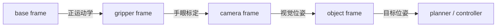

# Embodied Coordinate Transforms and Kinematics Articles Implementation Plan

> **For agentic workers:** REQUIRED SUB-SKILL: Use superpowers:subagent-driven-development (recommended) or superpowers:executing-plans to implement this plan task-by-task. Steps use checkbox (`- [ ]`) syntax for tracking.

**Goal:** Add two体系型具身智能文章，分别完整讲清坐标变换与手眼协调、机器人运动学与 DH 参数，并把它们接入现有知识脉络、导航和课程测试。

**Architecture:** 两篇文章共享 `^{A}T_B` 变换记号，但职责分离：坐标文章主讲跨 frame 对齐和手眼链，运动学文章主讲 joint-to-pose 映射与经典 DH。统一总览只保留摘要和入口，详细公式、NumPy 验证、工程边界和来源全部下沉到专文。

**Tech Stack:** Markdown、MathJax/Arithmatex、Mermaid、NumPy 教学代码、MkDocs Material、Python `unittest`

---

## 工作区约束

当前工作区已有与本任务相关且未提交的修改：

- `files/embodied-ai/index.md`
- `files/world-models-and-embodied-ai/index.md`
- `mkdocs.yml`
- `tests/test_world_models_embodied_curriculum.py`

执行时必须在当前工作区增量编辑这些文件，不得覆盖或还原现有内容。由于它们同时包含用户的其他未提交改动，计划中的提交步骤只允许提交全新文章文件；涉及上述共享文件的修改保留为工作区改动，除非用户另行授权提交。每次编辑前后都用 `git diff -- <path>` 检查范围。

## 权威来源

- 飞书“机器人基础和控制、手眼协调”：`https://v11enp9ok1h.feishu.cn/wiki/D5tuwjNfOiWPeakiNEhc88yOnqd?from=from_copylink`
- 飞书“机器人运动学与 DH 参数”：`https://v11enp9ok1h.feishu.cn/wiki/UU7yw4IlDiiJX8kNWBucuCFJnab?from=from_copylink`
- OpenCV `calibrateHandEye`：`https://docs.opencv.org/4.x/d9/d0c/group__calib3d.html`
- Modern Robotics，开放链正运动学：`https://modernrobotics.northwestern.edu/nu-gm-book-resource/4-1-1-product-of-exponentials-formula-in-the-space-frame/`
- Universal Robots DH 参数：`https://www.universal-robots.com/articles/ur/application-installation/dh-parameters-for-calculations-of-kinematics-and-dynamics/`
- ROS 2 URDF 可动关节：`https://docs.ros.org/en/rolling/Tutorials/Intermediate/URDF/Building-a-Movable-Robot-Model-with-URDF.html`

实现时只从这些来源提炼事实，不长篇复制原文。OpenCV 用于核对 eye-in-hand / eye-to-hand 和输入输出变换方向；Modern Robotics 用于核对 FK 的 base/space 与 end-effector frame；UR 与 ROS 文档用于说明 DH、URDF 和真实标定文件不是同一种约定。

### Task 1: 为坐标变换文章增加失败测试

**Files:**
- Modify: `tests/test_world_models_embodied_curriculum.py:8-145`
- Test: `tests/test_world_models_embodied_curriculum.py`

- [ ] **Step 1: 增加单页教学契约 helper**

在 `WorldModelsEmbodiedCurriculumTests` 中加入：

```python
    def assert_teaching_page(self, relative, required_terms):
        page = DOCS_ROOT / relative
        self.assertTrue(page.is_file(), str(page))
        text = page.read_text(encoding="utf-8")
        headings = [line for line in text.splitlines() if line.startswith("## ")]
        self.assert_ordered_subsequence(
            (
                "## 本章回答什么",
                "## 前置知识",
                "## 核心机制",
                "## 常见错误与失效边界",
                "## 检查理解",
                "## 相关阅读与下一步",
            ),
            headings,
        )
        for term in required_terms:
            self.assertIn(term, text)
        self.assertNotRegex(text, r"[\x00-\x08\x0b\x0c\x0e-\x1f]")
        self.assert_local_links_resolve(page)
```

- [ ] **Step 2: 增加坐标文章测试**

```python
    def test_coordinate_transforms_page_covers_hand_eye_and_action_frames(self):
        self.assert_teaching_page(
            "embodied-ai/coordinate-transforms-and-hand-eye-calibration.md",
            (
                r"{}^{A}T_B",
                "eye-in-hand",
                "eye-to-hand",
                "AX=XB",
                "body-frame",
                "world-frame",
                "np.linalg.inv",
                "工程检查表",
            ),
        )
```

- [ ] **Step 3: 运行测试并确认按预期失败**

Run:

```bash
python -m unittest tests.test_world_models_embodied_curriculum.WorldModelsEmbodiedCurriculumTests.test_coordinate_transforms_page_covers_hand_eye_and_action_frames -v
```

Expected: `FAIL`，原因包含 `coordinate-transforms-and-hand-eye-calibration.md` 不存在。

- [ ] **Step 4: 检查只改变目标测试文件**

Run:

```bash
git diff -- tests/test_world_models_embodied_curriculum.py
```

Expected: diff 只新增 helper 和坐标文章测试；不重排原有测试。

### Task 2: 创建“坐标变换与手眼协调”文章

**Files:**
- Create: `files/embodied-ai/coordinate-transforms-and-hand-eye-calibration.md`
- Test: `tests/test_world_models_embodied_curriculum.py`

- [ ] **Step 1: 建立文章教学骨架**

文章必须使用以下一级和二级结构：

```markdown
# 坐标变换与手眼协调：把相机观测接到机器人动作

## 本章回答什么
## 前置知识
## 核心机制
### 坐标系名称必须对应一条变换方向
### 旋转矩阵与齐次变换
### 组合与求逆形成可检查的坐标链
### Eye-in-hand 与 eye-to-hand
### 手眼标定为什么写成 AX=XB
### 局部增量和世界增量的乘法顺序不同
### 用 NumPy 做最小数值验证
## 常见错误与失效边界
## 工程检查表
## 检查理解
## 相关阅读与下一步
```

开头结论必须说明：视觉估计给出的位姿只有在 frame、方向、单位、时间戳和标定版本明确时才能变成控制目标。

- [ ] **Step 2: 写入统一变换公式与可手算例子**

正文必须包含：

```latex
{}^{A}T_B=
\begin{bmatrix}
{}^{A}R_B & {}^{A}t_B\\
0 & 1
\end{bmatrix},
\qquad
\bar p_A = {}^{A}T_B\bar p_B
```

```latex
({}^{A}T_B)^{-1}
=
{}^{B}T_A
=
\begin{bmatrix}
R^\top & -R^\top t\\
0 & 1
\end{bmatrix}
```

沿用飞书的可手算例子：B 相对 A 绕 z 轴 90°，平移 `(2, 1, 0)`；B 中的点 `(1, 0, 0)` 变到 A 后为 `(2, 2, 0)`。解释旋转先改变局部轴方向，平移再决定 B 原点在 A 中的位置。

- [ ] **Step 3: 写入手眼变换链与 Mermaid 图**

Eye-in-hand 主链必须写为：

```latex
{}^{\mathrm{base}}T_{\mathrm{object}}
=
{}^{\mathrm{base}}T_{\mathrm{gripper}}
{}^{\mathrm{gripper}}T_{\mathrm{camera}}
{}^{\mathrm{camera}}T_{\mathrm{object}}
```

Mermaid 图使用以下节点和边：



在 `AX=XB` 小节只解释相邻机器人姿态产生的 gripper motion 与相机观测产生的 camera motion 共享同一个固定 hand-eye 外参，不推导具体求解算法。明确 OpenCV `calibrateHandEye` 的 eye-in-hand 输出是 camera-to-gripper 变换 `^{g}T_c`，并提醒 eye-to-hand 需要按官方文档组织合适的输入方向。

- [ ] **Step 4: 写入局部/世界增量和完整 NumPy 示例**

解释：

```latex
T_{t+1}^{\text{body}}=T_t\Delta T,
\qquad
T_{t+1}^{\text{world}}=\Delta T T_t
```

代码块必须完整可复制：

```python
import numpy as np


def rotation_z(theta_deg):
    theta = np.radians(theta_deg)
    c, s = np.cos(theta), np.sin(theta)
    return np.array([[c, -s, 0.0], [s, c, 0.0], [0.0, 0.0, 1.0]])


def make_transform(rotation, translation):
    transform = np.eye(4)
    transform[:3, :3] = rotation
    transform[:3, 3] = translation
    return transform


T_A_B = make_transform(rotation_z(90), np.array([2.0, 1.0, 0.0]))
p_B = np.array([1.0, 0.0, 0.0, 1.0])
p_A = T_A_B @ p_B
T_B_A = np.linalg.inv(T_A_B)

assert np.allclose(p_A[:3], [2.0, 2.0, 0.0])
assert np.allclose(T_B_A @ p_A, p_B)
assert np.allclose(T_A_B[:3, :3].T @ T_A_B[:3, :3], np.eye(3))
assert np.isclose(np.linalg.det(T_A_B[:3, :3]), 1.0)
```

- [ ] **Step 5: 写入错误边界、检查表和来源**

至少覆盖：frame 方向反转、active/passive rotation、左乘/右乘、角度/弧度、米/毫米、四元数顺序、时间同步、标定版本漂移。工程检查表必须给出可执行判断：正交性、行列式、round trip、已知点、静态场景重复测量和标定版本记录。

“相关阅读与下一步”至少链接：

- `../prerequisite-math/geometry-vision-and-3d.md`
- `cameras-depth-and-robot-vision.md`
- `state-action-robot-datasets.md`
- 飞书原始笔记
- OpenCV 官方 `calibrateHandEye`

此时不要提前链接尚未创建的运动学文章；互链在 Task 4 创建第二篇文章后补齐。

- [ ] **Step 6: 运行坐标文章测试**

Run:

```bash
python -m unittest tests.test_world_models_embodied_curriculum.WorldModelsEmbodiedCurriculumTests.test_coordinate_transforms_page_covers_hand_eye_and_action_frames -v
```

Expected: `PASS`。

- [ ] **Step 7: 提交全新文章文件（可选安全提交）**

仅当缓存区为空且只暂存新文章时执行：

```bash
git add files/embodied-ai/coordinate-transforms-and-hand-eye-calibration.md
git diff --cached --name-only
git commit -m "docs: add coordinate transforms and hand-eye guide"
```

Expected staged path: `files/embodied-ai/coordinate-transforms-and-hand-eye-calibration.md`。测试文件和其他脏文件不得进入该提交。

### Task 3: 为运动学文章和导航增加失败测试

**Files:**
- Modify: `tests/test_world_models_embodied_curriculum.py`
- Test: `tests/test_world_models_embodied_curriculum.py`

- [ ] **Step 1: 增加运动学文章测试**

```python
    def test_robot_kinematics_page_covers_dh_fk_and_failure_boundaries(self):
        self.assert_teaching_page(
            "embodied-ai/robot-kinematics-and-dh-parameters.md",
            (
                "关节空间",
                "任务空间",
                "Forward Kinematics",
                "Denavit--Hartenberg",
                r"a_i",
                r"\alpha_i",
                r"d_i",
                r"\theta_i",
                "revolute",
                "prismatic",
                "奇异",
                "工程检查表",
            ),
        )
```

- [ ] **Step 2: 增加导航顺序断言**

在 `test_navigation_exposes_every_topic_page_in_grouped_order` 中增加：

```python
        embodied_sequence = [
            "embodied-ai/cameras-depth-and-robot-vision.md",
            "embodied-ai/coordinate-transforms-and-hand-eye-calibration.md",
            "embodied-ai/robot-kinematics-and-dh-parameters.md",
            "embodied-ai/stereo-matching-and-cost-volume.md",
        ]
        self.assert_ordered_subsequence(embodied_sequence, paths)
```

- [ ] **Step 3: 运行新增测试并确认失败**

Run:

```bash
python -m unittest tests.test_world_models_embodied_curriculum.WorldModelsEmbodiedCurriculumTests.test_robot_kinematics_page_covers_dh_fk_and_failure_boundaries tests.test_world_models_embodied_curriculum.WorldModelsEmbodiedCurriculumTests.test_navigation_exposes_every_topic_page_in_grouped_order -v
```

Expected: 运动学文章不存在，且导航缺少两个新路径。

### Task 4: 创建“机器人运动学与 DH 参数”文章

**Files:**
- Create: `files/embodied-ai/robot-kinematics-and-dh-parameters.md`
- Modify: `files/embodied-ai/coordinate-transforms-and-hand-eye-calibration.md`
- Test: `tests/test_world_models_embodied_curriculum.py`

- [ ] **Step 1: 建立文章教学骨架**

```markdown
# 机器人运动学与 DH 参数：从关节状态算到末端位姿

## 本章回答什么
## 前置知识
## 核心机制
### 关节空间和任务空间是两种接口
### FK、IK、Jacobian、规划与控制各自负责什么
### 经典 DH 用四个参数连接相邻连杆
### 单节变换怎样写成 4×4 矩阵
### 多节连乘得到末端位姿
### 二维两连杆先建立可手算直觉
### 用 NumPy 从 DH 表计算正运动学
### 经典 DH、改进 DH 和 URDF 不能混用
## 常见错误与失效边界
## 工程检查表
## 检查理解
## 相关阅读与下一步
```

- [ ] **Step 2: 写入 FK/IK 边界与经典 DH 公式**

必须明确：FK 是 `q -> T_base_ee(q)`；IK 是目标位姿到满足约束的一个或多个 `q`；Jacobian 是局部速度映射；planner 处理路径、碰撞和约束；controller 负责跟踪。

经典 DH 单节变换采用唯一明确顺序：

```latex
{}^{i-1}T_i
=
R_z(\theta_i)T_z(d_i)T_x(a_i)R_x(\alpha_i)
```

显式矩阵写为：

```latex
{}^{i-1}T_i=
\begin{bmatrix}
c_{\theta_i} & -s_{\theta_i}c_{\alpha_i} & s_{\theta_i}s_{\alpha_i} & a_i c_{\theta_i}\\
s_{\theta_i} & c_{\theta_i}c_{\alpha_i} & -c_{\theta_i}s_{\alpha_i} & a_i s_{\theta_i}\\
0 & s_{\alpha_i} & c_{\alpha_i} & d_i\\
0 & 0 & 0 & 1
\end{bmatrix}
```

整链写为 `^{base}T_{ee}=\prod_{i=1}^{n}{}^{i-1}T_i`。表格说明 revolute 通常以 `theta_i` 为变量，prismatic 通常以 `d_i` 为变量。

- [ ] **Step 3: 写入二维两连杆可手算例子**

使用：

```latex
x=l_1\cos\theta_1+l_2\cos(\theta_1+\theta_2)
```

```latex
y=l_1\sin\theta_1+l_2\sin(\theta_1+\theta_2)
```

取 `l1=l2=1`：

- `theta1=90°`, `theta2=0°`，末端位置 `(0, 2)`。
- `theta1=90°`, `theta2=-90°`，末端位置 `(1, 1)`。

用这两个姿态解释关节角不是末端坐标、同一目标可能存在肘上/肘下多解、超出半径 `l1+l2` 的目标不可达。

- [ ] **Step 4: 写入完整 NumPy DH/FK 示例**

```python
import numpy as np


def dh_transform(a, alpha, d, theta):
    ca, sa = np.cos(alpha), np.sin(alpha)
    ct, st = np.cos(theta), np.sin(theta)
    return np.array(
        [
            [ct, -st * ca, st * sa, a * ct],
            [st, ct * ca, -ct * sa, a * st],
            [0.0, sa, ca, d],
            [0.0, 0.0, 0.0, 1.0],
        ]
    )


def forward_kinematics(dh_rows):
    transform = np.eye(4)
    for a, alpha, d, theta in dh_rows:
        transform = transform @ dh_transform(a, alpha, d, theta)
    return transform


q1, q2 = np.radians([90.0, -90.0])
T_base_ee = forward_kinematics(
    [(1.0, 0.0, 0.0, q1), (1.0, 0.0, 0.0, q2)]
)

assert np.allclose(T_base_ee[:2, 3], [1.0, 1.0])
assert np.allclose(T_base_ee[:3, :3].T @ T_base_ee[:3, :3], np.eye(3))
```

- [ ] **Step 5: 写入约定和失效边界**

明确区分：

- 经典 DH 与改进 DH 的 frame 放置和乘法顺序不同。
- URDF 用 parent/child link、joint origin 和 axis 描述树结构，不等同于复制一张 DH 表。
- 厂商理想 DH 参数与单台真实机器的标定修正可能不同。
- IK 可能多解、无解或落在关节限位外；奇异位形会使局部速度映射退化；碰撞约束仍由 planner 检查。

“相关阅读与下一步”至少链接：

- `coordinate-transforms-and-hand-eye-calibration.md`
- `asset-perception-grasp-and-trajectory-pipeline.md`
- `planning-control-and-safety.md`
- `state-action-robot-datasets.md`
- 飞书原始笔记
- Modern Robotics、Universal Robots 和 ROS 官方来源

同时在 `coordinate-transforms-and-hand-eye-calibration.md` 的“相关阅读与下一步”中加入：

```markdown
- 下一步：[机器人运动学与 DH 参数](robot-kinematics-and-dh-parameters.md)。
```

- [ ] **Step 6: 运行运动学文章测试**

Run:

```bash
python -m unittest tests.test_world_models_embodied_curriculum.WorldModelsEmbodiedCurriculumTests.test_robot_kinematics_page_covers_dh_fk_and_failure_boundaries -v
```

Expected: `PASS`。

- [ ] **Step 7: 提交全新文章文件（可选安全提交）**

```bash
git add files/embodied-ai/robot-kinematics-and-dh-parameters.md
git diff --cached --name-only
git commit -m "docs: add robot kinematics and DH guide"
```

Expected staged path 只能是 `files/embodied-ai/robot-kinematics-and-dh-parameters.md`。

### Task 5: 接入具身智能知识脉络和导航

**Files:**
- Modify: `files/embodied-ai/index.md:38-48,73-84`
- Modify: `files/world-models-and-embodied-ai/index.md:76-161`
- Modify: `mkdocs.yml:258-265`
- Test: `tests/test_world_models_embodied_curriculum.py`

- [ ] **Step 1: 更新具身智能专题首页**

在“感知与状态”表中加入：

```markdown
| 相机、末端、基座和物体坐标怎样组成可验证的变换链 | [坐标变换与手眼协调](coordinate-transforms-and-hand-eye-calibration.md) |
| 关节角怎样通过 FK 和 DH 参数变成末端位姿 | [机器人运动学与 DH 参数](robot-kinematics-and-dh-parameters.md) |
```

把“按问题进入”中的“从看到物体到真实抓取经过哪些坐标转换”改为：

```markdown
| 从看到物体到真实抓取经过哪些坐标转换 | [相机与机器人视觉](cameras-depth-and-robot-vision.md) → [坐标变换与手眼协调](coordinate-transforms-and-hand-eye-calibration.md) |
| 关节状态、末端位姿、FK 和 IK 怎样连接 | [机器人运动学与 DH 参数](robot-kinematics-and-dh-parameters.md) → [资产到轨迹 Pipeline](asset-perception-grasp-and-trajectory-pipeline.md) |
```

- [ ] **Step 2: 更新统一总览并消除正文重复**

把“具身智能系统脉络”两行入口改为：

```markdown
| 坐标变换与手眼协调 | 旋转矩阵、齐次变换、坐标链、手眼标定以及局部/世界坐标增量怎样连接感知与动作 | [坐标变换与手眼协调](../embodied-ai/coordinate-transforms-and-hand-eye-calibration.md) |
| 机器人运动学 | 关节状态怎样通过正运动学和 DH 参数变成末端位姿，FK、IK 与机器人模型怎样分工 | [机器人运动学与 DH 参数](../embodied-ai/robot-kinematics-and-dh-parameters.md) |
```

将当前 90-157 行的大段公式缩成一个摘要段：

```markdown
坐标变换负责把相机、物体、末端与机器人基座表达在同一条可检查的空间链中；运动学负责把关节状态映射成链上的末端位姿。两者共同决定视觉目标能否正确变成规划和控制输入。完整公式、数值验证与工程边界分别见[坐标变换与手眼协调](../embodied-ai/coordinate-transforms-and-hand-eye-calibration.md)和[机器人运动学与 DH 参数](../embodied-ai/robot-kinematics-and-dh-parameters.md)。
```

删除总览里的飞书直链，来源由专文管理。

- [ ] **Step 3: 更新 MkDocs 导航**

在 `相机、深度与机器人视觉` 后、`双目匹配与 Cost Volume` 前加入：

```yaml
              - 坐标变换与手眼协调: embodied-ai/coordinate-transforms-and-hand-eye-calibration.md
              - 机器人运动学与 DH 参数: embodied-ai/robot-kinematics-and-dh-parameters.md
```

- [ ] **Step 4: 运行导航与索引测试**

Run:

```bash
python -m unittest tests.test_world_models_embodied_curriculum.WorldModelsEmbodiedCurriculumTests.test_topic_indexes_define_complete_reading_paths tests.test_world_models_embodied_curriculum.WorldModelsEmbodiedCurriculumTests.test_navigation_exposes_every_topic_page_in_grouped_order -v
```

Expected: `2 tests ... OK`。

- [ ] **Step 5: 检查共享文件没有覆盖用户改动**

Run:

```bash
git diff -- files/embodied-ai/index.md files/world-models-and-embodied-ai/index.md mkdocs.yml
```

Expected: 只看到新文章入口、总览摘要替换和两条导航；其他既有变动原样保留。

### Task 6: 完整验证和交付检查

**Files:**
- Verify: `files/embodied-ai/coordinate-transforms-and-hand-eye-calibration.md`
- Verify: `files/embodied-ai/robot-kinematics-and-dh-parameters.md`
- Verify: `files/embodied-ai/index.md`
- Verify: `files/world-models-and-embodied-ai/index.md`
- Verify: `mkdocs.yml`
- Verify: `tests/test_world_models_embodied_curriculum.py`

- [ ] **Step 1: 运行课程测试**

Run:

```bash
python -m unittest discover -s tests -p 'test_world_models_embodied_curriculum.py' -v
```

Expected: 所有测试 `OK`，新增两篇文章测试和导航顺序测试均通过。

- [ ] **Step 2: 运行严格构建**

Run:

```bash
mkdocs build --strict
```

Expected: exit code `0`；没有新增 missing link、missing anchor 或 nav warning。Material for MkDocs 自身的未来版本提示不算本任务失败。

- [ ] **Step 3: 验证代码片段数值结果**

直接运行与文章代码块逐行一致的两个校验程序：

```bash
python - <<'PY'
import numpy as np


def rotation_z(theta_deg):
    theta = np.radians(theta_deg)
    c, s = np.cos(theta), np.sin(theta)
    return np.array([[c, -s, 0.0], [s, c, 0.0], [0.0, 0.0, 1.0]])


def make_transform(rotation, translation):
    transform = np.eye(4)
    transform[:3, :3] = rotation
    transform[:3, 3] = translation
    return transform


T_A_B = make_transform(rotation_z(90), np.array([2.0, 1.0, 0.0]))
p_B = np.array([1.0, 0.0, 0.0, 1.0])
p_A = T_A_B @ p_B
T_B_A = np.linalg.inv(T_A_B)
assert np.allclose(p_A[:3], [2.0, 2.0, 0.0])
assert np.allclose(T_B_A @ p_A, p_B)
assert np.allclose(T_A_B[:3, :3].T @ T_A_B[:3, :3], np.eye(3))
assert np.isclose(np.linalg.det(T_A_B[:3, :3]), 1.0)
PY
```

```bash
python - <<'PY'
import numpy as np


def dh_transform(a, alpha, d, theta):
    ca, sa = np.cos(alpha), np.sin(alpha)
    ct, st = np.cos(theta), np.sin(theta)
    return np.array(
        [
            [ct, -st * ca, st * sa, a * ct],
            [st, ct * ca, -ct * sa, a * st],
            [0.0, sa, ca, d],
            [0.0, 0.0, 0.0, 1.0],
        ]
    )


def forward_kinematics(dh_rows):
    transform = np.eye(4)
    for a, alpha, d, theta in dh_rows:
        transform = transform @ dh_transform(a, alpha, d, theta)
    return transform


q1, q2 = np.radians([90.0, -90.0])
T_base_ee = forward_kinematics(
    [(1.0, 0.0, 0.0, q1), (1.0, 0.0, 0.0, q2)]
)
assert np.allclose(T_base_ee[:2, 3], [1.0, 1.0])
assert np.allclose(T_base_ee[:3, :3].T @ T_base_ee[:3, :3], np.eye(3))
PY
```

Expected: 两个程序 exit code `0`，所有 `assert` 通过且无输出。

- [ ] **Step 4: 验证来源与站内入口**

Run:

```bash
rg -n "feishu.cn|docs.opencv.org|modernrobotics.northwestern.edu|universal-robots.com|docs.ros.org" files/embodied-ai/coordinate-transforms-and-hand-eye-calibration.md files/embodied-ai/robot-kinematics-and-dh-parameters.md
rg -n "coordinate-transforms-and-hand-eye-calibration|robot-kinematics-and-dh-parameters" files/embodied-ai/index.md files/world-models-and-embodied-ai/index.md mkdocs.yml
```

Expected: 两份飞书来源、四类权威来源和三个站内入口均出现。

- [ ] **Step 5: 最终工作区审计**

Run:

```bash
git status --short
git diff --check
```

Expected: 无空白错误；交付说明明确列出本任务文件和工作区中原有的无关改动，不暂存、不覆盖无关文件。
