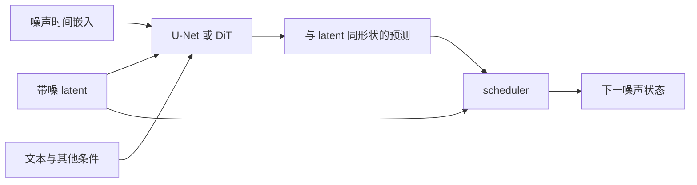
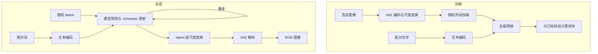
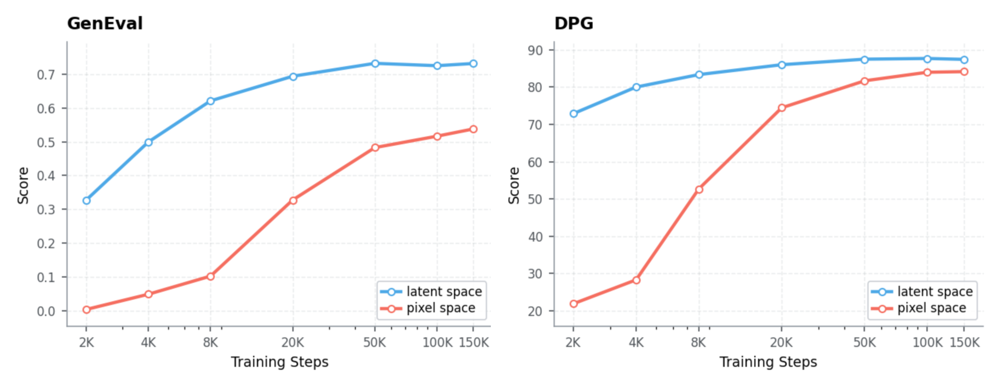

# 一张图怎样通过 Stable Diffusion 的各个组件

一张 512 × 512 的 RGB 图像含有 786432 个颜色数值。直接在这个数组上反复去噪，每次都要处理完整空间网格。Latent Diffusion 把问题拆成两段，先问压缩器保留了什么，再让生成模型在这个表示上学习分布。这样做省了计算，也把一部分细节和失真责任交给了 VAE。

下面以 Hugging Face 教学 notebook 使用的 Stable Diffusion 2.1 base 接口为具体参照。示例的 4 通道 latent、8 倍空间压缩和 77 个文本位置属于这类配置，不能推广成所有 Stable Diffusion 或视频模型的固定尺寸。代码 API 随版本变化，这里解释张量与计算关系，并以本站可运行的[最小 DDPM](minimal-ddpm-implementation.md)核验基本机制。

## VAE 先定义生成模型将学习什么

编码器把图像映成连续 latent，解码器再尝试恢复原图

\[
[1,3,512,512]\xrightarrow{E}[1,4,64,64]
\xrightarrow{D}[1,3,512,512].
\]

空间网格少了 64 倍，通道从 3 变成 4，总标量数少了 48 倍。这个比例描述数组大小，不等于整个系统精确快 48 倍，网络宽度、中间激活和访存还影响成本。

VAE 编码器可以输出 posterior 的均值与方差，训练生成模型时究竟采样 latent 还是取均值，要按实现约定。把编码输出记为 \(z_{\mathrm{raw}}\)，扩散常还使用尺度变换，例如 \(z_0=s z_{\mathrm{raw}}\)。解码前需做逆变换。示例 notebook 的早期 SD 配置使用 .18215，其他模型可能有不同配置、通道统计或 shift，不能复制成全局常量。

假设原始 latent 标准差为 5.49，乘 .18215 后约为 1。此时单位高斯噪声与信号尺度可比较。遗漏缩放后，同一时间系数对应的实际 SNR 会偏移；网络 shape 一切正常，输入分布却变了。

先检查真实图像的 \(D(E(x))\)。若小字在这一步已不可辨，说明当前表示和解码链路无法精确保留它。生成模型仍可能补出合理纹理，但无法唯一恢复已被编码丢弃的真实细节。重建是定位保真瓶颈的对照，不能当作所有生成感知指标的严格上限。

## 带噪 latent 为什么还需要时间输入

取一份干净 latent \(z_0\)，按训练日程得到 \(z_t=a_tz_0+b_t\epsilon\)。网络需要根据 \(z_t,t,c\) 预测指定目标

\[
f_\theta(z_t,t,c)\longrightarrow\hat\epsilon,
\quad\hat z_0,\quad\hat v\quad\text{或其他约定量}.
\]

同一个输入数值可能来自不同噪声水平，后验解释不同，因此网络接收时间嵌入。离散 timestep、连续 sigma、log-SNR 的数值意义不同，必须与训练匹配。

图中的 scheduler / solver 消费预测并更新状态。它通常没有需要反向传播训练的权重，却必须理解网络输出的语义。同形状的 velocity 与 epsilon 不能直接互换。

## U-Net 怎样同时保留局部位置和较大上下文

把 `[1,4,64,64]` 输入投影为更多通道后，下采样路径逐渐减小空间分辨率，较少的位置能够聚合更大范围的内容。上采样恢复分辨率，并接收同尺度的早期特征作为 skip。这样，局部空间信息不必全部挤过最低分辨率瓶颈。

只作形状说明，若某层从 `[B,64,32,32]` 下采样到 `[B,128,16,16]`，后来上采样回 `[B,64,32,32]` 并与原 skip 拼接，后续块接收到 `[B,128,32,32]`。这里的通道数是教学配置，不是 SD2.1 的完整网络表。最终输出仍要恢复 4 个 latent 通道，不能停留在隐藏宽度。

残差块通常将时间嵌入投影到通道维，在空间位置广播后做加法或 scale-shift。Attention 进一步允许远处位置交换信息。U-Net 的多尺度结构、卷积局部性与注意力并存，不能把它简单归为只会处理纹理的网络。

## 文字怎样进入每次去噪

Tokenizer 把一句话变成 token ID，文本编码器（text encoder）产生上下文化向量。该教学配置的文本张量可为 `[B,77,1024]`。77 包括长度处理后的文本位置，1024 是这套编码器的隐藏宽度；换模型可能改变二者。

某个视觉层展开成 \(H\in\mathbb R^{N\times D}\)，文本为 \(C\in\mathbb R^{L\times D_c}\)。Cross-attention 使用

\[
Q=HW_Q,\quad K=CW_K,\quad V=CW_V,
\qquad O=\operatorname{softmax}(QK^\top/\sqrt d)V.
\]

分数矩阵为 \(N\times L\)。每个视觉位置根据当前特征读取文本，而非等图像生成完再检查文字。若“红球”被截断，后续注意力无法读取被丢弃的 token；若 caption 只写“球”，模型也缺少学习左右运动区别的明确监督。

冻结文本编码器后，同一提示词的上下文通常可以预先计算一次。视频或图像状态会随着去噪改变，因此视觉 query 和它对文本的权重仍然需要重新计算。

## 一次训练与一次生成分别调用哪些组件

纯文生图推理没有输入图像，所以不需要 VAE encoder。图生图则先编码已有图像并加入某种程度的噪声，再从相应时间开始生成。增加 strength 通常改变起始噪声和可修改范围，具体索引映射由 pipeline 定义。

使用 CFG 时，同一当前 latent 会配两份文本上下文。例如把 `[1,4,64,64]` 复制成 `[2,4,64,64]`，分别预测基准和条件结果，再组合回一份输出。这样可以合并调用，却没有省掉两份分支计算。随后 scheduler 更新 latent，循环完成后才解码。[条件控制](guidance-and-conditioning.md)解释组合的分布含义。

训练哪些组件也是配方选择。常见设置冻结 VAE 与文本编码器，只更新去噪网络；文本微调、ControlNet 或全模型训练会有不同梯度路径。不能把“冻结全部辅助组件”当作架构定义。

## DiT 换掉的是哪部分计算

DiT 把 latent 分成 patch。若 `[1,4,64,64]` 按 2 × 2 分块，每块有 16 个数，共 1024 个 patch。投影到宽度 \(D\) 后，Transformer 处理 `[1,1024,D]`，输出头再投影回每块 16 个预测数，并按原顺序恢复 latent 网格。

这个替换保留了输入与输出接口，可以训练 epsilon、数据或 Flow velocity。时间与条件可通过 adaptive normalization、cross-attention 或联合 token 注入，具体架构各不相同。Patch 变大减少序列长度，但每个 token 需要代表更大的局部区域；不能仅看参数量判断细节与成本。

视频进一步增加时间维，压缩后的 21 × 60 × 104 网格在 1 × 2 × 2 patch 下仍有 32760 个 token。其注意力与条件计算见[Video DiT](video-dit-1029-1246.md)，压缩和首帧边界见[视频 VAE](video-vae-1029-1246.md)。

## DINO 等表示老师增加了哪一种训练信息

噪声回归只规定最终输出，不唯一规定中间特征如何组织。REPA 类目标把某层隐藏表示投影到冻结视觉编码器的特征空间，与干净图像的特征比较

\[
L=L_{\mathrm{diffusion}}+
\lambda\|P_\phi(h_\theta(z_t,t))-\operatorname{stopgrad}(g(x))\|^2.
\]

\(g\) 是老师，\(P_\phi\) 负责维度和网格匹配。目标侧不更新，梯度通过投影回到生成网络。推理时若不再需要这个损失，可以移除老师；它不会自动成为新的生成器或文本控制器。

另一类方法先重建像素再计算感知特征损失，梯度还要经过重建与解码路径。两者计算位置不同。DINO 相似度偏好某种视觉表示，不能证明文字准确、物理动作正确或视频运动充分。

## 绕开 VAE 后，原来的任务会移到哪里

像素空间生成直接处理 RGB 或像素 patch，省去最终 VAE 解码，也绕过这套压缩器的保真损失。代价是生成模型需要自己处理更多低层变化与更高维数据。即使人为匹配 token 数，像素与 latent 的学习难度仍可能不同。

{ width="900" }

<small>图源：[An Empirical Study of Training Pixel-Space Text-to-Image Diffusion Models](https://arxiv.org/abs/2608.16887)，Figure 2。图中比较论文所设定的像素空间与潜空间预测实验，训练预算和模型配置需结合原文读取。</small>

这张图属于 Z-Image-Pixel 的特定受控实验，适合比较其论文中的表示与训练条件。不能只从曲线外推所有像素模型都更慢。具体模型与实验设置见 [Z-Image-Pixel 精读](../paper-deep-dives/diffusion/z-image-pixel.md)。[PixelDiT](../paper-deep-dives/diffusion/pixeldit.md)讨论像素架构，其他感知监督方法改变训练约束；它们与 sampler 加速处在不同层。

一个最终直接输出像素的生成器，也可以先利用 latent 预训练再迁移。因而“部署不含 VAE”和“整个训练从未使用 VAE”是两种不同事实。判断系统时，应逐阶段记录表示、模型输出、条件接口和更新规则，才知道哪个模块真的被替换。

## 参考实现

- [Hugging Face Stable Diffusion 组件 notebook](https://github.com/huggingface/diffusion-models-class/blob/72bf3dd739da641075dcff0ee54ce28e7a38a8ab/unit3/01_stable_diffusion_introduction.ipynb)提供 VAE、文本、U-Net、scheduler 和手写采样循环。其旧 API 不作为当前安装指南。
- [Latent Diffusion](https://arxiv.org/abs/2112.10752)、[DiT](https://arxiv.org/abs/2212.09748)和[REPA](https://arxiv.org/abs/2410.06940)分别对应表示压缩、Transformer 主干和中间表示对齐。

## 论文和实现依据

整体分工参考 [High-Resolution Image Synthesis with Latent Diffusion Models](https://arxiv.org/abs/2112.10752)，Transformer 生成主干参考 [DiT](https://arxiv.org/abs/2212.09748)，张量接口对照 Hugging Face 的 Stable Diffusion 教学 notebook。512、64、4 通道和 `.18215` 只属于页面采用的教学配置；不同 VAE、checkpoint 或视频模型应重新核对缩放、latent shape 和解码路径。页面中的像素与 latent 对照不复现任何论文 benchmark。

先单独测 `D(E(x))`，再测固定 latent 下的一次去噪，最后才接完整采样。这样能区分 VAE 重建已经丢掉的细节、生成网络的预测误差和 scheduler 的数值误差。
