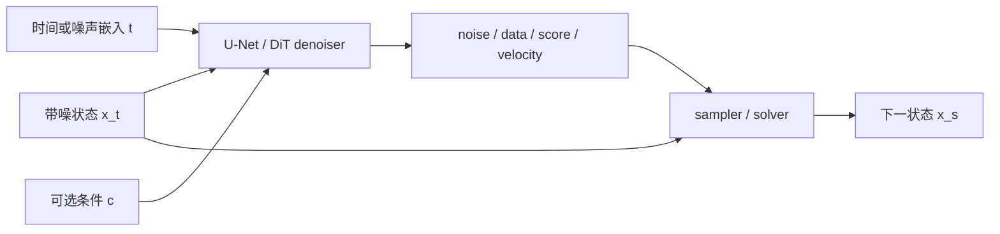
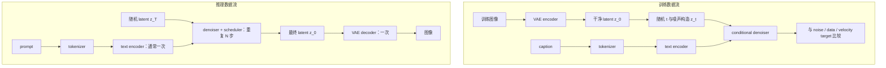

# 扩散网络架构与 Stable Diffusion 系统

扩散训练目标只规定网络在噪声状态上预测什么，并不规定网络必须采用哪种主干。U-Net、DiT、VAE、文本编码器和 scheduler 处在不同层：前两者近似去噪函数，VAE 定义表示空间，文本编码器提供条件，scheduler 负责沿时间轨迹更新状态。

读扩散网络架构时，先拆三个系统问题：denoiser 为什么必须同时读取样本、时间和条件；U-Net 与 DiT 怎样实现同一个预测接口；Stable Diffusion 如何把 autoencoder、文本编码器、条件去噪网络和采样器组合成训练与推理链路。

## 前置知识

- [扩散模型基础](foundations-and-core-intuition.md)：路径、局部预测和 sampler 的分工。
- [DDPM 数学与训练](training.md)：\(x_t\)、噪声预测 loss 和反向采样。
- [卷积、频域与多尺度表示](../prerequisite-math/convolution-frequency-and-multiscale.md)：卷积和多尺度特征。
- [序列、位置编码与注意力](../prerequisite-math/sequence-position-and-masking.md)：token 与 attention。

## 核心机制

### 统一 denoiser 接口

扩散网络可以抽象为：

\[
f_\theta(x_t,t,c)\rightarrow \text{prediction},
\]

其中 \(x_t\) 是当前带噪表示，\(t\) 是时间或噪声水平，\(c\) 是可选条件。prediction 可以是 ε、\(x_0\)、\(v\)、score 或 Flow velocity；sampler 必须知道输出采用哪一种参数化。

图中神经网络输出局部预测，scheduler 才执行状态更新。scheduler 不是网络的一层；改变 solver 通常不改变网络权重，但必须保持参数化、时间方向和噪声尺度兼容。

### 时间嵌入告诉网络当前任务难度

相同像素值在高噪声和低噪声状态中含义不同。网络若不知道 \(t\)，无法判断应该恢复全局结构还是修正局部细节。常见做法是把时间步映射为正弦/余弦特征，再经 MLP 投影，并通过加法、scale-shift normalization 或 adaptive layer norm 注入残差块。

离散 DDPM 常输入整数 timestep；EDM、SDE 和 Flow 系统可能输入连续 \(\sigma\)、log-SNR 或归一化时间。时间变量的数值范围属于模型接口，不能只在 sampler 端随意替换。

### U-Net：多尺度卷积、跳连与注意力

扩散 U-Net 通常包含：

1. 下采样路径逐渐降低空间分辨率、增加通道数，提取大感受野结构。
2. 中间 block 处理最低分辨率特征，常放置 self-attention 或 transformer block。
3. 上采样路径恢复空间分辨率。
4. skip connection 把下采样阶段的高分辨率特征送到对应上采样层，减少细节在瓶颈中丢失。
5. 时间和条件嵌入进入多个残差块，而不是只在输入处拼接一次。

U-Net 的“U”描述多尺度拓扑，不等于原始分割 U-Net 的固定实现。扩散 U-Net 通常使用残差块、GroupNorm、SiLU、attention 和条件 cross-attention，具体通道数与 attention 分辨率随模型而变。

### DiT：把 latent patch 当作序列

Diffusion Transformer（DiT）把图像或 latent 切成 patch token，使用 Transformer block 建模 token 关系。时间和类别/文本条件常通过 adaptive layer norm、cross-attention 或额外 token 注入。

DiT 改变函数逼近器，不自动改变扩散训练目标。一个 DiT 可以训练 ε-prediction、\(v\)-prediction 或 Flow velocity；一个 U-Net 也可以承载不同参数化。现代模型常选择 DiT，是因为 Transformer 便于扩大模型和序列长度，并能统一图像、视频或多模态 token，但其计算仍受 token 数和 attention 结构限制。

### 像素扩散与 latent diffusion

像素空间扩散直接对 \(x\in\mathbb R^{H\times W\times 3}\) 加噪。高分辨率下，每次 denoiser 前向都处理完整像素网格，训练和采样成本高。

Latent Diffusion 先用 autoencoder：

\[
z=\mathcal E(x),\qquad \hat x=\mathcal D(z),
\]

再在较小的 \(z\in\mathbb R^{h\times w\times c}\) 上扩散。这样减少空间计算，但 VAE 的压缩误差会成为质量上限：文字、细线、面部和纹理若在编码阶段丢失，denoiser 无法完全恢复。

“latent”在这里不是 DDPM 每个时间步的随机变量统称，而是 autoencoder 学到的压缩表示。Stable Diffusion 同时具有 autoencoder latent 和 diffusion time state，两个概念需要分开。

### Stable Diffusion 的组件

| 组件 | 输入 | 输出 | 主要职责 |
| --- | --- | --- | --- |
| tokenizer | prompt 字符串 | token ids | 把文本转成离散序列 |
| text encoder | token ids | 文本 embedding | 提供语义条件 |
| VAE encoder | 图像 | 图像 latent | 训练或图生图时压缩图像 |
| denoiser（U-Net/DiT） | noisy latent、\(t\)、文本 embedding | 噪声/数据/速度预测 | 学习生成方向 |
| scheduler / solver | 当前 latent、模型输出、时间配置 | 下一 latent | 执行有限步更新 |
| VAE decoder | 最终 latent | 像素图像 | 把 latent 解码为可见结果 |

cross-attention 让图像/latent token 作为 query，文本 embedding 提供 key 和 value。它不是在采样结束后“检查 prompt”，而是在每次 denoiser 前向中影响方向。

### 训练数据流与推理数据流

图中展示典型 latent text-to-image 系统。具体训练配方可能冻结或微调不同组件；例如基础模型训练、LoRA、ControlNet、DreamBooth 和文本编码器微调的可训练参数并不相同，因此不能把“VAE 和文本编码器永远冻结”当成定义。

推理成本主要来自 denoiser 的重复前向，但端到端延迟还包括文本编码、VAE 解码、CFG 的条件/无条件分支、ControlNet、I/O 和后处理。NFE 下降不保证服务延迟按同一比例下降。

### Classifier-Free Guidance 在系统中的位置

训练时随机丢弃一部分条件，使同一网络同时学习有条件和无条件预测。采样时组合两者：

\[
\hat\epsilon
=\epsilon_\theta(x_t,t,\varnothing)
+w\left[
\epsilon_\theta(x_t,t,c)-
\epsilon_\theta(x_t,t,\varnothing)
\right].
\]

CFG 不增加新的文本知识，只放大条件与无条件方向的差。\(w\) 过大可能带来过饱和、结构异常和多样性下降。完整机制见[条件控制与 Guidance](guidance-and-conditioning.md)。

### 从 Stable Diffusion 到现代 latent DiT / Flow 系统

现代文生图和视频系统经常保留相似的外层结构：tokenizer / text encoder、压缩表示、条件生成主干、数值采样器和解码器。变化集中在：

- U-Net 换成 DiT 或时空 Transformer；
- 2D VAE 换成时空 VAE / video tokenizer；
- ε 或 \(v\)-prediction 换成 Flow velocity；
- DDIM/DPM-Solver 换成 Flow ODE solver；
- 文本条件扩展为图像、音频、姿态、深度、动作或历史状态；
- 多步基础模型进一步经过 consistency、trajectory 或 distribution matching distillation。

因此读现代系统时，先把组件层和训练动力学层分开，再检查它们如何通过张量 shape、时间变量和条件接口连接。

## 常见误解与失效边界

**把 denoiser 叫作“扩散模型的全部”。**实际 pipeline 还依赖表示、条件编码和 sampler；换 VAE 或 scheduler 也可能显著改变输出。

**认为 U-Net 只负责细节、Transformer 只负责语义。**多尺度结构影响感受野，但职责不是硬切分；两类主干都可以同时建模全局结构与局部细节。

**把 VAE latent 当成纯语义空间。**latent 仍保存空间和视觉细节，只是经过有损压缩。压缩率与重建质量共同决定后端上限。

**把 scheduler 名字当成可互换开关。**scheduler 必须匹配模型训练时的 prediction type、噪声尺度、时间方向和方差约定。

**只按 denoiser 参数量比较系统。**文本编码器、VAE、tokenizer、上下文长度、latent 压缩率和采样步数都会影响质量和成本。

## 检查理解

1. 为什么时间嵌入必须进入 denoiser？
2. U-Net 换成 DiT 后，哪些扩散公式可以保持不变？
3. Stable Diffusion 训练和推理中，哪些组件通常运行一次，哪个组件重复运行？
4. 为什么 latent diffusion 更便宜，同时可能受 VAE 质量限制？
5. scheduler 为什么必须知道模型的 prediction type？

## 外部材料

- 原始来源：[Latent Diffusion Models](https://arxiv.org/abs/2112.10752)、[DiT](https://arxiv.org/abs/2212.09748)。
