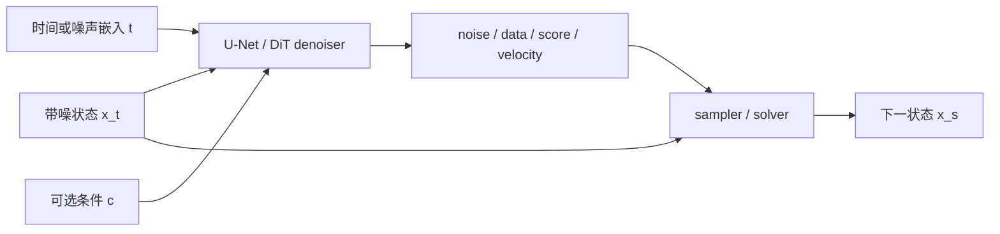
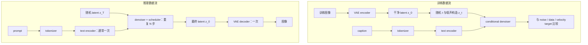

# 扩散网络架构与 Stable Diffusion 系统

扩散训练目标只规定网络在噪声状态上预测什么，并不规定网络必须采用哪种主干。U-Net、DiT、VAE、文本编码器和 scheduler 处在不同层：前两者近似去噪函数，VAE 定义表示空间，文本编码器提供条件，scheduler 负责沿时间轨迹更新状态。

读扩散网络架构时，先拆三个系统问题：denoiser 为什么必须同时读取样本、时间和条件；U-Net 与 DiT 怎样实现同一个预测接口；Stable Diffusion 如何把 autoencoder、文本编码器、条件去噪网络和采样器组合成训练与推理链路。

## 本文解决什么问题

这篇文章解决“扩散模型到底由哪些系统部件组成”。重点是把 denoiser、VAE、文本编码器、scheduler、DINO/VFM 辅助目标和 VAE-free 像素路线分开：有的决定预测函数，有的决定表示空间，有的只在训练或评测时提供额外约束。读完后应该能判断一个新模型是在换主干、换表示、换条件接口，还是换采样路径。

## 前置知识

- [扩散模型基础](foundations-and-core-intuition.md)：路径、局部预测和 sampler 的分工。
- [DDPM 数学与训练](training.md)：\(x_t\)、噪声预测 loss 和反向采样。
- [卷积、频域与多尺度表示](../prerequisite-math/convolution-frequency-and-multiscale.md)：卷积和多尺度特征。
- [序列、位置编码与注意力](../prerequisite-math/sequence-position-and-masking.md)：token 与 attention。

## 核心机制

### 统一 denoiser 接口

扩散网络可以抽象为：

\[
f_\theta(x_t,t,c)\rightarrow \text{prediction},
\]

其中 \(x_t\) 是当前带噪表示，\(t\) 是时间或噪声水平，\(c\) 是可选条件。prediction 可以是 ε、\(x_0\)、\(v\)、score 或 Flow velocity；sampler 必须知道输出采用哪一种参数化。

图中神经网络输出局部预测，scheduler 才执行状态更新。scheduler 不是网络的一层；改变 solver 通常不改变网络权重，但必须保持参数化、时间方向和噪声尺度兼容。

### 时间嵌入告诉网络当前任务难度

相同像素值在高噪声和低噪声状态中含义不同。网络若不知道 \(t\)，无法判断应该恢复全局结构还是修正局部细节。常见做法是把时间步映射为正弦/余弦特征，再经 MLP 投影，并通过加法、scale-shift normalization 或 adaptive layer norm 注入残差块。

离散 DDPM 常输入整数 timestep；EDM、SDE 和 Flow 系统可能输入连续 \(\sigma\)、log-SNR 或归一化时间。时间变量的数值范围属于模型接口，不能只在 sampler 端随意替换。

### U-Net：多尺度卷积、跳连与注意力

扩散 U-Net 通常包含：

1. 下采样路径逐渐降低空间分辨率、增加通道数，提取大感受野结构。
2. 中间 block 处理最低分辨率特征，常放置 self-attention 或 transformer block。
3. 上采样路径恢复空间分辨率。
4. skip connection 把下采样阶段的高分辨率特征送到对应上采样层，减少细节在瓶颈中丢失。
5. 时间和条件嵌入进入多个残差块，而不是只在输入处拼接一次。

U-Net 的“U”描述多尺度拓扑，不等于原始分割 U-Net 的固定实现。扩散 U-Net 通常使用残差块、GroupNorm、SiLU、attention 和条件 cross-attention，具体通道数与 attention 分辨率随模型而变。

### DiT：把 latent patch 当作序列

Diffusion Transformer（DiT）把图像或 latent 切成 patch token，使用 Transformer block 建模 token 关系。时间和类别/文本条件常通过 adaptive layer norm、cross-attention 或额外 token 注入。

DiT 改变函数逼近器，不自动改变扩散训练目标。一个 DiT 可以训练 ε-prediction、\(v\)-prediction 或 Flow velocity；一个 U-Net 也可以承载不同参数化。现代模型常选择 DiT，是因为 Transformer 便于扩大模型和序列长度，并能统一图像、视频或多模态 token，但其计算仍受 token 数和 attention 结构限制。

### DINO：冻结视觉老师，而不是生成主干

DINO / DINOv2 / DINOv3 是自监督视觉编码器，常被扩散生成拿来当外部表征坐标。它不负责从噪声生成图像，也不替代文本编码器；更常见的角色是把图像或视频帧映射成 patch-level visual features，让 denoiser 的中间表示、预测图像或跨帧内容去对齐这些特征。

这类用法大致分成四种：

| 用法 | 发生在什么阶段 | 代表问题 | 推理时是否增加成本 |
| --- | --- | --- | --- |
| REPA / representation alignment | 训练时约束 DiT / SiT 中间层 | denoiser 不只学局部去噪，也更快学到对象和空间结构 | 通常不增加 |
| DINO perceptual loss | 训练时比较预测图像和真图像的冻结特征 | 像素空间扩散不要平均拟合所有不可感知扰动 | 通常不增加 |
| 视频跨帧对齐 | 视频微调时约束相邻帧或参考帧特征 | 生成视频保持主体、身份和跨帧语义一致 | 通常不增加 |
| DINO similarity / diversity metric | 评测时比较样本或帧特征 | 判断语义多样性、主体一致性或编辑保真 | 只增加评测成本 |

REPA 的核心做法是把 denoiser 内部 hidden state 投影到冻结视觉编码器的特征空间，和 clean image 的 DINOv2 等特征对齐。PixelDiT 采用 REPA 风格的 DINOv2 representation alignment 来稳定 patch-level 表征；PixelGen 则把 DINO 做成 perceptual loss，用来强化全局语义。两者都说明同一件事：现代扩散生成不只在学一个噪声回归器，也在借外部视觉模型补足表示学习。

### 像素扩散与 latent diffusion

像素空间扩散直接对 \(x\in\mathbb R^{H\times W\times 3}\) 加噪。高分辨率下，每次 denoiser 前向都处理完整像素网格，训练和采样成本高。

Latent Diffusion 先用 autoencoder：

\[
z=\mathcal E(x),\qquad \hat x=\mathcal D(z),
\]

再在较小的 \(z\in\mathbb R^{h\times w\times c}\) 上扩散。这样减少空间计算，但 VAE 的压缩误差会成为质量上限：文字、细线、面部和纹理若在编码阶段丢失，denoiser 无法完全恢复。

“latent”在这里不是 DDPM 每个时间步的随机变量统称，而是 autoencoder 学到的压缩表示。Stable Diffusion 同时具有 autoencoder latent 和 diffusion time state，两个概念需要分开。

图像 VAE 主要做空间压缩。视频 VAE 还要做时间压缩：

\[
x_{1:T}
\rightarrow
z\in\mathbb R^{T'\times H'\times W'\times C}
\rightarrow
\hat{x}_{1:T}
\]

这会多出两个图像 VAE 没有的问题。第一，\(T'\) 怎样从 \(T\) 得到，决定若干原始帧会共享一个 temporal latent；第二，encoder / decoder 是否 causal，决定当前帧能否读取未来帧。很多视频系统使用 Causal 3D VAE，是为了让长视频可以按时间块编码、缓存和流式处理，但它也会让第一帧、chunk 边界帧和后续帧处在不同的时间上下文里。具体展开见[视频与多模态扩散](video-and-multimodal-diffusion.md)。

### VAE-free pixel diffusion 的回潮

VAE-free pixel diffusion 直接在 RGB 像素或像素 token 上扩散，试图去掉 autoencoder 的重建瓶颈、低层伪影和两阶段目标错配。它的难点也很实在：像素空间维度高，里面有很多对感知不重要的传感器噪声和微小纹理；如果模型把这些都当成同等重要的预测目标，优化会变慢，采样也更贵。

VAE 在这里其实承担两种职责。第一种是大家最熟悉的 computational compressor：把高分辨率 RGB 变成较短的 latent grid，降低每次 denoiser 前向的成本。第二种更容易被忽略：经过大规模图像训练的 VAE 也提供 learned visual representation，提前压掉局部冗余和部分高频变化，让生成模型更快学习物体结构与文本对齐。后一种作用意味着，VAE-free 不只是删掉一个 decoder，还可能把表示学习的负担重新交还给 denoiser。

{ width="900" }

<small>图源：[An Empirical Study of Training Pixel-Space Text-to-Image Diffusion Models](https://arxiv.org/abs/2608.16887)，Figure 2。作者固定 Z-Image Transformer、Qwen3-4B 条件栈、训练数据、优化配置与 $64\times64$ token grid，只改变 prediction space；两边都使用超过 20B 图文对。</small>

**这张图怎么读：pixel pre-training 的困难不只来自 token 更长。** 两边 Transformer sequence length 相同，latent model 仍然更早学到结构和文本对齐，并在相同训练预算内保持领先。作者把原因解释为 VAE latent 已经整理过原始 RGB 分布；从优化角度，可以把它理解成一种 learned preconditioner，但论文没有直接测量条件数或梯度频谱，因此这是机制解释，不是严格证明。实验能支持的是“这套 matched-compute 设置下 pixel pre-training 更慢”，不能推出 pixel pre-training 在任何架构和无限预算下都不可行。

近年的代表工作通常会同时改训练信号或 token 结构，不能只把 latent DiT 的输入换成 RGB。

| 路线 | 关键做法 | 解决的瓶颈 | 主要代价 |
| --- | --- | --- | --- |
| PixelGen | 直接预测 clean image，并用 LPIPS loss 强化局部纹理、DINO 感知损失强化全局语义 | 让像素扩散关注 perceptual manifold，而非完整像素流形里的无关信号 | 额外依赖冻结感知模型，训练目标和 loss 权重需要仔细配平 |
| [PixelDiT](../paper-deep-dives/diffusion/pixeldit.md) | 用 patch-level DiT 负责全局语义，用 pixel-level DiT 细化纹理；Pixel Token Compaction 控制 attention 成本，Pixel-wise AdaLN 给每个像素注入语义调制 | 绕开 VAE 重建误差，同时避免 full pixel attention 爆炸 | 像素路径、compaction、调制和采样器都要作为一个系统一起调 |
| [Z-Image-Pixel](../paper-deep-dives/diffusion/z-image-pixel.md) | 先在 latent space 预训练，再迁移共享 Transformer，使用 self-generated + real data、$x_0$-prediction 和重新校准的 noise scale 做 pixel post-training | 把“高效学先验”和“最终直接生成 RGB”分配到不同阶段 | 仍依赖高质量 latent checkpoint；迁移数据、目标、decoder、噪声和 patch size 都要重新设计 |

三条路线分别把主要矛盾放在训练信号、像素架构和训练阶段上。它们共同说明，VAE-free 不必定义整段训练历史，也可以只定义最终生成器：一个模型可以在 pre-training 期间依赖 VAE latent 学先验，post-training 后却直接从噪声输出 RGB，部署时不再调用 VAE。

这条路线对小字、细线、局部编辑背景一致性和高频纹理尤其有吸引力。阅读时至少检查六个接口：去掉 VAE 后 token 数怎样控制；像素空间里哪些信号被感知损失或架构过滤；模型是从头 pixel pre-training，还是 latent-to-pixel post-training；$v$ 与 $x_0$ 等 prediction target、noise scale 是否重新校准；结果是超过 pixel-space family，还是也超过强 latent baseline；VAE decode 成本省掉以后，denoiser、larger patch 和蒸馏分别贡献了多少端到端收益。

### Stable Diffusion 的组件

| 组件 | 输入 | 输出 | 主要职责 |
| --- | --- | --- | --- |
| tokenizer | prompt 字符串 | token ids | 把文本转成离散序列 |
| text encoder | token ids | 文本 embedding | 提供语义条件 |
| VAE encoder | 图像 | 图像 latent | 训练或图生图时压缩图像 |
| denoiser（U-Net/DiT） | noisy latent、\(t\)、文本 embedding | 噪声/数据/速度预测 | 学习生成方向 |
| scheduler / solver | 当前 latent、模型输出、时间配置 | 下一 latent | 执行有限步更新 |
| VAE decoder | 最终 latent | 像素图像 | 把 latent 解码为可见结果 |

VAE-free 系统会从最终训练/采样状态和部署链路中删掉 VAE encoder / decoder 两行，状态直接变成像素或像素 token。这样少了一层有损重建，也少了最终 decode，但 denoiser 每一步要处理的信息更密，模型必须自己解决细节和计算量的矛盾。Latent-to-pixel 路线是一个重要例外：VAE 可以参与前期 latent pre-training，却不进入完成迁移后的 pixel generator 推理链路。

cross-attention 让图像/latent token 作为 query，文本 embedding 提供 key 和 value。它不是在采样结束后“检查 prompt”，而是在每次 denoiser 前向中影响方向。

### 训练数据流与推理数据流

图中展示典型 latent text-to-image 系统。具体训练配方可能冻结或微调不同组件；例如基础模型训练、LoRA、ControlNet、DreamBooth 和文本编码器微调的可训练参数并不相同，因此不能把“VAE 和文本编码器永远冻结”当成定义。

推理成本主要来自 denoiser 的重复前向，但端到端延迟还包括文本编码、VAE 解码、CFG 的条件/无条件分支、ControlNet、I/O 和后处理。NFE 下降不保证服务延迟按同一比例下降。

### Classifier-Free Guidance 在系统中的位置

训练时随机丢弃一部分条件，使同一网络同时学习有条件和无条件预测。采样时组合两者：

\[
\hat\epsilon
=\epsilon_\theta(x_t,t,\varnothing)
+w\left[
\epsilon_\theta(x_t,t,c)-
\epsilon_\theta(x_t,t,\varnothing)
\right].
\]

CFG 不增加新的文本知识，只放大条件与无条件方向的差。\(w\) 过大可能带来过饱和、结构异常和多样性下降。完整机制见[条件控制与 Guidance](guidance-and-conditioning.md)。

### 从 Stable Diffusion 到现代 latent DiT / Flow 系统

现代文生图和视频系统经常保留相似的外层结构：tokenizer / text encoder、压缩表示、条件生成主干、数值采样器和解码器。变化集中在：

- U-Net 换成 DiT 或时空 Transformer；
- 2D VAE 换成时空 VAE / video tokenizer；
- 训练中加入 DINO / DINOv2 这类冻结视觉编码器做 representation alignment 或 perceptual loss；
- ε 或 \(v\)-prediction 换成 Flow velocity；
- DDIM/DPM-Solver 换成 Flow ODE solver；
- 文本条件扩展为图像、音频、姿态、深度、动作或历史状态；
- 多步基础模型进一步经过 consistency、trajectory 或 distribution matching distillation。

因此读现代系统时，先把组件层和训练动力学层分开，再检查它们如何通过张量 shape、时间变量和条件接口连接。

## 常见误解与失效边界

**把 denoiser 叫作“扩散模型的全部”。**实际 pipeline 还依赖表示、条件编码和 sampler；换 VAE 或 scheduler 也可能显著改变输出。

**认为 U-Net 只负责细节、Transformer 只负责语义。**多尺度结构影响感受野，但职责不是硬切分；两类主干都可以同时建模全局结构与局部细节。

**把 VAE latent 当成纯语义空间。**latent 仍保存空间和视觉细节，只是经过有损压缩。压缩率与重建质量共同决定后端上限。

**把 scheduler 名字当成可互换开关。**scheduler 必须匹配模型训练时的 prediction type、噪声尺度、时间方向和方差约定。

**只按 denoiser 参数量比较系统。**文本编码器、VAE、tokenizer、上下文长度、latent 压缩率和采样步数都会影响质量和成本。

**把 VAE-free 读成天然更快。**省掉 VAE decode 不等于端到端一定更低延迟；像素空间 denoiser 的 token 数、attention 结构和采样步数可能吃掉这部分收益。

**把 VAE-free 等同于“从头训练时从未使用 VAE”。**VAE-free 可以描述最终生成空间和部署链路。Latent-to-pixel 模型先借助 VAE latent 高效学习生成先验，再做 pixel post-training，最终仍能直接输出 RGB。

**把 DINO 当成万能语义评分器。**DINO 特征更偏视觉结构和对象一致性，不直接理解 prompt，也不保证物理运动正确；视频任务仍要单独看时间一致性、动作幅度和条件遵循。

## 检查理解

1. 为什么时间嵌入必须进入 denoiser？
2. U-Net 换成 DiT 后，哪些扩散公式可以保持不变？
3. Stable Diffusion 训练和推理中，哪些组件通常运行一次，哪个组件重复运行？
4. 为什么 latent diffusion 更便宜，同时可能受 VAE 质量限制？
5. scheduler 为什么必须知道模型的 prediction type？
6. PixelGen 和 PixelDiT 分别用什么办法缓解像素空间扩散的优化或计算压力？
7. 为什么 Video VAE 的 temporal compression 会让首帧和后续帧处在不同信息瓶颈下？
8. DINO 作为训练老师、感知损失和评测特征时，分别约束的是哪一层？
9. 为什么 latent-to-pixel 路线可以在 pre-training 使用 VAE，同时让最终生成器保持 VAE-free？

## 相关阅读与下一步

- 原始来源：[Latent Diffusion Models](https://arxiv.org/abs/2112.10752)、[DiT](https://arxiv.org/abs/2212.09748)、[DINOv3](https://arxiv.org/abs/2508.10104)、[REPA](https://arxiv.org/abs/2410.06940)、[PixelGen](https://arxiv.org/abs/2602.02493)、[PixelDiT](https://arxiv.org/abs/2511.20645)、[An Empirical Study of Training Pixel-Space Text-to-Image Diffusion Models](https://arxiv.org/abs/2608.16887)。
- 本站精读：[PixelDiT：无 VAE 的像素空间 DiT](../paper-deep-dives/diffusion/pixeldit.md)、[Z-Image-Pixel：像素扩散更适合 post-training](../paper-deep-dives/diffusion/z-image-pixel.md)。
