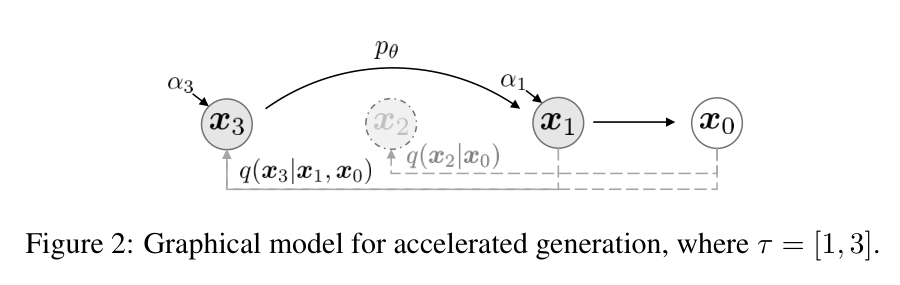

# 按实际瓶颈选择扩散方法

假设现有图像服务总耗时约 1000ms，其中文本处理、解码和传输占 200ms，20 次等效去噪评估各占 40ms。这是一组用于说明预算的假设值。若把评估次数减半，理想总耗时约为 600ms；即使去噪完全免费，也无法低于固定的 200ms。选择方法前，先分清实际要减少哪一段工作。

模型调用还可能含 CFG 两分支、额外 ControlNet 和不同 batch。以下比较需要固定输出尺寸与质量目标。真实延迟应测量，不能由采样步数按比例直接推断。

## 保留权重时能够改变什么

如果不准备训练学生，可先调整兼容的 sampler、时间网格和 NFE。DDIM 可以在子序列上生成；Euler、Heun 与 DPM-Solver 类方法使用不同近似。它们读取已有网络提供的信息，因此适合研究同一模型在质量与数值成本之间的取舍。

<small>图源：[DDIM](https://arxiv.org/abs/2010.02502)。原图表达同一个训练好的扩散模型可以用更稀疏的反向路径加速采样；读图重点是把“换采样器”和“重训/蒸馏学生”先分开，避免把所有少步方法混成一类。它不能证明任意模型都能极少步高质量生成，只说明不重训路线的第一层收益来自采样路径。</small>

比较时固定初始噪声、提示词与 guidance。先用较细网格形成可用参考，再逐步压缩预算，保留失败样本。两个方法都报告 10 步时，应先问其中一个是否每步两次评估，以及 CFG 是否按一次大 batch 调用计数。

如果增加 NFE 仍然画错提示中的对象，证据指向的就不限于求解器。网络、数据和条件问题需要另外诊断。[采样篇](inference.md)给出实际一步更新与误差传播。

## 愿意训练学生时，先决定保留什么

希望同一个噪声仍产生接近教师的结果，可以使用轨迹配对或两步合一步的回归。希望不同时间状态快速返回共同终点，可以训练一致性函数。更关心最终输出分布、允许噪声到图像映射改变，可以研究 DMD 等分布匹配。

这三类目标都可能用于少步，但没有一个与固定步数绑定的通用质量保证。教师本来缺少某种模式，回归学生可能继续缺失；fake score 估计滞后，分布学生可能不稳定。少步收益要与训练成本、条件兼容和多种子覆盖一起评估。

| 路线 | 改动的位置 | 训练时额外需要什么 | 最直接的验证 |
| --- | --- | --- | --- |
| DDIM / Euler / Heun / DPM-Solver | 推理更新与时间网格 | 通常无学生训练 | 同权重同条件下的 NFE 与误差 |
| Progressive Distillation | 学生跨步预测 | 教师复合轨迹标签 | 教师两步与学生一步的误差，再看完整采样 |
| Consistency / LCM | 共同终点函数 | 边界、配对与专用训练 | 不同时间映射、一步和多步分布 |
| DMD / DMD2 | 最终生成分布 | 教师 real score、动态 fake score等 | 多模式覆盖、条件和动态稳定性 |
| Flow / reflow | 概率路径与速度场 | 新目标或新端点配对训练 | 边缘场、有限步误差和最终分布 |

[蒸馏篇](distillation.md)具体推导分布梯度，[一致性篇](consistency-models-and-rectified-flow.md)说明终点函数与局部速度不能互换。

## 若失败已经出现在 VAE 重建，换 solver 不够

把真实图像编码再解码，若小字和细线已经损坏，当前表示的精确保真是一个限制。可以改压缩器、降低压缩率，或研究像素空间生成。每个选择都改变训练输入和计算成本，不能作为仅改部署参数的优化。

像素生成省掉 VAE 解码，但 denoiser 可能处理更多 token 或更难优化的像素变化。若在前面预算里 decoder 只占 50ms，即使完全删去它也只直接省 5%；若像素网络每次多用 10ms、仍评估 20 次，就额外增加 200ms。这组假设计算说明必须同时测前向和解码成本，不能从“少了一个组件”推出整体更快。

[PixelDiT](../paper-deep-dives/diffusion/pixeldit.md)与[Z-Image-Pixel](../paper-deep-dives/diffusion/z-image-pixel.md)探索不同结构和训练阶段。先验证自己的任务确实受到该瓶颈限制，再看它们的证据是否覆盖相同场景。

## 辅助表示目标解决的是训练信号问题

DINO、CLIP 等冻结特征可以参与感知损失或中间表示对齐。它们通常增加训练计算，推理时可以不运行老师。使用前应明确要对齐哪一层、哪个空间网格、哪些时间帧，以及梯度流向哪里。

若视频主体相似度提高却几乎不动，辅助指标可能没有覆盖目标动作。必须同时检查运动和条件遵循；不能把特征距离当成所有视频能力的代理。机制见[视频训练与采样](video-training-and-sampling-1029-1246.md)。

## 视频和世界模型要再增加一层约束

视频的单次前向成本取决于时空 token、attention 和历史长度。逐块生成可能缩短首段等待，但会改变模型面对的前缀分布，并要求缓存满足因果条件。少步蒸馏减少噪声时间上的调用，分块生成改变视频时间上的顺序，二者需要分别验证。

世界模型还要检查动作变化是否导致正确未来，规划使用的候选是否在模型支持范围内，以及执行后重新观察能否纠偏。自然的视频并不能证明反事实正确。相关内容见[长视频](long-video-and-cache-1029-1246.md)与[生成式模拟](../world-models/generative-simulation-and-video.md)。

## 把选择记录成可复查的对照

一个可用的比较表应同时包含模型权重、表示、目标、solver、时间网格、CFG、分辨率、实际评估工作量与端到端时间。质量列则保存同一组提示和种子的结果，以及普通条件、复杂关系、局部细节和模式覆盖的失败比例。

从这个记录里才能回答某次收益来自更好的求解、更小的模型、不同的表示，还是降低了输出要求。方法名用来定位机制，最终选择取决于目标任务的这些证据。

- [架构与 Stable Diffusion](architecture-and-stable-diffusion.md)解释组件成本。
- [训练排障](practical-training-recipes-and-failure-analysis.md)解释怎样隔离错误来源。
- [方法脉络](evolution.md)将同一系统中的表示、目标与求解分支放在一起。

## 先按瓶颈选择实验，而不是按方法名选择

把优化问题先写成约束：固定质量和条件，减少端到端时间；固定延迟，减少显存；固定教师能力，压缩训练或部署成本。不同约束会选择不同路线，同一个方法名不能直接回答所有问题。

建议使用三级对照：第一层只替换 sampler，第二层改变 NFE 或 CFG，第三层再训练学生或改变表示空间。每层都记录相同初始噪声、提示词、分辨率、硬件、batch 和输出检查，避免把多个变化混在一个数字里。

## 最小实验矩阵

| 变量 | 固定项 | 需要报告 |
| --- | --- | --- |
| sampler | 权重、条件、初始噪声 | NFE、每步调用次数、端到端时间 |
| guidance | 权重、solver、提示词 | 条件遵循、结构错误、延迟 |
| distillation | 教师、数据、学生容量 | 训练成本、少步质量、模式覆盖 |
| latent/pixel | 目标、分辨率、硬件 | VAE 成本、token 数、细节保真 |
| video chunk | 模型、帧数、历史窗口 | 首段延迟、长程一致性、缓存成本 |

只比较平均图像质量不够。对于视频和世界模型，还要检查运动、动作条件、长时稳定和反事实响应；自然画面好看并不代表系统能正确执行任务。

## 来源与改编说明

- **无重训加速**参考 [DDIM](https://arxiv.org/abs/2010.02502)，说明稀疏时间路径与重训学生应分开比较。
- **连续路径**可结合 [Diffusion Meets Flow Matching](https://diffusionflow.github.io/)，但页面中的等价关系有适用条件，不能扩展到所有模型。
- **自测**：如果总耗时中固定部分为 200ms、20 次去噪各 40ms，分别计算减少 NFE 和删除固定部分的理论上限，并说明为什么两者不是同一种优化。
