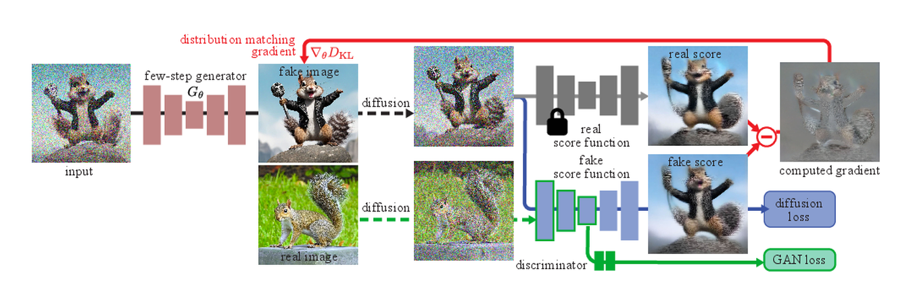

# 一致性模型与 Rectified Flow

扩散模型在生成质量上取得巨大成功后，一个越来越现实的问题浮出水面：采样太慢。哪怕 DDIM、DPM-Solver、Euler、Heun 已经把步数从几百降到几十，很多交互式应用仍然希望“一步到几步就出图”。一致性模型（Consistency Models）、Rectified Flow、Flow Matching 以及一系列一步生成、蒸馏与整流方法，正是在这个背景下快速发展起来的。它们的共同目标，是把原本多步的生成轨迹压缩得更短、更直、更稳定。

!!! note "初学者先抓住"

    一致性模型想学“从任意噪声时刻直接看见同一个终点”，Rectified Flow 想把噪声到数据的路径变得更直。它们都在减少采样步数，但一个强调跨时间输出一致，一个强调轨迹形状更好积分。

!!! note "难点解释：一步生成为什么难"

    多步扩散可以在每一步修正一点错误；一步模型没有这种反复校正机会。训练时必须把全局构图、局部纹理、条件对齐和分布覆盖都压进一次映射里，所以蒸馏、教师质量、噪声采样和 loss weighting 会非常关键。

!!! tip "主线定位：降低 rollout 成本和部署成本"

    Consistency、Rectified Flow、DMD/DMD2 这条线在世界模型高效训练里负责把“未来想象”的单次成本压低。它不一定减少训练成本，甚至常常增加教师采样、蒸馏和消融成本；真正收益发生在需要大量 rollout、候选规划或低延迟部署的阶段。

## 1. 从扩散采样的本质说起

标准扩散模型训练的是一个逐步去噪过程。推理时，我们从噪声 $x_T$ 出发，沿着离散时间网格逐步更新到 $x_0$。无论是 DDPM 还是 DDIM，本质都在近似求解一个随时间演化的逆过程。

若从连续时间视角看，很多采样器其实都在求解某个 ODE 或 SDE：

$$
\frac{dx_t}{dt} = f_\theta(x_t, t).
$$

传统扩散生成慢，是因为为了控制数值误差，需要沿时间轴取很多步。于是问题变成：能不能把这条轨迹学得更“直”、更“好走”，甚至直接学出跨时间一致的映射？

## 2. 一致性模型的核心思想

一致性模型希望学习一个映射 $F_\theta(x_t, t)$，使得无论你从轨迹上的哪个时间点出发，映射后都得到同一个或接近同一个干净样本近似：

$$
F_\theta(x_t, t) \approx x_0.
$$

更严格地说，如果 $x_s$ 和 $x_t$ 位于同一生成轨迹上，那么理想情况下应满足

$$
F_\theta(x_s, s) \approx F_\theta(x_t, t).
$$

**这就是“一致性”的含义**：跨不同噪声级别，映射结果应保持一致。

## 3. 一致性为什么能支持一步生成

传统扩散模型更像在学“下一步怎么走”，一致性模型更像在学“从当前状态直接对齐到终点的稳定映射”。如果这个映射学得足够好，那么推理时从一个高噪声输入一步映射到结果就是可能的。

当然，一步生成并不意味着问题变简单了。你把“多步细调”的难度转移成了“单步映射必须足够强”的难度，所以训练和蒸馏会更关键。

## 4. 一致性训练的形式

一种典型思路是从教师采样轨迹中取两个邻近或相关时间点 $(x_t, x_s)$，让模型输出相近：

$$
\mathcal{L}_{\text{cons}}
=
\mathbb{E}_{x_t, x_s}
\left[
\|F_\theta(x_t, t) - F_\theta(x_s, s)\|_2^2
\right].
$$

再配合边界条件，如在 $t \to 0$ 时输出接近真实数据：

$$
F_\theta(x_0, 0) \approx x_0.
$$

实践中常用一个强教师模型或高精度数值求解器，先生成高质量轨迹，再蒸馏成一致性学生模型。

## 5. Consistency Distillation 与 Consistency Training

### 5.1 Distillation

有教师模型，学生通过模仿教师轨迹或终点来学一致性映射。优点是效果通常更稳，缺点是依赖已有高质量扩散模型。

### 5.2 Training from scratch

不依赖外部教师，直接训练一致性目标。理论上更干净，但实践上更难稳定，需要良好的参数化、噪声采样和训练技巧。

## 6. Rectified Flow 的直觉

Rectified Flow 关注的是另一件事：如果原本从噪声到数据的路径太弯、太复杂，能不能把这条路径“拉直”？直线更容易数值积分，也更容易少步采样。

设从噪声样本 $x_0^{(n)}$ 到数据样本 $x_1^{(d)}$ 的插值路径为

$$
x_t = (1-t)x_0^{(n)} + t x_1^{(d)}.
$$

Rectified Flow 试图学习一个速度场 $v_\theta(x_t, t)$，使得沿流动方向前进时，样本能从噪声平稳到达数据分布：

$$
\frac{dx_t}{dt} = v_\theta(x_t, t).
$$

与传统扩散相比，这种视角弱化了“加噪-去噪”的离散马尔可夫叙事，更强调连续运输。

## 7. 为什么“拉直”有意义

数值分析上，轨迹越弯曲、局部变化越剧烈，同样步数下的积分误差越大。若路径被整流得更接近线性或低曲率，则可以用更少步长维持精度。直观地说，开车走高速直道比走山路发卡弯更容易高速稳定。

**可把轨迹曲率看成一个概念性量**：

$$
\kappa(t) = \frac{\|x_t''\|}{(1+\|x_t'\|^2)^{3/2}}.
$$

Rectified Flow 的目标之一，就是让有效生成路径的曲率更低。

## 8. Flow Matching 与扩散的关系

Flow Matching 的核心不是“再发明一个采样器”，而是把生成问题直接写成一个连续流：

$$
\frac{dx_t}{dt}=v_\theta(x_t,t,c),
$$

其中 \(x_0\) 通常来自简单先验分布，例如高斯噪声；\(x_1\) 来自数据分布；\(c\) 是文本、首帧、视频历史或动作等条件。采样时从噪声出发，沿这个 ODE 积分到数据端：

```text
z ~ N(0, I)
  -> integrate dx/dt = v_theta(x,t,c)
  -> generated sample
```

训练时先指定一条连接噪声和数据的中间路径，再让模型拟合这条路径上的目标速度。一般写作：

$$
\mathcal{L}_{\text{FM}}
=
\mathbb{E}_{t,x_0,x_1}
\left[
\|v_\theta(x_t,t,c)-u_t(x_t\mid x_0,x_1)\|_2^2
\right],
$$

其中 \(u_t\) 是由所选路径给出的目标速度。不同 Flow Matching / Rectified Flow 方法的主要差别，就在于路径怎么选、目标速度怎么构造、时间怎么采样、loss 怎么加权，以及条件 \(c\) 如何注入主干。

最容易理解的是线性插值路径：

$$
x_t=(1-t)x_0+t x_1,
\qquad t\in[0,1].
$$

这时目标速度很简单：

$$
u_t=x_1-x_0.
$$

也就是说，模型在训练中看到一堆“从噪声点走向数据点”的中间点，学习在每个中间点该往哪个方向走。Rectified Flow 常从这种直线路径出发，并通过 reflow 或蒸馏让模型自身生成的路径进一步变直，从而让 Euler 这类低阶求解器也能用很少步数生成较好样本。

扩散里的 \(v\)-prediction 可以和 Flow Matching 放在同一张图里看。若路径写成三角形式：

$$
x_\phi=\cos\phi\,x_0+\sin\phi\,\epsilon,
$$

那么路径速度是：

$$
\frac{dx_\phi}{d\phi}
=-\sin\phi\,x_0+\cos\phi\,\epsilon.
$$

这正是常见 velocity target：

$$
v=\alpha_\phi\epsilon-\sigma_\phi x_0.
$$

所以在这个意义上，`v-prediction` 让扩散模型的输出更像一个速度场；而 Flow Matching 则把“拟合速度场”提升为整个训练框架的中心。

### 8.1 Flow Matching 的训练步骤

一个标准训练循环可以压成：

```text
sample data x_1 and noise x_0
sample time t
construct intermediate x_t along a chosen path
compute target velocity u_t
predict v_theta(x_t, t, condition)
minimize ||v_theta - u_t||^2
```

这个过程看起来比传统扩散少了“逐步加噪马尔可夫链”的叙事，但监督信号仍然是普通回归。它的优势在于目标更直接：模型不是先预测噪声、再由采样器间接换算更新方向，而是直接预测当前点应沿生成路径移动的向量。

### 8.2 采样时怎么走

训练好速度场后，推理阶段就是数值积分：

$$
x_{t+\Delta t}=x_t+\Delta t\cdot v_\theta(x_t,t,c)
$$

这就是 Euler 形式。为了更稳，也可以用 Heun 做预测-校正：

```text
v1 = v_theta(x_t, t)
x_pred = x_t + h * v1
v2 = v_theta(x_pred, t + h)
x_next = x_t + h * (v1 + v2) / 2
```

条件生成里，classifier-free guidance 通常也可以在速度场上做：

$$
v_{\text{cfg}}
=v_{\text{uncond}}+s\cdot(v_{\text{cond}}-v_{\text{uncond}}).
$$

但这并不意味着 guidance 问题自动消失。强 guidance 仍会改变 ODE 轨迹，可能造成过饱和、运动僵硬、视频闪烁或条件过拟合。Flow Matching 只是让“被放大的对象”从噪声预测变成速度预测，仍然要配合时间调度、动态 guidance 和负面样本策略。

### 8.3 为什么它常和少步生成绑定

Flow Matching / Rectified Flow 吸引人的地方，在于它们把采样看成沿速度场从先验运输到数据。如果路径足够直、速度场足够平滑，粗步长积分也能接近正确终点；这就是少步生成的基础。

不过“预测速度场”不自动等于“少步高质量”。少步质量还取决于：

1. 训练路径和真实数据几何是否匹配；
2. 速度场在高噪声和低噪声区间是否平滑；
3. 条件信号是否被模型真正使用；
4. solver 的时间网格是否覆盖关键变化区；
5. 是否经过 reflow、consistency、DMD 或其他蒸馏后训练。

### 8.4 常见误区

第一，Flow Matching 里的 `velocity` 不是视频中物体的运动速度。视频模型预测的是 video latent 空间里的生成向量场；它可能间接编码人物运动、相机运动和物体变化，但目标本身不是 optical flow。

第二，Flow Matching 不是一定比扩散“更真实”。它重写了路径和训练目标，能让少步积分更自然，但模型容量、数据质量、条件设计和 tokenizer 仍然决定上限。

第三，Rectified Flow 里的“直”不是唯一目标。路径太直但条件控制弱，或者低噪声细节学不好，生成仍会失败。现代整流和蒸馏方法往往更关心采样效率、分布匹配、局部细节和条件一致性的综合平衡。

## 9. 一致性模型与 Rectified Flow 的共同点与差异

### 9.1 共同点

1. 都服务于少步甚至一步采样；
2. 都试图从连续时间视角重写生成问题；
3. 都强调轨迹结构而不是单纯局部噪声预测；
4. 都常与蒸馏、ODE 求解器和 teacher model 结合。

### 9.2 差异

1. 一致性模型更强调不同时间点到终点映射的一致。
2. Rectified Flow 更强调从噪声到数据的流场与路径整流。
3. 一致性推理可更直接地做一步映射；Rectified Flow 常保留少步 ODE 积分形式。

## 10. 与 DMD、DMD2、rDM 的关系

Distribution Matching Distillation（DMD）及其后续变体，从另一个角度追求快速生成：直接把慢教师的分布蒸馏给快学生。若学生只需一步或极少步生成，那么它与一致性模型和整流流方法在目标上高度一致，只是训练信号与优化目标不同。

粗略看，这些方法都在回答同一问题：

1. 如何让学生生成分布接近教师或真实数据分布；
2. 如何减少采样步数而不明显损失质量；
3. 如何稳定训练非自回归或极少步生成器。

**不同路线的区别在于**：是直接蒸馏终点分布，还是蒸馏轨迹结构，或重建流场。

{ width="920" }

<small>图源：[Improved Distribution Matching Distillation for Fast Image Synthesis](https://arxiv.org/abs/2405.14867)，Figure 3。原论文图意：DMD2 交替训练 generator、fake score function 和 GAN discriminator，让少步 generator 同时接收 distribution matching gradient 与真实图像监督。</small>

!!! note "图解：少步蒸馏不是把采样器调小"
    DMD2 的方法图说明了一个关键点：少步生成的训练难度被转移到在线 fake critic、真实数据监督和推理链路模拟上。也就是说，部署端少跑几十步，不是因为模型“白捡速度”，而是因为训练端额外付了更复杂的分布匹配与稳定性成本。

## 11. 一步生成为何仍然困难

一步生成虽快，但任务更“硬”。模型必须在一次前向中解决：

1. 全局布局
2. 局部细节
3. 纹理一致性
4. 条件对齐
5. 多模态语义约束

多步采样可以逐步修正错误；一步模型若早期判断偏了，后面没有回旋空间。因此极少步模型常在细节、多样性或条件一致性上更脆弱。

## 12. 训练中的稳定性问题

### 12.1 教师质量依赖

若蒸馏来源教师本身不稳，学生容易继承错误偏差。

### 12.2 模式覆盖不足

一步模型可能更倾向学习高概率主模态，忽略长尾细节。

### 12.3 条件控制弱化

文本到图像、图到视频等条件任务里，少步蒸馏后有时会牺牲 prompt fidelity。

## 13. 采样器视角下的收益

即使不做到一步，若生成轨迹更直，Euler、Heun、DPM-Solver 等显式求解器也能在更少步下保持质量。也就是说，一致性和整流方法不只是“替代采样器”，还可以被视作“让采样器更容易工作”的轨迹重构方法。

### 13.1 算一遍：50 步、8 候选动作和 10Hz 闭环

假设一个视频世界模型用于在线规划，每个候选未来要生成 `16` 帧，单次去噪 forward 为 `90ms`。如果沿用 `50` 步扩散：

```text
1 个候选未来：50 x 90ms = 4.5s
8 个候选动作：8 x 4.5s = 36s
```

这类成本只能用于离线数据生成或低频 shadow evaluation。若蒸馏到 `4` 步：

```text
1 个候选未来：4 x 90ms = 360ms
8 个候选动作：8 x 360ms = 2.88s
```

它仍然不适合 `10Hz` 控制，但可以用于 `1Hz` 左右的高层重规划，或先用轻量 policy 预筛到 `2` 个候选后再调用世界模型。若做到一步，`8` 个候选是 `720ms`，延迟终于可讨论，但代价是模型失去逐步修正机会，必须额外看 long-tail risk recall、action sensitivity 和 closed-loop recovery。

这个例子给出的设计判断是：少步生成首先降低 rollout 和部署成本，不自动降低训练成本。替代方案也要一起比较：

```text
症状：质量可接受，但规划延迟超过控制周期
指标：P50/P95 latency、候选数、每候选步数、闭环成功率、风险漏报率
机制：推理成本随 denoising steps 线性放大，随候选动作数再次放大
取舍：少步蒸馏、候选预筛、分层规划、低分辨率 risk model、高分辨率 verifier
失败反例：一步模型 FID 好，但对接触边界和遮挡变化不敏感
适用边界：交互预览和离线回放可激进少步；安全关键控制要保留验证器或多步复核
```

## 14. 一个形象例子

把传统扩散想成从山顶雾中一步步摸索下山，每一步都小心确认方向；一致性模型更像学会了“无论你在山上哪个雾区，我都能告诉你山脚大门大概在哪”；Rectified Flow 则像在山里重新修了一条更直、更平缓的下山路。三者都在帮助你更快到达终点，但着力点不同。

## 15. 在图像、视频与控制中的意义

### 15.1 图像生成

更低延迟，更适合交互式设计、实时预览、移动端或边缘端部署。

### 15.2 视频生成

视频每一步成本更高，少步采样收益更大，因此整流与一致性思想对视频模型尤为重要。

### 15.3 控制与规划

在轨迹生成、动作生成中，若能少步得到高质量候选，就更适合在线控制和 model-based planning。

## 16. 小结

一致性模型与 Rectified Flow 代表着扩散生成从“高质量多步采样”走向“高质量极少步采样”的重要方向。它们并不是对 DDPM/DDIM 的简单替代，而是对生成轨迹、时间一致性和流场结构的更深重构。理解这条线索，有助于把 DMD、蒸馏、整流流和现代快速生成方法放到同一演化坐标系里看。 


## 工程收束

Consistency model 和 rectified flow 要把少步采样、轨迹整形、teacher-student 关系和部署收益放在一起看。核心问题不是“采样步数少了多少”，而是质量、稳定性、控制性和服务成本是否同时闭合；训练目标、条件信号、分辨率、视频长度和部署时延一变，最佳采样路径往往也会变。
