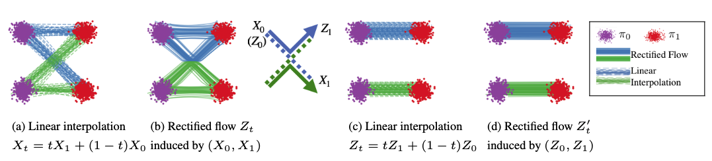

# 一致性模型与 Rectified Flow：终点映射和速度场不是一回事

少步生成经常被讲成“把 50 步变成 4 步、1 步”。这个说法太粗。真正要分清的是：模型到底在学什么对象。

这篇只回答一个问题：**Consistency / LCM 和 Rectified Flow / Flow Matching 都能服务少步生成，但它们为什么不是同一种方法？**

一个更好的抓手是：一致性模型学的是“同一条生成轨迹上的不同噪声点，应该映射到同一个终点”；Flow / Rectified 路线学的是“从噪声到数据的连续路径上，每个点应该沿哪个速度走”。前者更像学一个跨噪声层级的终点函数，后者更像学一张运输速度场。

## 先看多步扩散到底慢在哪里

普通扩散采样从高噪声状态 \(x_T\) 出发，经过很多小步到达干净样本 \(x_0\)：

\[
x_T\rightarrow x_{t_1}\rightarrow x_{t_2}\rightarrow\cdots\rightarrow x_0
\]

\(x_T\) 是几乎纯噪声，\(x_0\) 是最终图像或视频 latent，中间的 \(x_{t_i}\) 是模型和采样器一步步修正后的状态。多步采样慢，但它有一个很重要的好处：每一步只承担一小段纠错。

少步方法要解决的不是“循环写少一点”，而是下面这件事：当中间状态变少，每一步都变成大跳时，模型怎样不丢全局结构、条件控制、细节和分布覆盖。

## 一致性模型：同一条轨迹应指向同一个终点

一致性模型把注意力放在终点映射上。设 \(f_\theta(x_t,t)\) 是模型，输入是一条生成轨迹上的某个带噪状态 \(x_t\) 和时间 \(t\)，输出是对干净样本的估计。理想情况是：

\[
f_\theta(x_t,t)\approx x_0
\]

这里 \(f_\theta\) 不再只是预测下一小步，而是尽量回答：“如果从当前噪声层级直接看终点，这条轨迹最后应该是什么？”

一致性约束更关键。若 \(x_t\) 和 \(x_s\) 来自同一条 probability-flow ODE 或教师采样轨迹上的两个时间点，那么它们虽然噪声强度不同，但应该回到同一个干净样本：

\[
f_\theta(x_t,t)\approx f_\theta(x_s,s)
\]

\(x_t\) 和 \(x_s\) 可以理解为同一辆车在同一条路上的两个位置，\(f_\theta\) 输出的是“这辆车最终要到的目的地”。一致性的意思不是两个 noisy latent 长得一样，而是它们经过模型后指向同一个终点。

训练时常见的损失可以写成：

\[
\mathcal{L}_{\mathrm{cons}}
=
\mathbb{E}_{(x_t,x_s)}
\left[
\|f_\theta(x_t,t)-\mathrm{sg}(f_\theta(x_s,s))\|_2^2
\right]
\]

期望符号表示对很多轨迹点对取平均；平方距离让两个输出靠近；\(\mathrm{sg}\) 表示 stop-gradient，意思是右边那一路只作为目标，不让梯度从那里反向修改，避免两个分支互相追着漂。论文实现会有 EMA、边界条件和参数化细节，但这条式子已经抓住核心：同一条轨迹不同时间点的终点估计要一致。

边界条件也很重要：

\[
f_\theta(x_0,0)=x_0
\]

如果输入已经是干净样本，模型不应该再改它。没有这个锚点，一致性只会变成“大家输出一样”，但不保证输出的是正确图像。

## LCM 把一致性接到 latent diffusion

Consistency Models 提供了少步映射的基本思路，Latent Consistency Models（LCM）把它接进 latent diffusion 生态。普通 Stable Diffusion 一类模型在 latent 空间里去噪，LCM 的目标是让学生在同一条教师 ODE 轨迹上学到一致映射，从而 1 到 4 步也能得到可用图像。

LCM 为什么在工程上受欢迎？因为它不是重新发明完整生成系统，而是把已有 latent diffusion 教师蒸馏成快速学生，还可以通过 LoRA 形式进入原有生态。对交互预览、草图探索、低延迟 UI，这很有吸引力。

但要记住它的代价：终点一致不等于细节无损。复杂 prompt、文字、局部编辑、ControlNet、参考图一致性和高频纹理，都可能在少步映射里被压平。读 LCM/Consistency 的结果时，不要只问 4 步是否“能出图”，还要看强条件、长尾 prompt 和局部细节是否退化。

## Flow Matching：直接学习路径上的速度

Flow Matching / Rectified Flow 换了一个问题。它不先问“这个 noisy point 的终点是什么”，而是先选一条从噪声分布到数据分布的连续路径，再让模型学习路径上每个点的速度。

最简单的路径是线性插值：

\[
x_t=(1-t)x_0+t x_1,\qquad t\in[0,1]
\]

这里 \(x_0\) 是噪声端样本，\(x_1\) 是数据端样本，\(t\) 从 0 走到 1。\(t=0\) 时在噪声端，\(t=1\) 时在数据端，中间状态就是两者按比例混合。

这条线性路径的目标速度很简单：

\[
u_t=x_1-x_0
\]

它表示“从起点指向终点的方向”。模型 \(v_\theta(x_t,t,c)\) 要做的是在中间点 \(x_t\)、时间 \(t\)、条件 \(c\) 下预测这个方向：

\[
\mathcal{L}_{\mathrm{FM}}
=
\mathbb{E}_{t,x_0,x_1}
\left[
\|v_\theta(x_t,t,c)-u_t(x_t\mid x_0,x_1)\|_2^2
\right]
\]

\(v_\theta\) 是模型预测速度，\(u_t\) 是所选路径给出的目标速度。这个损失不是让模型预测噪声，也不是让它直接输出终点，而是让它学“当前位置应该怎么移动”。采样时就沿 ODE 积分：

\[
\frac{dx}{dt}=v_\theta(x,t,c)
\]

用 Euler 写成离散更新就是：

\[
x_{t+\Delta t}=x_t+\Delta t\,v_\theta(x_t,t,c)
\]

\(\Delta t\) 是步长。路径越平滑、速度场越稳定、时间网格越合适，少数几步积分就越可能接近正确终点。

## Rectified Flow：让路径更适合粗步走

Rectified Flow 从线性连接噪声和数据出发，进一步关心“生成轨迹能不能变直、变好积分”。它的 reflow 思路可以理解为：先训练一个 flow，让它从噪声生成样本；再把模型实际生成的起点-终点配对拿来重新训练，使后续路径更接近直线。

{ width="700" }

<small>图源：[Rectified Flow 官方实现](https://github.com/gnobitab/RectifiedFlow)，来自 `github_misc/intro_two_gauss.png`。原图用两个高斯分布展示线性插值路径和 Rectified Flow 路径的区别：蓝色是被模型整流后的运输路径，绿色是直接线性配对产生的路径。本站读法：Rectified Flow 的重点不是“少跑几个 timestep”，而是让从噪声到数据的运输关系更容易被低步数 ODE 积分跟上。</small>

这张图适合先看左半边：如果起点和终点配对不合适，线性插值会出现交叉路径，模型要学的速度场就会很别扭。再看右半边：经过 flow 诱导后的配对更接近“同一簇到同一簇”，路径更平行，Euler 这类粗步积分也更容易工作。

但“直”不是万能目标。Rectified Diffusion 的标题就提醒过：straightness is not your need in rectified flow。真正需要的是路径、时间采样、条件控制、数据几何和少步采样质量一起成立。路径看起来更直，如果低噪声细节弱、prompt 控制弱、视频运动被压慢，依然不是好模型。

## v-prediction 和 Flow velocity 容易被混在一起

扩散论文里也常见 \(v\)-prediction，这和 Flow Matching 的 velocity 有联系，但不是同一层东西。

在扩散参数化里，\(v\)-prediction 通常是一种更方便的输出坐标。模型预测 \(\hat v\)，采样器再把它换算成 \(\hat\epsilon\) 或 \(\hat x_0\)，然后按 DDIM、DPM-Solver、Euler 等规则更新。

在 Flow Matching 里，\(v_\theta(x,t,c)\) 直接就是 ODE 右边的速度场。采样器拿它做：

\[
x \leftarrow x + \Delta t\,v_\theta(x,t,c)
\]

所以可以这样记：

| 名字 | 模型输出是什么 | 采样器怎样用 |
| --- | --- | --- |
| 扩散 \(v\)-prediction | 噪声/数据混合坐标里的预测量 | 先换算，再按扩散采样规则更新 |
| Flow Matching velocity | 生成 ODE 的速度向量 | 直接作为积分方向 |

这个区别很重要。否则读 SD3、Wan、Flux、视频 DiT 或机器人 diffusion policy 时，很容易把“视频里物体的运动速度”和“latent 空间里的生成速度场”混成一件事。Flow velocity 描述的是样本在高维 latent 里如何从噪声流向数据，不是画面中人物跑得多快。

## 两条路线到底怎么选

如果你已经有一个强扩散教师，只想把现有模型压到 1 到 4 步，Consistency / LCM 往往更自然。它保留 teacher-student 语境，适合快速预览、交互式 UI 和已有 Stable Diffusion 生态。

如果你在训练新一代图像或视频底座，Flow Matching / Rectified Flow 更值得看。SD3、Wan 这类系统都说明：在 latent 上学速度场、用 DiT 做主干、用 ODE sampler 推理，已经成为现代生成模型的一条主线。它不是只为一步生成服务，而是把训练目标和采样路径一起重写。

如果目标是极限一步高质量，光有一致性或 rectified 路线通常还不够，还要看 DMD、DMD2、Phased DMD 这类分布匹配蒸馏。那是另一篇文章的重点：它关心的是学生最终分布是否像 teacher/data，而不是单纯轨迹一致或路径更直。

## 评测要看各自最容易坏的地方

Consistency / LCM 最怕“快但变钝”：图能出，结构大致对，但文字、手、边缘、局部编辑和强条件控制变弱。评测应拆 prompt 难度、ControlNet/参考图、局部编辑和高频细节。

Flow / Rectified 路线最怕“路径好看但任务不保真”：速度场损失下降，少步积分也稳定，但条件没有被持续使用，视频运动变慢，低噪声细节不足，或者时间采样漏掉关键噪声区间。评测应拆 timestep bucket、condition bucket、视觉细节、视频 motion bucket 和端到端延迟。

两条路线都不能只看 FID 或少数样例。少步生成的真正验收，是在真实 1/2/4/8 步、真实 CFG、真实 prompt 分布、真实服务延迟下，质量和控制性是否一起过线。

## 读完以后怎么判断

这篇可以用四句话收住：

1. 一致性模型学终点映射：同一条轨迹上的不同噪声点，输出应该一致。
2. LCM 把一致性蒸馏接到 latent diffusion，使 1 到 4 步交互式生成更实用。
3. Flow Matching 学速度场：先选噪声到数据的路径，再回归路径上的移动方向。
4. Rectified Flow 关心路径是否更适合少步积分，但“更直”本身不是质量保证。

继续读时，可以把本文接到 [采样与推理加速](inference.md)、[一步生成、蒸馏与整流](distillation.md)、[Score Matching 到 SDE](score-matching-sde-and-probability-flow.md) 和 [视频与多模态扩散](video-and-multimodal-diffusion.md)。

## 外部精读

- [Consistency Models](https://arxiv.org/abs/2303.01469)：理解同一 PF-ODE 轨迹上不同点为什么要输出一致。
- [Latent Consistency Models](https://arxiv.org/abs/2310.04378)：看一致性蒸馏如何进入 latent diffusion 和 Stable Diffusion 生态。
- [Rectified Flow](https://arxiv.org/abs/2209.03003)：理解 reflow 和路径整流怎样服务少步生成。
- [Flow Matching](https://arxiv.org/abs/2210.02747)：理解“先定义概率路径，再学习速度场”的生成框架。
- [Scaling Rectified Flow Transformers](https://arxiv.org/abs/2403.03206)：看 SD3 路线如何把 rectified flow 和多模态 DiT 接到高分辨率文生图。
- [Meta Flow Matching Guide and Code](https://ai.meta.com/research/publications/flow-matching-guide-and-code/)：适合从工程角度复习 Flow Matching 的统一写法和代码入口。
