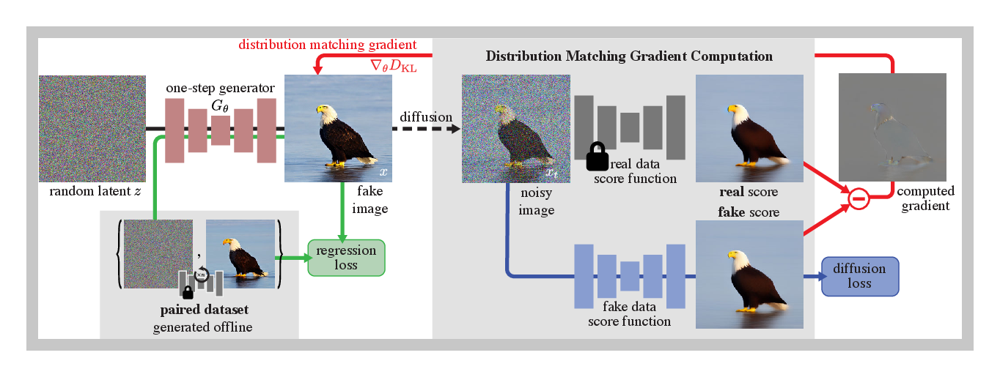
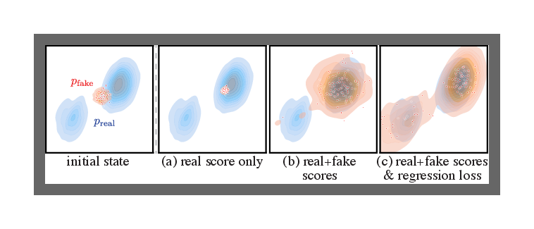
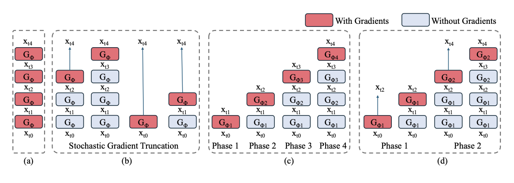

# 一步生成、蒸馏与整流

当 `DDIM`、`Euler`、`DPM-Solver` 已经把推理压到几十步后，下一步问题就变成了：能不能直接把几十步教师，压缩成几步甚至一步学生。

!!! note "读法定位"
    这页先回答“一步生成、蒸馏与整流”在「扩散模型」里的位置：它解决什么局部问题，依赖哪些前置，最后会影响哪类工程或研究判断。
    **前置**：先知道张量、损失函数和高斯噪声的基本读法；不熟时回基础知识再继续。 必要时先回 [扩散模型入口](index.md)、[基础知识](../foundations/index.md) 或 [术语表](../glossary/index.md)。
    **主线关系**：把训练目标、噪声日程、采样器、条件控制和蒸馏看成同一条链：带噪状态如何一步步被推回数据分布。

DMD 原论文的核心图很适合说明“少步/一步生成”为什么不能只靠删采样步：student generator 需要同时接受回归信号和分布匹配信号，目标不是机械复刻 teacher 的每个中间状态，而是让最终生成分布靠近 teacher / data 分布。

{ width="920" }

<small>图源：[One-step Diffusion with Distribution Matching Distillation](https://arxiv.org/abs/2311.18828)，Figure 2。原论文图意：一步生成器 \(G_\theta\) 从噪声生成 fake image；一条支路用预计算 noise-image pairs 做 regression loss，另一条支路通过 real / fake score 差异形成 distribution matching gradient。</small>

!!! note "图解：DMD 方法图里的两条训练信号"
    图中 \(G_\theta\) 是一步 generator，它直接把噪声映射成 fake image。上方 regression branch 用预计算的 teacher pairs 稳住单样本对应关系，避免学生完全偏离教师轨迹；下方 distribution matching branch 把 fake image 加噪后交给 real / fake score models，用两者差异给 generator 一个“整体分布应该往哪里移动”的梯度。少步生成不是单纯把采样步数删掉；越接近一步生成，越需要重新验证文本对齐、细节锐度、模式覆盖和长尾稳定性。

!!! example "有趣例子：把慢教程压成速成课"

    Teacher 像一门 50 节课的绘画教程，每节只教一点构图、线条、明暗和细节。Student 若只上 4 节课，就不能简单删掉 46 节，而要把关键步骤重新编排成更大的学习跳跃。少步扩散蒸馏也是在重新组织这条学习路径。

## 少步蒸馏：从多步教师到 1-8 步学生 { #few-step-distillation }

少步蒸馏要解决的问题很具体：已经有一个质量可靠但很慢的 teacher diffusion model，它可能需要 20、30、50 步甚至更多步才能生成一张图；现在希望训练一个 student，让它只用 1、2、4 或 8 步就达到接近教师的结果。

这件事不能理解成“把采样循环里的步数删掉”。如果原模型是在 30 步里逐渐修正构图、纹理、边缘、文字和条件对齐，那么删到 4 步后，每一步都必须承担原来好几步的信息量。少步蒸馏的核心，就是重新定义训练信号，让学生学会这种“粗粒度跳跃”。

{ width="920" }

<small>图源：[Improved Distribution Matching Distillation for Fast Image Synthesis](https://arxiv.org/abs/2405.14867)，Figure 3。原论文图意：DMD2 交替训练 generator、fake score function 和 GAN discriminator；generator 同时接收 distribution matching gradient 与 GAN loss。</small>

!!! note "图解：DMD2 为什么多了 fake score 和 GAN 分支"
    DMD2 图里有三组角色：generator 负责产生少步样本，fake score function 追踪当前 generator 的 fake distribution，GAN discriminator 额外约束视觉真实感。这样做的原因是 teacher 的轨迹细、慢、稳定，而 student 的轨迹粗、快、风险更高；只把 teacher 输出当标签会过于僵硬，只做分布匹配又容易不稳。fake score、real score 和 discriminator 合在一起，是在同时管训练信号稳定、分布覆盖和视觉锐度。

### 1. 为什么少步蒸馏和普通 teacher-student 不一样

普通分类蒸馏里，teacher 给一个 soft label，student 学这个 label 就可以。扩散少步蒸馏更麻烦，因为 teacher 的输出不是一个静态答案，而是一条从噪声到图像的轨迹：

\[
x_T \rightarrow x_{t_1} \rightarrow x_{t_2} \rightarrow \cdots \rightarrow x_0.
\]

这里 \(x_T\) 是起点噪声，\(x_0\) 是最终干净图，中间的 \(x_{t_i}\) 是 teacher 采样过程中经过的若干噪声状态。

如果 student 只有 \(K\) 步，就要学习一个更大的跳跃：

\[
x_T \rightarrow x_{\tau_1} \rightarrow \cdots \rightarrow x_0,\qquad K \ll T.
\]

\(\tau_i\) 表示学生保留的少量粗时间点，\(K\ll T\) 表示学生步数远少于教师步数。少步蒸馏本质上是在让学生跨过教师原来很多个小修正。

这意味着 student 不只是在模仿 teacher 的单步预测，而是在学习 teacher 多步复合后的结果。直觉上，teacher 每一步像“慢慢擦掉噪声”，student 每一步像“直接跨过一大片噪声区间”。跨度越大，训练目标越难，越需要额外的稳定手段。

### 2. 三类常见蒸馏信号

| 蒸馏信号 | 学什么 | 代表路线 | 优点 | 风险 |
| --- | --- | --- | --- | --- |
| 轨迹压缩 | 学 teacher 两步或多步采样后的状态 | Progressive Distillation | 直觉清楚，适合逐级从 32 到 16、8、4 步 | 步数越低，误差累积越明显 |
| 终点一致性 | 同一 PF-ODE 轨迹上的不同噪声点映射到一致结果 | Consistency Models、LCM | 适合 1-4 步快速生成，和 latent diffusion 结合自然 | 容易牺牲细节或强条件控制 |
| 分布匹配 | 不要求逐点模仿 teacher，只要求 student 生成分布接近目标 | DMD、DMD2、Phased DMD | 更适合一步生成和极低步数 | 训练稳定性、模式覆盖和锐度都更难管 |

工程上可以先这样判断：如果目标是 4-8 步，轨迹压缩和一致性路线通常更稳；如果目标是一两步，并且能接受更复杂训练和更严格回归，再看 DMD/DMD2 这类分布匹配路线。

### 3. 一个简化的少步蒸馏训练流程

下面的伪代码不是照搬某一篇论文，而是把少步蒸馏的共同骨架抽出来：

```text
Algorithm: Few-Step Diffusion Distillation

Input:
  teacher T                 # 多步扩散模型或高精度采样器
  student S                 # 目标少步模型
  step budget K             # 例如 1, 2, 4, 8
  prompts / conditions c

repeat:
  1. 采样噪声 x_T 和条件 c
  2. 用 teacher 从 x_T 生成高质量轨迹:
       x_T -> ... -> x_0^teacher
  3. 选择 student 的粗时间点:
       tau_K > ... > tau_1 > 0
  4. 构造训练目标:
       path target: teacher 多步结果
       consistency target: 同轨迹终点
       distribution target: teacher/真实分布的 score 差
  5. 更新 student:
       L = L_path + lambda_c L_consistency + lambda_d L_distribution
  6. 用 K 步真实推理回放验证:
       quality, prompt fidelity, control, latency

until validation passes
```

真正做实验时，第 6 步非常关键。少步模型训练 loss 看起来下降，并不代表真实 4 步或 1 步推理就稳。因为训练时看到的 \(x_t\) 分布和 student 自己推理时产生的中间状态可能不一样，这就是很多少步路线会遇到的 train-inference mismatch。

### 4. 一个例子：把 50 步文生图压到 4 步

假设 teacher 是一个 50 步 latent diffusion 文生图模型。原流程大致是：

1. 前 10 步确定整体构图和主体位置；
2. 中间 20 步逐渐补物体关系、材质和局部结构；
3. 最后 20 步修边缘、纹理、文字和高频细节。

如果 student 只有 4 步，就不能指望它按原来的细节节奏慢慢修。更现实的分工是：

1. 第 1 步先把大构图和主要对象拉出来；
2. 第 2 步把对象关系、颜色和光照压稳；
3. 第 3 步补关键细节和条件对齐；
4. 第 4 步做局部锐化和伪影修复。

这就是少步蒸馏最难的地方：student 的每一步不再是“微小去噪”，而是带有阶段性规划意义的大跳跃。步数越少，它越像一个非自回归生成器，而不是传统意义上的逐步扩散采样器。

### 5. 少步蒸馏最该验什么

只比较“生成速度快了多少”是不够的。少步蒸馏至少要固定 teacher-student 同 seed、步数桶、强条件、长尾 prompt 和真实延迟几类对照：同一个 prompt、seed、guidance 下看退化来自哪里；1、2、4、8 步分别测，不要只展示最好看的那一档；文本、ControlNet、参考图、局部编辑、风格约束要分开测；多对象、计数、空间关系、文字、复杂材质最容易暴露问题；端到端时延也要报告，而不只是 UNet 前向次数。

如果一个少步学生在平均视觉指标上接近 teacher，但在复杂 prompt 里丢对象、文字糊、结构控制漂移，那么它还不能算真正可替代 teacher，只能算快速预览或低风险场景的候选。

### 6. 相关论文入口

1. Progressive Distillation: [Progressive Distillation for Fast Sampling of Diffusion Models](https://arxiv.org/abs/2202.00512)
2. Consistency Models: [Consistency Models](https://arxiv.org/abs/2303.01469) / [官方 GitHub](https://github.com/openai/consistency_models)
3. LCM: [Latent Consistency Models](https://arxiv.org/abs/2310.04378)
4. DMD: [One-step Diffusion with Distribution Matching Distillation](https://arxiv.org/abs/2311.18828)
5. DMD2: [Improved Distribution Matching Distillation for Fast Image Synthesis](https://arxiv.org/abs/2405.14867)

## Progressive Distillation

**它的思想可以写成**：

\[
\text{student}(x_t, t) \approx \text{teacher}^{(2)}(x_t, t)
\]

也就是让学生学会“教师两步完成的事”。这里输入仍是同一个带噪状态 \(x_t\) 和时间 \(t\)，右上角的 \((2)\) 表示 teacher 连续走两步后的等效结果。不断重复后，步数可以从 \(N\) 压到 \(N/2\)、\(N/4\) 甚至更低。

这条路线的价值，在于它尽量保留了原始扩散教师的行为方式。学生不是从零发明一条新路径，而是在教师已经验证过的多步轨迹上逐级压缩。这样做的优点是直觉清楚、过渡自然，也更容易和原有训练框架兼容。

但它的局限也很明确。因为学生始终在模仿教师的压缩版本，所以一旦目标步数压得非常低，误差会层层累积。换句话说，它非常适合把 32 步压到 16、8、4 这种区间，却不一定天然擅长“高质量一步生成”。

### 例子：学徒画师

老师原本需要 16 笔画完一张苹果静物，学徒先学“两笔合成一笔”，再学“四笔合成一笔”，最后压缩成 4 笔或 2 笔完成。

## Consistency / LCM

**一致性路线希望直接学会**：

\[
f_\theta(x_t, t) \approx f_\theta(x_s, s), \qquad \text{当 } x_t, x_s \text{ 属于同一数据轨迹}
\]

直觉上，不同噪声层级的点，只要它们对应同一个真实样本，就应该被映射到接近的干净结果。左边和右边的输入时间不同，但目标输出应该一致，这就是 consistency 的数学含义。

这类方法适合一步或少步采样，也适合保留与大教师模型的一致性，并与 latent diffusion 结合。

一致性路线真正吸引人的地方，是它不再执着于“严格走完整条教师轨迹”，而是希望不同噪声层级上的点能被直接收束到相近的干净结果。这样一来，模型在推理时就不必重演那么多中间步骤，而可以更像一个“跨层级纠偏器”。

这类方法因此特别适合交互式预览、少步 latent diffusion 和需要快速试错的产品场景。风险则在于，一旦一致性目标定义得不够稳，学生很容易在高难 prompt、强 guidance 或长尾视觉模式上丢掉细节和条件敏感性。

## DMD：从轨迹模仿转向分布匹配

`DMD` 的关键不是“模仿教师每一步动作”，而是直接优化学生分布与目标分布的差异。

**可以把它粗略理解为最小化**：

\[
D\left(p_{\text{student}}(x), p_{\text{target}}(x)\right)
\]

论文中利用真实分布侧和生成分布侧的 score 差来构造训练信号。直觉上，如果学生样本分布偏离真实数据，两个 score 会给出方向差，并推动一步生成器朝正确分布移动。

这里 \(D(\cdot,\cdot)\) 表示某种“分布差异”度量：第 1 个位置是学生生成分布 \(p_{\text{student}}(x)\)，第 2 个位置是希望靠近的目标分布 \(p_{\text{target}}(x)\)。\(x\) 不是单张固定图片，而是用来表示整个样本空间里的随机样本。

`DMD` 的关键突破，不是简单让学生“少走几步”，而是把问题改写成“学生最终落到的分布对不对”。这会带来一种完全不同的蒸馏哲学：不再要求学生逐帧模仿老师，而是允许它用自己的方式，只要最终分布足够接近目标。

这也正是一步生成难度陡增的地方。因为你抛开了轨迹监督之后，学生获得了更大自由度，但训练稳定性、模式覆盖和锐度也更容易一起失控。

### 例子：做面包而不是背配方

传统轨迹蒸馏像让学徒严格模仿师傅每一步揉面、发酵、烘烤。

`DMD` 更像只看最终面包是否外形、口感和香气都接近目标产品，然后用“结果差异”反推哪里需要改。

## DMD2：解决模糊与训练不稳

`DMD2` 延续分布匹配思路，但更强调稳定性。可以用一个近似的总目标来理解：

\[
\mathcal{L} = \mathcal{L}_{\text{dist-match}} + \lambda_{\text{gan}}\mathcal{L}_{\text{gan}}
\]

这里的直觉是：分布匹配负责把总体分布拉对，对抗损失负责提升清晰度和锐度。

拆开看，\(\mathcal{L}_{\text{dist-match}}\) 是分布匹配项，\(\mathcal{L}_{\text{gan}}\) 是对抗损失项，\(\lambda_{\text{gan}}\) 是权重系数：它决定 GAN 分支在总损失里说话有多大声。

**这很像图像生成里常见的分工**：一个目标保“方向对”，另一个目标保“画面利”。

`DMD2` 更像是在承认一个现实：只靠分布级别的方向信号，往往还不足以把视觉清晰度和细节锐度也一起拉起来。于是它通过更稳定的训练耦合和更清楚的损失分工，把“分布对齐”和“视觉可用”重新接到一起。

从方法演化上看，`DMD2` 说明一步生成真正困难的，不是目标本身够不够激进，而是训练信号是否既能管大方向，又能管高频细节。只要这两者失衡，结果不是糊，就是不稳。

### 4.1 训练曲线里该看什么

在少步蒸馏或 Flow / DMD 混合训练里，常会同时看到两类曲线：

```text
v-prediction / velocity loss:  当前点的局部方向回归准不准
distribution matching loss:   当前生成分布是否靠近 teacher / real 分布
```

这两条曲线的读法不同。`v-prediction loss` 是局部监督信号，下降通常说明学生更会在给定噪声状态上预测正确移动方向；`distribution matching loss` 是分布信号，依赖 real / fake score、fake critic 或 discriminator，曲线更容易震荡，也更受 critic 是否跟上 generator 的影响。

{ width="630" }

<small>图源：[One-step Diffusion with Distribution Matching Distillation](https://arxiv.org/abs/2311.18828)，Figure 3。原论文图意：比较只用 real score、加入 distribution matching、再加入 regression loss 后的二维 toy 分布覆盖效果。</small>

<small>本教程读法：这张图支撑“distribution matching loss 不能只看数值下降”。只往 real score 高密度区走可能会塌到少数模式；加入 fake score 差分后分布覆盖改善；再加 regression anchor 才更容易保住不同 noise 对应的结构多样性。</small>

可以把它们放进一个诊断矩阵：

| 现象 | 解释 |
| --- | --- |
| \(L_v\) 降，\(L_{\text{dm}}\) 也降 | 局部方向和整体分布都在变好，通常是健康信号 |
| \(L_v\) 降，\(L_{\text{dm}}\) 不降 | 学生会做训练点上的回归，但生成分布还不像 teacher / real |
| \(L_v\) 不降，\(L_{\text{dm}}\) 降 | 分布梯度可能在拉结果，但单步/少步轨迹本身不稳，低步采样容易漂 |
| \(L_{\text{dm}}\) 剧烈震荡 | fake score / critic 可能滞后，generator 更新太快，或 timestep 采样太激进 |
| 两者都好看，样例不好 | 训练分布和真实少步推理分布错配，必须回放真实 sampler 验证 |

所以看训练曲线时，不要问“哪个 loss 更低”，而要问三件事：第一，\(L_v\) 是否在不同 SNR 桶里都下降；第二，distribution matching 是否让多 seed 输出保持多样而不是收缩到少数安全模式；第三，真实 1/2/4 步采样结果是否同步改善。DMD 类方法尤其要额外看 fake critic 的 denoising loss 和更新比例，因为 generator 的 distribution matching 梯度是借它算出来的。

## Phased DMD：把一步难题拆成多个阶段

`Phased DMD` 把噪声空间按 phase 划开，每个 phase 内再做局部分布匹配。可以写成：

\[
\mathcal{L}_{\text{total}} = \sum_{k=1}^{K} \left(\lambda_k \mathcal{L}_{\text{dm}}^{(k)} + \gamma_k \mathcal{L}_{\text{score}}^{(k)}\right)
\]

这里 \(k\) 表示不同阶段。这样做的好处是让早期 phase 先学大结构，中期 phase 学物体关系和构图，后期 phase 再盯住纹理与细节。

这条求和式从 \(k=1\) 加到 \(K\)，表示每个 phase 都有自己的训练项。括号里的两部分分别是第 \(k\) 个阶段的 distribution matching loss 和 score loss；\(\lambda_k,\gamma_k\) 控制这个阶段两种损失的相对权重。

### 例子：画一辆赛车

如果要求学生一步完成，很可能只画出“像车”的轮廓，赞助商贴纸、轮胎纹理、反光材质会丢失。

如果分阶段学，第一阶段可以先把赛车姿态、车头、轮胎位置定住，第二阶段学习车壳分色和赛道背景，第三阶段再补 logo、反射和运动模糊。

这比硬做一步往往稳得多。

### 5.1 从 Phased DMD 图里理解“少步不等于一步”

少步蒸馏最容易被误解成“把采样步数砍掉”。Phased DMD 的图正好能纠正这个误解：4 步生成仍然可以有阶段分工，高噪声阶段负责大结构和运动，低噪声阶段负责纹理和细节。真正要防止的是训练过程把每一步都逼成“一步解决全部问题”的学生。

{ width="920" }

<small>图源：[Phased DMD: Few-step Distribution Matching Distillation via Score Matching within Subintervals](https://arxiv.org/abs/2510.27684)，Figure 1。原论文图意：对比 vanilla few-step DMD、DMD2/SGTS、4-phase Phased DMD 和结合 SGTS 的 2-phase Phased DMD；红色表示记录梯度的 generator step，蓝色表示不记录梯度的 forward step。</small>

!!! note "这张图帮你补哪块基础"
    红色 step 表示训练信号真正反传到哪里，蓝色 step 表示只是向前跑出中间状态。DMD2 / SGTS 通过只记录最后一步梯度来省显存，但随机截断有时会让训练样本退化成近似 one-step distillation。Phased DMD 的补丁是把 SNR 路径切成 phase，让每个 expert 只负责一个子区间。这样少步模型仍保留“先定大局、再修细节”的分工。

这件事和 Wan2.2 的 high-noise / low-noise MoE 设计也能连起来理解。视频里的大运动、镜头变化、主体位置，往往在高噪声 / 低 SNR 阶段先被决定；低噪声 / 高 SNR 阶段再补纹理和局部细节。如果少步蒸馏总把训练压成一跳，模型就可能先保画面稳定，却牺牲运动幅度和多样性。

因此，少步蒸馏的验收不能只看“几步出图”和平均画质，还要看视频 motion intensity 有没有被压慢、不同 seed 的多样性有没有塌缩、复杂镜头和动作 prompt 是否还可控、文字 / logo / 边缘 / 高频细节是否被低步数牺牲，以及每个 phase 的训练目标是否真的对应正确的噪声子区间。

## Rectified Flow / Rectified Diffusion

这条路线并不是主要做“教师蒸馏”，而是重新设计从噪声到数据的生成路径，让它更适合少步离散。

**可以把目标想成**：学习一条更平直、更容易数值积分的轨迹

\[
\frac{dx}{dt} = v_\theta(x,t)
\]

\(\frac{dx}{dt}\) 是样本沿时间变化的速度，\(v_\theta(x,t)\) 是模型预测的速度场。若轨迹足够规则，一步或少步 Euler 就可能已经足够。

`Rectified Diffusion` 进一步说明：真正关键的不一定是几何意义上的“绝对直”，而是轨迹和配对方式是否适合粗离散。

这条路线值得单独看，是因为它把重点从“如何蒸馏教师”转成了“如何让路径本身更适合少步求解”。也就是说，它不是首先回答“老师怎么教学生”，而是先回答“从噪声走到数据，什么样的路更适合用很少步数走完”。

因此 rectified 路线和 DMD 路线虽然都在追求极少步，但关注点并不一样。前者更像重画道路，后者更像在结果空间里直接纠偏。

## 什么时候选哪条路线

### 你不想重训

看求解器，不看蒸馏。

这种场景最常见于：模型已经训完、部署链路已经跑通、团队只想在当前权重上把推理速度再压一点。此时蒸馏和整流的训练成本通常不划算，因为它们会把问题从“推理调优”升级成“重新训练并重新验收”。所以更稳妥的路径仍然是先换 solver，再看是否真的有必要进入学生模型路线。

### 你要 4 到 8 步

优先看 Progressive Distillation、Consistency / LCM 和 Rectified 路线。

这一档通常是工程上最有现实吸引力的区间。因为 4 到 8 步已经足够明显地降低时延和成本，但又没有一步生成那么极端，因此更容易兼顾质量、控制性和稳定性。很多真实产品若不是强追求一步，往往会在这个区间找到更好的性价比。

### 你要 1 步并且追求很高质量

重点看 DMD、DMD2 和 Phased DMD。

这类目标往往只在两种情况下值得认真投入：一是交互预算极紧，二是推理成本极敏感。因为一步生成不是“更快一点”，而是会显著改变训练、评测和回退设计。只要你决定走这条路，就等于接受了更复杂的训练流程和更严格的长尾验收要求。

## 本页结论

一步生成的难点，不是“把 20 步删成 1 步”，而是如何保住分布正确性、高频细节、模式覆盖和文本条件。

所以 `DMD2`、`Phased DMD`、`Rectified Diffusion` 本质上都在回答同一个问题：**极少步下，怎样既快又不崩。**

## 快速代码示例

```python
import torch  # 使用 no_grad 控制 teacher 前向
import torch.nn.functional as F  # 使用 MSE 蒸馏损失

def distill_step(student, teacher, x_t, t, cond):  # 定义 teacher-student 蒸馏单步
    with torch.no_grad():  # teacher 只提供目标，不参与梯度更新
        target = teacher(x_t, t, cond=cond).sample  # 生成 teacher 目标预测
    pred = student(x_t, t, cond=cond).sample  # 生成 student 预测
    return F.mse_loss(pred, target)  # 用 MSE 让 student 贴近 teacher
```

这段代码给出最小 teacher-student 蒸馏步：用 teacher 生成目标噪声（或速度）预测，student 直接回归。一步或少步扩散蒸馏通常都以这类“轨迹/分布对齐”损失为核心，再叠加对抗或感知约束稳住细节。

## 工程收束

一步生成、蒸馏与整流要按 teacher-student 差距、步数压缩、模式覆盖、稳定性和部署收益来验收。最容易踩坑的是蒸馏后快了但控制性变差、只看单一视觉指标、teacher 偏差继承到 student；少步学生尤其容易在强条件控制、高频细节和长尾 prompt 上露怯。上线前应固定 teacher-student、步数桶、控制桶和回退门槛四类对照。

!!! tip "下一站"
    - 回到本专题入口：[扩散模型](index.md)，确认这页在整条路线中的位置。
    - 按导航顺序继续：[一致性模型与 Rectified Flow](consistency-models-and-rectified-flow.md)。
    - 概念或符号卡住时，先查 [术语表](../glossary/index.md)，再回到当前页。
