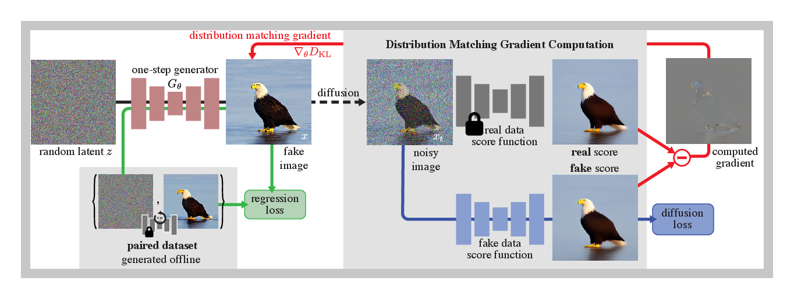
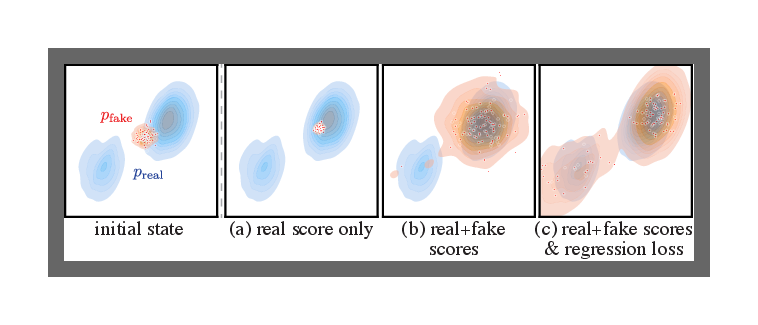
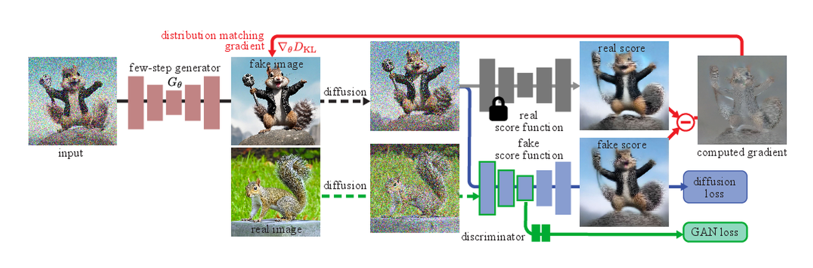
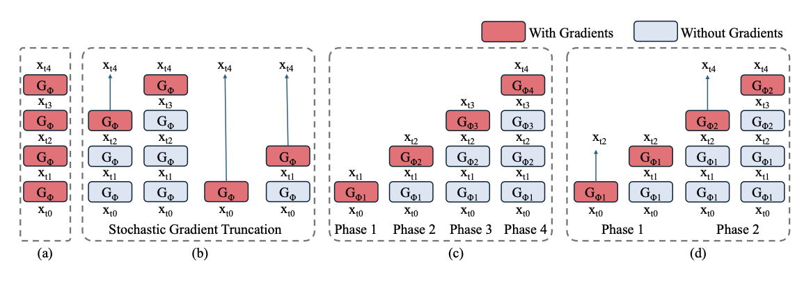

# 少步生成究竟把什么交给学生学习

把一个教师采样器从 50 步改成 4 步，有两种完全不同的操作。可以保留原权重，只用更粗的时间网格求解；也可以重新训练一个学生，让它在较大跨度上预测。前者改变数值误差，后者改变网络学到的函数。扩散蒸馏主要讨论后者。

学生少了多次在新状态重新预测的机会。为了判断怎样补这部分能力，需要把轨迹回归、终点一致和分布匹配各自监督什么算清楚，避免只按“一步、四步”归类。

## 教师两步怎样成为学生一步的标签

设教师更新算子为 \(T_{t\to s}\)，两次更新得到

\[
x_s=T_{t\to s}(x_t),
\qquad x_r=T_{s\to r}(x_s).
\]

学生的目标是让 \(S_{t\to r}(x_t)\) 接近 \(x_r\)。同一输入的标签来自教师两步复合，学生必须学会跨过中间状态。Progressive Distillation 逐轮重复这种减半过程。

如果学生仍输出干净样本估计，并通过确定性 DDIM 形成一步，则

\[
S_{t\to r}(x_t)=
\left(a_r-\frac{b_ra_t}{b_t}\right)\hat x_0+
\frac{b_r}{b_t}x_t.
\]

因此可从教师产生的 \(x_r\) 反解学生应预测的目标

\[
\hat x_0^{\mathrm{target}}=
\frac{x_r-(b_r/b_t)x_t}{a_r-b_ra_t/b_t}.
\]

这要求所选时间和系数使分母有定义，端点还需专门处理。它说明训练标签不一定是原始真实图像，而可能是“让学生这一步恰好落到教师两步终点”的等效目标。

教师误差会被学生继承，学生拟合误差也会继续传播。固定逐噪声配对提供明确监督，但会要求学生模仿教师选定的映射。若只关心最终分布，可能没有必要逐点复刻它。

## 终点一致怎样改变监督对象

一致性模型让同一教师轨迹上的状态映到同一低噪声端点。它不要求每一个学生中间状态复现教师，也不直接输出局部速度。边界条件排除所有输入输出同一个常量的坏解，CD 和 CT 使用不同配对构造，详见[一致性模型](consistency-models-and-rectified-flow.md)。

对已训练模型，所谓“四步”还要核对一步输出的是数据还是速度、是否重新加噪、采用哪些固定时间、是否额外运行 CFG。不同学生的循环次数相同，不代表算法或计算量相同。

## 分布匹配为何需要 real score 和 fake score

令学生 \(G_\theta(z)\) 的分布为 \(p_\theta\)，目标分布为 \(p_*\)。在适当光滑条件下，反向 KL 的生成器梯度可以表达为

\[
\nabla_\theta D_{\mathrm{KL}}(p_\theta\|p_*)
=\mathbb E_z\left[
J_\theta G_\theta(z)^\top
\left(s_\theta(G_\theta(z))-s_*(G_\theta(z))\right)
\right].
\]

\(s_\theta=\nabla_x\log p_\theta\) 描述学生当前分布，\(s_*\) 描述目标分布。这里用下标 \(\theta\) 标识分布依赖，不表示梯度实现要无条件穿过 score 估计器的全部训练过程。实际 DMD 用相应估计形成给学生的更新方向。

{ width="920" }

<small>图源：[One-step Diffusion with Distribution Matching Distillation](https://arxiv.org/abs/2311.18828)，Figure 2。原图展示一步生成器 \(G_\theta\) 从噪声生成样本，一条支路用 teacher 生成的 noise-image pair 做回归，另一条支路用 real / fake score 差异形成 distribution matching gradient。读图重点：DMD 的关键不是少跑几步，而是用分布信号约束学生最终落到哪里。</small>

用目标 \(\mathcal N(0,1)\)、学生 \(G_\mu(z)=z+\mu\) 的例子核验符号。学生分布为 \(\mathcal N(\mu,1)\)，两个 score 为

\[
s_*(x)=-x,
\qquad s_\mu(x)=-(x-\mu).
\]

差值 \(s_\mu-s_*=\mu\)，而 \(\partial G/\partial\mu=1\)，梯度就是 \(\mu\)。这与解析 KL \(\mu^2/2\) 的导数一致，梯度下降把均值推向 0，同时保留正确方差。

若只沿目标 score \(-x\) 移动每个输出，所有点都会向 0 收缩。密度变高并不代表分布匹配正确，方差可能丢失。fake score 提供学生当前分布的信息，使更新不只追求单个样本落在高密度处。有限精度估计和 KL 的模式偏好仍可能带来覆盖问题，不能把两个 score 的存在当作绝对防坍缩保证。

{ width="640" }

<small>图源：[DMD](https://arxiv.org/abs/2311.18828)，Figure 3。原图用二维 toy 分布比较只用 real score、加入 distribution matching、再加入 regression anchor 的效果。读图重点：分布匹配不能只看 loss 数字，关键是模式覆盖和样本多样性是否保住。</small>

## 为什么给学生输出再加噪

图像分布可能集中在高维空间很窄的区域，真实与学生分布缺少重叠时，直接比较密度梯度困难。DMD 对学生输出 \(x=G_\theta(z)\) 加噪

\[
y_t=a_tx+b_t\epsilon.
\]

教师扩散模型估计目标加噪分布的 real score；另一个模型持续在学生输出上训练，估计 fake score。生成器梯度相应含有 \(a_tJ_\theta G\)，再按时间权重汇总 score 差。因而不能省去加噪路径的链式法则系数，或把干净分布公式原样套进所有实现。

教师通常被冻结，fake 模型必须跟随不断变化的学生。更新学生时，score 差被用作当前的分布梯度估计；更新 fake 模型时，学生样本通常作为停止梯度的数据，使用去噪目标训练。它们是两个优化步骤。原始 DMD 还加入预计算噪声与教师图像配对的回归项，帮助保持结构与覆盖。

## DMD2 为什么改更新频率并使用真实数据

如果学生变化很快，fake score 还在描述几轮之前的分布，那么“学生减目标”的差就会不准确。DMD2 研究了这个不稳定来源，用不同更新频率使 fake 模型更好地跟踪学生，并移除原始 DMD 的配对回归项。

{ width="920" }

<small>图源：[Improved Distribution Matching Distillation for Fast Image Synthesis](https://arxiv.org/abs/2405.14867)，Figure 3。原图展示 generator、fake score function 和 GAN discriminator 交替训练。读图重点：DMD2 的少步速度不是白来的；部署端少跑几十步，训练端增加了动态 critic、GAN 分支和推理链路模拟。</small>

它还加入使用真实数据的 GAN 信号。教师 score 本身只是近似，单纯模仿它会继承相关误差；真实数据提供另一条分布证据。这不等于 GAN 分数高就保证提示词准确，仍需分别验证条件和模式覆盖。

多步学生又有输入分布问题。训练时读取真实图像加噪，推理时读取上一轮学生输出加噪，两者可能不同。DMD2 通过运行学生的少步生成过程构造中间输入，再对输出施加分布监督。训练成本上升，换来更接近实际部署的状态分布。

因此，不能用“分布 loss、GAN loss、可选 regression”三项相加就当成 DMD2 的准确完整配方。原论文移除回归项、fake 更新和学生 rollout 都是有具体动机的设计，必须区分。

## 分阶段蒸馏与视频上下文

{ width="920" }

<small>图源：[Phased DMD](https://arxiv.org/abs/2510.27684)，Figure 1。原图对比 vanilla few-step DMD、DMD2/SGTS、4-phase Phased DMD 和结合 SGTS 的 2-phase 版本；红色表示记录梯度的 generator step，蓝色表示只前向的 step。读图重点：少步训练仍要保留阶段职责，不能把每次训练都退化成“从噪声直接到最终画面”。</small>

Phased DMD 将蒸馏过程划为多个阶段，图中还区分哪些步骤保留梯度。分段让学生在不同噪声范围承担不同跨度的映射。每阶段具体训练目标和数据来源应按论文读取，不能仅凭高低 SNR 就断言某阶段专门生成语义、另一阶段只修纹理。

视频还多出一条时间轴。当前视频块的输入历史可能是真实前缀，也可能是学生自己生成的前缀。每块只有四次去噪，不代表长视频误差已经解决。CausVid 与 Self Forcing 对这种上下文差异采用不同处理，详见[长视频与缓存](long-video-and-cache-1029-1246.md)。

Flow Matching 和 reflow 则通过路径与端点配对改善速度场的积分性质。它们可以作为教师，也可以与蒸馏结合。Flow 条件目标中的直线不能单独保证一步准确，完整区别见[边缘速度与 reflow](flow-matching-and-rectified-flow.md)。

## 怎样证明学生保住了任务需要的能力

先用相同提示词与种子比较教师、原权重粗步采样、蒸馏学生。这三个对象能分开说明数值求解收益和训练收益。再跨多种子检查分布，避免逐点回归很好却减少了模式覆盖。

针对图像记录文字、细物体、空间关系与控制条件；针对视频记录运动幅度、身份保持、遮挡和长时漂移。把输出分辨率、实际网络工作量、CFG 分支和 VAE 成本固定后测端到端时间。没有一个通用的“某方法适合四步”保证能代替这些对照。

- [Progressive Distillation](https://arxiv.org/abs/2202.00512)对应教师两步与学生一步的目标构造。
- [DMD](https://arxiv.org/abs/2311.18828) Section 3 给出 score 差梯度与回归锚点。
- [DMD2](https://arxiv.org/abs/2405.14867) Section 4 解释移除回归、fake 更新、真实数据与多步学生模拟。
- [Phased DMD](https://arxiv.org/abs/2510.27684)给出阶段划分与梯度路径，具体实验证据见[本站精读](../paper-deep-dives/diffusion/phased-dmd.md)。
