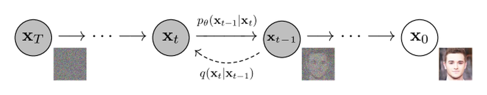

# 扩散方法怎样沿不同问题分化

一个文生图系统同时需要解决几件事，怎样从数据获得可训练的目标，怎样表示高分辨率图像，怎样读取文字，以及怎样在有限时间内生成。DDPM、Latent Diffusion、DiT、DPM-Solver 和 DMD 分别改变其中不同部分。因此把它们排成单线的“后一种替代前一种”，容易误解真实系统。

下面沿同一个系统遇到的障碍展开。方法出现时间可以作为检索线索，理解实现更需要知道它改动了哪个输入、输出或训练目标。

## DDPM 让训练标签可以由数据直接构造

给真实样本加上已知噪声，网络就有可比较的监督目标。线性高斯链使任意时刻都能闭式采样，反向高斯均值又能用噪声预测表达。这样把难以直接拟合的图像密度，转成多个噪声水平上的回归任务。

{ width="760" }

<small>图源：[Denoising Diffusion Probabilistic Models](https://arxiv.org/abs/2006.11239)，Figure 2。原图表达 DDPM 的正向加噪链和反向去噪链；读图重点是把后续 DDIM、Score SDE、DPM-Solver、Consistency 和 DMD 都看成在这条“从数据到噪声再回来”的路径上重新分配训练、采样和蒸馏成本。它不能证明哪条新路线一定更好，只提供共同坐标系。</small>

训练只需随机抽一个时间，生成却要沿反向链多次调用网络，这留下了采样成本问题。[DDPM 训练推导](training.md)把高斯后验和 loss 权重算清，[基础篇](foundations-and-core-intuition.md)解释局部 MSE 为何并不要求最终输出所有图像的平均值。

## DDIM 与连续时间视角打开采样器选择

同一套训练边缘并不只允许一种反向采样组织。DDIM 构造兼容训练目标的过程，并可以在时间子序列上生成。Score SDE 则把加噪与反向生成放进连续时间，probability flow ODE 提供共享边缘分布的确定性运输。

从这里产生数值求解分支。Euler 读取当前方向，Heun 增加预测终点的方向，DPM-Solver 利用已知线性部分解析积分。它们尽量用更少评估近似模型所定义的动态过程，不为模型增加缺失的概念。[采样篇](inference.md)用同一带噪值算出 DDIM 更新，并在解析方程上比较 NFE。

这条线不自动要求重训，但替换必须兼容输出参数化、时间坐标和尺度。换一个 scheduler 名字并不保证两个接口数学等价。

## Latent Diffusion 与 DiT 改变表示和计算结构

采样器减少调用次数以后，每次调用本身仍可能昂贵。Latent Diffusion 把图像压成较小的连续网格，在该表示中训练生成模型，再解码成像素。它减少空间成本，也加入编解码保真问题。

DiT 将 latent 切成 patch 并用 Transformer 交换信息。它可以预测 epsilon、数据或 Flow velocity，主干名称不决定训练目标。U-Net 与 DiT 可以共享外层 pipeline，而文本编码、VAE 与 scheduler 仍需单独说明。[系统篇](architecture-and-stable-diffusion.md)沿一张 512 × 512 图像追踪这些组件。

视频把表示增加到时间轴，带来时间压缩、时空注意力和长期依赖。减少噪声步骤只能降低其中一部分成本；视频块之间的生成顺序是另一件事。

## 少步学生开始改变训练任务

当原网络在粗网格下明显退化，只改求解器未必足够。Progressive Distillation 用教师多步复合构造学生一步标签；Consistency Models 学习同轨迹共同终点；DMD 用 real/fake score 差来约束最终生成分布。

这些目标可以使用相同教师，学生却学习不同函数。逐点模仿要求保留噪声到输出的配对，分布匹配允许映射变化，只要求输出集合满足分布约束。DMD2 进一步处理 fake 模型追踪、真实数据监督和学生中间输入分布。[蒸馏篇](distillation.md)用高斯分布直接核验 score 差梯度。

少步也带来训练成本。教师、额外 score 模型、数据与反向传播都可能变多，部署端省下的工作转移到训练端。方法比较需要把两部分成本分开记录。

## Flow Matching 是另一条局部场学习路线

Flow Matching 从可构造的端点路径得到速度监督。线性路径的条件速度为 \(\epsilon-x_0\)，网络学其条件均值，形成边缘速度场，再用 ODE 生成。它与 score 路线可以建立关系，但输出坐标和训练目标需明确转换。

Rectified Flow 的 reflow 使用旧模型生成的相关端点重新训练，尝试让新的场更适合粗步积分。它没有在时间上继承所有 DMD 或一致性方法，也不是它们的必然后继。Flow 可以独立训练，也可充当蒸馏教师，与 DiT、VAE、CFG组合。完整条件速度到边缘速度的推导见[Flow Matching](flow-matching-and-rectified-flow.md)。

## 表示老师与像素生成是横向分支

REPA 类目标用冻结视觉编码器的干净特征监督生成网络中间表示。它改变训练信号，通常保留原本的概率路径与 sampler。视频中的跨帧对齐还要处理帧与 token 的对应，特征接近本身不保证物理正确。

VAE-free 像素生成则重新选择建模空间。省去有损编解码，意味着主干要处理更多像素变化。可以改架构、加入感知监督，也可以先做 latent 预训练再迁移到像素输出。具体路线见[PixelDiT](../paper-deep-dives/diffusion/pixeldit.md)与[Z-Image-Pixel](../paper-deep-dives/diffusion/z-image-pixel.md)，这些论文的比较需要保留各自预算与数据口径。

一个系统因此可以同时是 DiT 主干、Flow 目标、latent 预训练、最终像素输出、少步蒸馏。每个标签回答一个不同问题。

## 读取新方法时把它放回接口

| 层次 | 要查的具体内容 | 相邻机制 |
| --- | --- | --- |
| 表示 | RGB、VAE latent、patch 或动作，如何归一化 | [架构](architecture-and-stable-diffusion.md) |
| 概率路径 | 时间端点、信号与噪声系数、末端先验 | [参数化](noise-schedules-and-parameterization.md) |
| 监督 | 噪声、数据、速度、终点或分布梯度 | [训练](training.md)、[蒸馏](distillation.md) |
| 条件 | 文本、图像、动作进入哪里，丢弃哪些分支 | [Guidance](guidance-and-conditioning.md) |
| 生成 | 更新公式、NFE、随机项、缓存与端点处理 | [采样](inference.md)、[长视频](long-video-and-cache-1029-1246.md) |

先能画出这些输入输出，再看论文的改动能否解释实验收益。同一个方法名在后续系统里可能只保留部分机制，最终应以实际训练和推理代码为准。

## 原始资料

[DDPM](https://arxiv.org/abs/2006.11239)、[DDIM](https://arxiv.org/abs/2010.02502)、[Score SDE](https://arxiv.org/abs/2011.13456)提供离散与连续基础；[Latent Diffusion](https://arxiv.org/abs/2112.10752)、[DiT](https://arxiv.org/abs/2212.09748)处理表示与主干；[Flow Matching](https://arxiv.org/abs/2210.02747)、[Consistency Models](https://arxiv.org/abs/2303.01469)、[DMD](https://arxiv.org/abs/2311.18828)分别提供速度、终点和分布监督。

## 按瓶颈而不是按年份选择路线

| 当前瓶颈 | 先比较 | 需要保留的条件 |
| --- | --- | --- |
| 每次采样调用太多 | DDIM、solver、蒸馏 | 训练目标、时间网格、NFE、质量和峰值显存 |
| 单次网络太大 | latent、patch、DiT、kernel | VAE 重建、token 数、硬件和 batch |
| 少步后细节崩坏 | progressive distillation、consistency、DMD | teacher 成本、学生训练预算和评测协议 |
| 条件控制不稳定 | CFG、ControlNet、adapter | null 条件、条件 dropout、空间对齐 |
| 视频时间一致性差 | causal VAE、时空 attention、chunk/cache | 帧率、上下文长度、首帧和动作条件 |

这张表故意不提供固定优胜者。一个 sampler 的 NFE 少，可能把成本转移到更大的单步网络；一个 latent 模型的像素成本低，可能引入 VAE 细节损失；一个高 CFG scale 可能提升条件遵循，却降低多样性或放大伪影。

## 阅读论文时保留五个接口

每篇新方法先填写：

```text
representation: pixel / latent / patch / feature
path: forward noise or endpoint construction
prediction: epsilon / x0 / score / velocity / distribution signal
condition: text / image / mask / action and injection point
sampler: update equation, time grid, NFE and stochasticity
```

再把论文的质量结果拆成训练成本、推理成本和样本质量三张表。若论文只报告 FID 或用户偏好，不要把它翻译成统一的“速度更快”；若只报告采样时间，也要检查是否包含 VAE、文本编码器和 warm-up。

## 一个最小路线实验

固定初始噪声、prompt、分辨率、模型权重和硬件，只替换 scheduler，测 NFE、端到端时间、峰值显存和质量。第二组实验固定 scheduler，只改变 guidance scale。第三组固定所有推理设置，比较 teacher 多步与学生少步模型。

这样可以把采样器、条件强度和模型蒸馏分开。如果第一组提升而第二组退化，说明问题可能是 guidance；如果学生只在短 prompt 上好，需按条件长度和主体复杂度分桶，而不是报告平均分。

## 来源与改编说明

- [Hugging Face Diffusion Course](https://huggingface.co/learn/diffusion-course/en/unit1/2)提供适合初学者的扩散对象和 pipeline 入口。
- [Diffusers Scheduler 文档](https://huggingface.co/docs/diffusers/en/using-diffusers/schedulers)用于核对 scheduler 接口和参数化边界。
- 原始论文链接见本页上方；方法结果始终保留其数据集、分辨率、采样步数和评测条件。

## 自测

1. 采样步数减少但端到端时间不变，可能是哪三种原因？
2. 为什么 DiT、Flow Matching 和 VAE-free 分别描述不同层？
3. 设计一个只替换 scheduler 的对照实验，并列出不能改变的变量。
4. 论文宣称质量更好时，如何检查它是否同时增加了 teacher 或评测成本？
