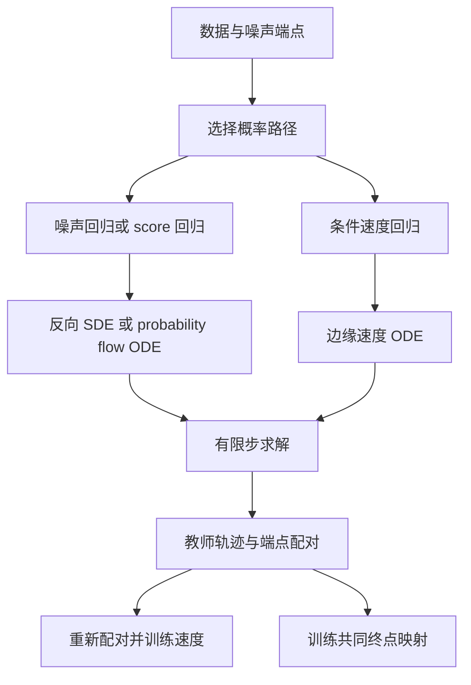

# Flow Matching 怎样从随机配对学到生成速度

抽一个真实样本，再抽一份噪声，把两者按比例混合，就能得到一条已知直线。直线的导数也已知，因此可以训练网络预测速度。困难在于，同一个中间位置可能属于许多不同直线，网络不知道这一次配对的端点。Flow Matching 要解决的是这些条件路径怎样共同决定一个可以生成数据的速度场。

本文沿用本站视频文章的时间约定，\(t=0\) 为数据，\(t=1\) 为噪声，生成从 1 向 0 积分。采用相反端点定义的论文会改变速度符号，不能直接复制公式。先修正时间约定，再比较机制。

## 已知端点怎样产生训练目标

令 \(X\sim p_{\mathrm{data}}\)，\(E\sim\mathcal N(0,I)\)，先采用独立配对

\[
Z_t=(1-t)X+tE,
\qquad U=\frac{\mathrm dZ_t}{\mathrm dt}=E-X.
\]

取教学端点 \(x=2,e=-2\)，在 \(t=.75\) 时 \(z=-1\)，目标速度为 −4，这种已知配对路径的速度称为 conditional velocity。因为生成时间差为负，Euler 更新会向正方向走。例如从 .75 走到 .5，若预测恰好为 −4，下一状态为 \(-1+(-.25)(-4)=0\)。

训练程序可以随时抽 \(X,E,t\)，直接算出输入与目标，无需先数值积分。网络读取 \((Z_t,t,c)\)，其中 \(c\) 是文本等条件，使用平方误差

\[
\mathcal L=\mathbb E\|v_\theta(Z_t,t,c)-(E-X)\|^2.
\]

这解释了训练的可执行性，还没有解释为什么它能生成正确分布。

## 回归输出是许多路径在当前位置的条件均值

固定 \((z,t,c)\)，平方误差最优解为

\[
v^*(z,t,c)=\mathbb E[E-X\mid Z_t=z,t,c].
\]

条件均值来自标准的平方误差分解。把目标 \(U\) 写成其均值 \(m\) 加零均值残差，则

\[
\mathbb E[\|v-U\|^2\mid z,t,c]
=\|v-m\|^2+\mathbb E[\|U-m\|^2\mid z,t,c].
\]

后一项与预测无关。网络学会综合可能端点，便能近似边缘速度场（marginal velocity），毋须识别每次隐藏配对。

为什么这个均值能推动分布？对任意光滑测试函数 \(\varphi\)，沿条件路径求导

\[
\frac{\mathrm d}{\mathrm dt}\mathbb E[\varphi(Z_t)]
=\mathbb E[\nabla\varphi(Z_t)^\top U]
=\mathbb E[\nabla\varphi(Z_t)^\top v^*(Z_t,t)].
\]

最后一步使用条件期望。因此条件路径与边缘速度对所有这些分布观测量给出相同变化；在适当光滑和唯一解条件下，它们对应同一个连续性方程（continuity equation）。训练目标的可计算性由端点提供，生成时需要的速度则来自条件平均。

## 用一个高斯数据分布把场写出来

取 \(X\sim\mathcal N(2,.25)\)，\(E\sim\mathcal N(0,1)\)，二者独立。线性路径具有

\[
\mu_t=2(1-t),
\qquad S_t=.25(1-t)^2+t^2.
\]

\(U=E-X\) 的均值为 −2，与 \(Z_t\) 的协方差为 \(t-.25(1-t)\)。联合高斯的条件均值因此为

\[
v^*(z,t)=-2+
\frac{t-.25(1-t)}{S_t}[z-2(1-t)].
\]

在 \(t=.5\) 时，\(\mu=1\)、\(S=.3125\)，斜率系数为 1.2。所以 \(v^*(z,.5)=-2+1.2(z-1)\)。位置 \(z=1\) 的平均速度是 −2，位置 \(z=2\) 是 −.8。不同位置汇集了不同端点配对，速度随位置变化。

这个场的精确轨迹为

\[
z_t=\mu_t+\sqrt{S_t}\,e,
\]

其中 \(e\) 是噪声端的初值。因为 \(S_1=1\)，初值服从标准高斯；到 \(t=0\) 时得到 \(z_0=2+.5e\)，恰好服从目标数据分布。

这条轨迹通常有曲率，因为 \(\sqrt{S_t}\) 对时间不是线性函数。训练使用的每一条配对直线，其端点来自独立抽样；边缘 ODE 则在每一位置使用所有可能配对的平均速度，两者不必是同一条线。

## 从速度到一条实际采样轨迹

生成只知道初值 \(z_1\)，并不知道最后该到哪张图。选择下降的时间网格，逐步执行

\[
z_{t'}=z_t+(t'-t)v_\theta(z_t,t,c).
\]

给定精确速度场，上面的高斯例子也会因为有限步 Euler 而产生误差。本站[数值示例](../assets/examples/diffusion/video_generation_mechanisms.py)从 −1、0、1 出发，用 2000 步得到约 1.500370、2、2.499630，解析终点为 1.5、2、2.5。它验证的是边缘速度和积分，不包含神经网络训练。

在线性路径的当前状态上，还可将预测速度转换成端点估计

\[
\hat x=z_t-tv_\theta,
\qquad \hat e=z_t+(1-t)v_\theta.
\]

当 \(v_\theta\) 是条件均值时，这些也是相应的端点条件均值。它们一般不是当前样本隐藏的实际端点。把 \(\hat x\) 直接解码只能得到当前预测，完整生成仍需要按训练目标与 sampler 的约定运行。

## Rectified Flow 的 reflow 改了哪一种配对

初次训练常用独立噪声和数据配对。训练好的 ODE 自己定义了一种配对，给定噪声 \(e\)，积分得到 \(\hat x=F_\theta(e)\)。Reflow 保存这对端点，用它们重新构造直线路径并训练速度。

```text
抽噪声 e
用旧 ODE 生成 x_hat
保存配对 (x_hat, e)
在两者连线上抽时间和中间点
训练新速度场预测 e - x_hat
```

新的端点相关，信息已包含旧模型学到的运输关系。它有机会减少条件路径之间的冲突，使新的 ODE 更适合粗步积分。但有限模型、近似教师和训练误差都影响结果，不能把“一次 reflow 后所有路径必为直线”写成保证。

高斯例子能看见理想情况。旧 ODE 配对为 \(x=2+.5e\)，新的插值为 \(z_t=2(1-t)+(.5+.5t)e\)。给定 \(z,t\) 能唯一解出 \(e\)，每条路径速度 \(.5e-2\) 为常量，因此准确场可以一步 Euler 走完。复杂数据中的配对并不一定具有这种简单结构，这个特例只说明为何 coupling 会改变积分难度。

Reflow 的数据端若来自旧模型，保留的是旧模型生成分布；旧模型缺失的模式不会因为重新画直线而自动恢复。真实数据混合、教师质量与最终分布检查仍然重要。

## 与扩散和一致性模型的接口区别



同一条概率路径有时可以建立 score 与速度的转换，但需要指定系数和时间坐标。DDPM \(v\)-prediction 是 \(a\epsilon-bx_0\)，一般不同于本页的 \(\epsilon-x_0\)。一致性模型则学习终点函数，其输出 shape 可以相同，语义不同。[一致性模型](consistency-models-and-rectified-flow.md)会具体对照这两种输出。

视频中的数组虽然更大，目标构造保持相同形式，困难来自时空表示、条件和训练分布。[视频训练与采样](video-training-and-sampling-1029-1246.md)把这里的速度场接回 VAE、DiT、mask 和 CFG。

## 参考资料

- [Flow Matching](https://arxiv.org/abs/2210.02747)讨论条件速度目标、边缘场和生成 ODE。
- [Rectified Flow](https://arxiv.org/abs/2209.03003)讨论运输配对、直线路径与 reflow。
- [本站可运行高斯运输例](../assets/examples/diffusion/video_generation_mechanisms.py)提供有限步误差与多初值验证。
