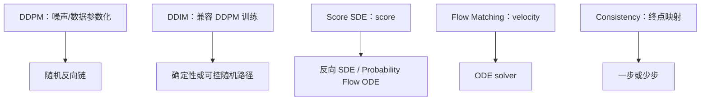

# Flow Matching 与 Rectified Flow：从速度回归到低曲率生成路径

Flow Matching 直接学习概率路径上的速度场，并通过常微分方程把简单分布输送到数据分布。它与 diffusion/score 方法可以共享“数据—噪声路径”的几何图，但监督目标、时间方向和生成方程必须分别写清。

Flow Matching 可以分成四层读：条件概率路径怎样构造可监督的 conditional velocity；网络为何能从条件目标学到 marginal velocity；ODE sampler 怎样沿速度场生成；Rectified Flow 为什么通过 reflow 降低路径曲率，并改善有限步积分。

全文采用 \(t=0\) 为数据、\(t=1\) 为噪声的约定，生成从 \(t=1\) 反向积分到 \(t=0\)。部分论文采用相反时间方向，比较公式前必须先统一约定。

## 本文解决什么问题

这篇文章说明 Flow Matching 和 Rectified Flow 怎样把扩散式生成改写成速度场学习。重点是区分 conditional velocity 与 marginal velocity，理解为什么训练可以用配对样本构造监督，而生成时只沿 ODE 积分；再看 reflow 如何通过降低路径曲率，让有限步采样更容易。

## 前置知识

- [扩散模型基础](foundations-and-core-intuition.md)：概率路径、网络目标与 sampler。
- [DDPM 数学与训练](training.md)：离散高斯加噪与噪声预测。
- [微分、Jacobian 与梯度流](../prerequisite-math/differential-jacobian-and-gradient-flow.md)：向量场与常微分方程。
- [Score Matching 到 SDE](score-matching-sde-and-probability-flow.md)：score、反向 SDE 和 probability flow ODE。

## 核心机制

### 先选条件概率路径

令数据样本 \(x_0\sim p_{\text{data}}\)，噪声 \(\epsilon\sim\mathcal N(0,I)\)。最直观的线性插值是：

\[
x_t=(1-t)x_0+t\epsilon,
\qquad t\in[0,1].
\]

给定一对 \((x_0,\epsilon)\)，这定义了条件路径。它的 conditional velocity 为：

\[
u_t(x_t\mid x_0,\epsilon)
=\frac{d x_t}{dt}
=\epsilon-x_0.
\]

因为训练时知道 \(x_0\)、\(\epsilon\) 和 \(t\)，目标速度可以直接计算。更一般的 Gaussian probability path 可写成：

\[
x_t=\alpha(t)x_0+\sigma(t)\epsilon,
\]

对应：

\[
u_t=\dot\alpha(t)x_0+\dot\sigma(t)\epsilon.
\]

路径不必是直线；选择 \(\alpha(t)\)、\(\sigma(t)\) 和样本 coupling 会改变速度目标、边缘分布以及有限步积分难度。

### 从 conditional velocity 到 marginal velocity

训练网络 \(v_\theta(x_t,t)\) 回归 conditional velocity：

\[
\mathcal L_{\text{FM}}
=\mathbb E_{t,x_0,\epsilon}
\left[
\lVert v_\theta(x_t,t)-u_t(x_t\mid x_0,\epsilon)\rVert_2^2
\right].
\]

网络只看到 \((x_t,t)\)，看不到生成这一个 \(x_t\) 的完整 \((x_0,\epsilon)\) 配对。平方误差的最优预测是条件期望，因此模型学习的是给定当前位置后的平均方向，即 marginal velocity field。它驱动的 continuity equation 使边缘密度沿时间演化。

这个结论解释了为何训练可以使用容易构造的 conditional targets，而生成时只需要 \(v_\theta(x,t)\)。但它不意味着任意有限数据、有限容量网络都会精确恢复目标边缘路径。

### 通过 ODE 执行生成

速度场定义 ODE：

\[
\frac{d x_t}{dt}=v_\theta(x_t,t).
\]

按这里的时间约定，训练路径从数据 \(t=0\) 指向噪声 \(t=1\)；生成从噪声初值 \(x_1\sim\mathcal N(0,I)\) 反向积分到 \(t=0\)。Euler 更新可以写成：

\[
x_{t-\Delta t}
=x_t-\Delta t\,v_\theta(x_t,t).
\]

Heun 或更高阶 solver 会在同一步使用额外函数评估，减少局部截断误差。实际速度不只取决于 solver 阶数，还取决于路径曲率、时间网格、条件 guidance 和模型误差。

### Diffusion 与 Flow 的共同坐标和不同接口

DDPM 的闭式加噪也可写成 \(x_t=\alpha_t x_0+\sigma_t\epsilon\)，因此噪声、数据、score 和某些 velocity 参数化可以代数转换。但要区分：

- **DDPM ε-prediction**回归构造 \(x_t\) 的标准高斯噪声。
- **DDPM \(v\)-prediction**是在 \(x_0\) 与 \(\epsilon\) 之间选择的输出坐标，常见形式由具体 \(\alpha/\sigma\) 约定决定。
- **Flow velocity**是概率路径对时间的导数，直接进入 ODE。
- **画面运动速度**描述视频中物体或相机随物理时间移动，与生成时间 \(t\) 上的 latent velocity 不是同一对象。

在特定路径下，这些输出可相互转换；不能据此忽略 loss weighting、preconditioning、时间方向和 sampler 接口。

### Rectified Flow 关注路径曲率

即使端点分布正确，生成轨迹也可能弯曲。粗时间网格在弯曲向量场上积分，会产生较大离散误差。Rectified Flow 的直觉是学习更接近直线的传输，使少量 Euler/Heun 步也能跟随。

典型 reflow 过程先用已有模型生成端点配对，再用这些配对重新训练速度场。新 coupling 更接近模型实际运输关系，理想情况下减少轨迹交叉与曲率。需要注意：

- 路径更直不等于模型一步预测完全准确；
- reflow 需要额外生成和训练成本；
- 条件生成中的文本对齐、身份和细节可能在大步积分时丢失；
- 不同文献中的 Rectified Flow、rectified diffusion 和 flow-based distillation 不应只按名字合并。

### 与 Score SDE / Probability Flow ODE 的关系

Score-based 方法学习 \(\nabla_x\log p_t(x)\)。给定 forward SDE 的 drift、diffusion coefficient 和准确 score，可以构造反向 SDE 或 probability flow ODE。Flow Matching 则可以直接从指定概率路径构造速度回归目标，不一定先显式估计 score。

两者都能得到确定性 ODE 生成器，但速度场的来源不同。某些 Gaussian path 下存在解析转换；这种统一视角依赖具体路径和系数，不应简化成“所有 diffusion 本质上都是完全相同的 Flow Matching”。

### 与 Consistency Models 的关系

Flow 模型学习路径上的局部速度：给定当前位置，告诉 solver 如何继续走。Consistency model 学习同一生成轨迹上不同时间点应映射到一致终点。前者通常需要积分，后者旨在支持一步或少步终点映射。

| 路线 | 学习对象 | 生成执行 | 主要额外成本 |
| --- | --- | --- | --- |
| Flow Matching | 路径局部速度 | ODE solver 多步积分 | 路径设计与数值求解 |
| Rectified Flow | 更低曲率的速度场 | 少步 ODE 积分 | reflow 数据与再训练 |
| Consistency / LCM | 不同时间点的一致终点映射 | 一步或少步函数调用 | consistency training / distillation |

Consistency 的目标与 LCM 接口见[Consistency Models 与 Flow 边界](consistency-models-and-rectified-flow.md)。

### 方法坐标图

图把“学习对象”和“生成动力学”配对，而不是按时间线宣称后者替代前者。实际系统还会叠加条件、VAE、DiT、guidance 和蒸馏。

## 常见误解与失效边界

**认为线性插值意味着生成轨迹一定是直线。**单个条件配对是直线，不同配对在同一位置的条件期望可能形成弯曲 marginal field；有限模型也会引入误差。

**忽略时间方向。**有的实现定义 \(t=0\) 为噪声，有的定义为数据。速度符号和积分方向随约定变化，直接复制公式可能把生成方向反过来。

**把 Flow velocity 与 DDPM \(v\)-prediction 混用。**二者可能转换，但训练目标定义不同；scheduler 配置必须匹配模型输出。

**把更高阶 solver 当成无条件收益。**每步额外网络前向可能抵消步数下降；强 CFG 和高曲率区域也会使高阶外推不稳。

**只看训练 velocity MSE。**还应检查有限 NFE 下的质量、条件保持、多样性、路径曲率、端到端延迟和不同时间区间的误差。

## 检查理解

1. conditional velocity 为什么可监督，marginal velocity 为什么不需要显式标签？
2. 按这里的时间约定，训练路径和生成积分分别朝哪个方向？
3. 为什么单个样本对使用直线插值，不保证学到的边缘速度场处处为直线？
4. Flow velocity、DDPM \(v\)-prediction 和视频物体运动速度分别描述什么？
5. Rectified Flow 减少曲率后，为什么仍不能保证一步生成无损？

## 相关阅读与下一步

- [Flow Matching for Generative Modeling](https://arxiv.org/abs/2210.02747)、[Flow Matching Guide and Code](https://arxiv.org/abs/2412.06264)、[Flow Straight and Fast](https://arxiv.org/abs/2209.03003)。
