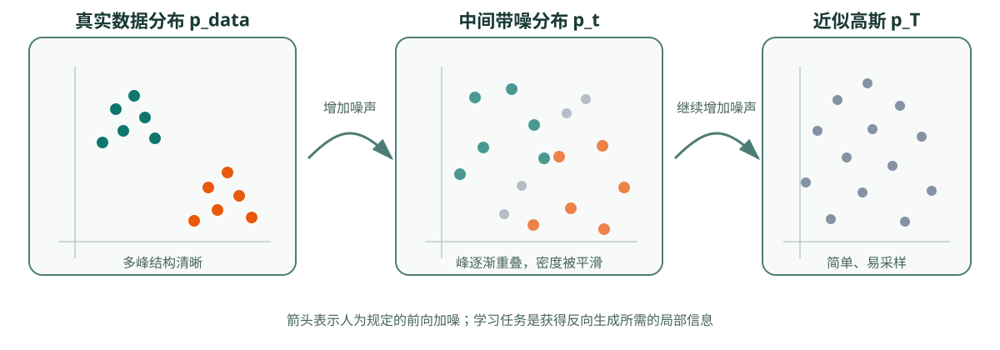

# 扩散模型怎样从去噪学会生成

假设训练集只有两种合法数据，数值 −1 和 +1，各出现一半。我们希望生成器也各有一半概率输出它们。输出 0 虽然离两种数据都不远，却从未在数据里出现。这个极小的例子已经包含图像生成的一个难点。同一句“画一只狗”允许许多外观，把所有合理图像逐像素平均，会得到模糊的结果。

扩散训练确实常用平方误差。为什么这种容易取平均的损失，最后能生成清楚且多样的样本？需要沿着一个带噪观测把问题算清。以下数值全部是教学构造，数据分布的符号使用 \(X\)，一次采到的值使用 \(x\)。

## 本页的学习路线

先只回答一个问题：模型如何从带噪状态得到“下一步该往哪里走”的统计信息。为此，本文固定一个只有 \(-1\) 和 \(+1\) 的数据分布，依次经过四个台阶：

1. 观察平方误差为什么得到条件均值，以及它为什么不能直接当作最终样本。
2. 让噪声水平变化，理解逐步反向转移怎样保留多种可能。
3. 对照一次训练更新和多步生成，区分训练时的已知标签与采样时的模型反馈。
4. 最后才比较噪声预测、数据预测、score、速度和不同 sampler 的接口。

读者可以把“条件均值”和“反向采样”当作本页的两个检查点。若只能复述去噪网络，却不能解释为什么 0.4173 不是合法数据点，就先不要跳到 U-Net、CFG 或视频扩散。

## 从两种合法数据构造一个监督任务

先自己规定加噪方式

\[
Y=aX+bE,\qquad E\sim\mathcal N(0,1),
\qquad a^2+b^2=1.
\]

取 \(a=0.8,b=0.6\)。若原样本为 +1、这次噪声为 −1，观测就是 \(y=0.2\)。训练程序知道这三项，因此可以把 \((0.2,t)\) 作为输入，让网络预测原样本 +1，或预测噪声 −1。时间 \(t\) 用来指明当前采用哪组 \(a,b\)。

然而，同一个观测 0.2 也能由原样本 −1 和噪声 \(5/3\) 产生。网络只拿到观测和时间，没有拿到原样本。这个训练任务从根本上带有不确定性，无法保证每个样本的平方误差都为零。

两种原样本在当前观测下的概率，由贝叶斯公式决定。两种先验概率相同，比较两个高斯似然即可

\[
\frac{p(X=+1\mid Y=y)}{p(X=-1\mid Y=y)}
=\exp\left(\frac{2ay}{b^2}\right).
\]

代入 0.2，指数为 \(0.8889\)，所以 +1 的后验概率约为 0.7087，−1 的概率约为 0.2913。网络无法唯一恢复原值，但可以学习这种由数据规律决定的偏好。

## 平方误差学到的是条件均值

对固定观测 \(y\)，用 \(f(y)\) 预测原样本。令 \(m=\mathbb E[X\mid Y=y]\)，平方误差可以分解为

\[
\mathbb E[(f(y)-X)^2\mid y]
=(f(y)-m)^2+\operatorname{Var}(X\mid y).
\]

第二项不随预测值改变，所以最优预测是 \(f^*(y)=m\)。在前面的例子里

\[
\hat x_0=0.7087\times1+0.2913\times(-1)\approx0.4173.
\]

这个值仍然不是一个合法数据点。若直接把它作为最终生成结果，就把“估计当前观测背后的平均原值”和“从数据分布采一个样本”混在了一起。

噪声回归也有相同性质。因为 \(E=(Y-aX)/b\)，最优噪声预测为

\[
\hat e(y)=\mathbb E[E\mid Y=y]
=\frac{y-a\mathbb E[X\mid Y=y]}{b}
\approx-0.2231.
\]

它与这次真正抽到的 −1 不相同。训练遍历许多样本后，网络学的是给定带噪输入的统计规律。某次噪声标签是一个可获得的监督样本，不代表网络能够识别每次隐藏的随机抽样。

## 为什么要构造许多噪声水平

当 \(a\) 很小、\(b\) 很大时，两种数据加噪后的分布大量重叠，观测几乎无法区分 ±1，后验均值接近 0。当噪声减小时，两个峰逐渐分开，当前状态能提供越来越多关于某一分支的信息。

{ width="900" }

图中每一栏是许多样本共同形成的分布。它没有规定一份初始噪声必须对应某个训练样本。扩散模型利用这些中间分布，把一次跨度很大的生成问题分解为一系列噪声水平相邻的转移。

在离散 DDPM 中，加噪链由人规定，真实反向条件分布 \(q(x_{t-1}\mid x_t)\) 则需要从数据学习。它对所有可能的原样本进行了边缘化。网络提供反向转移所需的统计信息，采样器决定下一状态并保留适当的随机性。重复这个过程后，最终样本可以走向不同的数据模式。

对于本例的离散数据，最终精确分布集中在 ±1。实际连续 DDPM 使用有限步数、近似网络和输出分布，不能据这个极小例子断言它能精确生成点质量。例子要说明的是，逐步学习分布转移与一次输出后验均值具有不同目标。[DDPM 数学与训练](training.md)会推导怎样由噪声回归构造反向均值。

## 一次训练更新为什么不用走完整条链

高斯前向链有一个方便的性质。知道累计信号系数，就可以直接构造任意噪声时刻

\[
x_t=\sqrt{\bar\alpha_t}x_0+\sqrt{1-\bar\alpha_t}\epsilon.
\]

训练时先抽真实样本、时间和噪声，一次乘加便得到网络输入。把许多 batch 的损失平均，相当于在整条噪声路径上学习。这里 \(\bar\alpha_t\) 是累计系数，不能用单步的 \(1-\beta_t\) 替换。

```python
# 机制伪代码，t 给每个样本选一个噪声水平
noise = randn_like(clean)
noisy = signal_scale(t) * clean + noise_scale(t) * noise
prediction = model(noisy, t, condition)
loss = mean((prediction - noise) ** 2)
```

生成时没有真实样本和训练标签。程序从易采样的噪声分布抽一个状态，调用网络、更新状态、再在新状态上调用网络。上一次预测的错误会改变下一次输入，因此单步回归准确与整条轨迹稳定需要分别验证。

确定性 ODE 也能生成多样结果。随机性可以全部来自最初抽到的噪声，确定的映射把不同初值送往不同结果。是否每一步额外加噪，取决于所用的采样过程，并非多样性的唯一来源。

## 模型输出和采样规则必须约定同一种量

噪声、干净样本、score 和速度都可以具有与输入相同的张量形状，但数值含义不同。噪声预测要经过系数变换才能得到反向均值；Flow Matching 的速度需要乘上时间差；一致性模型则直接近似某个低噪声端点。把它们原样交给同一个更新公式，会得到形状正确、数学意义错误的程序。

| 改动 | 直接改变的对象 | 还需保持的约定 |
| --- | --- | --- |
| U-Net 换成 DiT | 输入到预测的函数逼近结构 | 输出目标、条件与时间编码 |
| 噪声预测换成数据预测 | 回归目标与误差尺度 | 路径系数、损失权重和 sampler 转换 |
| DDPM 换成兼容的 DDIM | 反向更新与时间子序列 | 训练日程和预测参数化 |
| 训练少步学生 | 跨较大时间间隔的预测能力 | 学生专用时间网格与采样接口 |
| 像素换成 VAE latent | 模型所拟合的表示分布 | 编解码权重和 latent 归一化 |

文本条件进一步把目标变成 \(p(x\mid c)\)。例如文字明确要求 +1，当前不确定性就会缩小；文字只说明“输出一个合法值”，两种结果仍然都成立。条件进入网络的方法见[条件控制](guidance-and-conditioning.md)，从噪声预测到一次真实更新的计算见[采样与推理](inference.md)。

## 参考与可运行材料

- [DDPM 原论文](https://arxiv.org/abs/2006.11239)给出离散高斯链、变分训练与简化噪声目标。
- [Hugging Face 从头实现扩散的教学 notebook](https://github.com/huggingface/diffusion-models-class/blob/72bf3dd739da641075dcff0ee54ce28e7a38a8ab/unit1/02_diffusion_models_from_scratch.ipynb)从一次重建的模糊现象逐步引出迭代生成。其最初的均匀噪声混合是教学模型，不能直接当成 DDPM 公式。
- [本站最小 DDPM 实现](minimal-ddpm-implementation.md)说明一个 batch 的系数、网络输出和采样边界如何对应。

## 来源与改编说明

- **主线参考**：[Annotated Diffusion](https://huggingface.co/blog/annotated-diffusion)，Hugging Face；本文借鉴其“数学—网络—训练—采样”的顺序，但使用本站的 ±1 监督例子，没有搬运原文段落或图。
- **理论交叉参考**：[What are Diffusion Models?](https://lilianweng.github.io/posts/2021-07-11-diffusion-models/)，Lilian Weng；作者 FAQ 要求翻译前事先邮件联系，因此这里只作为阅读和核对来源。
- **边界**：本页只说明条件均值、逐步反向转移和输出参数化；score/SDE、flow matching、蒸馏和视频模型分别在后续页建立，不把受限条件下的等价关系扩大为普遍结论。

**自测**：已知模型输出的是噪声预测 \\(\\hat\\epsilon\\)，请写出把它转换为 \\(\\hat x_0\\) 所需的信号系数和噪声系数；若没有给出时间步的日程，不能直接套用某个 sampler 的更新式。
