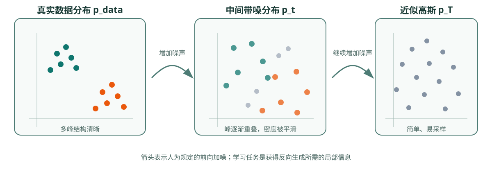

# 扩散模型基础：概率路径、局部预测与反向生成

扩散模型的关键不在“去掉图片上的噪点”，而在于把难以直接采样的数据分布，连接到一个容易采样的简单分布。模型学习这条路径上的局部信息，采样器再把局部信息积分成完整生成轨迹。

扩散方法共用一组坐标：数据分布与单个样本的区别；前向过程为何由人规定；训练为何能构造监督信号；生成为何必须从噪声分布出发；DDPM、score-based model 和 Flow Matching 的共同结构在哪里。

这里主要使用高斯噪声和连续数据作为例子。离散扩散、冷扩散和更一般的 stochastic interpolant 可以沿用“路径—局部目标—采样动力学”的框架，但具体转移核和训练目标不同。

## 前置知识

需要区分随机变量、概率分布、条件概率和期望。相关定义见[概率论、分布与期望](../prerequisite-math/probability-distributions-and-expectation.md)与[潜变量、似然与生成目标](../prerequisite-math/latent-likelihood-and-generative-objectives.md)。神经网络部分只假定已知监督学习中的输入、目标、loss 和参数更新。

## 核心机制

### 生成模型学习的是分布，不是一张目标图片

给定训练样本 \(x^{(1)},\ldots,x^{(N)}\sim p_{\text{data}}\)，生成建模希望得到一个模型分布 \(p_\theta\)，使它能产生与数据分布相似的新样本。模型没有一张固定“正确输出”；同一个条件可以对应多个合理结果。

因此扩散模型的生成不是传统图像去噪任务。图像去噪通常有一张被污染图像，希望恢复与它配对的干净图；无条件生成只有一份随机噪声，需要让最终样本整体服从学到的数据分布。条件生成再把目标改成 \(p_\theta(x\mid c)\)，其中 \(c\) 可以是文本、类别、深度图、动作或历史状态。

### 先定义一条从数据到简单分布的路径

直接描述高维图像密度很难，但从数据分布逐渐加入噪声，可以构造一族中间分布：


{ width="900" }

图中每一栏表示一个边缘分布 \(p_t\)，不是同一个点具有唯一可逆的配对轨迹。随着噪声增强，数据中的多峰结构被平滑，最终接近容易采样的高斯分布。前向路径的价值是让不同噪声水平都成为可以人为构造的训练任务。

一种统一写法是：

\[
x_t=\alpha(t)x_0+\sigma(t)\epsilon,
\qquad \epsilon\sim\mathcal N(0,I).
\]

\(\alpha(t)\) 控制保留多少数据信号，\(\sigma(t)\) 控制加入多少噪声。DDPM 常使用离散时间和 \(\sqrt{\bar\alpha_t}\)、\(\sqrt{1-\bar\alpha_t}\)；EDM 常直接使用噪声尺度 \(\sigma\)；Flow Matching 可以使用线性或更一般的条件概率路径。

### 前向过程是已知的，反向信息需要学习

前向过程由我们选择，所以训练时知道：

- 干净样本 \(x_0\)；
- 时间或噪声水平 \(t\)；
- 实际采样的噪声 \(\epsilon\)；
- 按规定公式构造的 \(x_t\)。

这使扩散训练能够转成监督回归。例如 DDPM 让网络预测实际加入的噪声：

\[
\epsilon_\theta(x_t,t)\approx\epsilon.
\]

也可以预测 \(x_0\)、score \(\nabla_{x_t}\log p_t(x_t)\) 或速度场。它们不是随意命名的输出头，而是对路径局部信息的不同参数化。选择会改变不同信噪比区间的优化权重、数值尺度和采样接口。

### 一次训练样本不等于一次完整扩散链

若路径存在闭式边缘采样公式，训练可以随机抽一个 \(t\)，一步得到 \(x_t\)，然后计算 loss：

```text
x_0 ~ dataset
t ~ time distribution
epsilon ~ Normal(0, I)
x_t = alpha(t) * x_0 + sigma(t) * epsilon
target = noise / data / score / velocity
prediction = model(x_t, t, condition)
loss = regression(prediction, target)
```

这与生成阶段完全不同。生成必须维护一个当前状态，并沿时间网格重复更新：

```text
x_T ~ simple noise distribution
for t from noisy end to data end:
    direction = model(x_t, t, condition)
    x_next = sampler_step(x_t, direction, t)
return x_0
```

训练能随机抽单个时间，是因为监督目标来自已知前向构造；生成必须走轨迹，是因为真实 \(x_0\) 和真实噪声都未知。

### 模型学习局部信息，采样器负责执行轨迹

网络通常只回答“当前状态处应该预测什么”，并不单独决定下一状态。sampler 把网络输出、噪声日程、时间步长和随机项组合成更新。由此可以区分：

- 换 U-Net 为 DiT：主要改变函数逼近器。
- 换 ε-prediction 为 \(v\)-prediction：改变输出参数化。
- 换 DDPM sampler 为 DDIM 或 DPM-Solver：改变有限步执行方式。
- 做 LCM 或 DMD 蒸馏：重新训练一个适合大步映射的模型。
- 使用 Flow Matching：重新定义路径上的监督速度与 ODE 生成接口。

同一权重能否直接换 sampler，取决于 sampler 是否理解该权重的训练参数化和噪声约定。方法名字相似不代表接口兼容。

### 与 VAE、GAN 和自回归模型的边界

| 方法 | 训练接口 | 生成接口 | 典型代价 |
| --- | --- | --- | --- |
| VAE | 编码、重参数化、重建与 KL 正则 | 从低维 latent 一次解码 | 强压缩可能损失细节 |
| GAN | 生成器与判别器对抗 | 一次生成器前向 | 对抗训练和分布覆盖可能不稳 |
| 自回归模型 | 预测下一个 token / patch / code | 按顺序逐项采样 | 串行长度随输出 token 数增长 |
| 扩散/score 模型 | 不同噪声水平上的局部回归 | 多步反向积分或随机采样 | 多次网络前向带来延迟 |
| Flow Matching | 概率路径上的速度回归 | ODE 数值积分 | 路径曲率和步长决定少步误差 |

这些类别可以组合。Latent Diffusion 先使用 autoencoder 压缩，再在 latent 中扩散；离散扩散可以建模 token；自回归模型也可以预测扩散块或生成模型的条件。

## 常见误解与失效边界

**误解一：扩散模型是在记住每张图怎样去噪。**训练信号来自样本分布与随机噪声的组合，目标是学习跨样本的局部统计结构。但这不意味着训练数据记忆自动消失；隐私、近邻复现和版权风险仍需专门评测。

**误解二：高斯噪声里隐藏着要生成的图片。**初始噪声只提供随机性。结构来自模型学到的数据先验和条件，采样轨迹把这种先验逐步写入当前状态。

**误解三：训练时逐步加噪，生成时逐步原样倒放。**训练常直接闭式采样任意 \(x_t\)；反向条件分布未知，需要模型近似，不是前向随机操作的录像倒放。

**误解四：网络预测准确就一定能少步生成。**单点回归误差和闭环积分误差不是同一个指标。步数减少后，每一步跨越更大分布距离，模型误差和数值误差都会被放大。

**误解五：Flow Matching、DDIM 和 Consistency 只是不同 sampler。**DDIM 主要改兼容 DDPM 的采样路径；Flow Matching改变训练速度目标和 ODE 接口；Consistency 学的是同一轨迹上不同点的一致终点映射。它们改变的层不同。

## 检查理解

1. 为什么训练能随机抽一个时间步，而生成不能只随机抽一个时间步就结束？
2. 前向路径、网络输出和 sampler 各自决定什么？
3. 如果把 U-Net 换成 DiT，扩散的前向过程是否必然改变？
4. 为什么“从噪声开始”不等于噪声中预先藏着目标图像？
5. Flow Matching 和 DDPM 都可以写成数据与噪声之间的路径，它们的监督目标为何仍不相同？

## 外部材料

- [DDPM](https://arxiv.org/abs/2006.11239)、[Lil'Log: What are Diffusion Models?](https://lilianweng.github.io/posts/2021-07-11-diffusion-models/)、[Step-by-Step Diffusion](https://arxiv.org/abs/2406.08929)。
