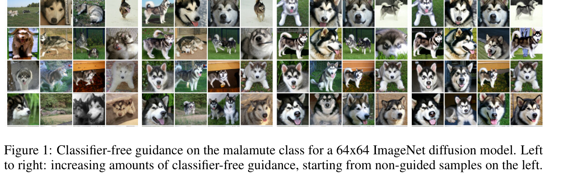

# 条件怎样进入生成过程，CFG 又改变了什么

固定同一份初始噪声，分别要求“红球向左移动”和“红球向右移动”。模型能否产生不同且方向正确的视频，取决于条件有没有被读进预测函数，以及训练数据是否建立了文字与运动之间的关系。CFG 进一步组合不同条件下的预测，但它本身不提供新的动作知识。

先把生成状态写成 \(x_t\)，条件写成 \(c\)。目标为 \(p_t(x_t\mid c)\)。文本、参考图、深度和动作序列都能成为条件，它们在信息内容、空间对齐和时间含义上不同，接口必须与这些结构对应。

## Bayes 公式怎样给出条件方向

由 \(p_t(x\mid c)\propto p_t(x)p_t(c\mid x)\)，对 \(x\) 求导可得

\[
\nabla_x\log p_t(x\mid c)
=\nabla_x\log p_t(x)+\nabla_x\log p_t(c\mid x).
\]

第一项描述当前噪声分布，第二项描述怎样改变样本可以提高条件的相容性。Classifier guidance 使用一个能读取带噪输入和噪声时间的分类器估计第二项。分类器只在干净图片上训练时，不能默认其梯度对高噪声输入仍然可靠。

给第二项乘权重 \(s\)，在固定时间上形式对应

\[
s_{\mathrm{guided}}=s_{\mathrm{base}}+
 s\nabla_x\log p_t(c\mid x).
\]

这说明引导是一种分布偏好变化，权重增大并不等于输出质量无条件提高。固定时间的 score 组合还不能单独保证整条时间路径都精确对应某个简单幂次重加权的终点分布，有限模型和求解器会再引入误差。

## CFG 怎样让一个网络提供两种预测

直接训练条件模型 \(f_\theta(x_t,t,c)\)，文本可以通过 cross-attention 进入。图像位置产生 query，文本 token 产生 key 和 value，因此每一层、每一次噪声更新都能读取文字。参考图或深度也可以通过拼接、适配器或额外注意力进入，具体结构由模型定义。

训练 CFG 时，按一定概率把条件替换成训练约定的空条件。这样同一组参数学习有条件和基准两种输入。空字符串的编码、特殊 null token、零向量并非总是可互换，应按实际训练接口读取。

生成时分别求出 \(\epsilon_c\) 与 \(\epsilon_{\varnothing}\)，组合为

\[
\epsilon_{\mathrm{cfg}}=
\epsilon_{\varnothing}+s(\epsilon_c-\epsilon_{\varnothing}).
\]

在相同路径系数下，score 与 epsilon 成线性关系，因此这种组合也对应两个 score 的线性外推。\(s=0\) 精确返回基准分支，\(s=1\) 精确返回条件分支，\(s>1\) 超过两者之间的插值范围。

取二维教学预测 \(\epsilon_{\varnothing}=[1,-1]\)、\(\epsilon_c=[3,2]\)，当 \(s=2\) 时结果为 \([5,5]\)。它不是一句更强的文字，而是交给 sampler 的两个数发生了变化。若当前系数为 \(a=.8,b=.6\)，相对条件分支，干净样本估计变化为

\[
\Delta\hat x_0=-\frac b a
(\epsilon_{\mathrm{cfg}}-\epsilon_c)
=-.75[2,3]=[-1.5,-2.25].
\]

这个变化还会进入后续状态和下一次网络输入。条件分支本来就错时，放大差异也可能放大错误；高噪声处的系数和大步长还会改变误差影响。

{ width="920" }

<small>图源：[Classifier-Free Diffusion Guidance](https://arxiv.org/abs/2207.12598)，Figure 1。原图展示 ImageNet 类别条件下 guidance weight 增大时，样本更贴近目标类别。读图重点：guidance 的确会强化条件方向，但这张图不能推出“scale 越大越好”；它同时提醒我们，多样性、自然度和稳定性也在被采样轨迹重新分配。</small>

## 负面提示词为什么不是禁止词过滤器

把空条件换成负面文本 \(c_-\)，组合变成

\[
\epsilon_{\mathrm{guided}}=
\epsilon_{c_-}+s(\epsilon_{c_+}-\epsilon_{c_-}).
\]

此时基准也有条件。在固定噪声时间、精确 score 和可归一化的形式下，它可理解为偏向 \(p_t(x\mid c_+)^s/p_t(x\mid c_-)^{s-1}\) 的局部 score。它没有一个逐对象的硬禁止判断，负面描述和正面描述共享特征时，可能一起压掉需要的内容。

图生视频里也可能两分支都保留参考图，只改变文本。这样的 CFG 放大的是“同一图像条件下两种文本预测”的差异，不能解释成移除了所有条件。应分别列清文本、图像、姿态和动作哪些被丢弃，哪些一直存在。

## ControlNet 的零初始化为什么仍然能学习

文字没有精确指定每个像素的位置。边缘、深度或姿态提供空间对齐的条件，ControlNet 类结构把条件变成额外特征，加入冻结或部分冻结的主干。用简化的残差支路表示

\[
h'=h+W_z g_\phi(x_t,c_{\mathrm{spatial}}),
\]

其中 \(W_z\) 是零初始化的输出卷积。初始化时 \(W_z=0\)，新增支路不会立即扰乱原模型。设上游梯度为 \(\delta=\partial L/\partial h'\)，则

\[
\frac{\partial L}{\partial W_z}=\delta g_\phi^\top,
\qquad
\frac{\partial L}{\partial\phi}
=\left(\frac{\partial g_\phi}{\partial\phi}\right)^\top W_z^\top\delta.
\]

第一步 \(W_z\) 的梯度通常非零，因此它能离开零；同一步内部支路的梯度在这个简化连接处被零矩阵阻断。后续 \(W_z\ne0\)，梯度就能传入 \(g_\phi\)。这解释了“初始输出为零”与“可以逐步学会控制”如何同时成立。真实 ControlNet 有多个注入层和更完整的结构，需逐层检查连接。

空间条件的坐标必须与图像预处理一致。原图裁剪了左边 20 像素，深度图却没有同样裁剪，网络会接到错位监督。提高 CFG 无法修复这种几何错误。mask 还需说明 1 表示已知区域还是待生成区域，这种相反约定也可能产生形状正确的失败。

## 硬约束需要放进更新过程

若局部编辑要求保留已知像素，只把原图作为条件并不保证逐像素相等。一种机制是在采样的适当状态上，用同噪声水平的已知区域替换相应位置，再让未知区域继续更新。具体替换发生在像素还是 latent、已知区域怎么加噪、边界怎样融合，都要与模型匹配。

同样，动作条件世界模型要对不同动作给出正确不同未来。固定初始观察和噪声，交换左右动作，可以检查模型是否使用动作；但有变化只证明敏感性，还要与环境真值对照才能判断方向和幅度正确。

## 用受控比较判断条件在哪一步失效

先固定样本与噪声，比较正确条件、空条件和打乱条件。在已知带噪目标上，正确条件若完全不能改善预测，需要检查编码、mask、数据配对与网络是否忽略条件。接着运行完整采样，在相同种子下只改变一个条件，观察所要求的属性是否变化，同时保留其他属性。

最后才比较 guidance 强度。图像看条件遵循、细节和多样性；视频还要看运动幅度与跨帧变化。静止视频可能主体很一致，却没有完成“向右移动”。同一设置在多个提示词和种子上有效，才比一条精选结果提供更强证据。

- [Classifier guidance](https://arxiv.org/abs/2105.05233)讨论噪声分类器的引导。
- [Classifier-Free Diffusion Guidance](https://arxiv.org/abs/2207.12598)给出条件丢弃与预测组合。
- [ControlNet](https://arxiv.org/abs/2302.05543)讨论零卷积和空间条件支路。
- [视频 DiT 的条件接口](video-dit-1029-1246.md)具体展开文本、参考图与 mask 的通道和注意力关系。
