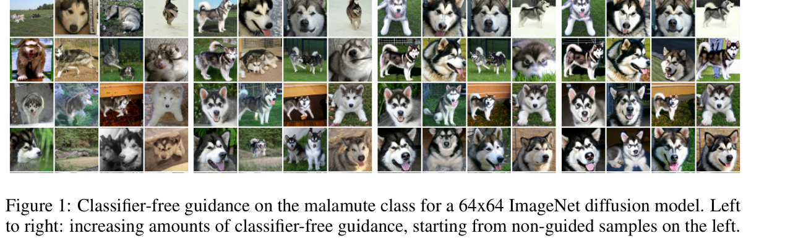

# 条件控制与 Guidance

到目前为止，我们讲的都是“无条件生成”：模型从噪声里生成一张合理图片。但真实应用里，用户通常会给条件，例如：

- 文本 prompt：“雨夜里的霓虹便利店”；
- 类别标签：“malamute / 阿拉斯加犬”；
- 边缘图、深度图、姿态图；
- 参考图、mask、首帧或视频历史。

这页要分清两个概念：

1. **Conditioning**：模型如何接收条件 \(c\)。
2. **Guidance**：采样时如何把生成方向更用力地拉向条件。

## 先看图：guidance 会改变样本外观

{ width="920" }

<small>图源：[Classifier-Free Diffusion Guidance](https://arxiv.org/abs/2207.12598)，Figure 1。</small>

<small>原论文图意：在 64×64 ImageNet diffusion model 上生成 malamute 类别样本；从左到右 classifier-free guidance 增强，样本越来越贴近目标类别。</small>

<small>本教程读法：guidance 会把采样方向推得更符合条件，因此类别特征更明显。但“更强”不总等于“更好”：过强 guidance 往往会牺牲多样性、自然度和数值稳定性。</small>

## 1. 条件生成的基本形式

无条件噪声预测写成：

\[
\epsilon_\theta(x_t,t)
\]

这行式子在说：模型只看当前带噪图 \(x_t\) 和时间步 \(t\)，预测噪声。

条件噪声预测写成：

\[
\epsilon_\theta(x_t,t,c)
\]

这行式子在说：模型除了看 \(x_t\) 和 \(t\)，还看条件 \(c\)，然后预测“在这个条件下应该去掉什么噪声”。

符号含义：

| 符号 | 含义 |
| --- | --- |
| \(x_t\) | 当前带噪样本 |
| \(t\) | 当前噪声时间步 |
| \(c\) | 条件，可以是文本、类别、结构图、参考图等 |
| \(\epsilon_\theta(x_t,t,c)\) | 条件模型预测的噪声 |

直觉上，条件不是最后才贴上去的标签，而是每一步去噪时都在影响方向。

## 2. Conditioning 解决“想生成什么”

Conditioning 是把条件信息送进模型。不同条件有不同信息形状：

| 条件类型 | 例子 | 主要约束 |
| --- | --- | --- |
| 文本条件 | prompt、caption | 语义、风格、关系、材质 |
| 类别条件 | ImageNet label | 对象类别 |
| 结构条件 | 边缘、深度、姿态、分割 | 轮廓、空间、布局 |
| 图像条件 | 参考图、mask、首帧 | 身份、外观、局部编辑范围 |
| 时间条件 | 视频历史、动作轨迹 | 时间一致性和运动方向 |

文本条件常通过 cross-attention 注入；结构条件常通过拼接、专门控制分支或 ControlNet 风格结构注入；图像条件常和 mask、噪声强度、保真权重一起使用。

初学时只要记住：**conditioning 决定模型每一步去噪时能看到哪些额外信息。**

## 3. Classifier Guidance：用外部分类器拉方向

早期条件引导可以借助一个额外分类器 \(p_\phi(c\mid x_t)\)。采样时加入分类器梯度：

\[
\nabla_{x_t}\log p_\phi(c\mid x_t)
\]

这行式子在说：分类器告诉我们，怎样微调当前带噪图 \(x_t\)，会让它更像条件 \(c\)。

符号含义：

| 符号 | 含义 |
| --- | --- |
| \(p_\phi(c\mid x_t)\) | 分类器认为当前图属于条件 \(c\) 的概率 |
| \(\phi\) | 分类器参数 |
| \(\nabla_{x_t}\) | 对当前样本求梯度 |
| \(\log p_\phi(c\mid x_t)\) | 条件类别的对数概率 |

这个方法解释性强，但需要额外训练分类器，而且分类器必须能处理不同噪声水平下的 \(x_t\)。对文本、布局、姿态等复杂条件就不方便。

## 4. Classifier-Free Guidance：不用外部分类器

现在更常用的是 Classifier-Free Guidance，简称 CFG。训练时，模型有时看到条件 \(c\)，有时把条件丢掉，用空条件 \(\varnothing\)。这样同一个模型会学到两种方向：

- 条件方向：\(\epsilon_\theta(x_t,t,c)\)
- 无条件方向：\(\epsilon_\theta(x_t,t,\varnothing)\)

采样时把它们组合：

\[
\hat{\epsilon}_{\text{cfg}}
=
\epsilon_\theta(x_t,t,\varnothing)
+
s\left(
\epsilon_\theta(x_t,t,c)
-
\epsilon_\theta(x_t,t,\varnothing)
\right)
\]

这行式子在说：先从无条件自然生成方向出发，再把“条件带来的方向差”放大 \(s\) 倍。

符号含义：

| 符号 | 含义 |
| --- | --- |
| \(\hat{\epsilon}_{\text{cfg}}\) | CFG 组合后的噪声预测 |
| \(\epsilon_\theta(x_t,t,\varnothing)\) | 无条件预测，不看 prompt 或条件 |
| \(\epsilon_\theta(x_t,t,c)\) | 条件预测，看条件 \(c\) |
| \(c\) | 条件，例如文本 prompt |
| \(\varnothing\) | 空条件 |
| \(s\) | guidance scale，条件方向放大倍数 |

中间的差值：

\[
\epsilon_\theta(x_t,t,c)
-
\epsilon_\theta(x_t,t,\varnothing)
\]

这行式子在说：条件 \(c\) 相比“不看条件”带来了怎样的方向偏移。CFG 的本质就是把这个偏移放大。

## 5. guidance scale 怎么影响结果

可以把 \(s\) 理解成“你在旁边强调 prompt 的力度”：

- \(s=0\)：几乎不看条件，只按自然图像分布生成。
- \(s\) 适中：更贴合 prompt，同时保持自然度。
- \(s\) 过大：条件特征被过度放大，可能过饱和、僵硬、局部破碎或多样性下降。

一个简单例子：

```text
prompt: rainy cyberpunk convenience store at night
```

guidance 太弱时，可能只是普通夜景；适中时，霓虹、雨夜反光和便利店主体都会更明确；太强时，颜色可能过度发亮，边缘发硬，结构开始不自然。

## 6. Guidance 为什么会影响采样稳定性

CFG 不只是“内容控制旋钮”，它会改变采样器看到的方向场。因为采样器使用的是 \(\hat{\epsilon}_{\text{cfg}}\)，而不是原始模型输出。

当 \(s\) 很大时：

\[
s\left(
\epsilon_\theta(x_t,t,c)
-
\epsilon_\theta(x_t,t,\varnothing)
\right)
\]

这一项会被放大很多。采样轨迹可能变得更陡，少步采样时更容易走过头。

这解释了为什么 guidance 和采样器要一起调：

- 低阶采样器在高 guidance 下更容易偏；
- 少步采样时每一步更大，更容易放大误差；
- DPM-Solver++ 这类方法专门考虑 guided sampling 的稳定性；
- 同一个 prompt、同一个 seed，只改 guidance scale 或 sampler，结果可能明显不同。

## 7. 多种条件不是简单相加

真实系统里经常同时有：

\[
c=\{c_{\text{text}},c_{\text{structure}},c_{\text{image}},c_{\text{mask}}\}
\]

这行式子在说：总条件 \(c\) 可能由文本、结构图、参考图和 mask 等多种条件组成。

符号含义：

| 符号 | 含义 |
| --- | --- |
| \(c_{\text{text}}\) | 文本条件 |
| \(c_{\text{structure}}\) | 边缘、深度、姿态等结构条件 |
| \(c_{\text{image}}\) | 参考图或输入图 |
| \(c_{\text{mask}}\) | 局部编辑区域 |

多条件控制的难点在于冲突：文本想改变风格，参考图想保身份，结构图想保布局，mask 只允许局部变化。条件越多，越需要清楚地规定优先级和作用范围。

## 8. 常见误区

### 误区 1：guidance scale 越大越好

不是。更大的 \(s\) 常让条件更明显，但也更容易损失自然度、多样性和稳定性。

### 误区 2：conditioning 和 guidance 是一回事

不是。conditioning 是模型看到条件；guidance 是采样时放大条件方向。前者偏模型输入和训练结构，后者偏推理控制。

### 误区 3：所有条件都能同样注入

不是。文本、边缘、深度、参考图和 mask 的信息形状不同，适合的注入层级和控制方式也不同。

## 9. 和下一页的关系

这一页解释了条件如何改变去噪方向。下一页 [采样与推理加速](inference.md) 会继续讲：模型给了方向以后，采样器如何决定每一步怎么走？为什么 DDPM、DDIM、Euler、Heun、DPM-Solver++ 会在速度、质量、随机性和 guidance 稳定性之间做不同取舍？

!!! tip "进阶理解"
    视频扩散里 guidance 还会影响时间一致性。单帧上更贴 prompt 的强 guidance，放到长视频里可能带来闪烁、身份漂移或动作不连贯。因此视频和世界模型场景里，guidance 必须和时间建模、采样步数、动作条件一起评估。

## 小结

Conditioning 决定模型每一步去噪时看什么条件；Guidance 决定采样时把条件方向放大多少。CFG 的核心公式并不复杂：无条件方向加上被放大的条件偏移。真正难的是把 guidance scale、采样器、条件类型和质量目标一起调稳。

*[CFG]: Classifier-Free Guidance。
