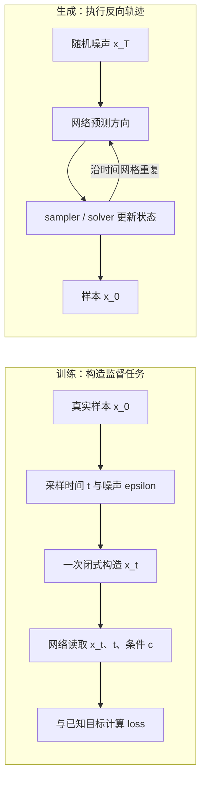

# 扩散模型：从概率路径到现代生成系统

扩散模型是一组生成建模方法：先规定数据分布如何逐渐过渡到易采样的噪声分布，再学习从中间状态恢复数据所需的方向、噪声或速度。DDPM、Score SDE、DDIM、Flow Matching、Rectified Flow 和 Consistency Models 的共同问题都是“怎样把简单分布中的样本送回数据分布”，差别在于路径怎样定义、模型预测什么、采样动力学怎样写，以及训练和推理成本放在哪里。

## 扩散模型是什么

给定真实样本 \(x_0\sim p_{\text{data}}\)，先定义一组随时间变化的分布 \(p_t\)。在 DDPM 中，前向过程逐步加入高斯噪声，使 \(x_T\) 接近标准高斯；训练模型从带噪样本 \(x_t\) 和时间步 \(t\) 中预测噪声、干净样本、score 或 velocity。生成时从 \(x_T\sim\mathcal N(0,I)\) 开始，反复调用模型和采样器，最终得到服从模型数据分布的样本。

这里有三个必须分开的对象：

- **概率路径**决定数据和噪声之间有哪些中间分布。
- **denoiser / score / velocity network**学习在中间状态上应该预测什么。
- **sampler / solver / scheduler**把模型输出转换成有限步更新。

## MMD：把“分布像不像”写成可训练的距离

**Maximum Mean Discrepancy（最大均值差异，MMD）**是一种两样本分布距离。它不要求给生成样本配一个逐点真值，而是把样本送进由核函数 $k$ 定义的特征空间，再比较两边的平均特征，也就是 kernel mean embedding。对生成分布 $P$ 和真实分布 $Q$，平方 MMD 为

\[
\operatorname{MMD}^{2}(P,Q)
=\mathbb E_{x,x'\sim P}k(x,x')
-2\mathbb E_{x\sim P,y\sim Q}k(x,y)
+\mathbb E_{y,y'\sim Q}k(y,y').
\]

常用高斯核

\[
k(x,y)=\exp\left(-\frac{\lVert x-y\rVert_2^2}{2\sigma^2}\right)
\]

会同时产生三项信号：生成样本之间的相似度、生成样本和真实样本之间的相似度、真实样本之间的相似度。对 characteristic kernel（特征核），总体 MMD 为零当且仅当 $P=Q$。因此它适合问“这一批输出的整体分布是否接近真实分布”，不要求知道每个噪声应该对应哪一张 teacher 图。

直觉上，跨分布项在拉近生成集合和真实集合，生成内部项又防止所有生成样本挤到同一个点。实际训练只能用 mini-batch 估计，成本、方差和估计偏差会改变优化行为。常见的 biased estimator 包含对角线项，计算简单但有限 batch 下有偏；unbiased estimator 去掉对角线，方差通常更大。高斯核的带宽 $\sigma$ 也很关键，过小只看到近邻，过大只看到粗粒度均值。RDM 的实验显示，精确的 batch 内 repulsion、用 Nyström 压缩后固定的全训练集 attraction，以及大于 2048 的新鲜生成 batch，才让 MMD 在高维视觉特征里变得实用；单一 encoder 仍可能被生成器“钻指标空子”。

MMD 的作用层次要和扩散机制分开。它可以直接作为一步生成器的 loss，也可以在冻结视觉 encoder 的表征空间里计算，还可以把 MMD 的梯度改写成样本漂移场。它本身没有规定噪声日程、score 网络或 ODE solver，因此不等于 DDPM、Flow Matching 或某一种 sampler。

| 目标 | 每个样本的监督 | 推理时是否需要迭代 | 与 MMD 的关系 |
| --- | --- | --- | --- |
| DDPM / Flow Matching | 噪声、score 或 velocity target | 通常需要 | 可把 MMD 用作额外分布级约束，但它不定义扩散路径 |
| DMD / DMD2 | teacher real score 与 fake score 差 | 一步或少步 | 用 score 差近似分布梯度，通常还需要 fake score 或回归锚点 |
| RDM / iRDM | 冻结 encoder 上的生成与真实特征分布 | 一步 | 直接优化表征空间 MMD，训练时无 online teacher、adversary 和 trajectory |
| Drifting | 真实样本吸引减生成样本排斥的漂移向量 | 一步 | kernelized drift 与 MMD 梯度有紧密关系，但论文以零漂移 fixed point 组织训练 |
| TBSM | 一个 projectile、一个 real source、一个 generated source | 一步 | energy distance 是一种距离核 MMD；三体散射给出线性样本级随机梯度 |

阅读后面三篇论文时，可以反复问四个问题：距离是在像素还是 frozen feature 上算，真实参考是每步重采样还是预先冻结，生成内部的 repulsion 有没有保留，有限 batch 的估计噪声由什么机制控制。答案决定了“分布匹配”到底是稳定的训练目标，还是一个容易被单一指标利用的近似。

Stable Diffusion 中的 U-Net、DiT、VAE 和文本编码器属于系统组件；DDPM、Flow Matching 和 Consistency 属于训练或生成机制。把这两层混在一起，很容易误以为“换成 Transformer”就等于换了一种扩散目标。

近年的 VAE-free / pixel-space diffusion 又把表示空间问题推回到台前。PixelGen、PixelDiT 直接在像素空间训练新底座，目标是绕开 VAE 重建误差和细节瓶颈，代价则转移到高维优化、token 数、感知监督和架构效率上。Z-Image-Pixel 又展示了阶段化路线：先在 latent space 高效预训练，再迁移到 pixel space 做 post-training，让 VAE-free 描述最终生成器，而不是限制整个训练历史。它们改的是“在哪个空间、哪个阶段扩散”，和“用 DDPM、Flow 还是少步蒸馏采样”属于不同层。

DINO / DINOv2 / DINOv3 这类自监督视觉编码器又提供了第三种接口：不直接生成像素，也不替代 denoiser，而是作为冻结视觉老师、感知损失或评测特征，告诉生成模型哪些结构、对象和跨帧语义更值得保住。它常和 DiT、Flow、VAE-free、视频微调一起出现，但本质上改的是训练监督和表征约束。

## 训练与生成是两条不同的执行链

训练时，真实样本和所加噪声都已知，因此可以随机抽一个时间步，直接构造 \(x_t\) 并形成监督目标；通常不需要真的把一张图逐步加噪到第 \(t\) 步。生成时没有真实 \(x_0\) 可用，只能从随机噪声出发，把许多局部预测串成完整轨迹。训练 loss 很低不自动保证有限步采样稳定，因为误差会在闭环轨迹中累积。

训练和生成共享同一个模型接口，但数据来源和运行方式不同；任意训练目标不能直接与任意采样器组合。

## 核心技术脉络

| 阶段 | 核心问题 | 对应文章 |
| --- | --- | --- |
| 共同基础 | 数据、噪声、中间分布和反向生成怎样组成一个生成模型 | [基础与核心直觉](foundations-and-core-intuition.md) |
| 离散扩散 | DDPM 的前向链、反向后验、噪声预测目标怎样连接 | [DDPM 数学与训练](training.md) |
| 网络与系统 | U-Net、DiT、VAE、文本条件和 scheduler 怎样协作 | [架构与 Stable Diffusion](architecture-and-stable-diffusion.md) |
| 可运行实现 | 怎样把噪声日程、loss 和反向采样映射到 PyTorch | [最小 DDPM 实现](minimal-ddpm-implementation.md) |
| 方法演进 | DDPM、DDIM、Score SDE、Solver、Flow 和少步生成怎样衔接 | [发展脉络](evolution.md) |
| 连续时间 | score、反向 SDE 和 probability flow ODE 怎样统一 | [Score Matching 到 SDE](score-matching-sde-and-probability-flow.md) |
| 速度场路线 | Flow Matching 如何回归速度，Rectified Flow 为什么关注路径曲率 | [Flow Matching 与 Rectified Flow](flow-matching-and-rectified-flow.md) |
| 分布级单步生成 | MMD、表征分布匹配、Drifting 与三体散射如何把迭代采样搬到训练 | [RDM 精读](../paper-deep-dives/diffusion/rdm.md)、[Drifting 精读](../paper-deep-dives/diffusion/drifting.md)、[TBSM 精读](../paper-deep-dives/diffusion/tbsm.md) |

## 方法分支与工程问题

| 分支 | 它主要改变什么 | 入口 |
| --- | --- | --- |
| 噪声日程与参数化 | 不同噪声区间的训练压力，以及 ε、\(x_0\)、score、\(v\) 的坐标转换 | [噪声日程与参数化](noise-schedules-and-parameterization.md) |
| 条件生成 | 文本、类别、结构条件如何进入网络，CFG 如何放大条件方向 | [条件控制与 Guidance](guidance-and-conditioning.md) |
| 采样与求解器 | DDPM、DDIM、Euler、Heun、DPM-Solver 怎样离散同一方向场 | [采样与推理加速](inference.md) |
| 少步与一步生成 | 蒸馏、一致性和分布匹配怎样把多步纠错压缩成大步映射 | [扩散蒸馏](distillation.md)、[Consistency 与 Flow 边界](consistency-models-and-rectified-flow.md) |
| 表示空间与 VAE-free | 在 latent VAE、直接 pixel pre-training 和 latent-to-pixel post-training 之间选择 | [架构与 Stable Diffusion](architecture-and-stable-diffusion.md)、[PixelDiT 精读](../paper-deep-dives/diffusion/pixeldit.md)、[Z-Image-Pixel 精读](../paper-deep-dives/diffusion/z-image-pixel.md) |
| DINO 与表示对齐 | 冻结视觉编码器怎样作为感知老师、REPA 目标、跨帧一致性约束或评测特征 | [架构与 Stable Diffusion](architecture-and-stable-diffusion.md)、[视频与多模态扩散](video-and-multimodal-diffusion.md) |
| 训练排障 | 数据、VAE、SNR bucket、EMA、条件接口和真实采样回放怎样定位失败 | [训练配方与排障](practical-training-recipes-and-failure-analysis.md) |
| 视频与多模态 | Video VAE、时空表示、条件保持、运动一致性和长序列成本怎样改变扩散系统 | [视频与多模态扩散](video-and-multimodal-diffusion.md) |
| 方法选择 | 已有模型、重训预算、目标步数和质量约束怎样决定路线 | [扩散路线选择与方法对照](comparison-table.md) |

这些分支不是互斥标签。例如一个现代文生视频系统可以同时采用 latent VAE、DiT、Flow Matching、CFG、ODE solver 和少步蒸馏；一个 VAE-free 图像系统也可以同时采用 pixel-space DiT、Flow Matching、感知损失和高阶 solver。每个名字描述的是系统中的不同层。

## 按问题进入

| 问题 | 建议阅读 |
| --- | --- |
| 为什么主动加噪反而能训练生成模型 | [基础与核心直觉](foundations-and-core-intuition.md) -> [DDPM 数学与训练](training.md) |
| 预测噪声、预测 \(x_0\)、预测 score 和预测 velocity 有什么关系 | [DDPM 数学与训练](training.md) -> [噪声日程与参数化](noise-schedules-and-parameterization.md) |
| Stable Diffusion 到底由哪些模块组成 | [架构与 Stable Diffusion](architecture-and-stable-diffusion.md) |
| VAE-free 模型到底省掉了什么，又把成本放到了哪里 | [架构与 Stable Diffusion](architecture-and-stable-diffusion.md) -> [PixelDiT 精读](../paper-deep-dives/diffusion/pixeldit.md) -> [Z-Image-Pixel 精读](../paper-deep-dives/diffusion/z-image-pixel.md) |
| DINO 在扩散生成里到底起什么作用 | [架构与 Stable Diffusion](architecture-and-stable-diffusion.md) -> [视频与多模态扩散](video-and-multimodal-diffusion.md) |
| 为什么 Video VAE 的第一帧经常和后续帧质量不同 | [视频与多模态扩散](video-and-multimodal-diffusion.md) |
| 如何亲手验证训练和反向采样链路 | [最小 DDPM 实现](minimal-ddpm-implementation.md) |
| DDIM 为什么可以少走时间步 | [采样与推理加速](inference.md) |
| Score SDE、Probability Flow ODE 和 DDPM 怎样对应 | [Score Matching 到 SDE](score-matching-sde-and-probability-flow.md) |
| Flow Matching 是否只是换一种噪声预测 | [Flow Matching 与 Rectified Flow](flow-matching-and-rectified-flow.md) |
| 为什么少步生成需要蒸馏或路径重构 | [扩散蒸馏](distillation.md) -> [Consistency 与 Flow 边界](consistency-models-and-rectified-flow.md) |
| MMD 在一步生成里做什么 | [MMD 与分布匹配](index.md#mmd) -> [RDM 精读](../paper-deep-dives/diffusion/rdm.md) -> [Drifting 精读](../paper-deep-dives/diffusion/drifting.md) -> [TBSM 精读](../paper-deep-dives/diffusion/tbsm.md) |
| 训练 loss 正常但采样结果很差时查什么 | [训练配方与排障](practical-training-recipes-and-failure-analysis.md) |

读论文时先标出五个接口：数据在哪个空间扩散、概率路径怎样定义、网络预测什么、条件怎样进入、采样器用多少次模型前向。方法名变化再快，也可以落回这五个问题。
