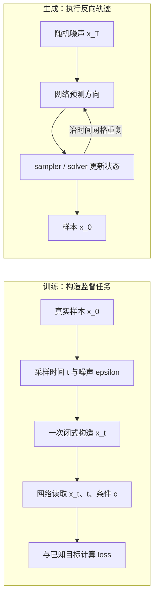

# 扩散模型：从概率路径到现代生成系统

扩散模型是一组生成建模方法：先规定数据分布如何逐渐过渡到易采样的噪声分布，再学习从中间状态恢复数据所需的方向、噪声或速度。DDPM、Score SDE、DDIM、Flow Matching、Rectified Flow 和 Consistency Models 的共同问题都是“怎样把简单分布中的样本送回数据分布”，差别在于路径怎样定义、模型预测什么、采样动力学怎样写，以及训练和推理成本放在哪里。

## 扩散模型是什么

给定真实样本 \(x_0\sim p_{\text{data}}\)，先定义一组随时间变化的分布 \(p_t\)。在 DDPM 中，前向过程逐步加入高斯噪声，使 \(x_T\) 接近标准高斯；训练模型从带噪样本 \(x_t\) 和时间步 \(t\) 中预测噪声、干净样本、score 或 velocity。生成时从 \(x_T\sim\mathcal N(0,I)\) 开始，反复调用模型和采样器，最终得到服从模型数据分布的样本。

这里有三个必须分开的对象：

- **概率路径**决定数据和噪声之间有哪些中间分布。
- **denoiser / score / velocity network**学习在中间状态上应该预测什么。
- **sampler / solver / scheduler**把模型输出转换成有限步更新。

Stable Diffusion 中的 U-Net、DiT、VAE 和文本编码器属于系统组件；DDPM、Flow Matching 和 Consistency 属于训练或生成机制。把这两层混在一起，很容易误以为“换成 Transformer”就等于换了一种扩散目标。

## 训练与生成是两条不同的执行链

训练时，真实样本和所加噪声都已知，因此可以随机抽一个时间步，直接构造 \(x_t\) 并形成监督目标；通常不需要真的把一张图逐步加噪到第 \(t\) 步。生成时没有真实 \(x_0\) 可用，只能从随机噪声出发，把许多局部预测串成完整轨迹。训练 loss 很低不自动保证有限步采样稳定，因为误差会在闭环轨迹中累积。

训练和生成共享同一个模型接口，但数据来源和运行方式不同；任意训练目标不能直接与任意采样器组合。

## 核心技术脉络

| 阶段 | 核心问题 | 对应文章 |
| --- | --- | --- |
| 共同基础 | 数据、噪声、中间分布和反向生成怎样组成一个生成模型 | [基础与核心直觉](foundations-and-core-intuition.md) |
| 离散扩散 | DDPM 的前向链、反向后验、噪声预测目标怎样连接 | [DDPM 数学与训练](training.md) |
| 网络与系统 | U-Net、DiT、VAE、文本条件和 scheduler 怎样协作 | [架构与 Stable Diffusion](architecture-and-stable-diffusion.md) |
| 可运行实现 | 怎样把噪声日程、loss 和反向采样映射到 PyTorch | [最小 DDPM 实现](minimal-ddpm-implementation.md) |
| 方法演进 | DDPM、DDIM、Score SDE、Solver、Flow 和少步生成怎样衔接 | [发展脉络](evolution.md) |
| 连续时间 | score、反向 SDE 和 probability flow ODE 怎样统一 | [Score Matching 到 SDE](score-matching-sde-and-probability-flow.md) |
| 速度场路线 | Flow Matching 如何回归速度，Rectified Flow 为什么关注路径曲率 | [Flow Matching 与 Rectified Flow](flow-matching-and-rectified-flow.md) |

## 方法分支与工程问题

| 分支 | 它主要改变什么 | 入口 |
| --- | --- | --- |
| 噪声日程与参数化 | 不同噪声区间的训练压力，以及 ε、\(x_0\)、score、\(v\) 的坐标转换 | [噪声日程与参数化](noise-schedules-and-parameterization.md) |
| 条件生成 | 文本、类别、结构条件如何进入网络，CFG 如何放大条件方向 | [条件控制与 Guidance](guidance-and-conditioning.md) |
| 采样与求解器 | DDPM、DDIM、Euler、Heun、DPM-Solver 怎样离散同一方向场 | [采样与推理加速](inference.md) |
| 少步与一步生成 | 蒸馏、一致性和分布匹配怎样把多步纠错压缩成大步映射 | [扩散蒸馏](distillation.md)、[Consistency 与 Flow 边界](consistency-models-and-rectified-flow.md) |
| 训练排障 | 数据、VAE、SNR bucket、EMA、条件接口和真实采样回放怎样定位失败 | [训练配方与排障](practical-training-recipes-and-failure-analysis.md) |
| 视频与多模态 | 时空表示、条件保持、运动一致性和长序列成本怎样改变扩散系统 | [视频与多模态扩散](video-and-multimodal-diffusion.md) |
| 方法选择 | 已有模型、重训预算、目标步数和质量约束怎样决定路线 | [扩散路线选择与方法对照](comparison-table.md) |

这些分支不是互斥标签。例如一个现代文生视频系统可以同时采用 latent VAE、DiT、Flow Matching、CFG、ODE solver 和少步蒸馏；每个名字描述的是系统中的不同层。

## 按问题进入

| 问题 | 建议阅读 |
| --- | --- |
| 为什么主动加噪反而能训练生成模型 | [基础与核心直觉](foundations-and-core-intuition.md) -> [DDPM 数学与训练](training.md) |
| 预测噪声、预测 \(x_0\)、预测 score 和预测 velocity 有什么关系 | [DDPM 数学与训练](training.md) -> [噪声日程与参数化](noise-schedules-and-parameterization.md) |
| Stable Diffusion 到底由哪些模块组成 | [架构与 Stable Diffusion](architecture-and-stable-diffusion.md) |
| 如何亲手验证训练和反向采样链路 | [最小 DDPM 实现](minimal-ddpm-implementation.md) |
| DDIM 为什么可以少走时间步 | [采样与推理加速](inference.md) |
| Score SDE、Probability Flow ODE 和 DDPM 怎样对应 | [Score Matching 到 SDE](score-matching-sde-and-probability-flow.md) |
| Flow Matching 是否只是换一种噪声预测 | [Flow Matching 与 Rectified Flow](flow-matching-and-rectified-flow.md) |
| 为什么少步生成需要蒸馏或路径重构 | [扩散蒸馏](distillation.md) -> [Consistency 与 Flow 边界](consistency-models-and-rectified-flow.md) |
| 训练 loss 正常但采样结果很差时查什么 | [训练配方与排障](practical-training-recipes-and-failure-analysis.md) |

读论文时先标出五个接口：数据在哪个空间扩散、概率路径怎样定义、网络预测什么、条件怎样进入、采样器用多少次模型前向。方法名变化再快，也可以落回这五个问题。
