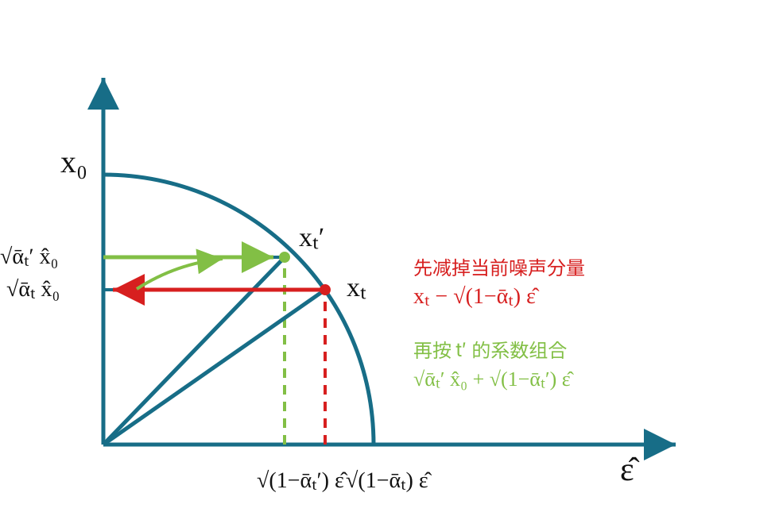

# 扩散采样与推理加速

训练阶段，扩散模型学会在不同噪声水平下判断“当前样本应该往哪里移动”。推理阶段，我们从噪声 \(x_T\) 出发，把这个方向连续兑现成图像、视频或动作序列。采样器要在有限模型调用次数里，尽量沿着正确轨迹从高噪声分布走回数据分布。

扩散采样的主线是：模型给方向，采样器决定怎样沿这个方向走。DDPM、DDIM、Euler、Heun、DPM-Solver、DPM-Solver++ 和 EDM 的差异，都可以放进这条主线里看。

## 采样器接管的是有限步执行

模型常输出噪声预测、干净样本预测、score 或 velocity。以噪声预测为例：

\[
\hat\epsilon=\epsilon_\theta(x_t,t,c)
\]

这里 \(x_t\) 是当前噪声水平下的样本，\(t\) 是时间或噪声尺度，\(c\) 是可选条件。模型输出 \(\hat\epsilon\)，意思是它估计当前样本里哪些成分更像噪声。采样器接下来必须决定：下一步去哪个噪声水平、走多远、是否加入随机噪声、是否跳过中间时间点、是否用多次方向估计校正误差。

所以一次推理步可以拆成两层：

```text
model:   当前样本 + 噪声水平 + 条件 -> 方向或目标估计
sampler: 方向或目标估计 + 时间表 + 更新规则 -> 下一个样本
```

NFE 是 Number of Function Evaluations，通常可以近似理解成模型前向调用次数。NFE 越低，推理越快，但每一步承担的距离越长；NFE 越高，轨迹有更多小修正机会，但延迟和显存压力也更大。采样器所有花样，核心都是在这条成本曲线上找更好的点。

## DDPM：很多小步组成随机反向链

[DDPM](https://arxiv.org/abs/2006.11239) 的原始反向采样把每一步写成高斯转移。粗略说，当前带噪样本 \(x_t\) 会经过模型预测的均值，再加上一点由方差控制的随机噪声，得到 \(x_{t-1}\)：

\[
x_{t-1}=\mu_\theta(x_t,t)+\sigma_t z,\qquad z\sim\mathcal N(0,I)
\]

这行式子的读法是：\(\mu_\theta(x_t,t)\) 给出模型认为下一步应该去的位置，\(\sigma_t z\) 保留反向链的随机性。\(z\) 是和样本同形状的标准高斯噪声，\(\sigma_t\) 决定这一步随机扰动的强度。

{ width="670" }

<small>图源：[Denoising Diffusion Probabilistic Models](https://arxiv.org/abs/2006.11239)，Figure 14。原图展示 CIFAR-10 unconditional generation 的反向链：样本从高噪声状态逐步变成可辨认图像。读图重点：早期步骤更负责大结构，中后期逐渐补颜色、边缘和纹理；多步采样的价值正是给这些修正留下时间。</small>

DDPM 的优势是概率建模清楚，随机链也自然带来多样性。代价是慢。早期设置里常用上百到上千步，这在交互式图像生成、视频生成和机器人 rollout 里都太贵。

## DDIM：不重训模型，也能改采样路径

[DDIM](https://arxiv.org/abs/2010.02502) 的关键不是训练一个新模型，而是构造一条和 DDPM 训练目标兼容的非马尔可夫采样路径。它允许采样时只取一部分时间点，跳过中间很多小步。

{ width="720" }

<small>图源：[Denoising Diffusion Implicit Models](https://arxiv.org/abs/2010.02502)，Figure 2。原图表达 accelerated generation 可以只使用时间子序列，从而减少生成步数。读图重点：虚线时间点不是训练时不存在，而是采样时可以跳过；DDIM 的重点是改反向路径，而不是让模型一次性直接吐出最终图。</small>

DDIM 常见更新会先从模型输出还原出当前的干净样本估计 \(\hat x_0\)，再按下一个噪声水平重新混合 \(\hat x_0\)、预测噪声和可选随机项：

\[
x_{t'}
=
\sqrt{\bar\alpha_{t'}}\hat x_0
+
\sqrt{1-\bar\alpha_{t'}-\sigma_t^2}\hat\epsilon
+
\sigma_t z
\]

这里 \(t'\) 是比 \(t\) 更低的噪声水平。公式的意思不是“直接取 \(\hat x_0\) 当结果”，而是把“模型认为的数据部分”和“模型认为的噪声方向”按新噪声水平重新组合。把 \(\sigma_t z\) 设成 0 时，轨迹变成确定性的；同一个初始噪声、同一个 prompt 和同一组时间步会得到可复现结果，也更适合反演和编辑。

确定性 DDIM 的几何读法很直接。当前 \(x_t\) 已经在圆弧上，但它对应的是当前噪声水平；若要走到更低噪声的 \(t'\)，不能只把点往上拖。采样器先用模型预测的 \(\hat\epsilon\) 从 \(x_t\) 中扣掉当前噪声分量，得到数据方向上的估计 \(\sqrt{\bar\alpha_t}\hat x_0\)，再把它按比例放大到 \(\sqrt{\bar\alpha_{t'}}\hat x_0\)，最后加回 \(t'\) 所需的较小噪声分量 \(\sqrt{1-\bar\alpha_{t'}}\hat\epsilon\)。

{ width="780" }

<small>图源：自绘，参考 DDIM 的确定性采样几何读法。红色箭头表示从 \(x_t\) 中减去当前预测噪声分量；绿色箭头表示按更低噪声水平 \(t'\) 重新组合数据分量和噪声分量。图只用于说明系数几何，不表示真实样本空间只有二维。</small>

DDIM 让“少步采样”变成现实，但它没有消除误差。时间点越稀疏，每一步跨度越大，模型对 \(\hat x_0\) 或 \(\hat\epsilon\) 的小误差越容易累积成结构漂移、细节变软或 prompt 丢失。

## DDIM 的随机性不是随手加噪

DDIM 公式里那项 \(\sigma_t z\) 很容易被读成“想要多样性就加点噪声”。更准确的说法是：随机项必须和剩余噪声项一起，组成下一时间步 schedule 要求的总噪声水平。若 \(x_{t'}\) 应该由 \(\sqrt{\bar\alpha_{t'}}\hat x_0\) 和某个总标准差的噪声组成，那么新增随机噪声和沿用的预测噪声不能让总噪声超标。

如果用几何图理解，确定性 DDIM 是沿着数据-噪声圆弧往低噪声处走；随机 DDIM 则是在噪声子空间里“换一部分方向”。新噪声 \(z\) 在高维空间里通常近似和旧预测噪声正交，所以两者的幅度不能线性相加，而要按方差相加。为了让下一步仍落在 \(t'\) 对应的总噪声半径上，加入 \(\sigma_t z\) 的同时，旧噪声项前面的系数必须变小。

这也是系数保持采样的核心直觉。采样器不仅要决定“往哪里走”，还要守住下一步的数据系数和噪声系数。DDPM 的随机反向链、DDIM 的确定/随机形式、Flow Matching 里人为注入的随机性，都可以用这条标准检查：数据部分是否按 scheduler 分配，噪声部分的总方差是否按 scheduler 分配。少步采样时 \(\Delta t\) 变大，这个约束更重要，因为高阶近似和连续 SDE 推导里的小步假设更容易失效。

## ODE 视角：sampler 是数值积分器

Score SDE 和 probability flow ODE 给了更统一的解释。确定性采样可以看成沿着一条由模型给出的连续方向场积分：

\[
\frac{dx}{dt}=f_\theta(x,t,c)
\]

这里 \(f_\theta\) 不是固定公式，而是由 score、噪声预测、\(x_0\)-prediction 或 velocity 变换出来的采样方向。真实机器不能连续走，只能选有限个时间点离散更新。采样器就是数值求解器：它决定怎样用很少的点近似这条轨迹。

最简单的一阶更新可以写成：

\[
x_{n+1}=x_n+h f_\theta(x_n,t_n,c)
\]

这就是 Euler 的直觉：只看当前位置的方向，沿它走一步，步长是 \(h\)。它便宜、直接，也最容易解释。但在少步场景里，只看起点方向常常太粗。

Heun 会先试走一步，再在临时终点重新看方向，最后用起点方向和临时终点方向的平均值更新：

\[
x_{n+1}
=
x_n+\frac{h}{2}
\left[
f_\theta(x_n,t_n,c)
+
f_\theta(\tilde x_{n+1},t_{n+1},c)
\right]
\]

这行公式的读法是：不要完全相信起点斜率，先预测再校正。代价是每步通常多一次模型前向。它说明了一个普遍事实：更稳的采样器常常用更多方向估计、更复杂时间表或历史状态，换取更低离散化误差。

## DPM-Solver：利用扩散 ODE 的结构

通用 ODE solver 只知道“沿方向场积分”。[DPM-Solver](https://arxiv.org/abs/2206.00927) 更进一步：它利用 diffusion ODE 的半线性结构，把一部分线性项解析处理，再近似模型输出带来的非线性项。粗略写成：

\[
x_{t_{n+1}}=\Phi(x_{t_n},\epsilon_\theta,t_n,t_{n+1})
\]

\(\Phi\) 表示专门为扩散 ODE 设计的更新规则。它不是魔法黑箱，而是在问：既然噪声日程和 ODE 形式已知，为什么还要像通用 Euler 那样粗糙地走？把已知结构用进去，就能在 10 到 20 步这类少步预算下更接近多步采样质量。

[DPM-Solver++](https://arxiv.org/abs/2211.01095) 继续针对 guided diffusion 做调整。强 guidance 会放大条件方向，采样轨迹会更陡，普通少步高阶 solver 可能在这种方向场下不稳。DPM-Solver++ 使用更适合 guided sampling 的 data prediction 形式和 singlestep / multistep 设计，目标是在低 NFE 下减少失真。

{ width="640" }

<small>图源：[DPM-Solver++](https://arxiv.org/abs/2211.01095)，Figure 1。原图在 ImageNet 256×256、classifier guidance scale 8.0、15 NFE 下比较不同 solver。读图重点：高阶不自动等于稳定；强 guidance 会改变方向场形状，少步求解器必须为这种更陡的轨迹付出设计。</small>

这也连接到前一页的 CFG：guidance scale 改变的不是最终图上的一个滤镜，而是采样每一步使用的方向。采样器、步数和 guidance 必须一起报告，否则“这个 sampler 更好”的结论没有可复现意义。

## EDM：采样器不是孤立名字，而是一组设计轴

[EDM](https://arxiv.org/abs/2206.00364) 很适合作为工程读法的收束：它把扩散模型设计拆成噪声尺度、数据预条件、训练权重、采样步长、solver 和 stochasticity 等多个轴。很多时候，效果提升不是因为某个 sampler 名字更时髦，而是这些轴配合得更一致。

可以把采样设计拆成几类问题。第一，时间变量怎么定义：用离散 \(t\)、连续 \(t\)，还是直接用噪声标准差 \(\sigma\)。第二，步长怎么分布：高噪声阶段需要覆盖大结构，低噪声阶段需要修细节，均匀步长不一定最合适。第三，模型输出用什么坐标：\(\epsilon\)-prediction、\(x_0\)-prediction、\(v\)-prediction 或 score 会改变误差在不同噪声区间的表现。第四，是否加入随机性：随机采样可能带来多样性，也可能增加方差和不稳定。

工程上选择 sampler 时，不能只看名字。`Euler`、`Heun`、`DDIM`、`DPM-Solver++`、`EDM sampler` 背后还有 timestep schedule、prediction type、CFG scale、thresholding、随机种子和实现细节。少报一个，就可能复现不出论文或 demo 里的质量。

## 少步为什么会坏

少步采样的失败，通常不是“少算几次所以略差”这么温和。高噪声阶段如果步子太粗，全局布局和对象关系可能一开始就走偏；中噪声阶段误差会变成几何不稳、姿态错位或结构扭曲；低噪声阶段跳得太猛，纹理、文字、手部、边缘和局部编辑会变软或破碎。

条件生成还会更敏感。CFG、ControlNet、参考图和 mask 都会影响方向场。强 CFG 下每一步更陡，ControlNet 下结构约束需要持续进入中间层，参考图条件需要保身份或风格。如果采样器只在平均画质上看起来不错，却在强条件桶里漂移，就不适合真实产品。

视频模型的代价更大。一次前向可能处理很多帧和大量 latent token，NFE 从 50 降到 20 的收益很明显；但每一步也承载更多时间一致性。少步过冲会表现为闪烁、主体漂移、运动变慢或首帧丢失。视频里 sampler 不能只看单帧质量，要和 motion bucket、temporal consistency 和端到端延迟一起评估。

## NFE 不是端到端延迟

NFE 是很好的第一指标，因为 U-Net / DiT 前向通常是扩散推理里的主成本。但产品里的延迟不是只等于 NFE。文本编码器、VAE 编解码、ControlNet / adapter、CFG 的 conditional / unconditional 分支、视频 tokenizer、batching、显存峰值、I/O 和安全后处理都会进入端到端成本。

CFG 是一个典型例子。理论上同一步需要条件和无条件两种预测；如果实现能把它们合批，墙钟时间未必翻倍，但显存和 batch 形状会变；如果不能合批，延迟就会明显增加。ControlNet 也类似：采样步数没变，但每步多了控制分支前向和中间特征注入。

因此评测 sampler 时，至少要固定或报告这些项：模型 checkpoint、prediction type、噪声日程、采样步数或 NFE、CFG scale、是否 thresholding、是否随机、分辨率、batch size、ControlNet / adapter / LoRA、硬件和端到端 P50 / P95 latency。只报告“20 steps, sampler X”很难支撑工程判断。

## 怎么选采样器

如果目标是理解模型行为，先用稳定、可复现的确定性设置，例如 DDIM 或 DPM-Solver++，固定 seed 和 prompt，观察不同噪声阶段的失败。这样更容易把问题归因到模型、条件还是采样器。

如果目标是产品预览，优先找 10 到 20 NFE 内足够稳定的 solver，并分开评估简单 prompt、复杂空间关系、文字、ControlNet、参考图和局部编辑。预览可以接受细节略软，但不能经常丢主体或违背硬结构条件。

如果目标是高质量最终图，步数可以更高，重点是自然度、多样性和局部细节。此时 sampler 的差距仍然存在，但模型、数据、prompt 分布和后处理常常同样重要。

如果目标是视频或世界模型 rollout，采样器选择要和时序成本绑定。每减少一步都可能省下大量算力，但也可能牺牲运动、动作敏感性或长时稳定。这里不能只看 FID 或单帧美观，要看时间一致性、动作条件、长时漂移和服务延迟。

当 15 到 30 NFE 仍然太慢时，下一步通常不是继续硬调 sampler，而是进入 [一步生成、蒸馏与整流](distillation.md)、[一致性模型与 Rectified Flow](consistency-models-and-rectified-flow.md) 这类训练端路线。采样器是在已有方向场上走得更聪明；蒸馏、consistency 和 flow 路线则是在训练端重新分配少步生成的责任。

## 读完以后怎么判断

扩散推理可以被压成一句话：模型学方向，采样器积分方向。DDPM 用很多随机小步走原始反向链；DDIM 改路径、允许跳步；Euler 和 Heun 展示一阶/二阶数值积分直觉；DPM-Solver / DPM-Solver++ 利用扩散 ODE 和 guidance 场景的结构减少少步误差；EDM 提醒我们把噪声尺度、预条件、步长、随机性和 solver 放在同一个设计空间里调。

读采样论文或调系统时，先问四件事：模型输出坐标是什么，采样时间表怎么选，每一步是否随机或 guided，总成本按 NFE 还是端到端延迟算。问清这些，sampler 名字就不再是一串菜单项，而是有限计算预算下怎样走生成轨迹。

## 外部材料

- [DDPM](https://arxiv.org/abs/2006.11239)：理解原始随机反向链、噪声预测和 progressive generation。
- [DDIM](https://arxiv.org/abs/2010.02502)：理解不重训模型也能改变采样路径、跳步和确定性采样。
- [零推导理解 Diffusion 和 Flow Matching（二）：随机性](https://zhuanlan.zhihu.com/p/1947597090311090928)：适合补 DDIM 随机项和确定性轨迹之间的直观关系。
- [Coefficients-Preserving Sampling for Reinforcement Learning with Flow Matching](https://arxiv.org/abs/2509.05952)：理解随机性注入为什么必须保持数据/噪声系数。
- [Score SDE](https://arxiv.org/abs/2011.13456)：理解反向 SDE、probability flow ODE 和数值求解器统一视角。
- [DPM-Solver](https://arxiv.org/abs/2206.00927)：理解专门利用 diffusion ODE 结构的少步 solver。
- [DPM-Solver++](https://arxiv.org/abs/2211.01095)：理解 strong guidance 下为什么需要更稳的 data prediction solver。
- [EDM](https://arxiv.org/abs/2206.00364)：理解噪声尺度、preconditioning、solver、stochasticity 和 NFE 的整体设计空间。
- [Diffusers schedulers overview](https://huggingface.co/docs/diffusers/en/api/schedulers/overview)：核对实际工程里 scheduler / sampler 的接口和命名。
- [Lil'Log: What are Diffusion Models?](https://lilianweng.github.io/posts/2021-07-11-diffusion-models/)：补 DDPM、score、SDE、sampling 和 guidance 的连续直觉。
