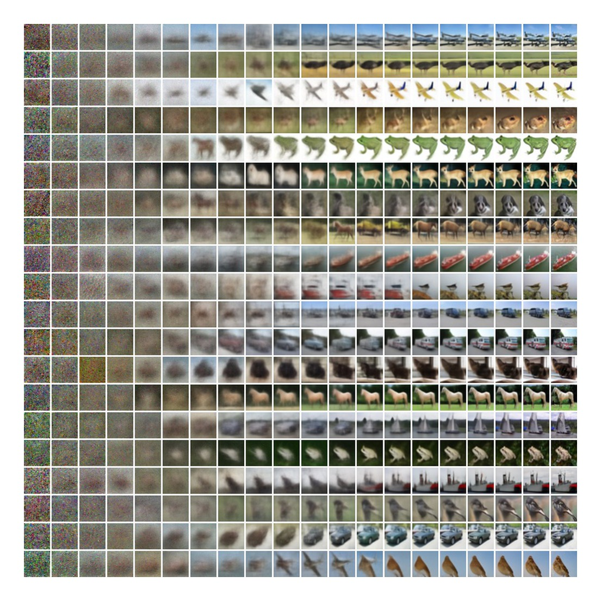
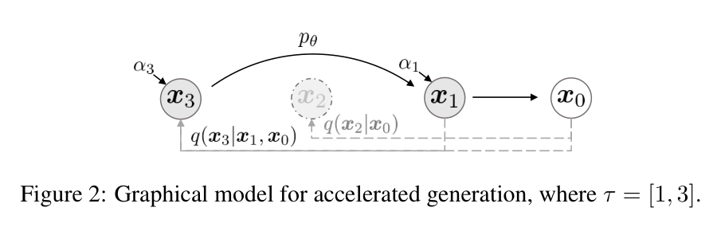

# 扩散采样与推理加速

训练阶段，模型学会在任意噪声水平下给出去噪方向。推理阶段，我们从纯噪声 \(x_T\) 出发，反复调用模型，逐步得到 \(x_0\)。


这页的核心问题是：**模型告诉我们往哪里去噪，采样器决定每一步怎么走。**

## 先看图：采样是逐步成形

{ width="670" }

<small>图源：[Denoising Diffusion Probabilistic Models](https://arxiv.org/abs/2006.11239)，Figure 14。</small>

<small>原论文图意：CIFAR-10 unconditional generation 的 progressive generation 过程，展示反向采样链中图像如何从噪声逐步变成可辨认样本。</small>

<small>本教程读法：早期采样主要确定大结构，中后期逐渐补边缘、颜色和纹理。这说明采样步不是装饰，而是在把模型的局部去噪能力串成完整图像。</small>

## 为什么需要采样器

模型通常输出的是某种方向信息，例如噪声预测：

\[
\hat{\epsilon}=\epsilon_\theta(x_t,t)
\]


这行式子在说：模型根据当前带噪样本 \(x_t\) 和时间步 \(t\)，预测里面的噪声 \(\hat{\epsilon}\)。

但光有方向还不够。推理时还要决定：

- 这一步从 \(x_t\) 更新到哪个 \(x_{t-1}\)；
- 时间步是否可以跳过；
- 要不要额外加入随机噪声；
- 每一步走多远；
- 是否用校正或高阶方法减少误差。

这些规则合起来就是采样器，也常叫 sampler 或 solver。

所以一次采样步可以拆成两层：

```text
model:   x_t, t -> predicted target
sampler: predicted target + schedule + step rule -> x_{t'}
```

其中 \(t' < t\)，表示往更低噪声水平走。模型负责估计方向或终点，采样器负责决定这一步走到哪里。

## 原始 DDPM：随机反向链

DDPM 的反向一步可以粗略写成：

\[
x_{t-1}=\mu_\theta(x_t,t)+\sigma_t z,
\qquad
z\sim\mathcal{N}(0,I)
\]


这行式子在说：下一步 \(x_{t-1}\) 由模型预测的均值 \(\mu_\theta\) 加上一点随机噪声组成。

这里 \(z\sim\mathcal{N}(0,I)\) 表示新噪声 \(z\) 从标准高斯采样：\(0\) 是均值，\(I\) 是单位协方差。它和 \(x_t\) 同形状，用来给 DDPM 的反向一步保留随机性；\(\sigma_t\) 再决定这份随机噪声实际加多大。

符号含义：

DDPM 的好处是贴近原始概率建模，坏处是通常需要很多步。早期设置里 \(T\) 常接近 1000，意味着要调用模型很多次。

## DDIM：为什么可以跳步

DDIM 的重要贡献是：不重新训练模型，也可以改变采样路径，让反向过程更确定、更少步。

{ width="640" }

<small>图源：[Denoising Diffusion Implicit Models](https://arxiv.org/abs/2010.02502)，Figure 2。</small>

<small>原论文图意：accelerated generation 可以只使用子序列 \(\tau=[1,3]\)，跳过中间部分时间步，从而减少生成所需步骤。</small>

<small>本教程读法：图中的虚线时间点表示训练时存在、采样时可以跳过的中间状态。DDIM 的关键是改采样路径，而不是重训模型。</small>

DDIM 常见更新形式为：

\[
x_{t-1}
=
\sqrt{\bar{\alpha}_{t-1}}\hat{x}_0
+
\sqrt{1-\bar{\alpha}_{t-1}-\sigma_t^2}\hat{\epsilon}
+
\sigma_t z
\]


这行式子在说：下一步 \(x_{t-1}\) 由三部分组成：预测干净图贡献、预测噪声方向贡献、以及可选随机噪声。

如果把 \(\sigma_t z\) 设为 0，就可以看到最核心的确定性部分：采样器不是直接输出 \(\hat{x}_0\)，而是把 \(\hat{x}_0\) 和 \(\hat{\epsilon}\) 按下一时间步的噪声强度重新混合。这样 \(x_t\) 会逐步变成 \(x_{t-1}\)、\(x_{t-2}\)，而不是一次跳到最终图。

符号含义：

当 \(\sigma_t=0\) 时，同一个初始噪声和同一组条件会得到确定性轨迹，更适合复现、反演和插值。

## ODE 视角：采样是数值积分

从 Score/SDE 视角看，确定性采样可以写成 probability flow ODE：

\[
\frac{dx}{dt}=f_\theta(x,t)
\]


这行式子在说：样本 \(x\) 随时间连续变化，变化速度由模型导出的向量场 \(f_\theta(x,t)\) 决定。

符号含义：

现实机器不能连续积分，只能选有限个时间点离散更新。采样器就是数值求解器：它决定如何用有限步近似这条连续轨迹。

## Euler：最简单的一阶方法

Euler 更新写成：

\[
x_{n+1}=x_n+h f_\theta(x_n,t_n)
\]


这行式子在说：从当前点 \(x_n\) 出发，沿当前方向 \(f_\theta(x_n,t_n)\) 走一步，步长是 \(h\)。

符号含义：

Euler 简单、便宜、每步只需一次方向估计。但步数太少时，它容易因为只看当前斜率而走偏。

## Heun：先预测，再校正

Heun 方法先做一次 Euler 预测：

\[
\tilde{x}_{n+1}
=
x_n+h f_\theta(x_n,t_n)
\]


这行式子在说：先用当前方向试着走到一个临时点 \(\tilde{x}_{n+1}\)。

然后用当前点和临时点的方向做平均：

\[
x_{n+1}
=
x_n
+
\frac{h}{2}
\left[
f_\theta(x_n,t_n)
+
f_\theta(\tilde{x}_{n+1},t_{n+1})
\right]
\]


这行式子在说：不要完全相信起点方向，而是看看走到临时点后方向变成什么，再用两个方向的平均值更新。

Heun 通常比 Euler 更平滑，但代价是每步大约需要两次模型方向估计。

## DPM-Solver：为扩散 ODE 定制

DPM-Solver 的思想不是简单套通用 ODE solver，而是利用 diffusion ODE 的特殊结构，把一部分线性项解析处理，再用模型输出近似剩下的非线性部分。

可以粗略写成：

\[
x_{t_{n+1}}
=
\Phi(x_{t_n}, \epsilon_\theta, t_n, t_{n+1})
\]


这行式子在说：DPM-Solver 用一个专门设计的更新算子 \(\Phi\)，根据当前状态、模型输出和两个时间点，直接计算下一状态。

符号含义：

它的目标是在 10 到 20 步这类少步预算下，尽量逼近很多步采样的质量。

## DPM-Solver++：为什么 guidance 场景更稳

高 guidance 会放大条件方向，让采样轨迹变陡。普通高阶 solver 在这种情况下可能不稳。

{ width="670" }

<small>图源：[DPM-Solver++](https://arxiv.org/abs/2211.01095)，Figure 1。</small>

<small>原论文图意：在 ImageNet 256×256、classifier guidance scale 8.0、15 NFE 下，直接使用此前高阶 solver 可能产生明显失真；DPM-Solver++ 生成更稳定。</small>

<small>本教程读法：高阶方法不是无条件更好。强 guidance 会改变方向场形状，使少步求解更难；DPM-Solver++ 的价值在于专门改善 guided sampling 的少步稳定性。</small>

DPM-Solver++ 还给出更具体的算法形式：

{ width="670" }

<small>图源：[DPM-Solver++](https://arxiv.org/abs/2211.01095)，Algorithm 1/2。</small>

<small>原论文图意：DPM-Solver++(2S) 使用 singlestep 中间点；DPM-Solver++(2M) 使用 multistep buffer 复用历史 \(x_\theta\) 预测。</small>

<small>本教程读法：算法图里的细节可以后读。入门时只抓住两点：它是训练后的 sampler，不需要重训模型；它通过更合适的参数化和多步信息，在少 NFE 下控制误差。</small>

收敛和步数关系可以看这张图：

{ width="670" }

<small>图源：[DPM-Solver++](https://arxiv.org/abs/2211.01095)，Figure 4。</small>

<small>原论文图意：在 pixel-space DPM 和 latent-space DPM 中比较不同 sampler 随 NFE 变化的 FID / MSE。</small>

<small>本教程读法：横轴 NFE 是模型前向调用次数。少 NFE 更快，但更考验 solver。不同 solver 在同样 NFE 下质量差异明显，说明“采样器怎么走”确实重要。</small>

## NFE：采样成本怎么数

NFE 是 Number of Function Evaluations，通常可以粗略理解成模型前向调用次数。

| 设置 | 直觉成本 |
| --- | --- |
| DDPM 1000 步 | 很慢，但接近原始反向链 |
| DDIM 50 步 | 少步、可跳步，常用于加速 |
| DPM-Solver++ 15-30 NFE | 少步高质量常用选择 |
| CFG 采样 | 如果条件和无条件不能合批，单步可能需要两次前向 |

NFE 不是唯一指标。真实选型还要看质量、多样性、prompt 对齐、失败样本类型和延迟预算。

## 几个采样器怎么选

| 采样器 | 随机性 | 典型优点 | 典型代价 |
| --- | --- | --- | --- |
| DDPM | 有 | 理论自然，多样性强 | 步数多 |
| DDIM | 可设为无 | 可跳步，可复现，适合反演 | 极少步时细节可能损失 |
| Euler | 通常确定 | 简单、快、好调试 | 低步数误差明显 |
| Heun | 通常确定 | 预测后校正，更平滑 | 每步更贵 |
| DPM-Solver++ | 通常确定或可扩展 SDE 版 | 少步质量好，强 guidance 更稳 | 参数和实现更复杂 |

初学时不用背所有名字。只要记住：

```text
DDPM：原始慢链
DDIM：改路径，能跳步
Euler / Heun：通用数值积分思路
DPM-Solver++：面向扩散 ODE 和 guidance 的少步高阶求解器
```

## 采样器不能补模型不会的东西

采样器能减少数值误差，提高同一模型在给定步数下的质量和速度。但它不能凭空让模型学会训练数据里没有的概念，也不能修复严重的数据偏差。

所以比较采样器时要固定：

- 同一个模型；
- 同一组 prompt；
- 同一组 seed；
- 同一 guidance scale；
- 同一分辨率；
- 同一 NFE 或延迟桶。

否则很容易把模型能力、prompt 难度和采样器差异混在一起。

## 和后续页面的关系

基础主线到这里已经闭环：训练学会去噪方向，噪声日程定义训练区间，score/SDE 解释方向场，guidance 改变条件方向，采样器负责数值求解。

后续 [一步生成、蒸馏与整流](distillation.md) 和 [一致性模型与 Rectified Flow](consistency-models-and-rectified-flow.md) 会继续问：如果 15 到 30 步还嫌慢，能不能训练一个学生模型，把多步生成压到几步甚至一步？

!!! tip "进阶理解"
    在生产系统和世界模型 rollout 里，采样器还会影响吞吐、显存、交互延迟和闭环控制频率。少步不是唯一目标，真正要优化的是“在任务可接受质量下，用最少成本稳定地产生结果”。

## 本页结论

采样器是扩散推理的执行策略。模型提供去噪方向，采样器把方向变成有限步更新。DDPM、DDIM、Euler、Heun、DPM-Solver++ 的差异，本质上都在回答同一个问题：在有限 NFE 下，怎样更快、更稳、更准地从噪声走回数据。

*[NFE]: Number of Function Evaluations，模型前向调用次数。
*[ODE]: Ordinary Differential Equation，常微分方程。
