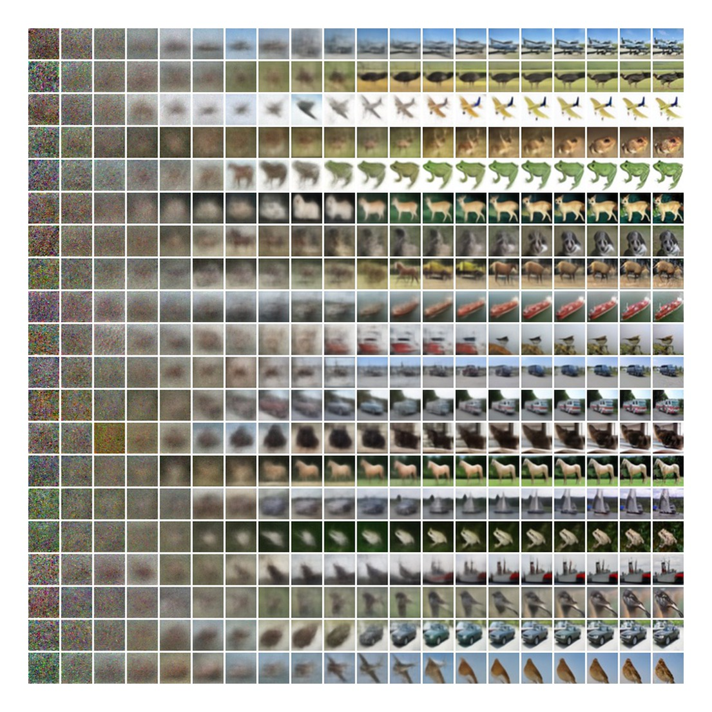
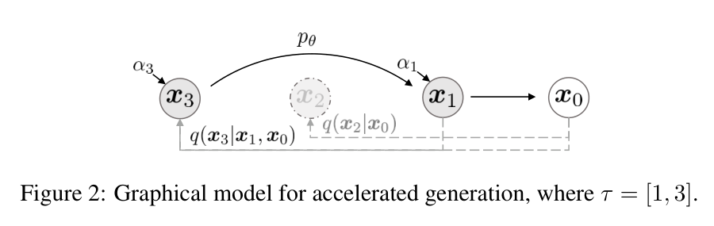
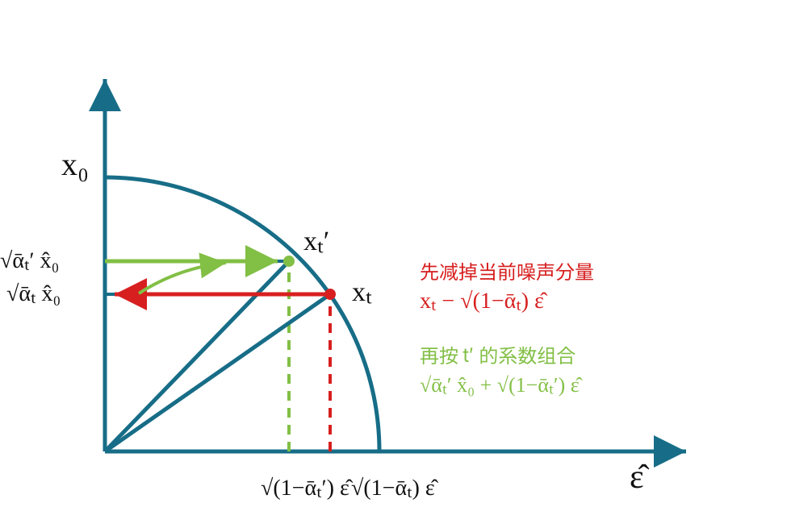
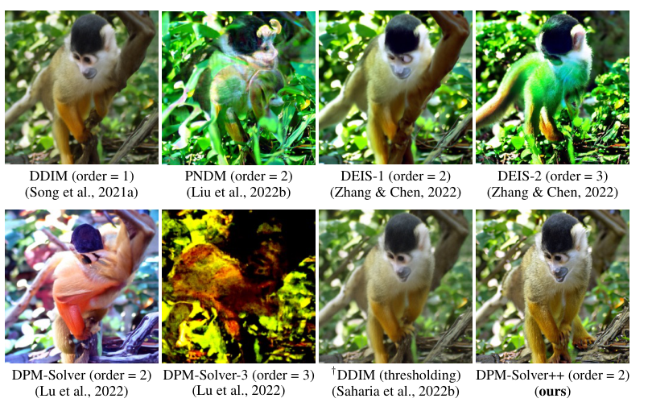

# 采样器怎样把一次预测变成生成轨迹

设当前带噪值为 \(x_t=-.2\)，这一步的信号、噪声幅度为 \(a_t=.8,b_t=.6\)。网络输出 −1。单看这个数无法更新状态，必须先知道它代表噪声、干净样本还是速度。下面先按 epsilon 预测解释它，再算出 DDIM 的下一步，由此进入更一般的数值求解。

这些标量都是教学构造。真实图像或视频使用同形状数组，系数作用于全部元素，网络则联合处理空间和时间关系。路径与目标的定义见[DDPM 训练](training.md)和[噪声参数化](noise-schedules-and-parameterization.md)。

## 先恢复当前的干净样本估计

给定 \(x_t=a_tx_0+b_t\epsilon\)，网络预测为 \(\hat\epsilon\)，可计算

\[
\hat x_0=\frac{x_t-b_t\hat\epsilon}{a_t}
=\frac{-.2-.6(-1)}{.8}=.5.
\]

这个值是当前预测推导出的数据估计。高噪声时它可能模糊或偏差很大；立刻把它当作最终结果，就放弃了后续在较低噪声状态重新读取信息的机会。

DDPM 先将 \(\hat\epsilon\) 转为反向高斯的均值，再按约定方差抽样。例如

\[
\mu_\theta=\frac1{\sqrt{\alpha_t}}
\left(x_t-\frac{\beta_t}{\sqrt{1-\bar\alpha_t}}\hat\epsilon\right),
\qquad x_{t-1}=\mu_\theta+\sigma_{p,t}\xi.
\]

\(\alpha_t\) 是单步系数，\(\bar\alpha_t\) 是累计系数，\(\xi\) 是新抽的噪声。最后到达数据端时，教学版不再添加随机项。这个反向转移依赖具体离散日程，不能仅删去若干循环就认为仍在执行同一过程。

{ width="670" }

<small>图源：[Denoising Diffusion Probabilistic Models](https://arxiv.org/abs/2006.11239)，Figure 14。原图展示 CIFAR-10 无条件生成的反向链，样本逐步变成可辨认图像。图中的不同噪声阶段呈现出不同程度的结构与细节，但这不意味着每一步都有固定的语义分工；日程、模型和条件都会改变具体演化。</small>

## DDIM 如何跳到另一个噪声水平

选择一个更低噪声的时刻 \(s<t\)，取 \(a_s=.96,b_s=.28\)，两者平方和仍为 1。确定性 DDIM 使用

\[
x_s=a_s\hat x_0+b_s\hat\epsilon
=.96(.5)+.28(-1)=.2.
\]

它先在当前状态推断数据分量和噪声分量，再按下一时刻的系数重组。之后网络会读取新的 .2 和新的时间，再作一次预测。除非模型和轨迹恰好具有特殊结构，否则不能一直重复使用第一次的 \(\hat\epsilon\)。

{ width="720" }

<small>图源：[Denoising Diffusion Implicit Models](https://arxiv.org/abs/2010.02502)，Figure 2。原图表达 accelerated generation 可以只使用时间子序列，从而减少生成步数。读图重点：虚线时间点不是训练时不存在，而是采样时可以跳过；DDIM 的重点是改反向路径，而不是让模型一次性直接吐出最终图。</small>

{ width="780" }

<small>图源：自绘，参考 DDIM 的确定性采样几何读法。红色箭头表示从 \(x_t\) 中减去当前预测噪声分量；绿色箭头表示按更低噪声水平 \(t'\) 重新组合数据分量和噪声分量。图只用于说明系数几何，不表示真实样本空间只有二维。</small>

图中的数据轴、噪声轴用于展示系数关系。真实样本向量和某次噪声不必正交，样本轨迹也不必画成圆。方差保持指的是所选概率路径的系数约定。

若当前预测从 −1 偏成 −.9，推得 \(\hat x_0=.425\)，下一状态为 \(.96(.425)+.28(-.9)=.156\)。一次 .1 的噪声误差造成 −.044 的状态误差。一般地

\[
\delta x_s=
\left(b_s-\frac{a_sb_t}{a_t}\right)\delta\epsilon.
\]

下一次网络就在这个偏移状态上运行，误差影响不再局限于当前公式。减少步数会改变每次更新跨度和误差传播，所以“模型在训练时间点上回归准确”不等于“任意跳步都准确”。

## 随机 DDIM 为什么要同时改变旧噪声系数

随机版本写成

\[
x_s=a_s\hat x_0+
\sqrt{b_s^2-\sigma_{t\to s}^2}\hat\epsilon+
\sigma_{t\to s}\xi,
\qquad\xi\sim\mathcal N(0,I).
\]

常见 DDIM 约定使用

\[
\sigma_{t\to s}=\eta
\sqrt{\frac{1-\bar\alpha_s}{1-\bar\alpha_t}}
\sqrt{1-\frac{\bar\alpha_t}{\bar\alpha_s}}.
\]

\(\eta=0\) 返回确定性更新。随机项来自指定转移过程，不能任意选择一个过大的标准差，让根号变成负数。系数上，旧噪声部分让出一部分幅度给新噪声，二者的平方和为 \(b_s^2\)。

这条平方和只解释系数如何分配。真实 \(\hat\epsilon\) 是模型函数，未必具有标准高斯分布，也与 \(\hat x_0\) 相关，因此不能只凭平方和断言任意预测下的边缘分布仍然正确。随机性改变轨迹，生成多样性也可以只来自初始噪声；给定种子、权重和执行环境的确定性过程，同样能在重新抽种子后产生不同结果。

## Euler 与 Heun 怎样近似同一个方向场

许多连续采样器把模型输出转换成 ODE 右侧

\[
\frac{\mathrm dx}{\mathrm dt}=f_\theta(x,t).
\]

时间差记为 \(h=t_{n+1}-t_n\)，逆噪声方向通常有 \(h<0\)。Euler 只读取当前斜率

\[
x_{n+1}^{\mathrm E}=x_n+h f_\theta(x_n,t_n).
\]

Heun 先用 Euler 预测临时终点，再在那里计算斜率

\[
\tilde x=x_n+h f_\theta(x_n,t_n),
\qquad
x_{n+1}^{\mathrm H}=x_n+\frac h2
[f_\theta(x_n,t_n)+f_\theta(\tilde x,t_n+h)].
\]

用可解析的教学方程 \(\mathrm dx/\mathrm dt=x\)，从 \(t=1,x=1\) 走到 \(t=.5\)，准确结果为 \(e^{-.5}\approx.606531\)。Euler 一步得到 .5，Heun 得到 .625，因为第二次读取的斜率为 .5。各用两次函数评估比较时，Euler 可以走两个 .25 的小步，结果为 .5625。这个例子能核验算法和成本，不证明 Heun 对所有生成模型都更好。

在足够光滑的方向场和稳定步长下，Euler 的全局误差通常是一阶，Heun 是二阶。实际模型近似误差、强 guidance、端点数值条件和时间网格都会影响这个比较。某些多步方法复用历史预测，可以减少每个新增时间点的模型调用；这些历史在改变模型或条件后也需要重新处理。

## 专用扩散 solver 利用什么结构

扩散的 probability flow ODE 常可整理成

\[
\frac{\mathrm dx}{\mathrm dt}=A(t)x+B(t)\epsilon_\theta(x,t),
\]

其中 \(A,B\) 来自已知噪声日程。令 \(\Phi(t,s)\) 为线性部分的解，则

\[
x(t)=\Phi(t,s)x(s)+
\int_s^t\Phi(t,u)B(u)\epsilon_\theta(x(u),u)\,\mathrm du.
\]

已知的线性演化可以解析处理，数值方法只需近似网络输出相关的积分。DPM-Solver 使用这种结构及合适的时间坐标构造高阶更新；DPM-Solver++ 使用数据预测形式并讨论 guided sampling。它们节省的是达到某种误差水平所需的网络评估，不会凭空补齐训练数据缺失的概念。

{ width="640" }

<small>图源：[DPM-Solver++](https://arxiv.org/abs/2211.01095)，Figure 1。原图在 ImageNet 256×256、classifier guidance scale 8.0、15 NFE 下比较不同 solver。读图重点：高阶不自动等于稳定；强 guidance 会改变方向场形状，少步求解器必须为这种更陡的轨迹付出设计。</small>

EDM 则把噪声坐标、预条件化、时间网格和确定/随机采样选择放在一起讨论。对特定模型切换 sampler 时，必须保留其输出参数化、输入缩放和端点约定。名字相同的 Euler 接口，也可能运行在不同时间坐标和状态表示上。

## 比较速度要数实际工作

NFE 通常表示网络函数评估次数。Heun 一个时间间隔常需要两次评估，CFG 又需要条件和基准两份预测。将两分支合成一次大 batch 减少了 Python 调用次数，仍然处理了两份样本。报告中应说明以调用次数还是等效单分支工作量计数。

总延迟可以粗分为

\[
T=T_{\mathrm{condition}}+T_{\mathrm{denoise}}+
T_{\mathrm{decode}}+T_{\mathrm{I/O}}.
\]

若非去噪部分占 200ms，每次等效评估 40ms，20 次总计约 1000ms，改成 10 次约 600ms，而非 500ms。这是假设单次耗时恒定的预算计算，真实 batching、并行和显存压力会改变单次耗时。

固定模型、条件和初始噪声后，比较不同时间网格、NFE 和 guidance，再跨多个提示词与种子检查分布。若增加 NFE 后错误持续存在，应继续检查模型和条件接口；若同一模型在细网格正常、粗网格退化，数值求解或少步适配才获得了更直接的证据。需要重训学生时见[扩散蒸馏](distillation.md)。

## 参考资料

- [DDIM](https://arxiv.org/abs/2010.02502)给出与 DDPM 目标兼容的非马尔可夫过程和跳步采样。
- [Score SDE](https://arxiv.org/abs/2011.13456)提供 probability flow ODE。
- [DPM-Solver](https://arxiv.org/abs/2206.00927)、[DPM-Solver++](https://arxiv.org/abs/2211.01095)与[EDM](https://arxiv.org/abs/2206.00364)讨论结构化求解与设计选择。
- [本站 DDPM 实现](../assets/examples/diffusion/minimal_ddpm.py)是固定方差离散链，不实现本页所有 solver。
