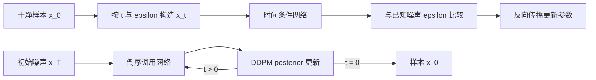

# 一个 DDPM batch 怎样走完训练与采样

本站的 [`minimal_ddpm.py`](../assets/examples/diffusion/minimal_ddpm.py)保留噪声日程、闭式加噪、时间条件网络、loss 和反向采样。它的用途不是生成好看的图片，而是让公式、索引和采样状态能逐行核验。这里沿同一个 batch 追踪这些对象，并说明随机张量 smoke test 可以证明哪些执行性质。

公式推导见[DDPM 数学与训练](training.md)。代码使用 0-based 时间索引，数组 `t=0` 对应公式的第一个带噪状态 \(x_1\)，`t=T-1` 对应公式 \(x_T\)。干净数据变量在代码中仍叫 `x0`，它不对应日程数组的零号元素。



训练链只随机抽一个时间步，采样链才完整走过时间网格。两条链共享噪声日程和网络输出约定，执行顺序却不同。

## 日程怎样变成可索引数组

`make_linear_schedule` 生成一维 `betas`，缓存 `alphas`、`alpha_bars`、前一累计值及根号系数。以下用两个 beta .2、.3 的教学配置手算

```text
array index                 0          1
formula state               x1         x2
beta                        .2         .3
alpha                       .8         .7
alpha_bar                   .8         .56
alpha_bar_prev              1          .8
posterior_variance          0          .1363636...
```

最后一行由 \(\beta_t(1-\bar\alpha_{t-1})/(1-\bar\alpha_t)\) 得到。索引 0 的前一状态是干净输入，所以前一累计值填 1，固定 posterior variance 为 0。这是最终采样不再加噪的边界来源。

这些数组不参与学习，网络参数才由优化器更新。日程可以换，但训练与采样必须使用相同的约定。

## 为什么可以一步得到任意时间的 (x_t)

前向过程的单步写法是

\[
q(x_t\mid x_{t-1})=\mathcal N\left(\sqrt{\alpha_t}x_{t-1},\beta_t I\right),
\qquad \alpha_t=1-\beta_t.
\]

把前面每一步的高斯噪声合并，可以得到闭式表达

\[
q(x_t\mid x_0)=\mathcal N\left(\sqrt{\bar\alpha_t}x_0,
(1-\bar\alpha_t)I\right),
\]

也就是代码中的

\[
x_t=\sqrt{\bar\alpha_t}x_0+\sqrt{1-\bar\alpha_t}\epsilon,
\qquad \epsilon\sim\mathcal N(0,I).
\]

闭式形式省去了从 (x_0) 逐步走到 (x_t) 的循环。训练可以随机抽一个 `t`，直接生成该噪声级别的输入；采样时才需要沿反向日程逐步返回。两者使用的是同一组累计系数，不能把单步的 `alpha` 错当作 `alpha_bar`。

用前面的 .2、.3 配置，`alpha_bar[1] = .56`。因此第二个状态保留信号的幅度是 \(\sqrt{.56}\)，噪声幅度是 \(\sqrt{.44}\)。它们的平方和为 1，说明这是两个独立高斯项的方差预算；信号和噪声的系数本身不需要相加为 1。

## 两个样本怎样读取各自的系数

设 `x0.shape == [2,1,8,8]`，选 `t=[0,1]`。`_extract` 从一维日程中 `gather` 两个数，再 reshape 为 `[2,1,1,1]`。这样第一个样本的全部像素使用第一个噪声尺度，第二个样本使用第二个尺度。

如果保持 `[2]` 直接与图像相乘，广播会尝试把它对齐到最右侧宽度维。即使某些尺寸碰巧允许运行，也不能保证系数对应 batch。显式 reshape 的目的就是把“每个样本一个时间”落实到维度。

`q_sample` 再执行

```python
xt = signal_scale * x0 + noise_scale * noise
```

假设两张图某一位置都是 .5，对应噪声都是 −1。第一张该位置为 \(\sqrt{.8}(.5)-\sqrt{.2}=0\)，第二张为 \(\sqrt{.56}(.5)-\sqrt{.44}\approx-.28916\)。相同原像素和噪声，时间不同，网络输入也不同。

## 网络在哪些层看到时间

`TinyDenoiser` 是一层下采样与上采样的 U-Net 形状网络。默认宽度 32，输入 `[2,1,8,8]` 先变为 `[2,32,8,8]`；下采样后为 `[2,64,4,4]`，上采样回 `[2,32,8,8]`，与早期的 skip 拼接成 `[2,64,8,8]`，最后投影回 `[2,1,8,8]`。

正弦时间嵌入产生 `[2,64]` 特征，经 MLP 后送进每个残差块。块内将时间投影成当前通道宽度，再扩成 `[B,C,1,1]` 加到空间特征。网络因此能对同样的观测值采用不同噪声水平下的预测。

Skip 保存较高分辨率特征，低分辨率路径扩大感受野，两者在恢复空间结构时汇合。这里没有文本条件和 attention，只验证无条件图像去噪接口。输出没有 sigmoid，因为高斯噪声目标可以为负，也没有限定在 `[0,1]`。

## loss 怎样沿相同数据流回传

`diffusion_loss` 抽噪声、调用 `q_sample`、读取网络输出，再使用 `F.mse_loss(prediction, noise)`。默认 reduction 是所有 batch 和空间元素的均值。如果有 padding 或无效区域，就需要额外定义有效元素归约；这份固定尺寸实现没有 padding。

```python
# 假定 x0、model、schedule 已放在同一 device
batch_size = x0.shape[0]
t = torch.randint(0, num_steps, (batch_size,), device=x0.device)
loss = diffusion_loss(model, x0, t, schedule)
optimizer.zero_grad()
loss.backward()
optimizer.step()
```

当 batch 中某个输出误差为 .1，该元素对 MSE 的贡献是 .01，但梯度还会除以总元素数。不能仅凭这个标量就判断某层权重变化有多大，后续还有网络 Jacobian 与优化器状态。

### 预测噪声只是三种等价参数化中的一种

本实现让网络输出 \(\epsilon_\theta(x_t,t)\)，训练目标是抽样时使用的噪声 \(\epsilon\)。如果网络改为预测干净图像，可以由

\[
\hat x_0=\frac{x_t-\sqrt{1-\bar\alpha_t}\epsilon_\theta(x_t,t)}
{\sqrt{\bar\alpha_t}}
\]

换算得到。也可以预测所谓 velocity，具体定义依赖采用的噪声参数化。三种写法的网络输入可以相同，但 loss、采样公式和数值尺度必须一起换，不能只把变量名 `noise` 改成 `x0`。

一个很小的数值自测是先随机生成 `x0` 和 `noise`，构造 `xt`，再用已知 noise 反推 `x0_hat`，检查最大绝对误差接近浮点误差。这个测试只验证代数关系；模型输出的噪声并不可能在训练早期等于真实噪声。

实现检查输出 shape 与噪声相同。形状正确仍不足以证明监督正确，例如误把 `xt` 当 target 也能运行。因此配套测试会独立核验加噪值、参数确实变化和采样边界。

## `p_sample` 怎样把预测转回状态

`p_sample` 使用单步 `alpha_t`、`beta_t` 和累计 `alpha_bar_t` 计算 DDPM 反向均值

\[
\mu_\theta=\alpha_t^{-1/2}
\left(x_t-\frac{\beta_t}{\sqrt{1-\bar\alpha_t}}\epsilon_\theta(x_t,t)\right).
\]

随后按 posterior variance 加入新噪声。若 batch 时间为 `[0,1]`，第一张必须保持均值，第二张可以添加随机项，因此实现使用逐样本 `nonzero_mask`。仅写 `if any(t == 0)` 并跳过整个 batch，会错误取消第二张的随机转移。

后验均值所用的系数来自

\[
q(x_{t-1}\mid x_t,x_0)
=\mathcal N\left(\tilde\mu_t(x_t,x_0),\tilde\beta_tI\right),
\]

其中

\[
\tilde\beta_t=\beta_t\frac{1-\bar\alpha_{t-1}}
{1-\bar\alpha_t}.
\]

代码不知道真实的 (x_0)，所以先用网络预测的噪声估计 \(\hat x_0\)，再把它代入后验均值的等价形式。采样实现中最容易出错的是把当前 `t`、前一累计量和数组索引错位。用只有两个 beta 的日程打印每个中间系数，比直接跑长日程更容易定位这个问题。

`sample_loop` 从标准高斯开始，倒序遍历全部日程，每次先预测再更新状态。新状态再次输入网络，形成完整轨迹。函数通过同一个生成器控制初值与各步随机项，便于固定 seed 对照。

## smoke 输出为什么不代表生成能力

`smoke` 用随机小图做一次优化器更新，再执行一条短采样链，输出 loss、形状与有限性。它能发现设备、shape、梯度和数值执行错误，却没有训练真实数据分布。

还要检查短日程的先验。默认 beta 在 .0001 到 .02 之间，如果只用 8 步，累计信号仍然很大，前向终点远没有接近纯高斯。smoke 从标准高斯初始化是为了走通采样代码，不能用这种配置评价 DDPM 图像质量。要做实际训练，应采用使末端分布与先验相容的完整配置，并检查数据尺度、训练收敛和真实采样结果。

这也说明为何“所有值有限”是执行检查，不是模型正确性的完整证明。一个恒零网络也可能输出有限值，形状也可以正确。

## 运行配套检查

在仓库根目录创建一个专用虚拟环境并安装依赖

```bash
python -m venv .venv-diffusion
source .venv-diffusion/bin/activate
python -m pip install -r files/assets/examples/diffusion/requirements.txt
python -m pytest files/assets/examples/diffusion/test_minimal_ddpm.py -q
python files/assets/examples/diffusion/minimal_ddpm.py smoke
```

这些命令会创建 `.venv-diffusion`，并从包索引下载依赖。环境清理与运行方式见[配套 README](../assets/examples/diffusion/README.md)。如果已有兼容 PyTorch 环境，可以直接执行最后两条，不必重复安装。本文解释了源码与机制，不声称已经训练出可辨识图像。

接入真实数据以后，可先固定很小的数据集、时间和噪声检查能否拟合，再恢复随机采样，最后比较完整生成。这个逐步放开随机性的过程能帮助判断失败发生在输入目标、优化，还是采样接口，具体见[训练配方与排障](practical-training-recipes-and-failure-analysis.md)。

如果要把这个最小实现扩展到真实训练，建议按下面的顺序增加复杂度。

1. 先用固定的 `t` 和固定 seed，确认 `q_sample`、loss 与梯度都能复现。
2. 再让 `t` 在 batch 内随机，统计每个时间桶的 loss，检查是否有某些噪声级别完全没有被学习。
3. 接着加入真实数据归一化和随机增强，保留未增强的验证样本作为参考。
4. 最后才增加 classifier-free guidance、EMA、更多采样器或更长的日程。

每一步都保留一条不变的 CPU 参考路径。若加入新功能后图像变差，先比较同一 `x0`、同一 `t`、同一噪声下的 `xt` 和网络目标，避免把数据变化误判为采样器问题。

- [完整实现](../assets/examples/diffusion/minimal_ddpm.py)与[配套测试](../assets/examples/diffusion/test_minimal_ddpm.py)分别提供可执行对象和数值断言。
- [Hugging Face 扩散实现 notebook](https://github.com/huggingface/diffusion-models-class/blob/72bf3dd739da641075dcff0ee54ce28e7a38a8ab/unit1/02_diffusion_models_from_scratch.ipynb)可对照从小 U-Net 到时间条件、噪声目标的组织方式。本站没有复制其安装环境或执行外部训练。

## 论文和实现依据

前向加噪、后验方差和采样顺序对照 [Denoising Diffusion Probabilistic Models](https://arxiv.org/abs/2006.11239)；实现接口参考 Hugging Face 的[从零实现 notebook](https://github.com/huggingface/diffusion-models-class/blob/72bf3dd739da641075dcff0ee54ce28e7a38a8ab/unit1/02_diffusion_models_from_scratch.ipynb)。代码、测试和 0-based 索引是本站自己整理的最小实现，不复现完整图像训练，也不把 smoke 的 finite/shape 通过当作生成质量。

先运行单步 forward，打印 `alpha_bar[t]`、`x_t` 和噪声目标；再固定 seed 跑完整短链，比较每一步 shape、有限值和最后状态。若要接真实数据，先在小数据集上过拟合，再恢复随机采样，保持这条诊断顺序。
