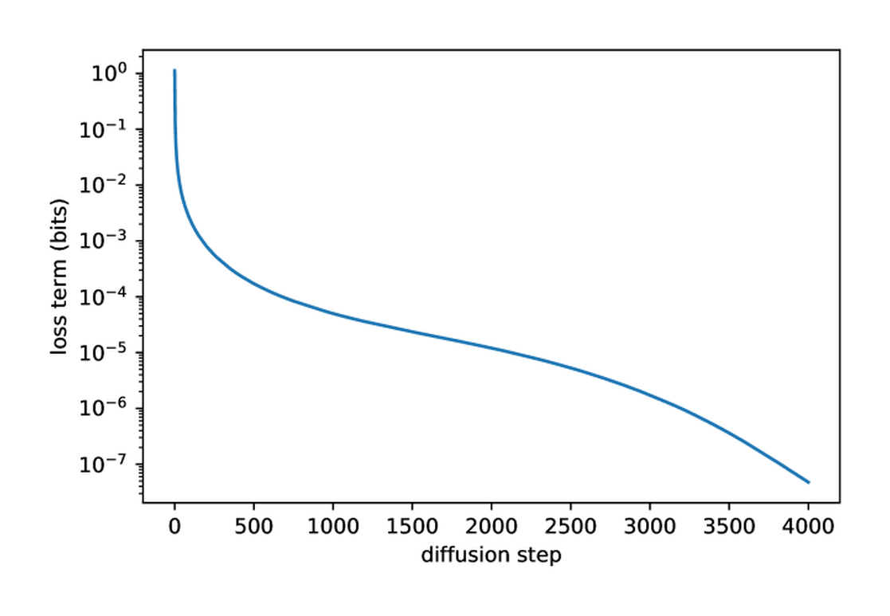
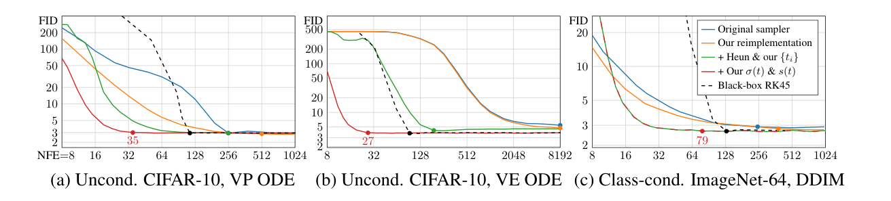

# 噪声日程与参数化

上一页讲了扩散训练如何构造带噪样本：

\[
x_t=\sqrt{\bar{\alpha}_t}x_0+\sqrt{1-\bar{\alpha}_t}\epsilon
\]

这页继续问两个更细的问题：

1. **噪声日程**：不同时间步到底加多少噪声？
2. **参数化**：模型到底预测噪声、干净图、score，还是 velocity？

这两个问题看似是训练细节，其实会直接影响采样质量、少步生成、guidance 稳定性和视频一致性。

## 先看图：不同时间步的学习压力不同

{ width="660" }

<small>图源：[Improved Denoising Diffusion Probabilistic Models](https://arxiv.org/abs/2102.09672)，Figure 2。</small>

<small>原论文图意：该图分析 CIFAR-10 训练中 variational lower bound 各 timestep 项的贡献，显示不同 diffusion step 的损失权重和学习压力差异很大。</small>

<small>本教程读法：不要把所有时间步想成一样难。低噪声区间更像补边缘和纹理，中噪声区间更像恢复结构，高噪声区间更像从几乎看不见的信号里猜语义。噪声日程和 loss weighting 会决定模型把精力花在哪里。</small>

## 1. 噪声日程决定什么

离散扩散里，单步前向过程是：

\[
q(x_t \mid x_{t-1})
=
\mathcal{N}\left(x_t;\sqrt{1-\beta_t}x_{t-1},\beta_t I\right)
\]

这行式子在说：第 \(t\) 步把上一时刻图像 \(x_{t-1}\) 缩小一点，再加入强度为 \(\beta_t\) 的高斯噪声。

把 \(\mathcal{N}\) 拆开读会更清楚：

| 位置 | 在这条公式里 | 含义 |
| --- | --- | --- |
| 第 1 个位置 \(x_t\) | 当前带噪样本 | 这个分布要生成或评估的变量 |
| 第 2 个位置 \(\sqrt{1-\beta_t}x_{t-1}\) | 均值 | 保留下来的上一时刻信号 |
| 第 3 个位置 \(\beta_t I\) | 协方差 | 噪声强度；\(I\) 表示各维独立同方差 |

符号含义：

| 符号 | 含义 |
| --- | --- |
| \(\beta_t\) | 第 \(t\) 步新增噪声强度 |
| \(1-\beta_t\) | 第 \(t\) 步保留信号比例 |
| \(I\) | 单位矩阵，表示独立同方差噪声 |
| \(q\) | 固定加噪过程 |

一整串 \(\beta_1,\beta_2,\ldots,\beta_T\) 就叫噪声日程。它决定图像从清晰到纯噪声的速度。

通常还会定义：

\[
\alpha_t=1-\beta_t,
\qquad
\bar{\alpha}_t=\prod_{s=1}^{t}\alpha_s
\]

这行式子在说：\(\alpha_t\) 是单步保留信号比例，\(\bar{\alpha}_t\) 是从第 1 步到第 \(t\) 步累计保留的信号比例。

符号含义：

| 符号 | 含义 |
| --- | --- |
| \(\alpha_t\) | 单步信号保留比例 |
| \(\bar{\alpha}_t\) | 累计信号保留比例 |
| \(\prod\) | 连乘，表示把多个时间步的保留比例乘起来 |

## 2. SNR：比 \(\beta_t\) 更贴近学习难度

闭式加噪是：

\[
x_t
=
\sqrt{\bar{\alpha}_t}x_0
+
\sqrt{1-\bar{\alpha}_t}\epsilon
\]

这行式子在说：\(\bar{\alpha}_t\) 控制原图信号还剩多少，\(1-\bar{\alpha}_t\) 控制噪声占多少。

如果上下文写着 \(\epsilon\sim\mathcal{N}(0,I)\)，这里的 \(0\) 是噪声均值，\(I\) 是单位协方差；也就是每个维度独立采样标准高斯噪声。和 \(\mathcal{N}(x;\mu,\Sigma)\) 相比，它省略了“在哪个变量上取值”的第 1 个位置，因为这是在说“\(\epsilon\) 从这个分布里采样”。

于是可以定义信噪比：

\[
\text{SNR}_t
=
\frac{\bar{\alpha}_t}{1-\bar{\alpha}_t}
\]

这行式子在说：SNR 衡量当前时间步里“原图信号”相对“噪声”的强弱。

符号含义：

| 符号 | 含义 |
| --- | --- |
| \(\text{SNR}_t\) | 第 \(t\) 步的信噪比 |
| \(\bar{\alpha}_t\) | 信号强度部分 |
| \(1-\bar{\alpha}_t\) | 噪声强度部分 |

直觉上：

- SNR 高：图像还很清楚，模型主要学局部细节修复。
- SNR 中等：图像结构还在，模型学语义和形状。
- SNR 低：几乎都是噪声，模型要靠分布先验猜大结构。

所以线性 \(\beta_t\) 不等于线性学习难度。真正影响训练体验的，是整个 SNR 曲线怎么变化。

## 3. 常见噪声日程

### 3.1 线性 \(\beta_t\)

最直接的做法是让 \(\beta_t\) 从小到大线性增加。

优点：简单、好复现、适合入门理解。

缺点：线性增加噪声强度，不代表信息难度线性变化；某些 SNR 区间可能过密，另一些区间可能过稀。

### 3.2 Cosine 日程

Improved DDPM 推动了 cosine schedule 的常用化。它更直接地控制 \(\bar{\alpha}_t\) 的衰减，让信号保留过程更平滑。

直觉上，cosine 日程不会过早把图像彻底打成噪声，因此中间噪声区间更容易得到稳定训练信号。它常被当作比线性日程更稳的默认选择。

### 3.3 连续噪声尺度 \(\sigma\)

EDM 等连续时间框架更常直接用噪声标准差 \(\sigma\) 描述状态：

\[
x = x_0 + \sigma \epsilon
\]

这行式子在说：当前样本是干净图加上标准差为 \(\sigma\) 的噪声。这里不再强调离散编号 \(t\)，而是直接用噪声大小 \(\sigma\) 表示“现在有多吵”。

符号含义：

| 符号 | 含义 |
| --- | --- |
| \(x\) | 当前带噪样本 |
| \(x_0\) | 干净样本 |
| \(\sigma\) | 噪声标准差，越大表示噪声越强 |
| \(\epsilon\) | 标准高斯噪声 |

这种写法更容易和 ODE / SDE 采样器连接，因为采样器可以直接沿着连续噪声尺度安排步长。

## 4. 参数化：模型到底输出什么

同一个带噪状态 \(x_t\)，模型可以学习不同目标。它们表达的信息可以互相转换，但训练难度和采样稳定性不完全一样。

### 4.1 预测噪声 \(\epsilon\)

\[
\hat{\epsilon}=\epsilon_\theta(x_t,t)
\]

这行式子在说：模型输入带噪图 \(x_t\) 和时间步 \(t\)，输出它认为被加入的噪声。

优点：训练目标最直接，因为训练时真实噪声 \(\epsilon\) 是我们自己采样出来的。

代价：在不同 SNR 区间，噪声预测的尺度和误差影响不完全均衡，少步采样或强 guidance 时需要和采样器一起调。

### 4.2 预测干净图 \(x_0\)

\[
\hat{x}_0=x_{0,\theta}(x_t,t)
\]

这行式子在说：模型直接从带噪图里猜原始干净图。

优点：直觉清楚，采样器可以直接拿 \(\hat{x}_0\) 计算更新。

代价：高噪声时 \(x_t\) 几乎看不出原图，直接预测 \(x_0\) 更容易承受尺度和不确定性压力。

### 4.3 预测 score

\[
s_\theta(x_t,t)
\approx
\nabla_{x_t}\log p_t(x_t)
\]

这行式子在说：模型估计当前噪声分布 \(p_t\) 的对数密度梯度，也就是“往哪里走，概率密度会上升最快”。

符号含义：

| 符号 | 含义 |
| --- | --- |
| \(s_\theta\) | 模型估计的 score |
| \(p_t(x_t)\) | 第 \(t\) 个噪声水平下的数据分布 |
| \(\log p_t(x_t)\) | 当前样本在该分布下的对数概率密度 |
| \(\nabla_{x_t}\) | 对样本 \(x_t\) 求梯度 |

score 不是“分数”，而是一个方向向量。它把扩散和 SDE / ODE 理论连起来。

在常见噪声预测参数化下，可以粗略理解为：

\[
s_\theta(x_t,t)
\propto
-\frac{1}{\sigma_t}\epsilon_\theta(x_t,t)
\]

这行式子在说：预测噪声和预测 score 不是两件完全无关的事；噪声方向的反方向，经过时间相关缩放后，就是朝数据高概率区域移动的方向。

### 4.4 预测 velocity \(v\)

常见的混合路径写成：

\[
x_t=\alpha_t x_0+\sigma_t\epsilon
\]

这行式子在说：\(x_t\) 是干净图和噪声按两个权重混合出来的状态。

velocity 通常定义为：

\[
v=\alpha_t\epsilon-\sigma_t x_0
\]

这行式子在说：\(v\) 是沿混合路径移动的方向，既包含噪声信息，也包含数据信号信息。

如果模型预测 \(\hat{v}\)，常可以换回：

\[
\hat{x}_0=\alpha_t x_t-\sigma_t\hat{v}
\]

\[
\hat{\epsilon}=\sigma_t x_t+\alpha_t\hat{v}
\]

这两行式子在说：velocity 不是新的神秘信息，而是一个坐标系。预测 \(v\) 后，采样器仍然能得到需要的 \(\hat{x}_0\) 或 \(\hat{\epsilon}\)。

## 5. 为什么“等价”又“不等价”

从信息表达看，只要知道 \(x_t\)、时间步和其中一种预测目标，很多情况下可以解析换算到其他目标。

但训练不是只看信息能否换算，还要看：

- 损失在不同时间步的尺度是否均衡；
- 高噪声和低噪声区间谁主导梯度；
- guidance 放大后是否容易过冲；
- 少步采样时误差是否累积；
- 模型输出坐标是否适合采样器。

所以 \(\epsilon\)-prediction、\(x_0\)-prediction、score prediction 和 \(v\)-prediction 像是用不同坐标系描述同一个去噪问题。坐标系不同，优化几何也不同。

## 6. 日程、参数化、采样器要一起看

{ width="920" }

<small>图源：[Elucidating the Design Space of Diffusion-Based Generative Models](https://arxiv.org/abs/2206.00364)，Figure 2。</small>

<small>原论文图意：在多个预训练模型上比较确定性采样设计，横轴是 NFE，纵轴是 FID；Heun、噪声日程 \(\sigma(t)\)、scaling \(s(t)\) 等改动都会影响少步质量。</small>

<small>本教程读法：这张图说明，采样质量不是只由模型权重决定。噪声日程、参数化、时间离散方式和 solver 共同决定少步采样表现。NFE 是模型前向调用次数，越少通常越快，但数值误差更难控制。</small>

一句话：**噪声日程决定训练样本落在哪些噪声区间，参数化决定模型用什么坐标理解这些样本，采样器决定推理时如何兑现这些学习成果。**

## 7. 和下一页的关系

这一页解释了噪声水平和预测坐标。下一页 [Score Matching 到 SDE](score-matching-sde-and-probability-flow.md) 会把“预测噪声”进一步解释成“学习概率分布的梯度方向”，并说明为什么扩散采样可以被看成 SDE / ODE 的数值求解。

!!! tip "进阶理解"
    在视频扩散和世界模型里，噪声日程还会影响运动是否连续、身份是否漂移、动作条件是否敏感。基础图像扩散先把 SNR 和参数化理解清楚，后面看高低噪声 expert、Flow Matching 或 Phased DMD 会轻松很多。

## 小结

噪声日程控制“训练题目有多难、难题分布在哪里”；参数化控制“模型用哪个坐标系回答题目”。它们不是孤立技巧，而是扩散训练和采样之间最重要的连接层。

*[SNR]: Signal-to-Noise Ratio，信噪比。
*[NFE]: Number of Function Evaluations，模型前向调用次数。
