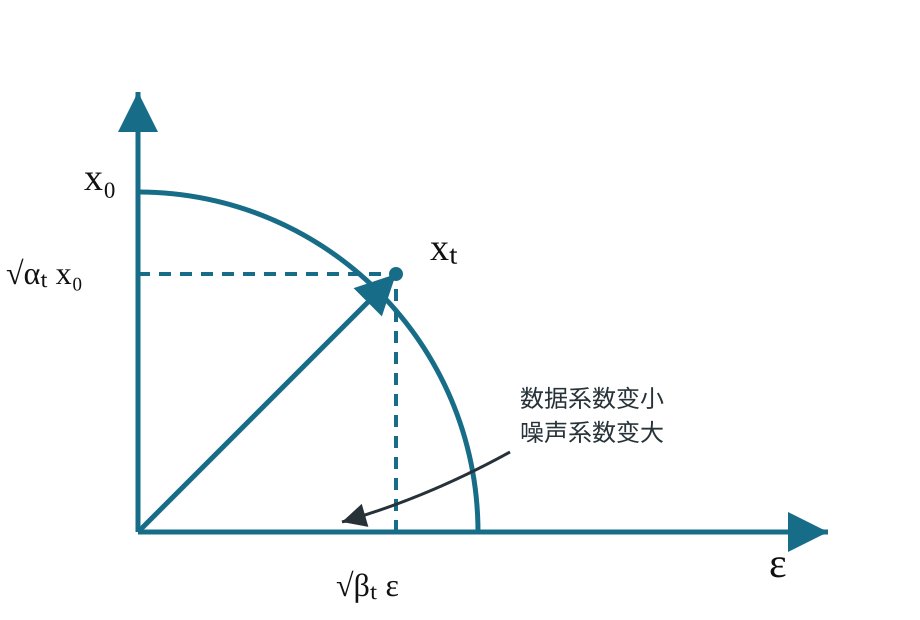
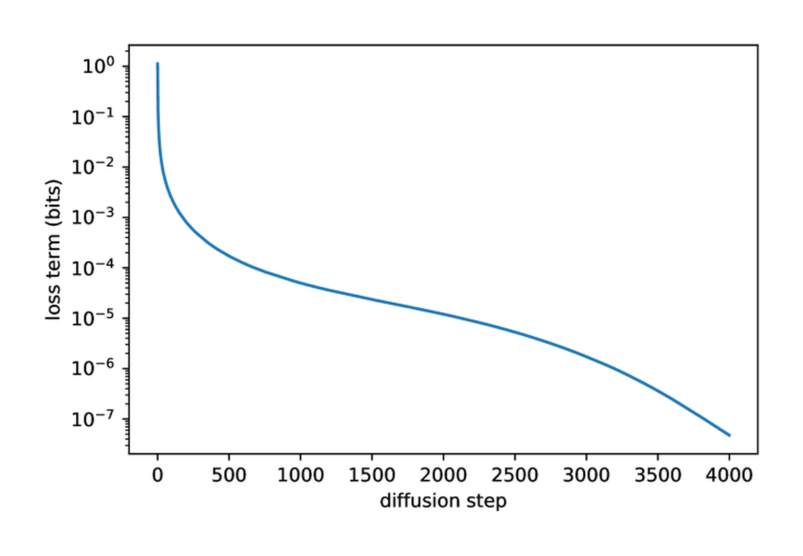
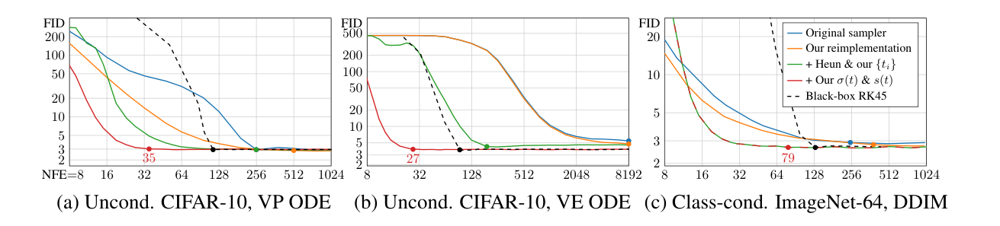

# 噪声日程与预测目标怎样改变同一次训练

设一个干净 latent 元素为 .5，这次抽到的标准高斯噪声为 −1。在信号系数 .8、噪声系数 .6 时，网络看到的值为 −.2。现在让三个网络分别预测噪声、干净值和 velocity，它们输出 −1、.5 和 −1.1 都可以是正确答案。只有先说明所用坐标，才能判断输出是否正确、损失有多大、下一步怎样更新。

本文固定写成

\[
x_t=a_tx_0+b_t\epsilon.
\]

\(a_t\) 是信号幅度，\(b_t\) 是噪声标准差。在方差保持的 DDPM 路径中，\(a_t=\sqrt{\bar\alpha_t}\)、\(b_t=\sqrt{1-\bar\alpha_t}\)。单步 \(\alpha_t=1-\beta_t\) 保留给离散链，避免用同一个字母混指单步量和累计幅度。

## 日程规定每个训练输入还含多少信号

单步 beta 日程经过累计乘积后才形成 \(a_t,b_t\)。即使 \(\beta_t\) 线性增长，\(a_t\) 也不线性下降。训练采到同样的整数时间，在不同日程中可能得到完全不同的输入难度。

{ width="760" }

<small>图源：自绘，参考 DDPM / DDIM 的系数几何读法。读图时把纵轴看成数据方向 \(x_0\)，横轴看成随机噪声方向 \(\epsilon\)。\(x_t\) 位于圆弧上，表示它由 \(\sqrt{\bar\alpha_t}x_0\) 和 \(\sqrt{1-\bar\alpha_t}\epsilon\) 两部分组成。图只用于建立直觉，不表示真实图像空间只有二维。</small>

若数据每维已中心化且方差约为 1，信噪比可写成

\[
\operatorname{SNR}(t)=\frac{a_t^2}{b_t^2},
\qquad \lambda_t=\log\operatorname{SNR}(t).
\]

本例 SNR 为 \(.64/.36=1.7778\)，log-SNR 约为 .5754。若换了 VAE，latent 方差变成 4，实际信号方差就是 \(4a_t^2\)。即使日程表完全相同，信噪比也变为原来的四倍。因此 VAE 的尺度变换属于训练接口，不能仅在解码时补救。

高噪声会掩盖更多可观测细节，低噪声保留更多输入信息。但不能据此把语义、布局和纹理严格分配给固定时间区间。低对比度的小物体可能很早消失，大结构也可能需要多个噪声区间共同决定。按 SNR 分桶可以比较误差发生在哪里，不能单独证明某一桶只负责某种内容。

## 从一个输出恢复其他预测量

给定 \(a_t,b_t\)，噪声与数据预测可以相互转换

\[
\hat x_0=\frac{x_t-b_t\hat\epsilon}{a_t},
\qquad
\hat\epsilon=\frac{x_t-a_t\hat x_0}{b_t}.
\]

在本例中，\((-.2-.6\times(-1))/.8=.5\)，反向转换也得到 −1。这是逐元素代数，不能保证一个有限容量网络在两种目标下学到相同函数。

当 \(a_t\) 很小时，从噪声恢复数据涉及除以一个小数。若噪声预测误差为 \(\delta\epsilon\)，数据估计误差是

\[
\delta x_0=-\frac{b_t}{a_t}\delta\epsilon.
\]

本例中误差放大系数为 .75。若 \(a_t=.1\)、\(b_t\approx.995\)，相同 .1 的噪声误差会变成约 .995 的数据误差。由此可见，高噪声端的很小 MSE 也可能对应较大的干净样本误差。

score 的坐标又不同。对高斯扰动分布，平方误差最优噪声预测与边缘 score 的关系为

\[
s_\theta(x_t,t)\approx-\frac{\hat\epsilon(x_t,t)}{b_t}.
\]

这里的 score 是对样本坐标的对数密度梯度，单位与数据值互为倒数。准确关系涉及给定 \(x_t\) 的条件均值，不能把某一次已知噪声直接说成整个混合分布的真实 score，推导见[Score Matching](score-matching-sde-and-probability-flow.md)。

## v-prediction 是一组可逆的旋转坐标

对 \(a_t^2+b_t^2=1\) 的路径，定义

\[
v_t=a_t\epsilon-b_tx_0.
\]

将它与输入放在一起

\[
\begin{pmatrix}x_t\\v_t\end{pmatrix}
=
\begin{pmatrix}a_t&b_t\\-b_t&a_t\end{pmatrix}
\begin{pmatrix}x_0\\\epsilon\end{pmatrix}.
\]

矩阵正交，因此逆变换不需要除以 \(a_t\) 或 \(b_t\)

\[
\hat x_0=a_tx_t-b_t\hat v,
\qquad
\hat\epsilon=b_tx_t+a_t\hat v.
\]

本例 \(v=.8(-1)-.6(.5)=-1.1\)。代回得到 \(\hat x_0=.8(-.2)-.6(-1.1)=.5\)，\(\hat\epsilon=.6(-.2)+.8(-1.1)=-1\)。这种转换避免了上述端点除法，但网络的学习难度、训练权重和其他数值问题仍然存在。

若令 \(a=\cos\phi,b=\sin\phi\)，则 \(\mathrm dx/\mathrm d\phi=v\)。对一般时间变量 \(t\)，实际导数为

\[
\frac{\mathrm dx_t}{\mathrm dt}=\frac{\mathrm d\phi_t}{\mathrm dt}v_t.
\]

所以这里的 v 不自动等于任意日程下的 \(\mathrm dx/\mathrm dt\)。[Flow Matching](flow-matching-and-rectified-flow.md)在线性路径 \(x_t=(1-t)x_0+t\epsilon\) 上的目标为 \(\epsilon-x_0\)，与这组旋转坐标的 v 使用不同定义。

## 能互换预测值，不代表能互换无权重损失

固定同一个 \(x_t\)，利用上面的转换可得

\[
\|\hat\epsilon-\epsilon\|^2
=\frac{a_t^2}{b_t^2}\|\hat x_0-x_0\|^2
=\operatorname{SNR}(t)\|\hat x_0-x_0\|^2.
\]

因此，无权重 epsilon MSE 相对于无权重数据 MSE，会把高 SNR 时间的同等数据误差赋予更大权重。v 预测则满足

\[
\|\hat v-v\|^2=\frac1{b_t^2}\|\hat x_0-x_0\|^2,
\]

因为固定输入时 \(\delta x_0=-b_t\delta v\)。这些等式比较的是通过指定转换得到的预测值，说明隐含权重如何变化，并没有宣布某一种目标对所有模型最优。

{ width="720" }

<small>图源：[Improved Denoising Diffusion Probabilistic Models](https://arxiv.org/abs/2102.09672)，Figure 2。原图分析 CIFAR-10 训练中 variational lower bound 各 timestep 项的贡献。读图重点：不同时间步对训练目标的压力差异很大；schedule、loss weighting 和 timestep sampling 会决定模型容量花在低噪声细节、中噪声结构还是高噪声语义上。</small>

时间采样也在改权重。若目标为均匀平均 \(T^{-1}\sum_t L_t\)，却按 \(p(t)\) 抽时间，那么无偏估计需要使用 \(L_t/[Tp(t)]\)。不做这个修正也可以形成新的目标，但此时应承认优化比例变了。例如只增加高噪声样本数量，又增加相应 loss 权重，两项效果会叠加。

## 训练日程与推理时间网格有不同职责

训练日程决定带噪数据分布。推理网格决定求解器实际访问哪些状态。同一个训练日程可以选择 20 个或 50 个推理时间点，但不能把训练索引 `500` 直接改解释成标准差 `500`。

在一种常见的连续噪声坐标里，将输入除以 \(a_t\)，得到

\[
y_\sigma=x_0+\sigma\epsilon,\qquad\sigma=b_t/a_t.
\]

网络输入缩放、时间编码和输出重构都要随之配套。EDM 用预条件化组织这些尺度，典型形式为

\[
D_\theta(y,\sigma)=c_{\mathrm{skip}}(\sigma)y+
 c_{\mathrm{out}}(\sigma)F_\theta(c_{\mathrm{in}}(\sigma)y,c_{\mathrm{noise}}(\sigma)).
\]

外层系数控制信号范围与残差尺度，内部网络承担经缩放后的预测。不能仅把 checkpoint 的时间输入替换成连续 sigma，就得到相同模型。

{ width="920" }

<small>图源：[Elucidating the Design Space of Diffusion-Based Generative Models](https://arxiv.org/abs/2206.00364)，Figure 2。原图在多个预训练模型上比较确定性采样设计，横轴是 NFE，纵轴是 FID。读图重点：采样质量不是由模型权重或 sampler 名字单独决定；噪声尺度、preconditioning、时间离散、solver 和 NFE 共同决定少步表现。</small>

随机采样同样需要匹配所选转移核。像 DDIM 的 \(b_s^2-\sigma_{t\to s}^2\) 系数来自指定过程，不能任意加一份噪声后仍宣称保持原路径。尤其是预测噪声通常与预测数据相关，也不一定服从单位高斯；系数平方和正确只是必要的代数检查之一，不足以证明真实输出分布正确。

## 核验一个 checkpoint 的接口

实际接入时，可以固定一个真实样本和一份噪声，在几个时间点构造输入，记录模型输出解释成 epsilon、数据或 v 后的结果。转换回输入应满足原来的系数等式。这个检查可以发现参数化和尺度错误，但模型输出全为零也能通过部分代数一致性，所以还需要比较已知监督误差，并运行完整采样。

先确定表示和归一化，再确定路径、目标、时间编码与 sampler。它们共同定义一次模型调用的含义。具体代码对照见[最小实现](minimal-ddpm-implementation.md)，采样的数值例见[DDIM 与 ODE solver](inference.md)。

- [DDPM](https://arxiv.org/abs/2006.11239)给出累计系数与 epsilon 参数化。
- [Progressive Distillation](https://arxiv.org/abs/2202.00512)讨论 v 参数化。
- [EDM](https://arxiv.org/abs/2206.00364)讨论噪声尺度、预条件化、训练和求解器的共同设计。
