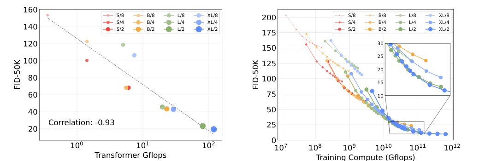
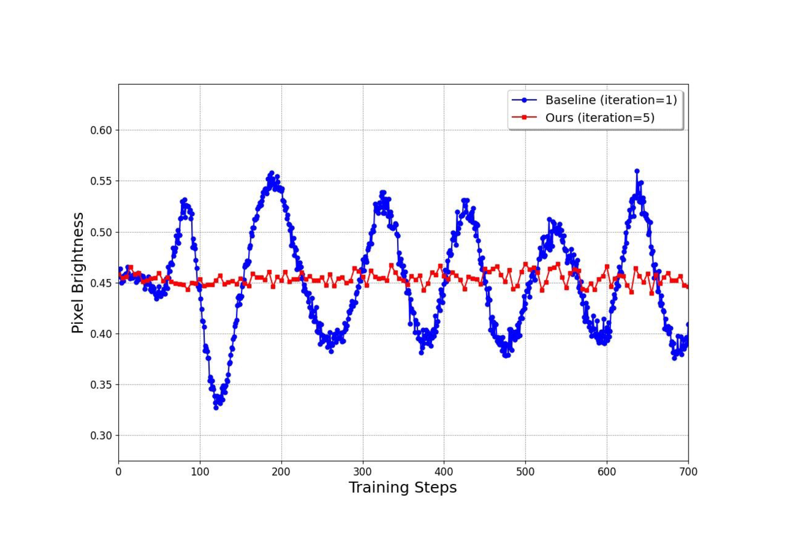
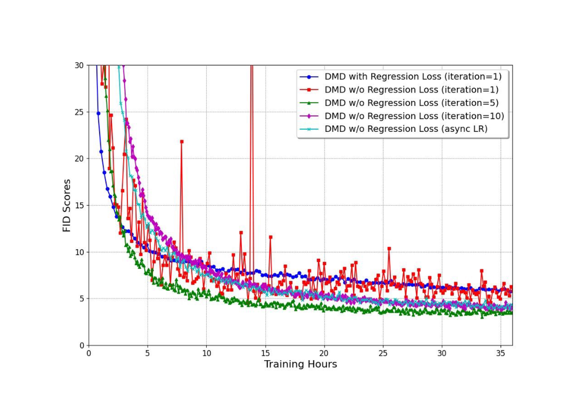

# 训练 loss 下降，为什么生成结果仍然不对

假设一个模型的训练 loss 稳定下降，完整采样却总把提示中的红球画模糊。可以猜 VAE 压缩过强、网络没学会、噪声日程不合适，也可以不断换 sampler。但单个现象不足以区分这些原因。更有效的方式是固定同一份输入，逐次绕开组件，观察错误在哪一步首次出现。

下面是一组用于诊断的实验设计，没有声称来自某次真实训练。它从普通图像出发，再说明怎样延伸到视频和少步学生。每次只改变一个能解释结果的因素，保留固定输入与失败输出。

## 先让重建路径回答是否丢失了信息

选一张真实红球图，固定裁剪、分辨率与像素范围，只运行 VAE 编码、latent 尺度变换的逆过程和解码，不运行扩散网络。

如果球的轮廓已经模糊，先检查预处理和编解码。输入本来只有低分辨率、错误地重复归一化、使用了不匹配的 VAE 权重，都可能产生同样现象。需要将预处理后实际进入 VAE 的图也保存下来，才能分清输入已经损坏还是重建损坏。

如果重建清晰，才有理由继续查看生成主干。这个对照不能证明 VAE 对所有场景都足够，只能说明当前失败样本在已检查设置下具有可重建的表示。

视频应逐帧回放，并把首帧、快速运动和分块边界单独标记。整体编码与带缓存分块编码的输出若只在边界显著不同，优先检查历史特征与步长相位，见[视频 VAE](video-vae-1029-1246.md)。仅凭“首帧比较清楚”无法确定原因。

## 再固定一个样本、一个时间和一份噪声

冻结外部组件，用同一份干净 latent、同一噪声和同一时间反复计算 loss，检查小网络是否能拟合这个明确目标。它暂时去掉了数据变化与时间抽样，方便检查梯度和目标构造。

```python
# 机制伪代码，只为定位接口与优化问题
clean = frozen_encoder(fixed_image)
noise = fixed_noise
noisy = a * clean + b * noise
for _ in range(debug_updates):
    prediction = model(noisy, fixed_t, fixed_condition)
    loss = mean((prediction - noise) ** 2)
    optimizer.zero_grad()
    loss.backward()
    optimizer.step()
```

若连这个任务都无法明显降低误差，先查参数是否在优化器内、是否被 `no_grad` 截断、目标是否在每次循环意外变化、学习率和数据尺度是否合理。注意，这种拟合容易让模型记住固定噪声，成功只能说明有监督的执行链可学习，不能证明生成泛化。

通过以后逐项放开随机性，先固定小数据集但重新抽噪声，再增加时间变化，最后增加数据和条件。这样可以看到误差在哪项变化引入后显著增长。

## 用代数检查区分参数化错误与模型误差

假设真实 \(x_0=.5,\epsilon=-1,a=.8,b=.6\)，则 \(x_t=-.2\)。epsilon 模型的正确输出是 −1，v 模型的正确输出是 −1.1。若误把 −1.1 当成 epsilon，得到的数据估计为

\[
\hat x_0=\frac{-.2-.6(-1.1)}{.8}=.575.
\]

输出形状和有限性全部正常，却已经产生 .075 偏差。这个检查可以不训练网络，直接把准确目标送进 sampler，验证它是否得到预期更新。真实预测再与已知监督比较，才能分清转换错误和预测本身不准确。

还要核对训练末端是否接近采样先验。短 smoke 日程只验证代码执行，往往没有把数据充分加噪；直接从标准高斯开始生成就会遇到分布错配，详见[最小实现](minimal-ddpm-implementation.md)。

## 平均 loss 为什么会掩盖发生变化的任务

假设两个噪声桶的误差分别为 .1 和 1.0，原来各采一半，平均为 .55。后来模型完全没变，但采样比例变成九成低误差桶、一成高误差桶，平均便下降到 .19。曲线变好，预测能力没有变化。

因此比较训练阶段时，应在固定验证分布上按 SNR、条件和数据类型分桶，并同时记录样本数。不要将训练随机桶的均值与固定验证桶直接混比。不同参数化的无权重 MSE还具有不同隐含权重，epsilon loss 与数据 loss 的绝对值也不能跨目标直接排名。

SNR 说明输入保留多少信号，不自动划分“语义阶段”和“纹理阶段”。模糊可能来自表示、数据、模型和求解器的多种组合，桶统计是缩小假设范围的证据。

{ width="860" }

<small>图源：[Scalable Diffusion Models with Transformers](https://arxiv.org/abs/2212.09748)，Figures 8-9。原图用 forward pass GFLOPs 和训练计算量展示 DiT 模型规模与 FID 的关系。读图重点：扩散质量常常要用每步前向成本换；在视频和世界模型里，这个成本还会乘以帧数、候选动作数和去噪步数。</small>

图中的计算量与质量关系属于 DiT 的特定实验。扩大主干可能改善容量，也会增加每次前向成本。视频帧数通常已体现在单次输入规模中，不能计算了完整视频前向后再机械乘一次帧数。候选数、CFG 分支和去噪次数则会增加额外工作。

## 条件是否被用到，需要与打乱条件比较

对同一个带噪 latent，分别提供正确 caption、空 caption 和其他图片的 caption。在固定时间上比较监督误差，再运行固定种子的完整生成。正确条件如果始终不带来区别，可能是文本编码没有接入、mask错位、数据错配，也可能是当前样本单靠视觉输入就足以预测。

因此还应选高歧义、确实需要文字区分的输入，例如同类对象的不同数量或运动方向。在低噪声完整图上做条件置换，模型可能从图像直接读到答案，容易低估条件作用。

当条件接口可靠以后，再扫描 CFG。提高引导强度改变方向场，不能补齐训练从未提供的关系。结构条件需要额外检查裁剪、resize、时间戳与 mask 含义，见[条件控制](guidance-and-conditioning.md)。

## 完整采样怎样隔离数值问题

固定权重、初始噪声与条件，比较细时间网格和粗时间网格。细网格较稳定而粗网格退化，提示有限步求解或少步适配可能重要。二者都画错对象，则继续检查训练数据与条件，而非假定换 solver 必然修复。

比较 sampler 时，还要记录实际模型评估次数。Heun 一个间隔可能两次评估，CFG 合并 batch 仍包含两份工作。若把一个方法的 20 个间隔与另一个方法的 20 次评估直接比较，成本可能并不相等。

EMA 是另一项可以受控比较的选择

\[
\theta_{\mathrm{EMA}}\leftarrow m\theta_{\mathrm{EMA}}+(1-m)\theta.
\]

较大的 \(m\) 让历史权重衰减更慢。用同一采样配置比较当前权重和 EMA，能判断平滑是否改善当前任务。EMA 可以滞后，不能修复错误标签、缺失条件或错误参数化。

## 分布匹配训练要检查两个正在变化的模型

少步学生使用 DMD 类目标时，fake score 模型持续估计学生的当前分布。学生改得快、fake 模型跟不上，score 差可能给出偏移的梯度。这类训练不能只看某个回归 loss 单调下降。

{ width="760" }

<small>图源：[DMD2](https://arxiv.org/abs/2405.14867)，Appendix Figure 7。原图展示去掉 regression loss 后，不同 fake critic update ratio 对 ImageNet 生成样本平均亮度稳定性的影响。读图重点：distribution matching 背后是 generator 和 critic / score estimator 的动态追赶；critic 跟不上时，外观可能表现为亮度、颜色或清晰度振荡。</small>

{ width="760" }

<small>图源：[DMD2](https://arxiv.org/abs/2405.14867)，Appendix Figure 8。原图比较不同 fake critic update ratio 和原始 DMD 设置下的收敛表现。读图重点：少步蒸馏不能只看学生 loss；critic 更新、regression anchor、真实采样步数和样本多样性要一起看。</small>

两张图来自 DMD2 对更新比例与稳定性的具体分析，不能据此给所有数据集规定固定更新比。可记录同一批学生样本的亮度、条件指标和多样性，配合 fake 去噪误差与两边更新频率，检验变化是否同向。调整比例后仍需在独立验证提示上检查，避免只稳定某个外观统计。

多步学生还需要读取自己生成的中间状态。训练只在真实图像加噪上表现正常，不能证明它能处理自己的偏差。可对同一初值比较 teacher-forced 输入与真实 rollout 输入，将差异定位到上下文分布。

## 视频和动作输出增加哪些证据要求

视频生成应沿时间检查运动、身份和事件顺序。平均特征相似度提高，可能只是视频更静止；需要同时观察动态程度与任务完成情况。新增 DINO 等表示对齐目标时，记录老师层、空间与时间对应、梯度范围和权重，再检查辅助目标是否牺牲运动。

动作扩散输出的是动作分布，不能用图像观感验收。在障碍两侧都有可行路径时，直接轨迹 MSE 的均值可能碰撞；扩散训练的噪声 MSE则服务整个生成分布，不能把它与直接动作回归的均值问题混同。最终还需执行动作前缀、重新观察，统计成功、碰撞和恢复，见[VLA 策略学习](../vla/data-and-policy-learning.md)。

诊断记录应保存每次改变了什么、哪种假设因此得到或失去支持，以及仍不能排除什么。能复现的失败链比不断增加配置开关更有助于下一次定位。

## 参考资料

- [Hugging Face 从头扩散 notebook](https://github.com/huggingface/diffusion-models-class/blob/72bf3dd739da641075dcff0ee54ce28e7a38a8ab/unit1/02_diffusion_models_from_scratch.ipynb)通过可见的重建与生成结果逐步解释训练选择。
- [EDM](https://arxiv.org/abs/2206.00364)讨论训练与采样设计的配合。
- [DMD2](https://arxiv.org/abs/2405.14867)讨论 fake score 追踪与多步训练输入。
- [视频训练与采样](video-training-and-sampling-1029-1246.md)提供有效区域 loss、速度与 CFG 的数值验证。
