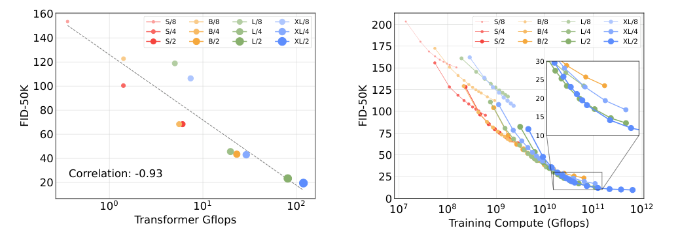
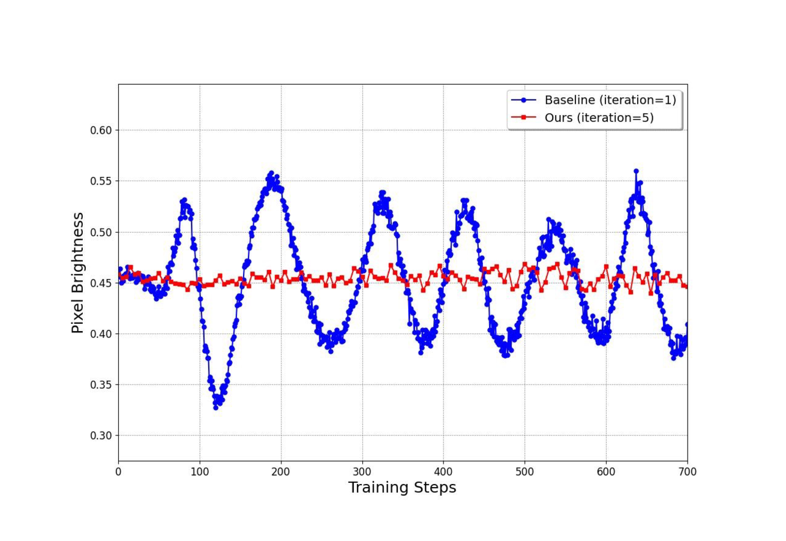
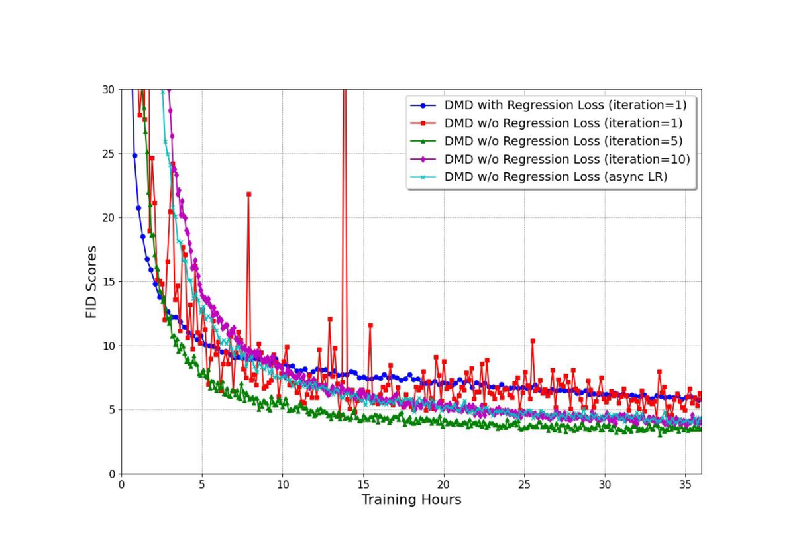

# 扩散训练配方与排障

扩散训练最容易被误解成一组技巧：数据清洗、cosine schedule、EMA、condition dropout、CFG sweep、几个固定 prompt。真实项目里，这些不是孤立开关，而是一条排障链。样本糊、主体错、prompt 不听、视频闪烁、动作扩散成功率下降，都要追问：失败发生在哪个噪声区间，条件信号有没有进入 denoiser，训练分布和采样链路是否一致，模型容量和表示空间是否够用。

这页不做孤立开关罗列。它讲一个更实用的问题：**当扩散训练看起来正常、采样却不对时，怎样把失败归因到数据、噪声日程、参数化、条件接口、优化或部署预算。**

## Loss 只是入口，不是诊断结论

常见噪声预测目标可以写成：

\[
\mathcal L
=
\mathbb E_{x_0,\epsilon,t}
\left[
w(t)\|\epsilon-\epsilon_\theta(x_t,t,c)\|_2^2
\right]
\]

这行式子看起来像普通 MSE，但里面每一项都对应一个工程选择。\(x_0\) 来自什么数据分布，决定模型会学到哪些外观和偏差；\(t\) 的采样分布决定训练更偏向高噪声语义还是低噪声细节；\(w(t)\) 决定不同 SNR 区间的梯度权重；条件 \(c\) 的质量和 dropout 决定推理时 CFG 有没有可靠的有条件/无条件差；\(\epsilon_\theta\) 的架构、参数化和优化器则决定这些监督信号能不能被稳定吸收。

所以训练 loss 下降只能说明“在训练采到的噪声点上，某个回归目标变准”。它不能直接证明 prompt 对齐、少步采样、ControlNet、视频运动或机器人闭环成功率会变好。排障时要把平均 loss 拆到 SNR bucket、条件类型、采样器和真实任务指标里。

## 数据和表示空间先决定上限

扩散模型对数据脏噪很敏感。图像数据里的低分辨率、压缩噪声、水印、拼图、模板图、重复样本和 caption 错配，会被模型当成真实分布的一部分。机器人或世界模型数据还会多出相机标定变化、动作标签延迟、轨迹截断、失败样本漏标、状态和图像不同步等问题。很多“模型不会画”“动作不敏感”的失败，第一根线索不是网络结构，而是数据和条件是否对齐。

表示空间同样决定上限。Latent diffusion 通过 VAE 把高分辨率像素压到 latent，显著降低 U-Net / DiT 的 token 和空间成本；代价是 VAE 重建质量、压缩倍率和解码器能力会变成细节上限。视频 latent 更敏感，因为时间压缩、chunk 切分和因果性会影响身份、运动和遮挡能否被后端模型看见。

{ width="860" }

<small>图源：[Scalable Diffusion Models with Transformers](https://arxiv.org/abs/2212.09748)，Figures 8-9。原图用 forward pass GFLOPs 和训练计算量展示 DiT 模型规模与 FID 的关系。本站读法：扩散质量常常要用每步前向成本换；在视频和世界模型里，这个成本还会乘以帧数、候选动作数和去噪步数。</small>

如果一个视频世界模型一次要处理多相机、多帧 latent，单次前向已经很贵，再乘以 20 到 50 个去噪步和多个候选 action sequence，闭环延迟会迅速失控。这里的排障顺序不是先问“用不用更 fancy 的 sampler”，而是先算 token 数、单步前向、采样步数、候选数和重规划频率。在线控制场景里，低 NFE 不是锦上添花，而是任务可用性的前提。

## SNR bucket 能把“糊”和“画错”分开

噪声日程和时间采样决定模型在哪些难度上练习。高噪声区负责全局语义、主体和大结构；中噪声区负责形状、布局和对象关系；低噪声区负责边缘、纹理、文字和局部细节。

如果样本“画得精致但主体错”，通常要查高噪声区：caption 是否太短，条件编码器是否弱，timestep sampling 是否过度偏低噪声，CFG 是否把错误方向放大。若样本构图对但细节糊、手部和文字差，通常要查低噪声区：VAE 是否压缩太强，loss weighting 是否让低噪声贡献太小，采样尾段步数是否不足，训练数据里此类细节是否稀缺。

Improved DDPM 的 VLB timestep 分析和 Min-SNR weighting 都在提醒同一件事：不同噪声区间不是同一个任务。平均 loss 把它们揉成一条曲线，很容易遮住真正的问题。一个更有用的训练面板，应同时看 high / mid / low SNR loss、固定 seed 样例、真实 sampler 下的样例，以及 prompt / condition 分桶失败。

## 条件接口决定 CFG 能不能工作

文本、类别、边缘图、深度图、姿态、mask、参考图、首帧和动作历史都可以是条件，但它们不是同一种证据。文本主要提供语义和风格，结构条件提供空间约束，参考图提供身份或外观，动作条件提供反事实未来。训练时条件入口如果弱，推理时再提高 CFG scale，只是在放大一个不可靠方向。

Classifier-free guidance 还要求训练时模型见过“有条件”和“无条件”两种输入。若 condition dropout 太低，无条件分支弱，CFG 的基准方向不稳；若 dropout 太高，条件对齐能力会被削弱。caption 质量也一样：短 caption 可能让模型学到粗语义，却学不到对象关系、数量、材质和动作；过度模板化 caption 又会让模型对真实用户 prompt 反应迟钝。

结构条件要额外检查作用范围。ControlNet 或 adapter 不是更长的 prompt，而是把空间证据送进中间层。排障时要单独看纯文本、结构控制、参考图、局部编辑和视频首帧桶。只看平均 prompt adherence，很容易把“文本能听懂”误判成“所有条件都稳”。

## EMA、优化和数值稳定性是在保住样本观感

扩散训练常用 EMA 权重部署，因为生成质量对后期权重抖动很敏感：

\[
\theta_{\mathrm{ema}}\leftarrow m\theta_{\mathrm{ema}}+(1-m)\theta
\]

这行式子表示 EMA 权重保留大部分旧值，只混入一小部分当前训练权重。\(m\) 越接近 1，更新越慢、越平滑。EMA 不能让模型学会不存在的数据，但它能让采样观感从抖动的瞬时权重里稳定下来。

优化器、batch 和混合精度也要按失败现象排查。坏 batch 会造成 loss spike；过高学习率会让低噪声细节抖；梯度裁剪缺失可能让少数高难样本主导更新；FP16 / BF16 数值问题可能表现为颜色、亮度或局部纹理异常。扩散训练的“稳定”不是 loss 没有 NaN，而是固定 prompt、固定 seed、固定 sampler 下的样例随训练逐渐变好，并且长尾桶没有被平均指标掩盖。

## 必须回放真实采样链路

训练点上的回归 loss 和推理时的采样轨迹不是同一件事。推理会引入 sampler、NFE、CFG scale、thresholding、ControlNet / adapter、VAE 解码、batching 和后处理。少步采样时，模型会访问更稀疏的噪声点；强 CFG 时，方向场会被拉陡；蒸馏学生还可能滚到 teacher 训练分布之外。

因此验证不应只保存训练 loss。更可靠的做法是固定一组 prompt / condition / seed，每隔固定训练间隔用真实部署采样器回放。图像模型看主体、构图、细节、文字、手部、颜色和多样性；视频模型看身份一致性、运动、首帧保真、长时漂移和延迟；动作扩散看碰撞、接触成功、恢复窗口和 closed-loop success。排障的基本单位应该是失败桶，而不是单张最好看的样例图。

## 分布匹配曲线要当动态系统看

少步和一步蒸馏会引入另一类训练信号。\(v\)-prediction loss 常是局部回归误差，distribution matching loss 则在问学生最终生成分布是否接近 teacher 或真实分布。后者通常依赖 fake critic、score estimator 或判别信号，曲线不一定像 MSE 那样单调平滑。

{ width="760" }

<small>图源：[DMD2](https://arxiv.org/abs/2405.14867)，Appendix Figure 7。原图展示去掉 regression loss 后，不同 fake critic update ratio 对 ImageNet 生成样本平均亮度稳定性的影响。本站读法：distribution matching 背后是 generator 和 critic / score estimator 的动态追赶；critic 跟不上时，外观可能表现为亮度、颜色或清晰度振荡。</small>

{ width="760" }

<small>图源：[DMD2](https://arxiv.org/abs/2405.14867)，Appendix Figure 8。原图比较不同 fake critic update ratio 和原始 DMD 设置下的收敛表现。本站读法：少步蒸馏不能只看学生 loss；critic 更新、regression anchor、真实采样步数和样本多样性要一起看。</small>

如果 \(v\)-loss 下降但样例变差，问题可能在 sampler、CFG 或 train-inference mismatch；如果 distribution matching loss 下降但多样性变差，可能是学生向高密度安全模式坍缩；如果亮度或颜色周期性晃动，要看 fake critic 更新频率、学习率、EMA 和 generated batch 分布。少步训练最怕“曲线看起来有进展，真实样例变钝”。

## 从现象反推原因

生成很糊时，先区分是全局没学会，还是低噪声细化不足。前者常伴随主体和语义也不稳；后者常表现为构图对但纹理软、边缘脏、文字坏。对应检查数据质量、VAE、低噪声 loss、采样尾段和分辨率 curriculum。

构图混乱或主体丢失时，优先看高噪声区、caption 和条件绑定。模型如果在高噪声阶段没有形成正确大结构，后面再多低噪声修补也只是把错误主体画精致。

Prompt adherence 差时，不要只调 CFG。先看文本编码器、caption 质量、condition dropout、训练 prompt 分布和 negative prompt 是否误伤细节。CFG scale 越高，错误条件方向也越容易被放大。

模式单一或风格一股味时，要查数据覆盖和训练权重。扩散比 GAN 更不容易经典坍缩，但在垂直商品图、固定 UI、单一艺术风格或 teacher 蒸馏场景里，学生仍可能只学到安全主模态。

视频闪烁、变脸或运动变慢时，要把失败切到时间桶。问题可能来自 video VAE、时空 attention、低噪声细节、少步跨度或 motion data 过滤。单帧 FID 或美观样例不能证明视频基础模型能稳定 rollout。

动作扩散成功率下降时，平均 MSE 常常是误导。多峰动作分布里，MSE 会奖励平均轨迹，而平均轨迹可能正好碰撞或错过抓取。Diffusion Policy 这类路线的价值在于表达多峰 action distribution，但真实验收仍要看 closed-loop success、碰撞率、接触阶段和 receding-horizon 执行，而不是只看轨迹相似度。

## 收束判断

扩散训练排障的核心不是记住更多技巧，而是让每个失败现象能回到一个机制：数据是否干净，表示空间是否保真，SNR 区间是否平衡，条件接口是否可靠，优化是否稳定，采样链路是否与训练匹配，任务指标是否真的覆盖长尾风险。

读训练日志时先问四件事：平均 loss 是否拆成 SNR bucket；固定样例是否用真实 sampler 回放；条件桶和长尾桶是否单独看；端到端延迟和闭环指标是否进入验收。做到这四件事，扩散训练就不再是靠经验调一堆旋钮，而是能一步步把错误定位到具体接口。

## 外部精读

- [DDPM](https://arxiv.org/abs/2006.11239)：理解噪声预测目标和反向链的训练基础。
- [Improved DDPM](https://arxiv.org/abs/2102.09672)：理解 learned variance、cosine schedule 和 timestep 贡献差异。
- [EDM](https://arxiv.org/abs/2206.00364)：理解噪声尺度、preconditioning、loss weighting 和 sampler 需要共同设计。
- [Min-SNR Weighting](https://arxiv.org/abs/2303.09556)：理解按 SNR 调整训练权重来处理不同时间步冲突。
- [Latent Diffusion Models](https://arxiv.org/abs/2112.10752)：理解为什么高分辨率生成常在 latent space 里训练，以及 VAE 会成为质量边界。
- [DiT](https://arxiv.org/abs/2212.09748)：理解扩散 Transformer 的 compute / quality tradeoff。
- [Classifier-Free Diffusion Guidance](https://arxiv.org/abs/2207.12598)：理解 condition dropout 与 CFG 的训练基础。
- [DMD2](https://arxiv.org/abs/2405.14867)：理解 distribution matching 蒸馏中的 fake critic、regression anchor 和训练稳定性。
- [Diffusion Policy](https://diffusion-policy.cs.columbia.edu/)：理解扩散用于动作策略时，评估目标如何从视觉质量转向 closed-loop control。
