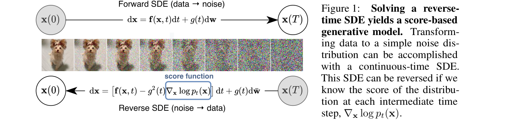

# Score Matching 到 SDE

前两页已经讲了：扩散训练常让模型预测噪声 \(\epsilon\)、干净图 \(x_0\) 或 velocity \(v\)。这一页换一个更统一的视角：**这些预测目标背后，都可以理解成模型在学习一个“往数据分布高概率区域走”的方向场。**

这个方向场叫 **score**。它是理解 DDPM、DDIM、SDE、ODE、DPM-Solver 和 Rectified Flow 的共同语言。

## 先看图：从数据到噪声，再从噪声回来

{ width="920" }

<small>图源：[Score-Based Generative Modeling through Stochastic Differential Equations](https://arxiv.org/abs/2011.13456)，Figure 1。</small>

<small>原论文图意：正向 SDE 将数据逐步扰动成简单噪声分布；如果知道每个中间分布的 score \(\nabla_x \log p_t(x)\)，就可以构造反向 SDE，从噪声生成数据。</small>

<small>本教程读法：上半部分是“数据 -> 噪声”，下半部分是“噪声 -> 数据”。中间被框出的 score function 是关键：它告诉反向过程在每个噪声水平下应该往哪里移动。</small>

## 1. score 是什么

对一个概率分布 \(p(x)\)，score 定义为：

\[
s(x)=\nabla_x \log p(x)
\]

这行式子在说：score 是对 \(\log p(x)\) 关于 \(x\) 的梯度。它指向让概率密度上升最快的方向。

符号含义：

| 符号 | 含义 |
| --- | --- |
| \(p(x)\) | 样本 \(x\) 所属的概率分布 |
| \(\log p(x)\) | 对数概率密度 |
| \(\nabla_x\) | 对 \(x\) 求梯度 |
| \(s(x)\) | score，指向更高概率区域的方向向量 |

如果把数据分布想成一片地形，概率高的地方像山峰，概率低的地方像山脚。score 就像当前位置的坡度箭头，告诉你往哪里走更接近高概率区域。

## 2. 扩散里为什么要写成 \(p_t(x)\)

扩散不是只有一个分布，而是每个噪声时间步都有一个分布：

- \(p_0(x)\)：干净数据分布；
- \(p_t(x)\)：加到第 \(t\) 个噪声水平后的分布；
- \(p_T(x)\)：接近标准高斯噪声的简单分布。

所以扩散里的 score 写成：

\[
s(x_t,t)=\nabla_{x_t}\log p_t(x_t)
\]

这行式子在说：在时间步 \(t\) 的噪声分布里，当前样本 \(x_t\) 应该往哪个方向移动，才会更像该噪声水平下的真实数据。

符号含义：

| 符号 | 含义 |
| --- | --- |
| \(p_t(x_t)\) | 第 \(t\) 个噪声水平下的样本分布 |
| \(x_t\) | 当前带噪样本 |
| \(s(x_t,t)\) | 该时间步下的 score |

注意：score 不是最终干净图本身，而是当前位置的方向信息。

## 3. 噪声预测和 score 的关系

前向加噪可以写成：

\[
x_t=\alpha_t x_0+\sigma_t\epsilon,
\qquad
\epsilon\sim\mathcal{N}(0,I)
\]

这行式子在说：当前带噪样本 \(x_t\) 是干净图 \(x_0\) 和高斯噪声 \(\epsilon\) 的混合。

在常见高斯扰动设定下，预测噪声和预测 score 可以互相对应。一个常见直觉关系是：

\[
s_\theta(x_t,t)
\approx
-\frac{1}{\sigma_t}\epsilon_\theta(x_t,t)
\]

这行式子在说：模型预测出的噪声方向 \(\epsilon_\theta\)，取反并按噪声尺度 \(\sigma_t\) 缩放后，就对应“往数据高概率区域走”的 score 方向。

符号含义：

| 符号 | 含义 |
| --- | --- |
| \(s_\theta(x_t,t)\) | 模型估计的 score |
| \(\epsilon_\theta(x_t,t)\) | 模型预测的噪声 |
| \(\sigma_t\) | 当前噪声标准差 |
| \(-\epsilon_\theta\) | 噪声的反方向，也就是去噪方向 |

这就是为什么很多看起来只是“回归噪声”的训练，其实也可以理解成在学习 score field。

## 4. Score Matching：直接学这个方向场

score matching 的目标是让模型输出的方向接近真实 score：

\[
s_\theta(x_t,t)
\approx
\nabla_{x_t}\log p_t(x_t)
\]

这行式子在说：模型 \(s_\theta\) 要学会在每个噪声水平下估计真实分布的概率梯度方向。

难点是：真实图像分布 \(p_t(x)\) 很复杂，我们通常不知道它的解析形式，也就不能直接算 \(\nabla\log p_t(x)\)。扩散训练的妙处在于，通过人为加高斯噪声，可以把这个难题转成可监督的噪声预测问题。

所以可以这样记：

```text
预测噪声：更容易训练
预测 score：更统一地解释为什么能采样
```

## 5. 连续时间 SDE：把很多小步写成一条方程

如果把离散时间步变得非常密，就可以用随机微分方程 SDE 描述前向加噪：

\[
dx=f(x,t)dt+g(t)dW_t
\]

这行式子在说：样本 \(x\) 随时间变化，一部分来自确定性漂移 \(f(x,t)dt\)，另一部分来自随机噪声 \(g(t)dW_t\)。

符号含义：

| 符号 | 含义 |
| --- | --- |
| \(dx\) | 样本状态的微小变化 |
| \(f(x,t)\) | 确定性漂移项 |
| \(dt\) | 很小的时间增量 |
| \(g(t)\) | 噪声强度函数 |
| \(dW_t\) | Wiener process 的微小随机扰动，可先理解成连续时间里的高斯噪声 |
| SDE | Stochastic Differential Equation，随机微分方程 |

初学时不必害怕这行式子。它只是把“每一步加一点噪声”的离散过程，写成连续时间版本。

## 6. 反向 SDE：知道 score 才能从噪声回来

Score SDE 论文给出的反向过程可以写成：

\[
dx=
\left[
f(x,t)-g(t)^2\nabla_x\log p_t(x)
\right]dt
+
g(t)d\bar{W}_t
\]

这行式子在说：反向生成不仅需要原来的漂移项和随机项，还需要 score \(\nabla_x\log p_t(x)\)。score 告诉系统如何从噪声分布往数据分布走。

符号含义：

| 符号 | 含义 |
| --- | --- |
| \(\nabla_x\log p_t(x)\) | 当前噪声水平下的真实 score |
| \(g(t)^2\nabla_x\log p_t(x)\) | 由 score 决定的反向修正方向 |
| \(d\bar{W}_t\) | 反向时间里的随机噪声项 |
| reverse-time SDE | 从噪声回到数据的随机微分方程 |

现实中真实 score 不知道，所以用模型 \(s_\theta(x,t)\) 替代它：

\[
\nabla_x\log p_t(x)
\approx
s_\theta(x,t)
\]

这行式子在说：只要模型学到了足够好的 score，反向 SDE 就能被近似求解。

## 7. Probability Flow ODE：去掉随机项的确定路径

同一个 SDE 还对应一条确定性的 probability flow ODE：

\[
\frac{dx}{dt}
=
f(x,t)-\frac{1}{2}g(t)^2\nabla_x\log p_t(x)
\]

这行式子在说：如果不再额外注入随机噪声，样本可以沿一条确定性轨迹从噪声流向数据。给定同一个初始噪声，ODE 轨迹是可重复的。

符号含义：

| 符号 | 含义 |
| --- | --- |
| ODE | Ordinary Differential Equation，常微分方程 |
| \(\frac{dx}{dt}\) | 样本随时间变化的速度 |
| \(-\frac{1}{2}g(t)^2\nabla_x\log p_t(x)\) | 由 score 导出的确定性去噪方向 |

DDIM、Euler、Heun、DPM-Solver 等很多采样器，都可以放进“如何数值求解这条 ODE / SDE”的框架里理解。

## 8. DDPM、DDIM 在这条线上的位置

### DDPM

DDPM 更接近离散反向马尔可夫链，每一步通常保留随机性。它理论自然、生成质量好，但原始设置下采样步数多。

### DDIM

DDIM 改变采样路径，在不重新训练模型的前提下使用更确定的、可跳步的生成过程。它可以理解成从随机链走向 ODE 视角的重要桥梁。

### 高阶求解器

如果采样是数值求解 ODE / SDE，那么 Euler、Heun、DPM-Solver 的区别就在于：同样调用模型若干次，谁能更准确地沿着 score field 移动。

## 9. 一个直观比喻

想象你在浓雾里找城市中心：

- 噪声样本像你在雾里的随机位置；
- score 像一个局部指南针，告诉你哪个方向更像城市中心；
- SDE 像你走路时还会被随机风吹；
- ODE 像你只按指南针指向稳定前进；
- 采样器像你的走路策略：小步慢走、跳步快走、先预测再校正，都会影响是否走偏。

## 10. 和下一页的关系

这一页解释了“模型输出为什么可以看成方向场”。下一页 [条件控制与 Guidance](guidance-and-conditioning.md) 会继续问：如果用户给了文本、类别或参考图条件，这个方向场如何被条件改变？Guidance scale 为什么会让图像更贴 prompt，也可能让采样变不稳定？

!!! tip "进阶理解"
    DPM-Solver、Consistency Models、Rectified Flow 和 Flow Matching 都在不同程度上利用了“生成是沿向量场积分”这个视角。初学时先把 score、SDE、ODE 的角色分清，再去看少步蒸馏和路径整流会顺很多。

## 小结

score 是扩散模型的数学骨架：它把“预测噪声”解释成“学习概率分布的梯度方向”。SDE / ODE 视角则把反向生成解释成沿这个方向场做数值求解。理解这一页，就能看懂为什么采样器不是玄学名字，而是在解一条由模型定义的生成轨迹。

*[SDE]: Stochastic Differential Equation，随机微分方程。
*[ODE]: Ordinary Differential Equation，常微分方程。
