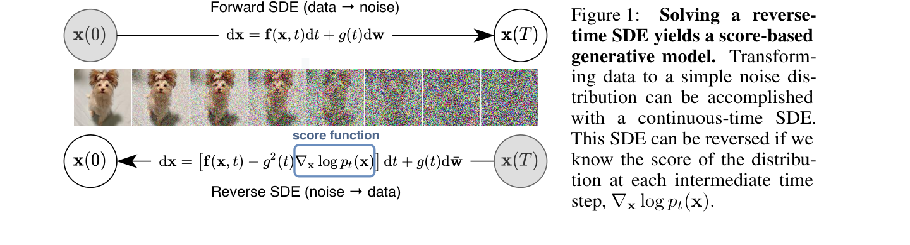
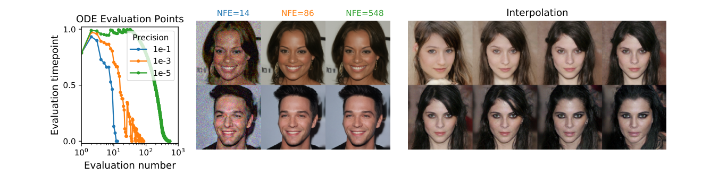

# Score 怎样把加噪分布变回数据分布

对一维标准高斯，score 是 \(s(x)=-x\)。如果从任何分布出发，反复沿这个方向移动，所有点都会往 0 收缩。这会找到高密度位置，却无法产生方差为 1 的标准高斯样本。理解扩散的 score，需要同时解释密度梯度和分布怎样随时间变化。

本文用数据 \(X_0\sim\mathcal N(0,1)\) 贯穿推导。这个分布已经能直接采样，选择它只是因为每一步都能解析核验，不代表真实图像也具有高斯密度。

## 一条可以直接计算的加噪路径

令前向过程为布朗运动

\[
\mathrm dX_t=\mathrm dW_t.
\]

持续时间为 \(t\) 的布朗增量方差是 \(t\)，因此

\[
X_t=X_0+\sqrt t E,
\qquad E\sim\mathcal N(0,1),
\qquad p_t=\mathcal N(0,1+t).
\]

\(X_0\) 与 \(E\) 独立。对数密度为

\[
\log p_t(x)=-\tfrac12\log(2\pi(1+t))-\frac{x^2}{2(1+t)},
\]

所以

\[
s(x,t)=\partial_x\log p_t(x)=-\frac{x}{1+t}.
\]

时间越大，分布越宽，同一个位置的坡度越小。这解释了为什么 score 网络必须接收噪声时间。直接使用干净分布的 \(-x\) 处理所有带噪状态，会把不同任务混为一谈。

{ width="920" }

<small>图源：[Score-Based Generative Modeling through Stochastic Differential Equations](https://arxiv.org/abs/2011.13456)，Figure 1。原图表达正向过程把数据逐渐扰动成噪声，反向过程依赖每个中间分布的 score 从噪声生成数据。这里的重点是：扩散采样不是凭空“去噪”，而是在一串噪声分布上沿概率方向移动。</small>

## 没有真实密度，怎样得到监督

真实图像只有样本，通常无法计算 \(p_t(x)\)。但知道一个训练样本 \(x_0\) 后，人为加噪的条件分布已知。对一般形式 \(X_t=a_tX_0+b_tE\)，有

\[
\nabla_x\log q_t(x\mid x_0)
=-\frac{x-a_tx_0}{b_t^2}=-\frac{E}{b_t}.
\]

这是条件 score。网络没有读取 \(x_0\)，只读取 \(x,t\)，怎样保证训练这个目标能够学到边缘 score？将混合密度的导数展开

\[
\nabla_x\log p_t(x)
=\frac{\int p_0(x_0)\nabla_xq_t(x\mid x_0)\,\mathrm dx_0}{p_t(x)}
=\mathbb E[\nabla_x\log q_t(x\mid X_0)\mid X_t=x].
\]

这里使用了可以交换微分与积分的常规光滑和可积条件。平方误差回归的最优输出正是目标的条件均值，因此可用每个样本的条件 score 训练边缘 score。噪声回归版本便得到 \(s_\theta=-\epsilon_\theta/b_t\)。

回到高斯例子，\(t=1\) 时观测到 \(x=2\)。高斯条件均值给出 \(\mathbb E[X_0\mid X_1=2]=1\)、\(\mathbb E[E\mid X_1=2]=1\)，所以 score 为 −1，与 \(-2/(1+1)\) 一致。即使训练那一次可能来自 \(x_0=.5,E=1.5\)，网络面对相同观测也应综合所有可能配对，而非唯一恢复这次噪声。

## 反向 SDE 为什么同时需要漂移和噪声

对于前向过程

\[
\mathrm dX_t=f(X_t,t)\mathrm dt+g(t)\mathrm dW_t,
\]

在扩散系数只依赖时间的条件下，逆时间 SDE 为

\[
\mathrm dX_t=[f(X_t,t)-g(t)^2s(X_t,t)]\mathrm dt
+g(t)\mathrm d\bar W_t.
\]

生成沿减小的 \(t\) 运行，\(\mathrm dt<0\)。数值步 \(t\to t-h\) 的随机增量尺度为 \(\sqrt h\)，不能对负时间差开平方。

在布朗例子里 \(f=0,g=1\)，score 为 \(-x/(1+t)\)。Euler 反向一步是

\[
X_{t-h}=\left(1-\frac h{1+t}\right)X_t+\sqrt h\,\xi,
\qquad\xi\sim\mathcal N(0,1).
\]

如果当前方差准确等于 \(1+t\)，下一步方差为

\[
\left(1-\frac h{1+t}\right)^2(1+t)+h
=1+t-h+\frac{h^2}{1+t}.
\]

目标方差是 \(1+t-h\)，差别为这个离散方法引入的二阶局部误差。漂移先收缩分布，随机项补回一部分方差。把随机项删除却保留整个漂移系数，会收缩过快。

## Probability Flow ODE 为什么有一个二分之一

相同的边缘密度也可以由确定性速度场输送。对应的 probability flow ODE 为

\[
\frac{\mathrm dX_t}{\mathrm dt}=f(X_t,t)-\frac12g(t)^2s(X_t,t).
\]

原因可以从密度方程看出。前向 SDE 的 Fokker–Planck 方程为

\[
\partial_t p=-\nabla\cdot(fp)+\tfrac12g^2\Delta p.
\]

因为 \(p\nabla\log p=\nabla p\)，右侧可改写为

\[
-\nabla\cdot\left[\left(f-\tfrac12g^2\nabla\log p\right)p\right].
\]

这正是确定性 ODE 的连续性方程。二分之一由扩散项的密度演化产生，不能把反向 SDE 的噪声简单删掉就得到正确 ODE。

{ width="900" }

<small>图源：[Score SDE](https://arxiv.org/abs/2011.13456)，Figure 3。原图表达 probability flow ODE 可以把数据确定性编码到 latent，也可以从 latent 确定性解码回数据。这里的重点是：ODE 视角让 likelihood、latent encoding 和高阶数值求解器进入扩散采样讨论。</small>

在高斯例子中

\[
\frac{\mathrm dX_t}{\mathrm dt}=\frac{X_t}{2(1+t)},
\qquad
X_t=X_T\sqrt{\frac{1+t}{1+T}}.
\]

若从正确末端 \(X_T\sim\mathcal N(0,1+T)\) 出发，走到 0 恰好得到方差 1。取 \(T=3\)，初值 −2、0、2 分别到达 −1、0、1。给定初值时轨迹确定，初值来自随机分布，因此最终结果依然多样。

本例是方差增加路径，末端为 \(\mathcal N(0,1+T)\)，不能直接用标准高斯初始化。实际 VE 模型常在大噪声端采用相应尺度的高斯近似，VP 模型则通过缩小信号使末端接近标准高斯。先验必须和所用路径一致。

## 为什么不能只沿密度梯度上升

如果在标准高斯的 score \(-x\) 上求解 \(\mathrm dx/\mathrm ds=-x\)，则 \(x(s)=x(0)e^{-s}\)，方差会趋于零。这是在寻找模式。Langevin 动力学通过匹配漂移与随机项，可以在适当条件下以给定密度为平稳分布；扩散的反向 SDE 与 probability flow ODE 则沿时间变化的分布工作。三者都用 score，但动态过程不同。

真实网络只给近似 score。即使 SDE 与 ODE 在准确 score 和精确积分下共享每个时刻的边缘分布，它们的单条轨迹也不同。近似模型与有限步求解进一步使最终分布出现差异，因此同一个 checkpoint 用不同采样器的结果仍需要实测。

DDPM 的小步极限对应 VP-SDE。若连续噪声率为 \(\beta(t)\)，则

\[
f(x,t)=-\tfrac12\beta(t)x,
\qquad g(t)=\sqrt{\beta(t)}.
\]

前向漂移抵消一部分持续注入的方差，因此“方差保持”指单位方差输入的这一结构；任意初始数据方差不必在所有时间严格不变。[噪声日程](noise-schedules-and-parameterization.md)说明离散累计系数怎样对应这一尺度。

## 从公式读到实现

实现一个采样步时，先固定输入代表什么分布、时间朝哪个方向走、模型输出是什么量。若输出 epsilon，先按路径系数换成 score；若输出 Flow velocity，则使用它自己的 ODE 定义，不能再额外套一次 score 漂移。Euler、Heun 和专用扩散求解器的差异见[采样与推理](inference.md)。

上述高斯方差是一个有用的机制核验。它可以检测负步长、随机项尺度和二分之一系数是否写错。通过这个解析例子只能验证公式实现，不能证明神经网络已经学到了图像分布。

- [Score SDE 原论文](https://arxiv.org/abs/2011.13456)给出反向时间 SDE、probability flow ODE 与采样关系。
- [DDPM](https://arxiv.org/abs/2006.11239)给出离散噪声预测形式。
- [本站最小 DDPM](minimal-ddpm-implementation.md)使用离散 Gaussian posterior；其反向方差不能与连续 Euler 噪声系数不加区分地混用。
