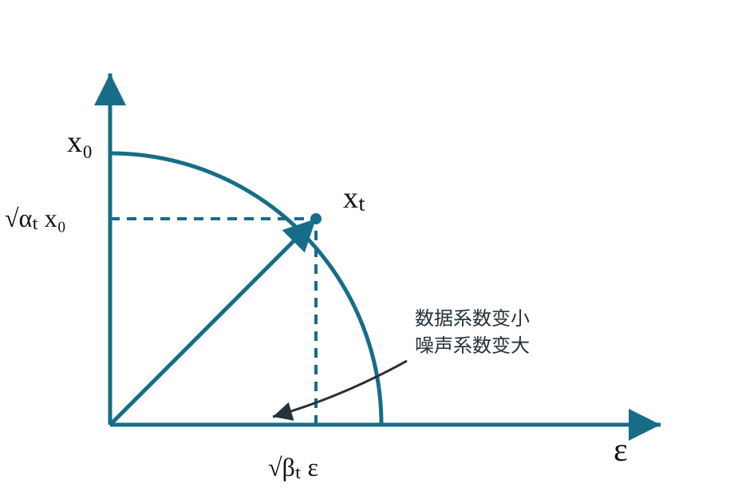

# DDPM 数学与训练：从前向高斯链到噪声预测

DDPM 把生成问题写成两个方向相反的过程：前向过程用固定高斯转移逐步破坏数据，反向过程用神经网络近似未知的反向条件分布。训练的关键，是利用已知前向过程把变分目标转成不同噪声水平上的监督回归。

DDPM 数学需要连接六个对象：逐步前向转移 \(q(x_t\mid x_{t-1})\)、任意时刻的闭式边缘 \(q(x_t\mid x_0)\)、可计算的后验 \(q(x_{t-1}\mid x_t,x_0)\)、需要学习的反向分布 \(p_\theta(x_{t-1}\mid x_t)\)、噪声预测 loss，以及从 \(x_T\) 到 \(x_0\) 的 DDPM 采样算法。

这里采用离散时间、方差保持（variance preserving）DDPM 记号。连续噪声尺度、EDM preconditioning、score SDE 和 Flow Matching 分别使用不同公式边界。

## 前置知识

- [扩散模型基础](foundations-and-core-intuition.md)：概率路径、局部预测和采样轨迹。
- [概率分布与条件概率](../prerequisite-math/probability-distributions-and-expectation.md)：高斯分布、条件分布和期望。
- [潜变量与生成目标](../prerequisite-math/latent-likelihood-and-generative-objectives.md)：对数似然、潜变量和变分下界。

统一记号如下：

| 符号 | 含义 |
| --- | --- |
| \(x_0\) | 来自真实数据分布的干净样本 |
| \(x_t\) | 第 \(t\) 个噪声水平的随机变量 |
| \(\beta_t\) | 第 \(t\) 步加入的方差，满足 \(0<\beta_t<1\) |
| \(\alpha_t=1-\beta_t\) | 单步保留的信号方差比例 |
| \(\bar\alpha_t=\prod_{s=1}^{t}\alpha_s\) | 从 0 到 \(t\) 的累计信号比例 |
| \(\epsilon\sim\mathcal N(0,I)\) | 标准高斯噪声 |
| \(q\) | 固定的前向过程及其可计算分布 |
| \(p_\theta\) | 参数为 \(\theta\) 的反向生成模型 |

## 核心机制

### 逐步前向高斯链

DDPM 规定一个马尔可夫前向过程：

\[
q(x_t\mid x_{t-1})
=\mathcal N\!\left(x_t;\sqrt{\alpha_t}x_{t-1},\beta_t I\right),
\qquad \alpha_t=1-\beta_t.
\]

等价的采样式为：

\[
x_t=\sqrt{\alpha_t}x_{t-1}+\sqrt{\beta_t}\epsilon_t,
\qquad \epsilon_t\sim\mathcal N(0,I).
\]

每一步缩小已有信号，再加入独立高斯噪声。若 \(\beta_t\) 足够小并且累计步数足够多，\(x_T\) 会接近标准高斯。这个过程没有可学习参数；noise schedule 完全由训练配置规定。

{ width="700" }

<small>图源：[Denoising Diffusion Probabilistic Models](https://arxiv.org/abs/2006.11239)，Figure 2。左到右是固定前向链，右到左是需要学习的反向链。图能说明条件依赖关系，不能说明实际训练必须逐步生成所有中间状态。</small>

### 任意时间步可以闭式采样

独立高斯噪声在线性组合下仍是高斯，因此可以把前 \(t\) 步合并：

\[
q(x_t\mid x_0)
=\mathcal N\!\left(
x_t;\sqrt{\bar\alpha_t}x_0,(1-\bar\alpha_t)I
\right).
\]

用重参数化形式采样：

\[
x_t
=\sqrt{\bar\alpha_t}x_0
+\sqrt{1-\bar\alpha_t}\epsilon,
\qquad \epsilon\sim\mathcal N(0,I).
\]

这条公式解释了训练为何可以随机抽一个 \(t\)，直接从 \(x_0\) 构造 \(x_t\)。模型仍覆盖整条路径，因为不同 batch 会采到不同时间步；单个训练样本不需要真的执行 \(t\) 次加噪。

{ width="760" }

<small>这张示意图把 \(x_t\) 画成数据分量和噪声分量的系数组合，用来读取 \(\sqrt{\bar\alpha_t}\) 与 \(\sqrt{1-\bar\alpha_t}\) 的消长。它是参数化直觉，不是在断言真实图像向量与某次噪声样本在像素空间必然正交。</small>

### 已知 \(x_0\) 时，单步后验仍是高斯

训练推导中 \(x_0\) 已知。利用高斯条件分布，可以得到：

\[
q(x_{t-1}\mid x_t,x_0)
=\mathcal N\!\left(
x_{t-1};\tilde\mu_t(x_t,x_0),\tilde\beta_t I
\right),
\]

其中：

\[
\tilde\mu_t(x_t,x_0)
=
\frac{\sqrt{\bar\alpha_{t-1}}\beta_t}{1-\bar\alpha_t}x_0
+
\frac{\sqrt{\alpha_t}(1-\bar\alpha_{t-1})}{1-\bar\alpha_t}x_t,
\]

\[
\tilde\beta_t
=\frac{1-\bar\alpha_{t-1}}{1-\bar\alpha_t}\beta_t.
\]

这个后验说明：如果知道干净样本，反向一步的均值和方差都能直接计算。但生成时只有 \(x_t\)，不知道对应的 \(x_0\)，所以需要模型提供足够的信息来近似反向均值。

### 学习反向条件分布

DDPM 用参数化高斯分布近似真实反向条件：

\[
p_\theta(x_{t-1}\mid x_t)
=\mathcal N\!\left(
x_{t-1};\mu_\theta(x_t,t),\Sigma_t
\right).
\]

原始 DDPM 常固定反向方差，只学习均值。把均值改写成噪声预测形式：

\[
\mu_\theta(x_t,t)
=\frac{1}{\sqrt{\alpha_t}}
\left(
x_t-
\frac{\beta_t}{\sqrt{1-\bar\alpha_t}}
\epsilon_\theta(x_t,t)
\right).
\]

网络 \(\epsilon_\theta\) 读取带噪样本和时间步，预测构造 \(x_t\) 时使用的标准高斯噪声。给定噪声预测，也能反推出干净样本估计：

\[
\hat x_0(x_t,t)
=\frac{x_t-\sqrt{1-\bar\alpha_t}\epsilon_\theta(x_t,t)}
{\sqrt{\bar\alpha_t}}.
\]

因此 ε-prediction 和 \(x_0\)-prediction 描述的是同一局部信息的不同坐标，但优化权重和数值稳定性并不自动相同。

### 从变分下界到噪声预测 MSE

反向生成模型的联合分布为：

\[
p_\theta(x_{0:T})
=p(x_T)\prod_{t=1}^{T}p_\theta(x_{t-1}\mid x_t).
\]

最大化数据对数似然可以转成对前向路径取期望的变分下界。中间时间步对应真实后验 \(q(x_{t-1}\mid x_t,x_0)\) 与模型反向分布 \(p_\theta(x_{t-1}\mid x_t)\) 的 KL 项。两者都是高斯，在固定方差和噪声参数化下，均值匹配可转成带时间权重的噪声预测误差。

DDPM 实践中常用简化目标：

\[
\mathcal L_{\text{simple}}
=\mathbb E_{x_0,t,\epsilon}
\left[
\lVert\epsilon-\epsilon_\theta(x_t,t)\rVert_2^2
\right].
\]

这里的监督目标 \(\epsilon\) 是训练时真实采样的噪声。简化目标和完整 VLB 有明确联系，但不能把“无权重 MSE”说成与每个 VLB 项数值完全相同；不同方差参数化、时间权重和 learned variance 会改变目标。

### 时间步和网络架构的接口

同一个 \(x_t\) 数值在不同 \(t\) 下代表不同信噪比，因此网络必须读取时间步或噪声嵌入。无条件模型接口为：

\[
\epsilon_\theta(x_t,t),
\]

条件模型则为：

\[
\epsilon_\theta(x_t,t,c).
\]

扩散目标不要求网络必须是 U-Net。U-Net、DiT 或其他主干只要能处理样本表示、时间信息和条件，就能承担 denoiser。组件细节见[架构与 Stable Diffusion](architecture-and-stable-diffusion.md)。

## DDPM 训练算法

```text
repeat:
    x_0 ~ p_data
    t ~ Uniform({1, ..., T})
    epsilon ~ Normal(0, I)
    x_t = sqrt(alpha_bar_t) * x_0
          + sqrt(1 - alpha_bar_t) * epsilon
    epsilon_pred = epsilon_theta(x_t, t, condition)
    loss = mean_square_error(epsilon_pred, epsilon)
    update theta with gradient(loss)
```

训练只需网络一次前向和一次反向，不随 \(t\) 线性增加计算。若时间步采样不是均匀分布，loss weighting 必须与采样分布一起解释，否则某些噪声区间会被隐式放大或削弱。

## DDPM 采样算法

先从简单先验采样：

\[
x_T\sim\mathcal N(0,I).
\]

然后对 \(t=T,T-1,\ldots,1\) 执行：

```text
epsilon_pred = epsilon_theta(x_t, t, condition)
mean = 1 / sqrt(alpha_t) * (
    x_t - beta_t / sqrt(1 - alpha_bar_t) * epsilon_pred
)
if t > 1:
    z ~ Normal(0, I)
    x_{t-1} = mean + sqrt(posterior_variance_t) * z
else:
    x_0 = mean
```

这里采用 \(\tilde\beta_t\) 作为 posterior variance 的教学版本。不同实现可能使用 \(\beta_t\)、learned variance 或其他插值；比较 sampler 时必须同时记录方差约定和时间下标。

{ width="700" }

<small>图源：[DDPM](https://arxiv.org/abs/2006.11239)，Figure 14。图展示反向链中的样本逐渐出现结构；它不能证明每个时间区间只负责一种固定语义或纹理。</small>

## 常见误解与失效边界

**把 \(\beta_t\) 当成噪声标准差。**在上述记号中 \(\beta_t\) 是单步方差，采样噪声项使用 \(\sqrt{\beta_t}\)。代码里混淆两者会直接破坏 schedule。

**把 \(\alpha_t\) 和 \(\bar\alpha_t\) 混用。**前者是单步系数，后者是累计乘积。闭式构造 \(x_t\) 使用 \(\bar\alpha_t\)，反向均值同时使用单步和累计量。

**在 \(t=0\) 继续加入随机噪声。**最终一步应返回均值估计；否则生成结果会被额外污染。不同代码使用 0-based 或 1-based 时间下标，必须先确认边界。

**认为训练 MSE 可以单独评价生成质量。**MSE 是局部预测指标；真实结果还受 VAE、条件、时间离散、solver、CFG 和误差累积影响。

**把 ε、score 和 \(v\) 当成完全独立模型。**在给定路径和系数时它们可以转换，但 loss weighting、preconditioning 和有限精度行为不同。转换公式见[噪声日程与参数化](noise-schedules-and-parameterization.md)。

## 检查理解

1. 从 \(q(x_t\mid x_{t-1})\) 到 \(q(x_t\mid x_0)\) 的闭式形式为什么依赖高斯噪声可合并性？
2. 为什么 \(q(x_{t-1}\mid x_t,x_0)\) 在训练推导中可计算，而生成时不能直接使用？
3. 噪声预测怎样进入反向均值 \(\mu_\theta\)？
4. 简化 MSE 与完整变分下界是什么关系，为什么不能说二者逐项数值相等？
5. 代码里将 \(\alpha_t\) 写成 \(\bar\alpha_t\) 会影响哪几个步骤？

## 外部材料

- 原始来源：[DDPM](https://arxiv.org/abs/2006.11239)、[Improved DDPM](https://arxiv.org/abs/2102.09672)。
