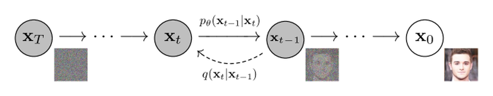
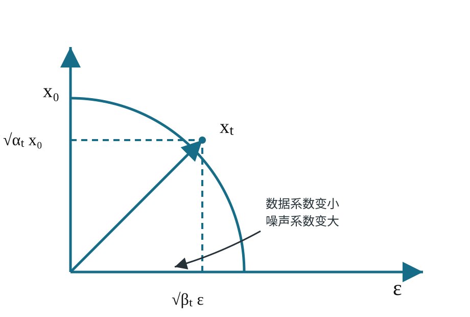
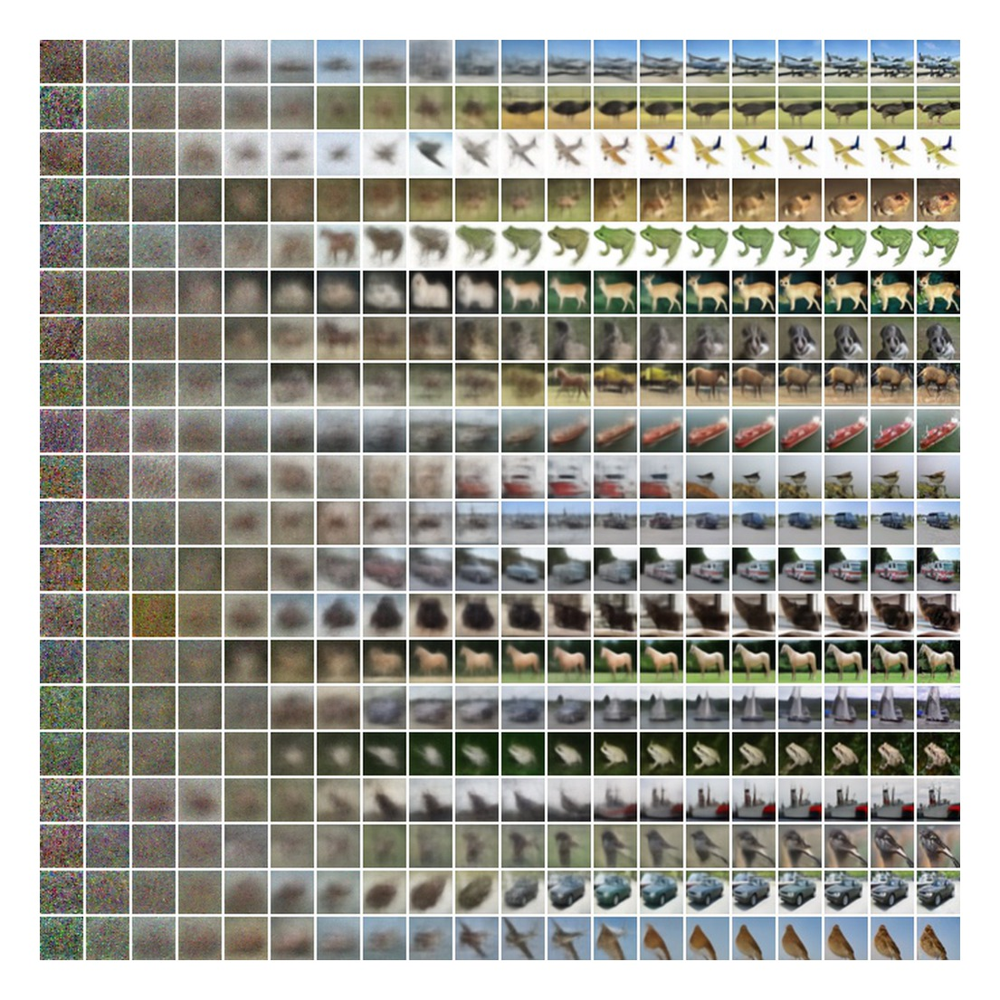

# DDPM 如何把反向生成变成噪声回归

给一张图逐步加噪很容易。拿到一张噪声图，想知道前一步可能是什么，就要利用数据里反复出现的结构。DDPM 把前向加噪写成一个固定过程，再让网络只学习反向转移所需的统计量。下面用两次加噪的数值例子，把后验、损失和采样接在同一套离散时间记号上。

## 先把符号固定下来

把 \(x_0\) 看作干净样本，把 \(x_t\) 看作第 $t$ 步的带噪状态。单步噪声方差是 \(\beta_t\)，对应的信号系数为 \(\alpha_t=1-\beta_t\)，累计信号系数为 \(\bar\alpha_t=\prod_{s=1}^t\alpha_s\)。后面所有数字都沿用这组定义，尤其要分清单步的 \(\alpha_t\) 和累计的 \(\bar\alpha_t\)。

读到后面时，应该能把四件事连起来：任意时间步怎样一次构造 \(x_t\)，反向均值为什么需要网络，MSE 怎样从似然目标中出现，训练时的噪声标签又怎样变成采样时的状态更新。只会背 \(x_t\) 公式，却对不上实现里的数组下标，就回到这里重新核对。

令 $t=1,\ldots,T$ 表示噪声步骤，并设 \(\bar\alpha_0=1\)。图像中的每个元素都按同一规则加噪，网络则利用整张图的空间结构来预测反向过程需要的量。

## 两次高斯加噪为什么可以合并

前向一步为

\[
x_t=\sqrt{\alpha_t}x_{t-1}+\sqrt{\beta_t}\epsilon_t,
\qquad \epsilon_t\sim\mathcal N(0,I).
\]

不同步骤的 \(\epsilon_t\) 独立。高斯分布记法中的第二个参数是协方差，因此

\[
q(x_t\mid x_{t-1})=\mathcal N(\sqrt{\alpha_t}x_{t-1},\beta_t I).
\]

取两步都为 \(\beta=.2\) 的教学日程，把第一步代入第二步

\[
x_2=.8x_0+\sqrt{.8}\sqrt{.2}\epsilon_1+\sqrt{.2}\epsilon_2.
\]

后两项的方差为 \(.8\times.2+.2=.36\)，所以它们的和可以重新写成 \(.6\epsilon\)，其中 \(\epsilon\) 是新的标准高斯变量。于是 \(x_2=.8x_0+.6\epsilon\)。这里合并的是分布，新的 \(\epsilon\) 不等于任意一个原始噪声。

把这个过程递推下去，得到

\[
q(x_t\mid x_0)=\mathcal N(\sqrt{\bar\alpha_t}x_0,(1-\bar\alpha_t)I),
\quad
x_t=\sqrt{\bar\alpha_t}x_0+\sqrt{1-\bar\alpha_t}\epsilon.
\]

因此训练可以随机抽一个 \(t\) 直接构造带噪输入。取 \(x_0=.5,\epsilon=-1\)，上面的两步边缘给出 \(x_2=-.2\)。下一节仍用这组数。

{ width="700" }

<small>图源：[Denoising Diffusion Probabilistic Models](https://arxiv.org/abs/2006.11239)，Figure 2。左到右是固定前向链，右到左是需要学习的反向链。图能说明条件依赖关系，不能说明实际训练必须逐步生成所有中间状态。</small>

{ width="760" }

<small>这张示意图把 \(x_t\) 画成数据分量和噪声分量的系数组合，用来读取 \(\sqrt{\bar\alpha_t}\) 与 \(\sqrt{1-\bar\alpha_t}\) 的消长。它是参数化直觉，不是在断言真实图像向量与某次噪声样本在像素空间必然正交。</small>

累计信号接近零时，\(q(x_T\mid x_0)\) 才接近标准高斯。仅仅设置“有 T 个步骤”不保证这一点。若把 1000 步日程截成 8 步又保留很小的 beta，终点仍含大量信号，从纯噪声采样就会遇到训练分布错配。

## 反向一步为什么多了一个已知的干净样本

训练时知道 \(x_0\)，可以计算 \(q(x_{t-1}\mid x_t,x_0)\)。先对一个标量推导，向量情形的各维具有相同系数。令 \(y=x_{t-1}\)，根据贝叶斯公式

\[
q(y\mid x_t,x_0)\propto q(x_t\mid y)q(y\mid x_0).
\]

忽略与 \(y\) 无关的归一化常数，负对数为

\[
\frac{(x_t-\sqrt{\alpha_t}y)^2}{2\beta_t}
+\frac{(y-\sqrt{\bar\alpha_{t-1}}x_0)^2}
{2(1-\bar\alpha_{t-1})}.
\]

把 \(y^2\) 与 \(y\) 的系数分别收集起来。高斯精度，即方差倒数，是

\[
A=\frac{\alpha_t}{\beta_t}+\frac1{1-\bar\alpha_{t-1}}
=\frac{1-\bar\alpha_t}{\beta_t(1-\bar\alpha_{t-1})}.
\]

一次项对应

\[
B=\frac{\sqrt{\alpha_t}x_t}{\beta_t}
+\frac{\sqrt{\bar\alpha_{t-1}}x_0}{1-\bar\alpha_{t-1}}.
\]

配方成 \(\tfrac A2(y-B/A)^2\)，后验均值为 \(B/A\)，方差为 \(1/A\)。由此得到

\[
\tilde\beta_t=\frac{1-\bar\alpha_{t-1}}{1-\bar\alpha_t}\beta_t,
\]

\[
\tilde\mu_t=
\frac{\sqrt{\bar\alpha_{t-1}}\beta_t}{1-\bar\alpha_t}x_0
+\frac{\sqrt{\alpha_t}(1-\bar\alpha_{t-1})}{1-\bar\alpha_t}x_t.
\]

这段推导适用于 \(t\ge2\)。在两步例子中，\(\tilde\beta_2=1/9\)，两个均值系数都约为 .4969，因此 \(\tilde\mu_2=.4969(.5-.2)\approx.1491\)。即使知道两个端点，中间状态仍有不确定性，因为两次噪声可以有不同组合。

生成时只有 \(x_t\)，没有 \(x_0\)。真实反向条件 \(q(x_{t-1}\mid x_t)\) 会把各种可能的 \(x_0\) 混合起来，一般不再是单个高斯。DDPM 使用小步高斯模型近似这个反向转移。步长很大时，这种近似的误差也需要考虑。

## 用噪声预测表达反向均值

将边缘采样式重排，有

\[
x_0=\frac{x_t-\sqrt{1-\bar\alpha_t}\epsilon}{\sqrt{\bar\alpha_t}}.
\]

把它代入后验均值，整理可得

\[
\tilde\mu_t=
\frac1{\sqrt{\alpha_t}}
\left(x_t-\frac{\beta_t}{\sqrt{1-\bar\alpha_t}}\epsilon\right).
\]

这样，网络可以预测 \(\epsilon_\theta(x_t,t)\)，再用相同系数得到模型均值 \(\mu_\theta\)。前面的数值代入准确噪声 −1，结果仍是 .1491。若网络只预测到 −.9，均值变为约 .1118；噪声误差会通过已知系数转成下一步状态误差。

网络面对许多可能的干净样本，平方误差最优预测是 \(\mathbb E[\epsilon\mid x_t,t]\)，通常无法逐次找回训练时抽到的具体噪声。这个条件均值恰好能提供平均的反向均值信息，见[二点分布的完整计算](foundations-and-core-intuition.md)。

## 似然目标怎样产生加权 MSE

模型先验为 \(p(x_T)\)，反向链为

\[
p_\theta(x_{0:T})=p(x_T)\prod_{t=1}^T p_\theta(x_{t-1}\mid x_t).
\]

对隐藏路径用已知的前向分布建立变分下界，负 ELBO 可分成三种项

\[
\mathcal L_{\mathrm{VLB}}=
\mathbb E_q\left[
D_{\mathrm{KL}}(q(x_T\mid x_0)\|p(x_T))
+\sum_{t=2}^T D_{\mathrm{KL}}
(q(x_{t-1}\mid x_t,x_0)\|p_\theta(x_{t-1}\mid x_t))
-\log p_\theta(x_0\mid x_1)
\right].
\]

第一项检查末端是否接近先验。中间项要求模型的反向转移接近可计算后验。最后一项是靠近数据端的重建似然，不能机械地当作方差为零的普通高斯 KL。

若模型反向方差固定为 \(\sigma_{p,t}^2I\)，中间 KL 中与网络均值有关的部分为

\[
\frac1{2\sigma_{p,t}^2}\|\tilde\mu_t-\mu_\theta\|^2
=
\frac{\beta_t^2}
{2\sigma_{p,t}^2\alpha_t(1-\bar\alpha_t)}
\|\epsilon-\epsilon_\theta(x_t,t)\|^2.
\]

这说明噪声回归与变分目标有明确关系，也说明不同时间天然带有不同权重。常用简化目标取均匀时间并去掉这组权重

\[
\mathcal L_{\text{simple}}
=\mathbb E_{x_0,t,\epsilon}\|\epsilon-\epsilon_\theta(x_t,t)\|^2.
\]

它改变了各噪声任务的优化比例。把简化目标叫作负 ELBO 的逐项等价实现，会漏掉这个选择。学习方差的实现还会引入额外目标，不能仅替换上式一个符号就认为全部推导不变。

## DDPM 训练算法

训练程序抽取数据、时间和噪声，用闭式公式构造输入。网络只执行一次前向与反向，每个 batch 中的不同图像可以选择不同时间。\(t\) 需要作为嵌入传进网络，因为同样的观测值在不同噪声水平下对应不同后验。

```python
# 机制伪代码，系数需按 batch 广播
noise = randn_like(x0)
xt = sqrt_alpha_bar[t] * x0 + sqrt_one_minus_alpha_bar[t] * noise
prediction = model(xt, t)
loss = mean((prediction - noise) ** 2)
optimizer.zero_grad()
loss.backward()
optimizer.step()
```

## DDPM 采样算法

生成从 \(x_T\sim\mathcal N(0,I)\) 开始，按 \(T,T-1,\ldots,1\) 调用模型。在固定后验方差的教学版本里

\[
x_{t-1}=\mu_\theta(x_t,t)+\sqrt{\tilde\beta_t}\xi_t,
\qquad\xi_t\sim\mathcal N(0,I),\quad t>1.
\]

最后 \(t=1\) 返回均值，不再添加随机项。这里的 \(\xi_t\) 是生成中新抽的噪声，与训练构造 \(x_t\) 的 \(\epsilon\) 不同。另一些实现选用不同反向方差或最终输出分布，读取代码时要明确它实际采用的版本。

{ width="700" }

<small>图源：[DDPM](https://arxiv.org/abs/2006.11239)，Figure 14。图展示反向链中的样本逐渐出现结构；它不能证明每个时间区间只负责一种固定语义或纹理。</small>

本站 [PyTorch 实现](minimal-ddpm-implementation.md)把公式时间 \(1,\ldots,T\) 存在数组索引 \(0,\ldots,T-1\)。因此源码里 `t == 0` 指最后一次去噪所读取的带噪状态，和公式里的干净 \(x_0\) 不是同一个下标约定。先写出这个映射，可以避免把边界 mask 加错一位。

## 继续核对公式与实现

[噪声日程与参数化](noise-schedules-and-parameterization.md)解释为什么预测噪声、数据和 velocity 虽能互换，却会得到不同的损失权重。[采样与推理](inference.md)进一步计算 DDIM 如何使用同一噪声预测跳到更低噪声水平。

- [DDPM 原论文](https://arxiv.org/abs/2006.11239)对应高斯链、ELBO 分解与简化目标。
- [Improved DDPM](https://arxiv.org/abs/2102.09672)讨论学习方差、噪声日程与似然目标。
- [本站 minimal_ddpm.py](../assets/examples/diffusion/minimal_ddpm.py)使用固定 posterior variance，便于核验上述系数。
