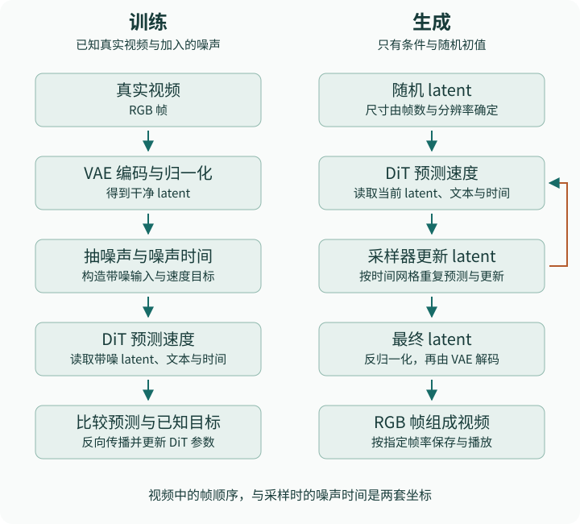

# 视频生成如何工作 { #video-generation }

给模型一句“镜头跟随一只向右奔跑的狗”，最后得到的是一段视频。狗的外观要前后一致，身体姿态要变化，背景要随镜头移动，遮挡以后重新出现的部位也要合理。这些关系跨越许多帧，单独生成若干张清晰图片再串起来，很容易出现变脸、闪烁和运动跳变。

视频生成模型需要学习整段视频的联合分布。现代系统常先用视频 VAE 压缩画面，再用扩散模型或 Flow Matching 模型在压缩表示中生成，最后解码成视频。本文沿一段具体尺寸的视频走完这条流程，解释每个组件接收什么、产生什么，以及它为什么要放在这里。具体计算以 Wan2.1 的一种配置为参照，算术示例会单独标明，不把某个实现写成所有视频模型的共同规定。

## 先确定模型要生成什么 { #video-data }

用 \(x\in\mathbb R^{B\times3\times F\times H\times W}\) 表示一批 RGB 视频。\(B\) 是样本数，\(F\) 是帧数，\(H,W\) 是画面高度和宽度。这里采用通道在前的布局；保存的视频文件、解码库和模型可能使用不同顺序，进入模型前需要明确转换。

文字描述 \(c\) 给出一个生成条件。文生视频要学习的是 \(p_\theta(x\mid c)\)，同一个描述允许不同的狗、不同的步态和背景，因此目标是一组可能视频的分布。图生视频增加首帧或参考图条件，动作条件视频还会增加控制序列。条件越具体，允许的结果范围通常越窄，但模型是否实际遵循它，仍取决于数据、接口和训练。

视频帧率决定这些帧怎样对应物理时间。以每秒 16 帧存放 81 帧，文件播放时长约为 \(81/16=5.06\) 秒，第一帧到最后一帧的时间跨度为 \(80/16=5\) 秒。帧数、帧率和采样间隔需要一起说明。生成完成后把帧率翻倍只会加快播放，不能当成模型学会了更快的运动。

生成过程还使用另一个时间变量 \(\tau\)，表示噪声程度。本文约定 \(\tau=1\) 为纯噪声、\(\tau=0\) 为干净视频。某个视频帧处在画面的第几秒，与整个生成状态当前的噪声程度，是两套独立坐标。

独立生成每一帧，等价于使用 \(\prod_f p(x_f\mid c)\) 这样的因子分解。即使每一帧都画出符合提示词的狗，它们也可能来自不同身份和不同运动阶段。联合分布允许当前帧依赖其他帧的信息。例如狗的后腿被遮挡时，前后帧给出运动连续性的证据，单帧条件没有这段信息。时空网络的任务，是在训练中学会利用这种统计依赖。训练目标仍可对各元素计算 MSE，依赖关系由网络读取整段输入和学习到的条件均值体现；不能从 loss 是逐元素相加推出各帧独立。

## 为什么先把视频压缩 { #video-compression }

考虑 \(B=1,F=81,H=480,W=832\)。原始视频含有

\[
3\times81\times480\times832=97\,044\,480
\]

个标量。若用 FP16 张量存储，仅输入就约为 185.1 MiB，还没有计算网络中间激活、梯度和优化器状态。这里说的是解码后的模型输入，MP4 等文件格式的压缩大小属于另一回事。

视频 VAE 的编码器 \(E\) 把画面映射到 latent，解码器 \(D\) 把 latent 恢复为画面

\[
x\xrightarrow{E}z\xrightarrow{D}\hat x.
\]

Wan2.1 的 VAE 使用 16 个 latent 通道、空间 8 倍压缩和相应的时间压缩结构。在支持的 \(F=4k+1\) 帧布局下，这个例子对应

\[
[1,3,81,480,832]\longrightarrow[1,16,21,60,104].
\]

latent 共 \(2\,096\,640\) 个标量，约为原来的 \(1/46.29\)。时间、空间网格合计缩小约 247 倍，但通道从 3 增加到 16，因此不能把网格压缩倍数直接当成整个数组的压缩倍数。

压缩让后续建模更便宜，也引入了重建误差。一个真实视频经过 \(D(E(x))\) 后，如果手指细节或短暂接触已经消失，就应先检查压缩表示与解码器。生成主干可能补出视觉上合理的细节，却无法从被丢弃的信息中唯一恢复原来的真实细节。先检查重建，可以把问题从整套生成系统中分离出来。

[视频 VAE 与因果压缩](video-vae-1029-1246.md)进一步解释 VAE 的训练目标、首帧边界、latent 归一化和分块缓存。尤其需要注意，按 `1、4、4…` 帧送入编码器不等于每块独立编码，历史状态仍可能参与计算。

## latent 怎样进入 Video DiT { #video-dit }

Transformer 接收的是向量序列，需要先把 latent 网格转换为 token。对上述 \([16,21,60,104]\) latent 使用 \((1,2,2)\) 的时间和空间 patch，每个 patch 含 \(16\times1\times2\times2=64\) 个数。把 64 维向量投影到模型隐藏维度 \(d\)，得到

\[
N=21\times30\times52=32\,760
\]

个 token，每个 token 表示一个局部时空区域。这里的 token 是连续向量，不需要对应词表中的离散编号。

网络需要同时知道这个 token 在视频中的时间和空间位置、当前整体噪声程度、文字描述。位置编码提供时空坐标，噪声时间嵌入告诉模型当前应处理哪种噪声水平，文本编码器把句子变成条件向量。三者提供不同信息，不能互相替代。

Self-attention 让视频 token 交换信息，cross-attention 等条件接口让文本参与预测。假设狗在相邻帧从左侧移动到右侧，相关视觉信息可能位于不同空间位置。能够跨帧、跨位置交换信息，有助于网络学习这种关联；位置编码本身不会提供准确的物体轨迹。

完成多层计算后，输出头把每个 token 投影回对应 patch 的数值数量，再恢复为与输入 latent 相同的网格。它输出的具体内容由训练目标决定，可以是噪声、干净样本估计或 Flow Matching 速度。网络叫 DiT，并不能单独说明它究竟预测什么。

这段计算的完整形状和注意力代价见[Video DiT 的时空建模与条件控制](video-dit-1029-1246.md)。32,760 个 token 的全注意力每头有约 10.73 亿个位置对；FlashAttention 能避免完整存下这张分数矩阵，但不会把标准全注意力的二次算术量直接变成线性。

## 一段真实视频怎样成为训练监督 { #video-training }

在一个常见的冻结 VAE、训练 DiT 的设置中，先把真实视频编码并按模型约定归一化为 \(z_0\)，再采同形状噪声 \(\epsilon\) 和一个噪声时间 \(\tau\)，构造

\[
z_\tau=(1-\tau)z_0+\tau\epsilon.
\]

这里一次混合就得到带噪输入。Flow Matching 的目标速度是这条路径对 \(\tau\) 的导数

\[
u=\epsilon-z_0.
\]

网络接收 \(z_\tau,\tau,c\)，输出 \(v_\theta\)，用平均平方误差让它接近 \(u\)。训练程序知道真实视频和加入的噪声，因而有监督目标；网络没有直接读取干净答案，只能从带噪状态和条件中学习预测。

用两个元素举例，若 \(z_0=[2,-1]\)、\(\epsilon=[-2,3]\)、\(\tau=0.75\)，则输入是 \([-1,2]\)，目标是 \([-4,4]\)。真实网络对整个视频数组做同样的目标构造，同时通过时空计算利用不同位置之间的关系。

普通联合视频训练通常给一整段视频共享一个噪声时间。模型在带噪的全部帧上学习怎样恢复跨帧关系，训练 loss 不需要额外写成“保持衣服颜色”或“让脚不打滑”才能学习到这些统计规律。不过，数据和目标也不会自动保证所有物理约束，训练样本中的偏差与遗漏仍会进入生成结果。

## 只有文字和噪声时怎样生成 { #video-sampling }

推理开始时先确定帧数、分辨率和对应 latent 尺寸，编码文字，再抽取纯噪声 \(z_1\)。此时不需要真实视频，也不需要为了文生视频先调用 VAE encoder。

模型与采样器沿下降的噪声时间网格重复运行。使用最简单的 Euler 更新，有

\[
z_{\tau'}=z_\tau+(\tau'-\tau)v_\theta(z_\tau,\tau,c),
\qquad\tau'<\tau.
\]

模型预测局部方向，solver 负责根据步长更新状态。生成每前进一步，都需要在新的状态上重新预测。最后得到 \(z_0\) 的估计，做 latent 反归一化后送入 VAE decoder，得到 RGB 帧，再按指定帧率编码为视频文件。

{ width="720" }

因此，训练一次网络前向与生成完整视频的计算过程不同。训练可以随机抽一个噪声时间构造监督，生成则要把多次预测串成轨迹。训练误差下降有意义，但还需要真正采样，才能发现误差累积和有限步求解的问题。

[视频训练与采样](video-training-and-sampling-1029-1246.md)把目标、梯度、Euler 更新、CFG 和有效区域 loss 全部展开，并提供[可直接运行的数值示例](../assets/examples/diffusion/video_generation_mechanisms.py)。它也解释了为什么给定噪声的确定性生成过程，仍能通过重新抽噪声产生不同视频。

## 首帧条件怎样改变问题 { #video-conditioning }

图生视频把任务改为在给定图像的条件下生成后续变化。一个常见接口会把已知图像编码成视觉条件，把未知帧位置填充，并附上已知区域 mask，再与带噪 latent 一同输入网络。视觉编码器还可以提供图像语义特征。具体通道数和编码方式因模型而异。

这里有两个容易混淆的目标。条件接口要求模型利用这张图；如果还要求输出第一帧逐像素等于输入，就需要相应的硬约束或输出处理。仅仅把图像作为条件，通常不能推出像素级相等。即使强制替换第一帧，第一帧与后续生成帧之间仍可能发生跳变。

文字、首帧、姿态、深度、轨迹和音频分别提供不同控制信息。比较它们的作用，可以固定初始噪声，只改变一个条件，观察主体、动作或镜头是否按预期变化。仅展示一条成功视频，很难判断控制信号是否被稳定使用。

## 更长的视频为何需要新的计算组织 { #long-video }

在同样分辨率下增加帧数，视频 token 数大致随帧数增长，全注意力的位置对数随 token 数平方增长。还会出现另一类困难，即短片段训练中没有遇到的事件长度、身份记忆和场景变化。扩大显存只能解决部分计算问题。

联合生成会在多次去噪中同时修改整段视频，通常需要等这段 latent 完成才得到最终画面。分块自回归生成则先完成一块，再把它作为后续块的历史条件，有机会缩短首段等待时间。它也把模型放进一个新的情境，后续条件包含自己生成的误差，误差可以随时间累积。

因果 VAE、分块因果注意力和自回归生成分别作用于压缩、信息可见范围和生成顺序。一个系统可以使用因果 VAE，同时在 DiT 中双向查看整段带噪视频。看到“causal”这个词，需要指出究竟是哪一层具有什么因果边界。

[长视频生成与缓存](long-video-and-cache-1029-1246.md)用四个视频块解释这些差异，以及 Diffusion Forcing、Self Forcing 和 CausVid 各自在解决什么问题。

## 怎样判断模型真正改善了什么 { #video-evaluation }

最先做的比较应是把同一段真实视频送入 VAE 再解码，观察重建损失出现在哪些帧、哪些细节。接着固定生成条件和随机种子，比较采样设置；最后再在多个提示词与种子上检查结果分布。它们分别回答压缩器、生成过程和总体能力的问题。

| 观察到的现象 | 可以先区分的来源 | 对应比较 |
| --- | --- | --- |
| 真实视频重建也丢失手部细节 | 压缩与解码能力 | 原视频与 VAE 重建逐帧比较 |
| 单帧清晰但身份不断变化 | 跨帧建模、条件保持或数据问题 | 回放整段，跟踪同一主体 |
| 视频很稳定但几乎不动 | 运动不足被一致性分数掩盖 | 同时比较运动幅度与平滑性 |
| 首帧接近参考图，后续逐渐偏离 | 图像条件在长时间上的有效性 | 分段比较主体、布局与动作 |
| 短片段正常，滚动生成后退化 | 历史误差、上下文截断和分布差异 | 相同条件下比较短片段与长 rollout |
| 少步采样变差 | 数值误差、模型误差和蒸馏目标 | 固定模型与噪声比较时间网格和前向次数 |

这些是定位方向，单个现象不足以证明唯一原因。视频评测也需要同时看画质、运动、条件遵循、长时稳定性和成本。静止画面可以很一致，却没有完成奔跑任务；逐帧锐利可以掩盖对象突然消失。相关评测与因果缓存的完整例子放在长视频文章中。

视频生成积累的视觉规律可以用于世界模型研究，但开放生成的观感不能证明动作会导致正确后果。若要用于规划或控制，还要验证动作敏感性、状态记忆和闭环任务表现，见[生成式模拟与视频](../world-models/generative-simulation-and-video.md)。扩散也可以直接生成机器人动作序列，届时输出空间、控制频率与评测对象都变了，见[动作策略学习](../vla/data-and-policy-learning.md)。

## 按机制继续查阅 { #video-reference }

| 想弄清的机制 | 完整说明 |
| --- | --- |
| 压缩率、KL、首帧边界和 VAE cache | [视频 VAE 与因果压缩](video-vae-1029-1246.md) |
| patch、时空注意力、3D RoPE 和图像条件 | [Video DiT 的时空建模与条件控制](video-dit-1029-1246.md) |
| Flow 目标、梯度、采样符号、CFG、表示对齐与奖励优化 | [视频生成的训练与采样](video-training-and-sampling-1029-1246.md) |
| 分块生成、forcing、KV cache、蒸馏与视频评测 | [长视频生成与缓存](long-video-and-cache-1029-1246.md) |

原文中的 DINO 表示对齐和 Flow-RL 已放入[训练与采样](video-training-and-sampling-1029-1246.md)，补充了辅助目标的梯度路径、确定性 ODE 的多样性来源，以及随机转移需要满足的条件。

这些文章可以按问题直接查阅。具体模型的设计选择与实验证据，见 [Wan 论文精读](../paper-deep-dives/diffusion/wan.md)、[CausVid 论文精读](../paper-deep-dives/diffusion/causvid.md)与 [Self Forcing 论文精读](../paper-deep-dives/world-models/self-forcing.md)。

## 参考资料 { #sources }

- [Wan 技术报告](https://arxiv.org/abs/2503.20314)与[官方实现](https://github.com/Wan-Video/Wan2.1)提供本文配置示例的 VAE、DiT 和生成接口依据。
- [Video Diffusion Models](https://arxiv.org/abs/2204.03458)讨论视频扩散中的时空建模与图像、视频联合训练。
- [Flow Matching for Generative Modeling](https://arxiv.org/abs/2210.02747)提供速度场学习的理论背景。
- [VBench](https://arxiv.org/abs/2311.17982)把视频质量与内容一致性分成多个评测维度。
