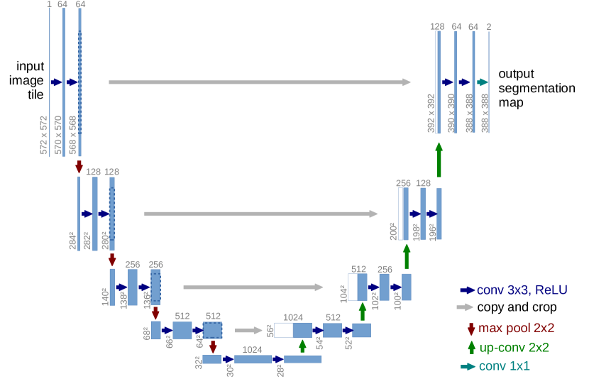
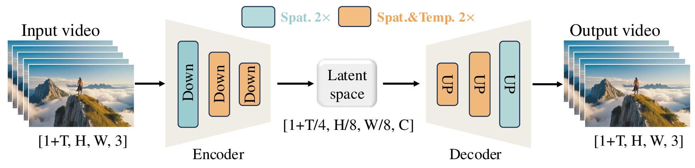
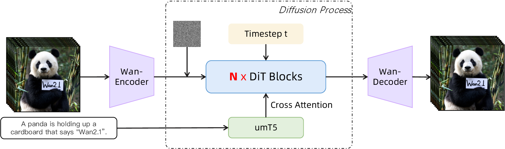

# 视频与多模态扩散

扩散模型最早在图像生成中爆发，但它真正显示出通用生成框架潜力，是在视频、多模态条件生成和跨模态建模中。图像扩散主要解决“生成一张符合条件的静态样本”，视频和多模态扩散则要解决“在时间、一致性、条件对齐和多模态关系上同时成立”的问题。难度骤升，方法也因此更加丰富。


## 从图像扩散到视频扩散，难点增加了什么

视频可以看作带时间轴的图像序列，最直接的表示是 $x_{1:T}$。若照搬图像扩散，对整段视频加噪并去噪，立刻会遇到几类新难点：时间维度拉长后显存和计算量急剧膨胀，帧间一致性要求模型不能一帧一帧各自漂亮却彼此不连贯，运动模式同时包含局部纹理变化和全局相机运动，条件也可能来自文本、首帧、草图、音频、动作轨迹等多种模态。

因此视频扩散不能只追求单帧质量，还必须建模时间结构。

## 视频扩散的基本目标

若视频样本记作 $x_{1:T}$，训练目标与图像扩散类似，可在某个噪声时间 $t$ 上最小化噪声预测误差：

$$
\mathcal{L}
=
\mathbb{E}_{x,\epsilon,t}
\left[
\|\epsilon - \epsilon_\theta(x_t, t, c)\|_2^2
\right],
$$


其中 $c$ 是条件信息。但关键在于 $\epsilon_\theta$ 不再只看二维空间，而要看三维时空结构。

拆开读：\(\mathbb{E}_{x,\epsilon,t}\) 表示对视频样本、随机噪声和噪声时间取平均；\(\epsilon\) 是真实加入的噪声；\(\epsilon_\theta(x_t,t,c)\) 是模型根据带噪视频、时间和条件预测的噪声；\(\|\cdot\|_2^2\) 让预测噪声尽量接近真实噪声。

## 时空建模的三条主线

视频扩散里的“时空建模”可以先按三个问题来拆：模型是在像素空间还是 latent 空间工作，时间维是和空间维一起处理还是分开处理，条件信息能不能在整段视频里持续生效。下面三条主线不是互斥的历史阶段，而是经常叠在一起的设计选择：先用视频 VAE 压缩，再用 U-Net 或 DiT 在 latent 上做时空建模，最后用文本、首帧、轨迹或音频等条件控制生成。

| 主线 | 核心想法 | 最适合解决 | 主要代价 |
| --- | --- | --- | --- |
| 全 3D U-Net / 时空卷积 | 把视频当成 \(T\times H\times W\) 的三维体，局部卷积同时看相邻帧和相邻像素 | 局部运动、纹理连续、短视频或低分辨率 base model | 显存随帧数膨胀，长程依赖仍不便宜 |
| 分解式时空注意力 | 先在单帧内做空间建模，再沿时间建模运动，或二者交替 | 降低 attention 成本，复用图像模型权重，处理更长视频 | 强相机运动、遮挡和跨位置对应需要额外设计 |
| Latent video diffusion | 先用视频 VAE/tokenizer 压缩，再在 video latent 上扩散 | 高分辨率、多秒视频、现代 Video DiT / Flow 系统 | 压缩器一旦丢掉运动细节，后端生成器很难补回来 |

### 3.1 全 3D U-Net / 时空卷积

最直接的做法是把视频张量写成 \([B,C,T,H,W]\)，然后用 3D convolution 或带时间核的 residual block 去处理它。普通图像 U-Net 的卷积核只在 \(H,W\) 上滑动；视频 U-Net 的卷积核可以写成 \((k_t,k_h,k_w)\)，因此一个输出 token 同时接收相邻帧和相邻空间位置的信息。

这样做的好处很直观：局部运动和局部纹理天然绑在一起。比如手臂挥动、头发飘动、火焰跳动、镜头小幅平移，这些现象都不是单帧里能完整判断的，必须看前后几帧。早期视频扩散论文如 [Video Diffusion Models](https://arxiv.org/abs/2204.03458) 就沿着这条路线，把图像扩散里的 U-Net 扩展成 space-time 结构；[Lumiere](https://arxiv.org/abs/2401.12945) 也强调用 Space-Time U-Net 一次性生成完整时长的视频，而不是先生成稀疏关键帧再补帧。

{ width="760" }

<small>图源：[U-Net: Convolutional Networks for Biomedical Image Segmentation](https://arxiv.org/abs/1505.04597)，Figure 1。这里借经典 U-Net 图说明骨架：视频扩散中的 3D U-Net 可以理解为把每个二维 feature map 换成带时间轴的视频 feature volume。</small>

把这张经典 U-Net 图迁移到视频时，先看 U 形结构：左边下采样扩大感受野，右边上采样恢复分辨率，中间的 skip connection 把高分辨率细节送回解码端。视频版的区别是 feature 不再只是 \(H\times W\)，而是 \(T\times H\times W\)。如果下采样也压缩时间维，模型能更快看到长一点的运动；如果只压缩空间维，时间分辨率保留更好，但显存压力更大。

这条线的短板也来自同一个地方。3D feature volume 比图像 feature map 大很多，activation、attention 和 skip connection 都会被 \(T\) 放大。并且卷积本质上偏局部，处理“人物从画面左边跑到右边”“镜头绕主体转半圈”这类长程对应时，常常还要配合 attention、金字塔尺度或后续 super-resolution 阶段。

### 3.2 分解式时空注意力

第二条主线是把“看清一帧”和“看懂跨帧变化”拆开。若直接对所有 video token 做 full self-attention，token 数是 \(N=T H W\)，复杂度接近 \(O(N^2)=O(T^2H^2W^2)\)，很快不可承受。分解式做法把它拆成两步：

\[
\text{spatial attention: } T\cdot O((HW)^2),
\qquad
\text{temporal attention: } HW\cdot O(T^2).
\]


直觉上，spatial attention 负责回答“这一帧里有什么、在哪里、彼此关系如何”；temporal attention 负责回答“同一个位置或相邻位置上的内容如何随时间变化”。很多视频模型会交替堆叠空间层和时间层，或者在已有图像 U-Net/DiT 里插入 temporal attention / motion module。这样既能复用图像模型学到的物体和构图能力，又能额外学习运动。

{ width="880" }

<small>图源：`Genie: Generative Interactive Environments`，arXiv HTML Figure 3。原论文图意：每个 spatiotemporal block 由 spatial attention、temporal attention 和 feed-forward layer 组成；这张图不是扩散专属，但很清楚地展示了“空间层 + 时间层”的分解式时空建模思想。</small>

图中的蓝色 spatial layer 只在同一帧内部混合 token，重点是物体、边界、布局和局部关系；绿色 temporal layer 沿时间混合对应 token，重点是运动方向、速度变化和前后状态延续。把它放回视频扩散里，可以理解为：denoiser 每一步不只是给单帧去噪，还要让跨帧特征对齐，避免同一个主体在相邻帧里突然换身份。

这条线的关键取舍是“省计算”与“跨位置运动”之间的张力。若 temporal attention 只沿同一空间位置看时间，遇到大幅相机运动或主体快速移动时，同一个物体已经不在同一格子里了。实际系统常会配合相对位置编码、窗口移动、光流/轨迹条件、3D RoPE、cross-frame attention 或更强的全局层来补这个缺口。

### 3.3 Latent video diffusion

第三条主线是先别在像素上扩散，而是先把视频压到更短的 latent 序列。图像 latent diffusion 的核心是：

\[
x\rightarrow z,\qquad
\text{diffusion on } z,\qquad
z\rightarrow x.
\]


视频里同样可以写成：

\[
x_{1:T}\in \mathbb{R}^{T\times H\times W\times 3}
\rightarrow
z\in \mathbb{R}^{T'\times H'\times W'\times C_z}.
\]


如果时间压缩率是 \(r_t\)，空间压缩率是 \(r_h,r_w\)，那么 \(T'=T/r_t\)、\(H'=H/r_h\)、\(W'=W/r_w\)。这会显著降低后端 U-Net/DiT 的 token 数，使高分辨率、多秒视频变得可训练。现代 Wan、CogVideoX、HunyuanVideo 等路线基本都离不开视频 VAE/tokenizer。

{ width="920" }

<small>图源：[Wan: Open and Advanced Large-Scale Video Generative Models](https://arxiv.org/abs/2503.20314)，Figure 4。原论文图意：Wan-VAE 用 3D causal 结构实现 `4 x 8 x 8` 时空压缩；橙色块表示时空 2x 压缩，绿色块表示空间 2x 压缩。</small>

这张 Wan-VAE 图要先看压缩方向：视频不是逐帧单独进一个图像 VAE，而是通过 3D causal block 同时压缩时间和空间。这样 latent 里保留了运动连续性，后面的 DiT 才有可能在较短序列上建模整段视频。再看第一帧：Wan-VAE 对第一帧只做空间压缩，这让模型兼容图像数据和 I2V 首帧条件，也避免一开始就把关键外观信息混进时间压缩里。

latent 路线最容易被低估的是：VAE/tokenizer 不是一个无聊的前处理模块，而是视频生成质量的地基。如果压缩器重建单帧很清楚，但跨帧 latent 不稳定，后面的扩散主干会学到闪烁；如果时间压缩太狠，细小接触、口型、手指动作和物体身份可能已经在 latent 里丢了；如果压缩太轻，DiT 的序列又会长到训练不起。因此现代视频扩散论文里，VAE 的因果性、时空压缩率、重建损失、chunk cache 和解码速度都应当和主干架构一起看。

读新视频生成论文时，可以先问它在 pixel 还是 latent 上扩散，再问主干是全时空 attention、分解式 attention、3D U-Net，还是几种混用，最后看条件如何注入到每个时间步。很多看似“新的视频模型”，本质差异就藏在这三个接口里：压缩器保留了什么，时空主干怎样交换信息，条件能否跨整段视频保持一致。

## 时序一致性为何比单帧质量更难

视频中一个常见失败是“每帧都好看，但放起来抖”。这说明模型学到了局部纹理生成，却没有学到对象身份和运动连续性。可以定义一个概念性时序一致性损失：

$$
\mathcal{L}_{\text{temp}}
=
\sum_{t=1}^{T-1}
\|g(x_t, x_{t+1}) - \hat{g}(x_t, x_{t+1})\|^2,
$$


其中 $g$ 可以表示光流、对象跟踪关系或特征一致性。真实系统里会用更复杂的代理约束，但核心思想相同：不仅要每帧像，还要帧与帧之间连。

这条求和式从第 1 帧对一直加到第 \(T-1\) 帧对：\(g(x_t,x_{t+1})\) 表示真实或参考的帧间关系，\(\hat{g}(x_t,x_{t+1})\) 表示模型生成结果里的帧间关系，二者越接近，时间一致性越好。

## 条件类型的扩展

视频与多模态扩散的条件远比图像丰富。文本到视频要求根据描述生成动态场景，图像到视频要求给一张起始图并让它合理动起来，视频编辑要保留整体结构只改风格或对象，音频到视频要根据说话节奏或音乐节奏生成口型与画面，轨迹 / 姿态条件则根据骨架、摄像机轨迹或控制点控制视频。

条件越多样，模型越像一个统一的多模态生成器，而不只是“会画动图的扩散模型”。

## 文本到视频中的关键问题

### 6.1 语义理解

提示词“一个穿黄色雨衣的人在风雨中奔跑，镜头缓慢跟随”不仅有对象，还有动作、环境和镜头语义。模型要同时理解“谁在动”“怎么动”“镜头怎么动”。

### 6.2 长时依赖

若视频较长，前后事件顺序就变得重要。比如“先打开门，再走进房间”与相反顺序完全不同。

### 6.3 物体身份保持

视频中人物衣服颜色、车辆外观、背景布局若频繁跳变，用户会立刻察觉违和。这种身份一致性往往比单帧 FID 更影响观感。

## 图像到视频与首帧条件

**图像到视频常要求**保留首帧主体外观，合理补全后续运动，在运动中维持身份和结构，并避免背景或主体突然变形。

这与传统 img2img 还不一样，因为它不仅要保真，还要“想象运动”。很多方法会显式编码首帧特征，并在时间维重复注入，帮助身份保持。

## 多模态融合方式

### 8.1 Cross-attention

文本、音频、姿态等条件通过 cross-attention 注入 U-Net 或 Transformer 主干。这是最常见的做法。

### 8.2 条件编码器 + 融合层

每种模态先单独编码，再用共享表示空间或融合模块交互。

### 8.3 条件作为控制信号

类似 ControlNet 思路，把边缘、深度、姿态或运动轨迹作为额外条件分支，提高可控性。

## 视频扩散中的训练代价

视频 token / latent 数远大于图像，计算量通常近似随时间长度线性甚至更高增长。若分辨率为 $H \times W$，帧数为 $T$，粗略复杂度常会包含 $O(THW)$ 或在注意力中更高的项。因此视频扩散几乎天然需要 latent 压缩、分块训练、时空分解注意力、蒸馏或少步采样。这也是为什么“一致性模型 / Rectified Flow”对视频尤其有吸引力。

### 9.1 为什么现代视频模型越来越像“视频压缩器 + DiT + Flow”

图像扩散时代，很多人先记住的是 U-Net；视频扩散进入 720P、多秒、长时一致性之后，主角逐渐变成三件套：视频 VAE/tokenizer 负责压缩，Video DiT 负责时空建模，Flow Matching / velocity prediction 负责给采样器一条更顺的生成路径。

{ width="920" }

<small>图源：[Wan: Open and Advanced Large-Scale Video Generative Models](https://arxiv.org/abs/2503.20314)，Figure 5。原论文图意：Wan 架构由 Wan-VAE、Video DiT 和 umT5 text encoder 组成，DiT 通过 cross-attention 接入文本条件。</small>

读 Wan 架构图时，先看左边的 Wan-VAE：它把像素视频压到 latent video，等于先把一部长片压成模型能处理的胶片索引。再看中间的 Video DiT：它不是逐帧画图，而是在时空 token 上同时建模空间布局、时间运动和文本条件。最后看右边的 text encoder / cross-attention：prompt 不只是给第一帧用，而是要持续影响整段视频的对象、动作、镜头和风格。

把这张图和 Flow Matching 放在一起看，会更容易理解“velocity”为什么不是物理速度。模型预测的是当前 noisy video latent 应该往哪个方向移动，才能沿着生成路径靠近干净视频 latent。画面里的狗跑得快不快，是视频内容；latent 里的 velocity，则是采样器每一步要走的方向。

视频模型的难点也藏在这张图里：VAE 压缩太狠会丢运动细节，DiT 序列太长会爆显存，文本条件太弱会 prompt drift，采样步数太多会慢，步数太少又容易崩。后面的 Wan、CausVid、DMD、Phased DMD 等论文，其实都在围绕这几个接口做取舍。

## Wan 系列：开源视频扩散底座怎么组织

`Wan` 系列值得单独放进视频扩散页，不是因为它只是一个效果更好的 demo，而是因为它把现代开源视频基础模型的几个关键部件放在了一起：视频 VAE / tokenizer、DiT 主干、Flow Matching / velocity 风格训练、多任务数据、T2V/I2V/编辑等任务接口，以及面向长视频和高分辨率的系统优化。

Wan2.1 技术报告 `Wan: Open and Advanced Large-Scale Video Generative Models` 把它定位成一个开放的视频 foundation model 套件。官方开源仓库提供 1.3B 和 14B 量级模型，覆盖 Text-to-Video、Image-to-Video、Video Editing、Text-to-Image 和 Video-to-Audio 等任务；其中 1.3B T2V 模型面向消费级 GPU，14B 模型承担更强质量和泛化能力。Wan2.2 则进一步把 MoE 引入视频扩散模型：A14B 系列用高噪声专家负责早期整体布局，用低噪声专家负责后期细节精修，在每一步只激活约 14B 参数，但总容量接近 27B。

如果想看完整论文拆解，包括原论文图、训练阶段、Flow Matching 目标、2D Context Parallelism、推理量化/cache，以及 Wan2.2 README 对 MoE 和 TI2V-5B 的官方说明，可以直接读 [Wan2.1 专题讲解](../paper-deep-dives/diffusion/wan.md)。

Wan 和 Flow Matching 应该放在一起看。Wan 这类视频 DiT 的训练语言更接近“在视频 latent 空间里预测从噪声走向干净视频的速度场”。推理时，采样器从随机 video latent 出发，沿模型预测的速度/流场逐步积分，最后由 Wan-VAE 解码成视频帧。这里的 velocity 不是画面中物体的物理速度，而是高维 video latent 的生成方向。

从组件角度看，Wan 系列可以拆成四层：

| Layer | Role in Wan-style video generation | Why it matters |
| --- | --- | --- |
| Video VAE / tokenizer | Compress frames into spatiotemporal latents and decode latents back to video | Reduces token count while preserving temporal information |
| Video DiT backbone | Models the denoising / flow field over video latents | Handles spatial layout, temporal motion and condition fusion |
| Text / image conditions | Inject prompt, first frame, reference image or editing instruction | Turns unconditional video modeling into controllable generation |
| Sampling and system stack | Solver, CFG, prompt extension, FSDP/Ulysses/Ring-style parallelism, offloading | Makes large video generation feasible under memory and latency limits |

这张表最重要的是第一层和第二层的关系。视频 VAE 决定模型看到的 latent 是否稳定、是否保留运动和身份；DiT / Flow 模型决定从噪声 latent 到视频 latent 的生成路径是否好走。很多视频模型失败不是 prompt 理解单独失败，而是 tokenizer 压缩、时空建模、噪声日程、solver 和 CFG 联合失配。

### 10.1 Wan2.1：开源视频 foundation model 的基线意义

Wan2.1 的价值在于它成为很多后续视频生成、视频世界模型和机器人世界动作模型的共同底座。站内几篇论文专题都能看到它：[Self Forcing](../paper-deep-dives/world-models/self-forcing.md) 用 Wan2.1 T2V 作为自回归视频扩散改造对象，[DreamZero](../paper-deep-dives/embodied-ai/dreamzero.md) 使用 Wan2.1-I2V-14B-480P，把视频模型改造成 joint video-action prediction / robot policy，[Phased DMD](../paper-deep-dives/diffusion/phased-dmd.md) 则把 Wan 系列作为视频少步蒸馏和专家分阶段的代表底座之一。

从训练视角看，Wan2.1 说明现代视频扩散不再只是“把图像扩散扩到时间维”。它需要大规模图像和视频混合数据同时学习空间语义和运动，高质量视频 VAE 避免 latent 压缩先破坏时序信息，DiT 主干和跨模态条件注入兼顾文本语义、首帧保真和运动生成，Flow Matching / velocity 风格目标让视频 latent 采样路径更适合少步积分，也需要系统并行和显存优化，否则 720P、长序列、多任务训练很快不可承受。

### 10.2 Wan2.2：高低噪声专家为什么合理

Wan2.2 的 MoE 设计非常适合用扩散时间来理解。高噪声阶段，样本还接近随机噪声，模型主要决定全局构图、主体关系、镜头运动和大尺度动态；低噪声阶段，主体和运动已经成形，模型主要修纹理、边缘、局部运动和视频细节。把这两个阶段交给不同专家，等于承认“早期语义布局”和“后期细节精修”不是同一种计算压力。

| Wan version | Main role | Typical model/task shape | Key point |
| --- | --- | --- | --- |
| Wan2.1 | Open video foundation baseline | T2V 1.3B/14B, I2V 14B, editing/VACE variants | Strong open backbone for downstream video generation and world-model work |
| Wan2.2 A14B | Higher-capacity MoE video model | T2V-A14B and I2V-A14B, 480P/720P | High-noise expert handles coarse layout; low-noise expert refines details |
| Wan2.2 TI2V-5B | Efficient hybrid generation | Text-to-video and image-to-video, 720P@24fps | Uses higher compression for more deployable high-definition generation |
| Wan2.2 Animate / S2V | Specialized downstream branches | Character animation, replacement, speech-to-video | Shows Wan becoming a family of task-specific video generators |

这里的 MoE 和 LLM 里的 token-level router 不完全一样。Wan2.2 的核心分工沿着 denoising timestep / SNR 发生：早期激活高噪声专家，后期切到低噪声专家。这样做对视频尤其自然，因为视频生成的早期错误会影响整段运动，后期错误则更多表现为闪烁、纹理漂移和局部不稳定。

### 10.3 Wan 对世界模型路线的意义

Wan 本身首先是视频生成基础模型，不自动等于世界模型。它变成世界模型底座时，通常还要补三类能力：动作条件让同一历史视频在不同动作下产生不同未来，因果 rollout 让推理时只能看过去和当前 chunk、不能偷看未来，少步或实时化则把采样延迟压到 agent 或用户交互可以调用的范围。

这正是 [LingBot-World](../paper-deep-dives/world-models/lingbot-world.md) 选择 Wan2.2 I2V 作为视频底座后继续做 action adapter、长序列训练、因果化和少步蒸馏的原因。可以把关系理解成：

```text
Wan-style video generator
  -> adds action / camera / interaction conditions
  -> causalizes attention and rollout interface
  -> distills sampling steps
  -> interactive video world simulator
```

因此，读 Wan 时不要只看“能不能生成好看的视频”。更应该看它提供了一个足够强、足够开放、可被继续训练的视频 latent world prior。下游世界模型、机器人 WAM、视频少步蒸馏和交互模拟器，都是在这个 prior 上继续增加动作、因果性、长期记忆和部署速度。

## 多模态扩散不只生成图像和视频

广义上，扩散思想已被用于语音生成、音乐生成、3D / NeRF / 高斯场景表示、机器人动作轨迹生成、蛋白质结构与科学建模等任务。

**其共性在于**：当目标空间复杂、条件约束丰富、样本分布多峰时，逐步去噪式生成往往能给出稳定建模路径。

## 动作与轨迹扩散

在机器人和控制里，扩散可直接生成动作序列 $a_{1:H}$ 或轨迹点集。训练形式与图像类似，但目标变成序列：

$$
\mathcal{L}
=
\mathbb{E}_{a,\epsilon,t}
\left[
\|\epsilon - \epsilon_\theta(a_t, t, c)\|^2
\right].
$$


其中条件 $c$ 可来自观测、目标状态或语言指令。这种方法对多模态、多解空间任务尤其合适，因为同一目标往往存在多条合理轨迹。

这里把图像里的 \(x_t\) 换成动作噪声状态 \(a_t\)：\(\epsilon\) 是加到动作序列上的真实噪声，\(\epsilon_\theta(a_t,t,c)\) 是模型预测的动作噪声。也就是说，模型学的是如何从带噪动作轨迹里去掉噪声，而不是只回归单个确定动作。

## 视频扩散的常见失效模式

### 13.1 时间抖动

每帧独立看还可以，连起来像对象闪烁或纹理漂移。

### 13.2 动作不守物理

人物走路像滑行，物体运动不符合惯性，接触不连贯。

### 13.3 条件漂移

开头符合 prompt，后面逐渐跑题。例如最初是“红色跑车”，后面颜色或车型逐渐变掉。

### 13.4 长视频崩塌

短视频质量高，拉长后故事结构和视觉一致性迅速退化。

## 评测的特殊性

图像生成常看 FID、CLIP score，但视频还需额外关注时间一致性、运动合理性、长时语义保持、条件遵循和人类主观评分。

很多自动指标只能部分反映这些属性，因此人工评测仍然很重要。

## 直觉例子

想象你让模型生成“一个小女孩拿着红气球从街口跑向镜头，风把气球轻轻吹向右后方”。如果这是图像任务，只要生成某一瞬间就行；而在视频里，模型必须同时处理人物步态、气球摆动、背景透视变化、镜头接近感、衣服与头发的连贯运动。任何一个环节稍微不一致，整段视频都会露馅。这就是为什么视频扩散远不只是“多生成几张图”。

## 与世界模型和具身智能的交汇

视频扩散若能更稳定地预测未来视觉序列，就天然与世界模型发生交集；动作扩散若能生成多样可行轨迹，就与具身智能和控制系统结合。也就是说，多模态扩散不只是内容生成工具，还可能成为预测、规划和模拟的底层建模框架。

## 本页结论

视频与多模态扩散标志着扩散模型从静态视觉生成走向时空和跨模态建模。它面对的不再只是“图片像不像”，而是“时间是否连贯、条件是否遵循、模态是否对齐、运动是否合理”。这既推动了更强的时空架构和控制方法，也让扩散模型与世界模型、VLM/VLA、机器人控制等领域开始深度交汇。 

### 快速代码示例

```python
import torch  # 使用张量差分与均值计算

def temporal_smooth_loss(video_latent):  # 定义时序平滑正则
    # video_latent: [B, T, C, H, W]  # 视频潜变量的 batch、时间和空间维度
    delta = video_latent[:, 1:] - video_latent[:, :-1]  # 计算相邻帧潜变量差分
    return delta.pow(2).mean()  # 惩罚相邻帧的平均平方变化
```

这段代码是视频扩散里最常见的时序一致性正则之一：惩罚相邻帧潜变量突变。它通常与主去噪损失共同优化，用来减少闪烁和跳帧，但权重过大也可能抹掉真实运动细节。

## 工程收束

视频与多模态扩散要按时空耦合、tokenizer、条件接口、长视频成本和多模态一致性来验收。最容易踩坑的是画质上去了但时序稳定差、多模态对齐错误隐藏很深、训练成本失控；更稳的做法是按短中长视频分桶，对条件丢失和漂移做专项测试，并把 rollout 与可控性一起验收。
