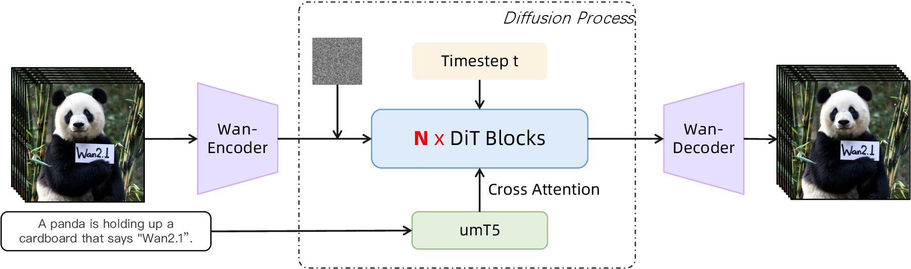

# 视频 DiT 怎样在时间和空间里交换信息

一段视频经过 VAE 编码以后，得到的仍然是一块有时间、空间和通道维度的数组。生成模型必须根据这块数组中目前还看得出的内容，判断人物在哪里、哪些纹理属于同一个对象、提示词要求发生什么，再预测下一次采样更新需要的量。Video DiT 用 Transformer 完成这次计算。

可以把一次前向计算理解为三个连续动作。先把带噪 latent 切成小块并变成向量，再让这些向量交换信息，最后把每个向量还原为对应位置的预测值。采样器会多次调用这个过程。一次 DiT 前向不直接产出 RGB 视频，最后的像素解码由 VAE decoder 完成。

下面以 Wan2.1 的公开实现说明具体接口，并把通用原理与它的实现选择分开。视频压缩见[视频 VAE](video-vae-1029-1246.md)，训练目标和采样更新见[视频训练与采样](video-training-and-sampling-1029-1246.md)。

## 从 latent 网格到一列 token

假设输入视频有 81 帧，分辨率为 \(480\times832\)，批大小为 1。采用 \([B,C,F,H,W]\) 的维度顺序，它的形状是

\[
x\in\mathbb R^{1\times3\times81\times480\times832}.
\]

\(F\) 表示视频帧数。本文用 \(\tau\) 表示扩散或 Flow Matching 的噪声时间，避免把视频中的第几帧与生成过程中的第几步混在一起。

按 Wan2.1 的时空压缩配置，这个例子的 latent 是

\[
z_\tau\in\mathbb R^{1\times16\times21\times60\times104}.
\]

其中时间长度为 \(1+(81-1)/4=21\)，空间两轴各缩小 8 倍。这里选用了符合时间压缩约束的帧数。这些数字是依据配置做的形状计算，不是性能测试结果。

DiT 还会把 latent 网格划成 \((p_f,p_h,p_w)=(1,2,2)\) 的小块。每块包含 \(16\times1\times2\times2=64\) 个数，共有

\[
N=\frac{21}{1}\frac{60}{2}\frac{104}{2}
=21\times30\times52=32760
\]

个块。把一个块内的数排列成向量 \(p_i\in\mathbb R^{64}\)，通过可学习的线性映射得到一个 token

\[
h_i=p_iW_E+b_E,\qquad W_E\in\mathbb R^{64\times D}.
\]

Wan2.1 用 kernel 和 stride 都等于 patch size 的 `Conv3d` 实现同样的非重叠分块与线性投影。卷积输出形状是 \([1,D,21,30,52]\)，展平网格以后是 \([1,32760,D]\)。这里的 token 是一个连续向量，没有查离散词表，也没有对某个词的概率做采样。

| 位置 | 本例形状 | 数值含义 |
| --- | --- | --- |
| VAE latent | `[1,16,21,60,104]` | 视频压缩表示，当前带有噪声 |
| Patch embedding 后 | `[1,D,21,30,52]` | 每个局部块的一份隐藏表示 |
| Transformer 输入 | `[1,32760,D]` | 同一块网格按固定顺序排成序列 |
| 输出 head 后 | `[1,32760,64]` | 每个块内 64 个 latent 数值的预测量 |
| Unpatchify 后 | `[1,16,21,60,104]` | 与输入带噪 latent 对齐的完整预测 |

在 Wan2.1 T2V-1.3B 配置中，\(D=1536\)，注意力头数为 12，每个头的维度是 128。隐藏维度从每块原始的 64 增加到 1536，让模型有空间表达不同特征，却也增加中间激活开销。仅一份 `[1,32760,1536]` 的 bf16 数组就约占 96 MiB，尚未计入其他层、梯度或注意力所需的张量。

VAE 压缩与 patchify 因此需要分别理解。前者学习一种可重建视频的表示，后者决定 Transformer 每个位置接收多少个 latent 数值。把 patch 做大能减少 token 数，但也会让一个 token 同时承担更大区域的预测。一个 latent 位置在原视频中的感受野通常跨越多个像素，甚至多帧，不能把这张网格当作精确的一对一像素标注。

## 一次注意力怎样改变一个位置的表示

假设已经得到 \(H\in\mathbb R^{N\times D}\)，先省略批维。一个注意力头从它计算 query、key 和 value

\[
Q=HW_Q,\qquad K=HW_K,\qquad V=HW_V,
\]

其中 \(Q,K,V\) 的形状都是 \([N,d_h]\)。Query 表达当前位置需要寻找的信息，key 用于比较哪些位置相关，value 提供被汇总的内容。这些矩阵都来自训练得到的线性变换，不是人工给某个 token 指定了“人物”或“背景”标签。

该头的输出为

\[
A=\operatorname{softmax}_{\text{row}}
\left(\frac{QK^\top}{\sqrt{d_h}}+M\right),
\qquad O=AV.
\]

第 \(i\) 行对应一个 query，它有 \(N\) 个分数。对这一行做 softmax，得到和为 1 的权重，再加权求和所有 value，形成当前位置的新信息。\(M\) 是可选掩码，允许的位置为 0，禁止的位置为负无穷。没有限制时，所有有效视频 token 都可以相互读取。

除以 \(\sqrt{d_h}\) 用来控制点积尺度。在各分量近似独立且方差相近的简化分析下，点积方差随维度增长，缩放能避免维度越大分数就自然越极端。实际模型还可能对 Q、K 做归一化。Wan2.1 在分头和施加 RoPE 前使用可学习的 RMSNorm，因此这条方差分析只是缩放项的基本动机，不能当作所有层实际分布的精确描述。

用一个人为构造的两位置例子看清加权过程。设某个 query 最终得到两个分数 \([0,\log3]\)，softmax 后是 \([0.25,0.75]\)。若相应 value 的某一个分量为 \([2,6]\)，输出的这个分量就是

\[
0.25\times2+0.75\times6=5.
\]

模型把两个位置的信息合成一个数，然后还会经过输出投影与残差相加。权重大不能直接解释成那个位置对应真实运动轨迹，也不能保证模型已经跟踪到同一个物体。注意力完成的是特征汇总，物体对应关系要靠整个模型和训练目标学出来。

多头注意力让不同组投影各自完成这种汇总，再把结果拼回宽度 \(D\)。不同头有机会学习不同关系，但头的角色并没有预先被固定为动作、身份、背景等类别。

## 为什么全时空注意力很贵

本例的一个 query 可以读取 32760 个 key，一共有 32760 个 query。每个头的分数矩阵包含

\[
N^2=32760^2=1\,073\,217\,600
\]

个元素。若显式用两个字节保存每个分数，一张矩阵约占 2 GiB；12 个头约占 24 GiB。这个数字只是在说明显式分数矩阵的体积，不能据此断言整个模型的实际显存占用。高效注意力实现通常不会同时物化这张完整矩阵。

设 token 时间长度为 \(F_p\)，每个时间位置有 \(S=H_pW_p\) 个空间 token。全时空注意力的配对数是 \((F_pS)^2\)。一种替代结构先对每个时间位置做空间注意力，再对每个固定空间位置做时间注意力，配对数变成

\[
F_pS^2+SF_p^2.
\]

代入 \(F_p=21\)、\(S=30\times52=1560\)，结果为

\[
21\times1560^2+1560\times21^2
=51\,793\,560.
\]

它约为全时空配对数的 \(1/20.72\)。这一比较只计算注意力关系的数量，并假设两种注意力的头维度相同。两次注意力各自的投影、归一化、布局转换和内存访问都需要成本，实际加速比不能直接用 20.72 代替。

| 计算部分 | 主要算术量，省略常数 | 增长来源 |
| --- | --- | --- |
| Q、K、V 与输出投影 | \(O(ND^2)\) | 每个 token 上的宽矩阵乘法 |
| 全时空注意力的两次矩阵乘法 | \(O(N^2D)\) | 每个位置与所有位置交换信息 |
| 两层前馈网络 | \(O(NDD_{\mathrm{ff}})\) | 每个 token 的特征变换 |
| 文本 cross-attention 的配对运算 | \(O(NLD)\) | \(N\) 个视频 query 读取 \(L\) 个文本位置 |

FlashAttention 通过分块与在线 softmax，减少显存读写，并避免保存完整的 \(N\times N\) 分数矩阵。对于全连接注意力，所有 query-key 配对仍然需要处理，二次算术复杂度保留。减少显存占用、减少配对数量、减少网络调用次数是不同的优化办法。

Wan2.1 的上述 T2V 配置使用全时空注意力，并调用 FlashAttention；分解式时空注意力是帮助理解取舍的另一种架构。不能把分解式公式当作 Wan 实际采用的计算量。

## 移动的物体不一定留在同一个格子

设一个球在较早的 latent 时间位置出现在空间格子 \((h,w)\)，较晚时移动到 \((h,w+2)\)。沿固定空间位置进行的时间注意力，只能直接连接 \((f,h,w)\) 与 \((f+1,h,w)\)，无法在这一层直接跳到 \((f+1,h,w+2)\)。

空间层和时间层组合以后，信息可以先在同一时间位置横向传播，再沿时间传播。多层网络能够建立更长的间接联系。因此固定位置时间注意力不等于模型完全无法理解运动，但它改变了信息到达另一个时空位置所需的路径。全时空注意力在单层内就允许这个跨时间、跨空间的直接联系，代价是更多配对。

窗口注意力、稀疏连接和交替的空间时间层，都在选择哪些联系必须直接计算，哪些联系允许经过中间位置传递。窗口大小和移动方式会影响遮挡后重现、大幅相机运动和长距离物体移动可利用的上下文。模型最终是否学会这些关系，仍要由实际生成结果与针对性的评测检验。

还有一个容易混淆的地方。视频 VAE 可以是因果的，DiT 却可以同时读取整段带噪视频的所有时间位置。VAE 的因果性描述压缩计算能否使用未来帧；DiT 的注意力掩码描述一次预测能读取哪些 latent。Wan2.1 的这条生成路径没有因为使用 causal VAE 就自动变成逐帧自回归生成。分块因果生成及其缓存条件见[长视频生成](long-video-and-cache-1029-1246.md)。

前面的注意力数值可以放回移动红球的场景。较晚帧的 query 需要区分较早帧里的红球与背景。如果训练得到的分数给这两个位置分别为 \(\log3\) 与 0，它会以 .75 与 .25 汇总对应 value；若球被遮挡或两者颜色相近，内容分数可能变得接近，模型就更依赖空间时间上下文。这里没有预先写入“红球必须跟踪红球”的标签，物体对应关系通过预测误差反向塑造投影矩阵。

因此可以构造一个直接对照，保持帧数、背景和位移一致，只交换两个物体的外观，再观察模型是否把身份和运动轨迹交换错。这个实验检验的是模型实际学到的对应关系。仅显示注意力热图，无法排除 value、其他层或残差支路仍然提供了不同信息。

## 空间时间坐标与噪声时间分别进入哪里

把网格展平以后，模型仍然需要知道一个 token 原来位于哪一帧、哪一行、哪一列。如果只保留一列向量，attention 本身没有空间邻近和时间先后的知识。

3D RoPE 把每个 token 的 \((f,h,w)\) 坐标用于旋转 Q、K 的不同维度组。在二维向量上，一个旋转可以写为

\[
R(\theta)=
\begin{pmatrix}
\cos\theta&-\sin\theta\\
\sin\theta&\cos\theta
\end{pmatrix}.
\]

如果位置 \(i\) 和 \(j\) 的 query 与 key 分别旋转 \(\theta_i\)、\(\theta_j\)，点积中会出现

\[
\bigl(R(\theta_i)q\bigr)^\top R(\theta_j)k
=q^\top R(\theta_j-\theta_i)k.
\]

相对位置差因此能够影响注意力分数。视频版本为时间、高度、宽度分配不同的旋转频率组。Wan2.1 的 `rope_apply` 根据 patch 网格生成这三组坐标，再作用在 Q、K 上。

这给模型提供了坐标信息，没有提供物体身份标签。球从一个坐标移动到另一个坐标，仍然需要模型结合内容判断两者是否相关。仅加入 3D RoPE 不能保证跨帧跟踪正确，也不自动保证比训练长度更长的视频仍然稳定。默认坐标是网格索引；物理上的秒数还取决于帧率和数据采样方式。

噪声时间 \(\tau\) 回答的是另一件事，即当前输入离纯噪声和干净数据各有多远。在同一次整段视频去噪中，通常所有帧使用同一个 \(\tau\)，但它们的 \(f\) 坐标仍然不同。下一次采样调用改变 \(\tau\)，这些空间时间坐标保持不变。

Wan2.1 把 scheduler 提供的时间步数值做正弦嵌入，再通过 MLP 生成调制向量。这些向量对归一化后的隐藏特征做缩放、平移，并控制残差支路的幅度。一个支路可以概括为

\[
\widetilde H=(1+s_\tau)\odot\operatorname{LN}(H)+b_\tau,
\qquad
H'=H+g_\tau\odot\operatorname{Attention}(\widetilde H).
\]

\(s_\tau,b_\tau,g_\tau\) 是按通道工作的向量，通常在 token 维广播。另一组向量调制前馈网络。模型由此可以在噪声较大时与噪声较小时采取不同的特征处理方式。实现接收的 timestep 数值范围由训练与 scheduler 的约定决定，不能把数学上的 \([0,1]\) 时间直接代入任何 checkpoint 的接口。

## 文本怎样持续影响整段视频

{ width="900" }

<small>图源为 [Wan 技术报告](https://arxiv.org/abs/2503.20314) Figure 5。图中下方文本经 umT5 到 cross-attention，上方 timestep 进入 DiT。左侧 encoder 表示真实视频的编码路径；纯文生视频推理从随机 latent 开始，无需输入一段真实视频。图把多次采样压缩为一个 Diffusion Process 框，右侧 decoder 接收的是完成采样后的 latent。</small>

**读这张图。**先沿左侧区分训练时的真实视频编码路径，再沿下方跟踪文本条件进入 cross-attention，最后看右侧 decoder 的输入已经是完成扩散采样的 latent。图中没有展开每个采样步，因此不能据此估计一次生成需要多少次 DiT 前向。


文本编码器先把提示词变成一串上下文向量 \(C\in\mathbb R^{L\times D_c}\)。通过投影后，视频 token 产生 query，文本向量产生 key 和 value

\[
Q_v=HW_Q,\qquad K_c=CW_K,\qquad V_c=CW_V,
\]

\[
O_c=\operatorname{softmax}
\left(\frac{Q_vK_c^\top}{\sqrt{d_h}}\right)V_c.
\]

这里的分数矩阵是 \(N\times L\)。每个视频位置根据当前状态从文本中读取信息，因此一句“红球向右移动”可以同时影响不同时间、不同空间位置的预测。文本不需要先被画进第一帧，再靠后续帧猜出原指令。

Wan2.1 用 UMT5 编码文本，在模型内部将文本特征投影到隐藏维度，并在每个 block 内加入 cross-attention。文本输入有固定的长度处理规则，这会影响长提示词实际被保留的内容。Cross-attention 只是给出读取条件的通道，没有把动作方向、数量或事件顺序变成必定满足的硬约束。训练样本是否清楚描述运动，模型是否有足够能力区分这些描述，都会影响条件遵循。

Classifier-free guidance 则发生在采样时。程序分别调用条件分支与基准分支，再组合它们的预测，例如

\[
\widehat v=v_{\mathrm{base}}
+w\bigl(v_{\mathrm{cond}}-v_{\mathrm{base}}\bigr).
\]

Cross-attention 决定一次调用内部怎样读取文本，CFG 决定怎样组合多次调用的输出。一个系统可以使用 cross-attention 却不使用 CFG。使用负面提示词时，基准分支本身也带有文本条件，不能把它严格解释为空条件分布。\(w\) 的影响与训练目标、scheduler 和模型有关，增大它不等于强制满足提示词。更完整的数值解释见[视频训练与采样](video-training-and-sampling-1029-1246.md)。

## 一张参考图怎样变成图生视频条件

图生视频需要同时表达两种信息。参考图给出了具体空间布局和局部外观，模型还需要从中提取能影响后续视频的视觉语义。不同系统会选择不同接口，Wan2.1 的 I2V 实现同时使用 latent 条件与图像特征。

第一条路径把参考图放在一个视频张量的首帧，其余位置填零，再交给 VAE 编码。这些零是占位输入，不能被解释成已知的未来画面。编码得到与目标视频 latent 对齐的 16 通道条件。程序另建一个 mask，标记哪些输入时间位置来自已知图像。

为匹配 4 倍时间压缩，原始首帧 mask 会先重复四次，再把时间维按四个一组重排为通道。对本例而言，mask 形状是 `[4,21,60,104]`。它与 `[16,21,60,104]` 的条件 latent 拼接，形成 20 通道条件。进入 DiT 时，再与 16 通道的当前带噪 latent 拼接，共 36 通道。

| 输入分量 | 通道数 | 内容 |
| --- | --- | --- |
| 当前待生成 latent | 16 | 每轮采样更新的变量 |
| 参考图构造的视频 latent | 16 | 固定的图像与占位帧编码 |
| 已知帧 mask | 4 | 时间压缩后保留的已知位置标记 |

因此 I2V 的输入 patch 含 \(36\times1\times2\times2=144\) 个数，输出仍然只预测待生成 latent 的 16 个通道，每个输出 patch 为 64 个数。输入条件不会把最终视频的 latent 通道数扩成 36。

第二条路径用 CLIP 视觉编码器提取图像特征，经投影后作为额外条件。Wan 的 I2V cross-attention 分别计算视频 query 对文本特征、图像特征的注意力，然后把两部分结果相加。两组注意力分别归一化，因此它不等价于把所有图像和文本 key 混在一起做一次 softmax。

在官方 I2V 采样代码中，条件分支和基准分支共用参考图 latent、mask 与 CLIP 图像特征，改变的是文本上下文。这时 CFG 主要放大两种文本条件下预测的差异，没有在两个分支之间移除图像条件。

这种设计让参考图在每次网络调用中都可见，却没有在上述更新代码里把输出首帧强制替换为原图。首帧重建误差、主体漂移和后续运动失真仍然需要检查。若任务要求特定像素严格保持，需要另外明确已知区域约束怎样进入采样过程，不能从“用了图生视频模型”直接推出这一保证。

## 输出怎样回到采样器

经过多个 block 以后，每个 token 仍是一个宽度为 \(D\) 的隐藏向量。输出 head 先做带时间调制的归一化，再线性投影到 \(C_zp_fp_hp_w\) 个数。在本例中就是 64 个数。

Unpatchify 按分块时使用的同一组网格尺寸和排列顺序，把这些预测放回 `[1,16,21,60,104]`。这一步是重排，不负责恢复到 81 帧 RGB。若把时间、高度或宽度轴排错，张量的元素数依然可能完全正确，画面结构却会被打乱。

下面的 NumPy 小例子只演示 patch 的排列与还原，不包含学习到的投影和 Transformer。它使用 2 个通道、2 个时间位置、\(4\times4\) 的空间网格，patch 为 \(1\times2\times2\)，所以得到 8 个 token，每个 token 有 8 个数。

```python
import numpy as np

z = np.arange(64).reshape(1, 2, 2, 4, 4)
b, c, f, h, w = z.shape
ph, pw = 2, 2
hp, wp = h // ph, w // pw
patches = z.reshape(b, c, f, hp, ph, wp, pw)
tokens = patches.transpose(0, 2, 3, 5, 4, 6, 1).reshape(b, f * hp * wp, -1)
restored = tokens.reshape(b, f, hp, wp, ph, pw, c)
restored = restored.transpose(0, 6, 1, 2, 4, 3, 5).reshape(z.shape)
print(tokens.shape)
print(tokens[0, 0].tolist())
print(np.array_equal(z, restored))
```

输出依次为 `(1, 8, 8)`、`[0, 32, 1, 33, 4, 36, 5, 37]` 和 `True`。这个排列让一个块中的通道维位于最内层，与上面描述的输出重排相配。真实模型的输入投影和输出 head 各自有学习到的权重，不能把它们当作这段可逆重排的直接替代。

网络输出的含义由训练目标决定。它可以是噪声、干净数据或概率路径速度的预测。Wan2.1 的 Flow Matching 路径需要与对应 scheduler 的输出约定配套；代码里某个局部变量叫 `noise_pred`，不足以判断模型训练的是哪一种目标。

采样器接到完整 latent 预测后，更新 \(z_\tau\)，在下一噪声时间再次调用同一个 DiT。只有完成整条采样路径，才将最终 latent 交给 VAE decoder。沿这条信息流检查实现时，最关键的接口是 token 顺序、输出目标和 scheduler 时间约定，它们决定了计算结果能否被下一步正确解释。

## 参考实现与资料

- [Video Diffusion Models](https://arxiv.org/abs/2204.03458) 的视频 U-Net 使用空间与时间注意力分解，提供与全时空注意力比较的具体架构背景。
- [FlashAttention](https://arxiv.org/abs/2205.14135) 解释分块、在线 softmax 与显存访问的关系。正文的显存数字仅为显式分数矩阵的形状推算。
- [Wan2.1 模型实现](https://github.com/Wan-Video/Wan2.1/blob/main/wan/modules/model.py) 中的 `WanModel`、`WanAttentionBlock`、`rope_apply` 和 `unpatchify` 对应正文的信息流。
- [Wan2.1 T2V-1.3B 配置](https://github.com/Wan-Video/Wan2.1/blob/main/wan/configs/wan_t2v_1_3B.py) 给出本文使用的压缩率、patch size、隐藏维度和注意力头数。
- [Wan2.1 注意力实现](https://github.com/Wan-Video/Wan2.1/blob/main/wan/modules/attention.py) 展示 FlashAttention 的调用、有效序列长度和掩码参数。
- [Wan2.1 图生视频实现](https://github.com/Wan-Video/Wan2.1/blob/main/wan/image2video.py) 给出参考图、mask、CLIP 特征与 CFG 两分支的实际构造。
- [Wan2.1 文生视频实现](https://github.com/Wan-Video/Wan2.1/blob/main/wan/text2video.py) 连接 DiT、scheduler 与 VAE 解码。
- [Wan 技术报告](https://arxiv.org/abs/2503.20314) 提供模型整体设计与实验背景。本文使用的例子均为形状和计算量推算，没有复现报告中的训练或性能实验。

回到[视频生成总览](video-and-multimodal-diffusion.md)可以查看一段视频从训练样本到生成结果的完整过程。
