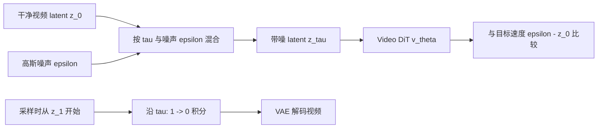

# 视频生成的训练与采样

视频模型的训练样本是一段真实视频，推理输入却通常是一团噪声。把这两种输入连起来，需要一个可以人为构造、又能让网络学到生成方向的任务。Flow Matching 的做法是混合真实视频 latent 与随机噪声，再让模型预测这条混合路径的变化方向。

本文把这个过程算一遍。视频 VAE 负责什么、latent 怎样变成 token，分别见[视频压缩与重建](video-vae-1029-1246.md)和[Video DiT](video-dit-1029-1246.md)。这里先把 latent 当作一个浮点数组，所有公式都可以逐元素计算；数组里面不同位置之间的关系由网络学习。



训练路径知道 `z_0` 和 `epsilon`，所以能直接构造监督；采样路径只保留当前 latent 和模型预测，必须把每次更新后的结果继续交回网络。把两条路径混写，是视频 Flow Matching 代码最常见的接口错误之一。

## 先把视频时间与生成时间分开

设真实视频编码后的 latent 为 \(z_0\in\mathbb R^{B\times C_z\times F_z\times H_z\times W_z}\)。\(F_z\) 是压缩后的帧数，下标 0 表示干净状态。使用 \(\tau\in[0,1]\) 表示噪声时间，约定 \(\tau=0\) 是数据、\(\tau=1\) 是纯噪声。

在普通的整段视频联合生成中，一次采样更新会改变整个数组。画面里的第 10 帧和第 20 帧可以同时处于 \(\tau=0.7\)，再同时更新到 \(\tau=0.6\)。把噪声去掉一半，不代表视频只播放到一半。分块生成或每帧使用不同噪声级别的系统另有设计，见[长视频生成](long-video-and-cache-1029-1246.md)。

下文采用从数据到噪声的时间定义，因此生成沿 \(1\to0\) 运行。一些 Flow Matching 论文把噪声放在 0，公式中的方向随之改变。读取实现时，先核对两个端点和输出含义，不能只凭变量叫 `noise_pred` 就认定它预测高斯噪声。[Wan2.1 的生成代码](https://github.com/Wan-Video/Wan2.1/blob/main/wan/text2video.py)使用了这个变量名，但相应 [scheduler](https://github.com/Wan-Video/Wan2.1/blob/main/wan/utils/fm_solvers_unipc.py) 配置为 `flow_prediction`。

## 一个训练目标怎样从真实视频产生

取与 \(z_0\) 同形状的标准高斯噪声 \(\epsilon\)，定义线性路径

\[
z_\tau=(1-\tau)z_0+\tau\epsilon.
\]

给定这一对端点，对 \(\tau\) 求导得到

\[
u=\frac{\mathrm d z_\tau}{\mathrm d\tau}=\epsilon-z_0.
\]

训练程序知道 \(z_0\) 和 \(\epsilon\)，所以目标 \(u\) 可以直接计算。网络只读取混合后的 \(z_\tau\)、噪声时间 \(\tau\) 和条件 \(c\)，输出与 latent 同形状的 \(v_\theta(z_\tau,\tau,c)\)。平方误差损失为

\[
\mathcal L_{\mathrm{FM}}
=\mathbb E_{z_0,\epsilon,\tau,c}
\left[\frac1D\sum_{i=1}^{D}
\big(v_{\theta,i}(z_\tau,\tau,c)-(\epsilon_i-z_{0,i})\big)^2\right],
\]

其中 \(D\) 是一个样本的有效 latent 元素数。期望表示要在许多视频、噪声和噪声时间上训练，实际使用 mini-batch 近似。

拿一个只有两个元素的教学样本计算。它用于展示算术，不代表真实视频可以压成两个数。

\[
z_0=[2,-1],\qquad \epsilon=[-2,3],\qquad\tau=0.75.
\]

于是

\[
z_{0.75}=0.25[2,-1]+0.75[-2,3]=[-1,2],
\qquad u=[-4,4].
\]

假设网络预测 \([-3,5]\)，两个分量都比目标大 1，平均平方误差为 1。对两个输出分量求导，有

\[
\frac{\partial\mathcal L}{\partial v_i}
=\frac{2}{D}(v_i-u_i)=1.
\]

梯度下降会通过链式法则调整网络参数，让当前样本的预测更接近目标。不同输出共享参数，一次参数更新还会影响其他位置，不能把它理解成独立修改两个输出值。训练只需随机抽取一个 \(\tau\) 就能得到这一项监督，无需先运行完整的去噪轨迹。

## 网络为什么没有拿到答案，却还能学习

同一个带噪值可能来自不同的干净视频和噪声配对。网络看不到该训练样本背后的两个端点，通常无法把每次抽样的目标都预测得完全相同。

对于固定的输入 \((z,\tau,c)\)，平方误差的最优预测是

\[
v^*(z,\tau,c)
=\mathbb E[\epsilon-z_0\mid z_\tau=z,\tau,c].
\]

这个结果来自平方误差的分解。用 \(m=\mathbb E[u\mid z,\tau,c]\) 表示条件均值，则

\[
\mathbb E[\|v-u\|^2\mid z,\tau,c]
=\|v-m\|^2+\mathbb E[\|u-m\|^2\mid z,\tau,c].
\]

第二项不随预测 \(v\) 改变，最小值在 \(v=m\) 处取得。因此，理想的平方误差最优解是当前位置的平均速度场。在相应正则条件与精确积分下，它随位置变化，把噪声分布输送到数据分布；实际网络只是在有限数据和容量下近似这个场，有限步 solver 还会引入误差。这种学习不要求记住每个训练噪声与某段视频的一一对应关系。[Flow Matching 原论文](https://arxiv.org/abs/2210.02747)给出了条件目标与边缘速度目标之间的关系，更完整的推导见[Flow Matching 与 Rectified Flow](flow-matching-and-rectified-flow.md)。

这也解释了一个常见困惑。训练中的每条配对路径是直线，但许多配对共同确定的边缘速度场可以弯曲，模型的实际采样轨迹并不必然是直线。有限步积分误差依然存在。

这件事可以用同一个可解析 latent 分布进一步检验。设真实 latent 元素 \(X\sim\mathcal N(2,.25)\)，噪声 \(E\sim\mathcal N(0,1)\)。在 \(\tau=.5\) 时，混合状态均值为 1、方差为 .3125，准确边缘速度为 \(-2+1.2(z-1)\)。所以观测到 \(z=1\) 时，平方误差最优预测为 −2，观测到 \(z=2\) 时为 −.8。它不会给所有样本一个固定的平均目标。

沿这个随位置变化的场积分，精确轨迹为 \(z_\tau=2(1-\tau)+\sqrt{.25(1-\tau)^2+\tau^2}\,e\)，其中 \(e\) 是噪声初值。最终得到 \(2+.5e\)，既有正确均值也有正确方差。后面的运行示例检验这个场，而不是预先知道某段视频答案再倒推常量速度。真实视频模型必须用学习得到的场近似同类分布运输。

## 一次训练迭代具体更新什么

在冻结 VAE 和文本编码器、训练视频 DiT 的常见设置下，数据流如下。它是机制伪代码，省略了设备、精度、分布式训练和具体模型接口。

```python
with no_grad():
    clean = normalized_video_encoder(video)
    context = text_encoder(caption)

noise = randn_like(clean)
tau = sample_noise_time(batch_size)
a = tau.reshape(batch_size, 1, 1, 1, 1)
noisy = (1 - a) * clean + a * noise
target = noise - clean
prediction = video_dit(noisy, tau, context)
loss = mean((prediction - target) ** 2)
optimizer.zero_grad()
loss.backward()
optimizer.step()
```

这里有三处约定直接影响训练含义。`clean` 应采用与推理 VAE 一致的归一化，不能训练时用原始 latent、推理时用标准化 latent。`tau` 要广播到样本的全部元素，普通联合训练通常让同一段视频共享一个噪声时间。`prediction` 的形状和目标完全相同，文本 token 不参与这项视频 latent 回归。

采样 \(\tau\) 的分布和损失权重决定模型在哪些噪声区域获得更多训练信号。上面选择最简单的说明形式，真实配方可能采用非均匀噪声时间、不同分辨率桶和损失权重。修改这些项会改变有效训练分布，不能只因为最终输入形状相同就当成等价配方。

如果视频在 batch 中补齐长度，需要区分两种 mask。注意力 mask 防止模型读取补齐位置；loss mask 防止无效元素进入平均误差。它们分别作用于网络计算和训练目标。对逐元素展开后的有效标记 \(m_i\in\{0,1\}\)，正确的有效元素平均为

\[
\mathcal L=\frac{\sum_i m_i(v_i-u_i)^2}{\sum_i m_i}.
\]

例如有效的两个误差都是 1，后面补齐两个位置，正确均值仍是 1。只把分子乘 mask 却仍除以 4，会得到 0.5，让短视频样本因补齐而被隐式降低权重。还要说明是“先逐样本平均再对 batch 平均”还是“所有有效元素一起平均”，后者会让长样本获得更大权重。

这两种 mask 又与图生视频的条件 mask 不同。条件 mask 告诉模型哪些位置来自输入图像，不自动意味着这些位置要从训练损失中删除。

## 推理时怎样从噪声走回视频

生成时没有真实 \(z_0\)，因此从 \(z_1\sim\mathcal N(0,I)\) 出发，求解

\[
\frac{\mathrm dz_\tau}{\mathrm d\tau}=v_\theta(z_\tau,\tau,c).
\]

选择下降的时间网格 \(1=\tau_0>\tau_1>\cdots>\tau_K=0\)，Euler 更新为

\[
z^{(k+1)}=z^{(k)}+
(\tau_{k+1}-\tau_k)v_\theta(z^{(k)},\tau_k,c).
\]

括号中的时间差为负。继续用前面的教学端点，假设沿路都能提供已知的常量速度 \([-4,4]\)，四次更新得到

| 噪声时间 | 当前状态 | 到下一时间的差 | 更新后的状态 |
| --- | --- | --- | --- |
| 1.00 | `[-2, 3]` | -0.25 | `[-1, 2]` |
| 0.75 | `[-1, 2]` | -0.25 | `[0, 1]` |
| 0.50 | `[0, 1]` | -0.25 | `[1, 0]` |
| 0.25 | `[1, 0]` | -0.25 | `[2, -1]` |

这个常量场用于核对符号，已知了终点，不能充当真实生成模型。真实模型每一步要根据当前状态重新预测，错误预测会把后续输入带到不同位置。

对于线性路径，还能从当前状态和速度估计两个端点

\[
\hat z_0=z_\tau-\tau v_\theta,
\qquad
\hat\epsilon=z_\tau+(1-\tau)v_\theta.
\]

把 \(z_{0.75}=[-1,2]\)、准确速度 \([-4,4]\) 代入，正好恢复 \([2,-1]\) 与 \([-2,3]\)。如果直接把速度输出交给 VAE 解码，就会把“变化方向”错当成“干净 latent”。正确流程是先完成积分，做相应 latent 反归一化，再调用 VAE decoder。

Euler 之外的 solver 可以改变每步近似方式和历史预测的利用方式。换 solver 时应核对输出参数化、时间网格、末端处理和实际模型前向次数。更高阶不保证任意模型、任意大步长都更好；减少采样步数也不会自动减少视频的帧数。

## CFG 怎样影响生成方向

文本条件通过网络内部的注意力或调制影响预测。Classifier-Free Guidance 则进一步组合两个预测

\[
v_{\mathrm{cfg}}=v_{\varnothing}+s(v_c-v_{\varnothing}).
\]

\(v_c\) 使用文本条件，\(v_{\varnothing}\) 使用训练约定的空条件或相应基准条件，\(s\) 是引导强度。\(s=1\) 返回条件预测，\(s=0\) 返回基准预测，\(s>1\) 沿两者差异外推。

例如两个预测分别为 `[1, -1]` 和 `[3, 2]`，取 \(s=2\) 得到 `[5, 5]`。这个输出继续交给 solver，而非直接作为视频。增大 \(s\) 会改变速度场，可能提升条件遵循，也可能损害细节、多样性或采样稳定性，效果需要在固定样本集上比较。

训练 CFG 所需的空条件分支，常通过随机丢弃条件来学习。推理时负面提示词可以取代空文本作为对照，但它和真正的无条件分布有区别。图生视频也可能在两个文本分支里都保留图像条件，因而“unconditional”只表示移除了某类条件。[Wan 的图像条件实现](https://github.com/Wan-Video/Wan2.1/blob/main/wan/image2video.py)就是需要按具体条件分别读的例子。

两分支可以分别执行，也可以合并成一个更大的 batch。后者减少调用次数，不会把两份模型计算凭空变成一份；记录采样成本时需要说明计算了多少分支、是否有 guidance distillation，以及计时包含哪些阶段。

## 帧率、切镜和字幕怎样进入训练问题

视频 tensor 只有帧的顺序，实际时间间隔还取决于帧率和采帧规则。假设物体相邻采样帧移动 10 像素，在每秒 10 帧时约为每秒 100 像素，在每秒 20 帧时约为每秒 200 像素。直接把同一段帧序列以另一帧率导出，会改变观众看到的速度；它不会补出中间运动细节。

训练时混合不同采样间隔却不保留相关信息，会让相似的帧位移对应不同真实速度。具体系统可以统一预处理帧率，也可以显式提供帧率等条件。读取一段代码里的 `num_frames`，不足以确定它覆盖几秒的动作。

切镜同样有语义后果。如果把两个场景拼成一个训练片段，模型可能学到在一个提示词下突然换场景。需要保留转场的任务可以这样训练；连续单镜头任务则需要相应的数据筛选。文字描述也要覆盖事件顺序，“人拿起杯子后喝水”与“人喝水”给出的监督不同。这里的数据选择会改变模型应该生成的分布，后处理无法完全补回缺失的动作描述。

## 表示对齐增加了什么监督

Flow loss 监督最终速度输出，中间特征怎样组织并没有唯一答案。表示对齐方法为部分隐藏状态增加视觉语义监督。一个说明性的形式是

\[
\mathcal L_{\mathrm{align}}
=\frac1{F'}\sum_f
\left[1-\cos\big(P_\phi(h_f),\operatorname{stopgrad}(g(x_f))\big)\right].
\]

\(h_f\) 是生成模型某层按时间位置取出的隐藏表示，\(P_\phi\) 把它投影到老师特征空间，\(g\) 是预训练视觉编码器。实际视频 VAE 会压缩时间，视觉编码器的空间网格也未必相同，所以先要定义帧与 token 的对应、插值或池化方法，不能直接对两个不同网格做逐元素相减。

固定老师参数并阻断目标侧梯度后，梯度仍会经过投影头传回生成模型。总目标 \(\mathcal L_{\mathrm{FM}}+\lambda\mathcal L_{\mathrm{align}}\) 同时要求正确的生成方向和特定的中间表示。\(\lambda\) 控制两项梯度的相对影响；数值上较大的 loss 不一定对应更大的梯度。

[CREPA](https://arxiv.org/abs/2506.09229)在视频微调中进一步把相邻帧的预训练特征纳入对齐，让当前隐藏表示受到附近时间语义的约束。这里的监督对象是老师特征，不能简化为把相邻帧像素直接平均。DINO 系列等视觉编码器提供的是某种语义表示，特征相近仍可能对应不同细节、不同接触状态或错误的物理过程。评测这类辅助目标时，需要同时观察主体一致性、运动幅度和任务结果。

## 奖励优化为什么还要检查采样分布

确定性 ODE 对给定初始噪声给出确定的轨迹，但初始噪声本身可以每次重新抽样。同一提示词因此可以产生多个候选，候选多样性无需依赖每步额外加噪。

某些策略梯度方法把采样过程的每一步当作随机策略动作，需要计算新旧策略对同一转移的概率比。确定性转移是集中在一个点上的分布，不能直接套用带非零方差的高斯转移密度。为建立可计算的随机转移，一些 Flow-RL 方法引入逐步随机采样。这里解决的是优化所需的转移分布问题。

随机项还要与原本的噪声水平协调。[CPS](https://arxiv.org/abs/2509.05952)式（12）提出一种系数保持的更新。记下一噪声时间为 \(\tau'\)，新抽取的噪声为 \(\xi\)，有

\[
z_{\tau'}=(1-\tau')\hat z_0
+\tau'\cos(\eta\pi/2)\hat\epsilon
+\tau'\sin(\eta\pi/2)\xi.
\]

其中 \(\eta\in[0,1]\) 控制每步新注入的随机性，\(\eta=0\) 时没有新的随机项。若 \(\tau'=0\) 或 \(\eta=0\)，这个转移的条件方差为零，不能直接代入非零方差的高斯 log-probability 公式，策略梯度实现需要跳过或专门处理这些步骤。

当两个噪声分量独立、各自单位方差时，合成噪声的方差系数为

\[
(\tau')^2\cos^2(\eta\pi/2)
+(\tau')^2\sin^2(\eta\pi/2)=(\tau')^2.
\]

例如 \(\tau'=0.5,\eta=0.5\)，两项系数都约为 0.3536，平方相加为 0.25。若保留原本 0.5 的噪声系数，再额外叠加 0.3536 的独立噪声，平方和会变成 0.375，偏离预期。这是系数计算的动机。预测噪声未必具有单位方差，预测数据与预测噪声也通常相关；即使速度回归达到条件均值最优解，也不能仅凭系数平方和证明整个边缘分布正确。

CPS 报告中的主要验证任务是图像生成的 GenEval、OCR 和偏好奖励，不能把这些实验直接当作视频运动质量提高的证据。迁移到视频时，还需比较训练用的随机采样与部署用的采样是否一致，并单独检查运动、条件遵循和奖励模型偏差。只有最终 reward 上升，无法区分真正的生成质量改善与评估器被利用。

## 运行这些计算

[可下载的数值示例](../assets/examples/diffusion/video_generation_mechanisms.py)仅使用 Python 标准库。保存后可以直接运行

```bash
python video_generation_mechanisms.py
```

它会打印 `32760` 个视频 token 的规模计算、`[-1, 2]` 的带噪状态、`[-4, 4]` 的目标速度、四步 Euler 轨迹和有效区域 loss。

代码还提供了一个与“已知终点常量速度”不同的验证。设数据为一维高斯 \(X\sim\mathcal N(2,0.5^2)\)，噪声为 \(E\sim\mathcal N(0,1)\)，且二者独立。路径的均值与方差为

\[
\mu_\tau=2(1-\tau),\qquad
S_\tau=(1-\tau)^2\cdot0.25+\tau^2.
\]

利用高斯条件均值可以直接写出正确的边缘速度

\[
v(z,\tau)=-2+
\frac{\tau-(1-\tau)\cdot0.25}{S_\tau}
\big[z-2(1-\tau)\big].
\]

这个已知速度场把整个标准高斯分布输送到目标高斯。分别从 `-1, 0, 1` 出发，用 2000 步 Euler 得到约 `[1.500370, 2, 2.499630]`，解析终点为 `[1.5, 2, 2.5]`。减小步长时数值误差缩小，不同初值仍得到不同终点。它同时说明了确定性 ODE 的多样性来源和积分误差，示例没有训练神经网络，也不能生成真实视频。

## 参考资料

- [Flow Matching for Generative Modeling](https://arxiv.org/abs/2210.02747)讨论条件速度回归与边缘速度场的关系，本文采用与该论文常用写法相反的时间端点。
- [Wan](https://arxiv.org/abs/2503.20314)以及[官方 text2video.py](https://github.com/Wan-Video/Wan2.1/blob/main/wan/text2video.py)用于对照模型预测、CFG 与 scheduler 的实际连接。
- [CREPA](https://arxiv.org/abs/2506.09229)讨论视频微调中的逐帧与跨帧表示对齐。
- [Coefficients-Preserving Sampling](https://arxiv.org/abs/2509.05952)讨论 Flow-RL 随机采样的系数与噪声水平。
