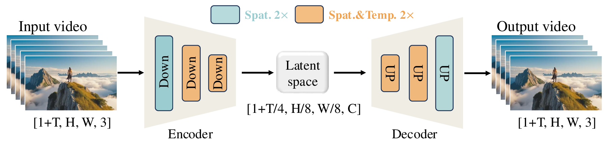

# 视频 VAE 怎样压缩时间并保留可生成的表示

一段 81 帧、480 × 832 像素的 RGB 视频共有 97,044,480 个颜色数值。如果生成模型在这个网格上反复执行几十次去噪，每一步都要为大量像素计算中间特征。视频 VAE 先把它变成更小的连续张量，生成模型学习这个张量的分布，最后由 VAE 的解码器恢复可见视频。

压缩后还需要保留哪些东西，是这里的核心问题。脸部纹理和背景纹理会竞争表示容量，连续帧里的细微运动也会被压进同一个时间表示。理解视频生成的质量和成本，必须先弄清生成模型接收到的究竟是什么。

## 从像素张量算到 latent 张量

本文采用深度学习代码中常见的通道在前布局

\[
x\in\mathbb R^{B\times3\times F\times H\times W}.
\]

\(B\) 是批大小，\(F\) 是视频帧数，\(H,W\) 是分辨率。这里的视频时间与扩散采样使用的噪声时间不同。视频帧用 \(f\) 编号，噪声程度在其他文章中用 \(\tau\) 表示。

编码器 \(E\) 把输入变成 latent，解码器 \(D\) 把 latent 变回像素。latent 是学习得到的表示，一个通道通常没有可以直接命名的 RGB 或运动含义。

\[
x\xrightarrow{E}z_{\mathrm{raw}}
\in\mathbb R^{B\times C_z\times F_z\times H_z\times W_z}
\xrightarrow{D}\hat x.
\]

以 [Wan2.1 的视频 VAE](https://arxiv.org/html/2503.20314v2#S4.SS1) 为具体例子，它使用 16 个 latent 通道，空间两轴各缩小 8 倍。对于 \(F=4k+1\) 的输入，首帧单独保留时间位置，后续部分以 4 倍比例压缩，因而

\[
F_z=1+\frac{F-1}{4},\qquad H_z=H/8,\qquad W_z=W/8.
\]

取 \(B=1,F=81,H=480,W=832\)，完整形状变化为

```text
RGB 视频             [1,  3, 81, 480, 832]
VAE 连续 latent      [1, 16, 21,  60, 104]
VAE 重建视频          [1,  3, 81, 480, 832]
```

{ width="880" }

<small>图源为 [Wan 技术报告](https://arxiv.org/html/2503.20314v2#S4.SS1) Figure 4。蓝色块只做空间缩放，两个橙色块同时在时间和空间上缩放。图中输入写成 `1+T` 帧，本文把总帧数记为 F，因此应代入 T=F−1；中间 latent 的 C 对应本例的 16 个通道。</small>

latent 包含 \(16\times21\times60\times104=2,096,640\) 个数值。相对输入，标量数量减少约 46.29 倍。常说的 \(4\times8\times8\) 描述时间和空间网格的缩放比例，不能直接当成存储字节减少 256 倍，因为通道数从 3 增加到 16，首帧又有特殊处理。真实字节数还取决于输入是 8 位像素还是浮点数，以及 latent 的数值精度。

这个形状也没有直接给出 Transformer 的 token 数。DiT 还会把相邻 latent 位置合成 patch，再投影到隐藏维度，具体过程见[视频 DiT 的时空计算](video-dit-1029-1246.md)。VAE 压缩与 DiT patch 化是两个不同的操作。

### 连续 latent 为什么也被叫作 token

这里的 \(z_{\mathrm{raw}}\) 是实数张量，可以直接加高斯噪声。某些资料把视频编码器统称为 tokenizer，把 latent 网格上的一个向量称为 token。这种叫法不表示它一定来自有限词表。

离散 tokenizer 还需要把向量映射到码本编号，后续模型可以预测编号的分类分布。连续 VAE 不要求这一步，扩散或 Flow Matching 直接预测连续张量上的噪声、数据或速度。读到“视频 token”时，先确定它是一个实数向量、一个 patch，还是一个码本 ID，才能判断后面的损失和生成算法。

## 编码器与解码器怎样学会这次压缩

先把视频生成主干放在一边。训练 VAE 时已经知道原始视频 \(x\)，要让 \(D(E(x))\) 尽量保留它，同时约束 latent 的分布。编码器和解码器的参数都参与更新。以后训练视频 DiT 时，常把这套 VAE 固定下来，训练目标才切换到加噪 latent 的预测。

标准 VAE 为每个输入给出一个近似后验分布。采用对角高斯时，编码器输出均值 \(\mu_\phi(x)\) 和逐元素对数方差 \(\ell_\phi(x)\)

\[
q_\phi(z_{\mathrm{raw}}\mid x)
=\mathcal N\!\left(\mu_\phi(x),
\operatorname{diag}(\exp(\ell_\phi(x)))\right).
\]

“对角”意味着给定视频后，这个近似分布不显式存储不同 latent 元素间的协方差。编码网络本身仍然联合处理空间和时间，各位置的均值可以包含相关信息。

训练时可以抽取 \(\eta\sim\mathcal N(0,I)\)，然后写成

\[
z_{\mathrm{raw}}=\mu_\phi(x)+\exp(\ell_\phi(x)/2)\odot\eta.
\]

这称为重参数化。随机数 \(\eta\) 与网络参数分开以后，重建损失能够沿加法、乘法和指数运算，把梯度传回均值和方差分支。它与视频扩散训练中另外抽取的噪声是不同的随机变量。

[标准 VAE 的负 ELBO 目标](https://arxiv.org/abs/1312.6114)可以写成

\[
\mathcal L_{\mathrm{VAE}}
=\mathbb E_{q_\phi(z_{\mathrm{raw}}\mid x)}
\left[-\log p_\psi(x\mid z_{\mathrm{raw}})\right]
+D_{\mathrm{KL}}\!\left(q_\phi(z_{\mathrm{raw}}\mid x)\,
\|\,\mathcal N(0,I)\right).
\]

第一项要求 latent 能通过解码器解释原视频。若把解码分布设成固定方差高斯，它对应一个平方重建误差加常数。第二项约束后验相对标准高斯的偏离，避免只为每段训练视频安排任意尺度、极端窄小的独立编码区域。

实际视觉 VAE 往往会调整这些项的权重，并加入感知损失或对抗损失，因此其训练目标不能一律等同于这个标准概率模型。Wan 论文在视频 VAE 的一个训练阶段采用 L1 重建损失、KL 损失与 LPIPS 感知损失，后续微调加入 3D 判别器的 GAN 损失。像素损失约束颜色和位置，感知损失比较视觉特征，对抗损失鼓励重建样本符合判别器学到的真实视频特征。它们偏好的误差不同，最终效果取决于权重和训练数据。

### KL 项到底在约束什么

对于上面的对角高斯，KL 有解析形式

\[
D_{\mathrm{KL}}
=\frac12\sum_i
\left(\mu_i^2+e^{\ell_i}-1-\ell_i\right).
\]

下标 \(i\) 遍历 latent 元素。作一个解释性计算，某个元素的均值为 2、标准差为 0.5，那么方差为 0.25，这个元素对 KL 的贡献为

\[
\frac12\left(4+0.25-1-\log0.25\right)
\approx2.31815.
\]

只考虑 KL 时，均值的梯度为 \(\mu_i\)，会把均值拉向 0；对数方差的梯度为 \((e^{\ell_i}-1)/2\)，会把方差拉向 1。但完整训练还包含重建项。若某个均值变化能明显改善视频重建，两个目标会发生竞争。KL 权重控制这项竞争的强弱，不能从“用了 KL”推出最终所有 latent 已经严格服从标准高斯。

压缩也有信息代价。若两种原始细节被编码成完全相同的 latent，一个确定性解码器对这份 latent 只能输出一个结果，无法同时精确恢复两种输入。解码器可以利用训练得到的图像先验补出合理纹理，但合理纹理未必就是输入中的真实细节。对于文字、口型和接触瞬间，这个区别会直接影响可用性。

VAE 重建因此能揭示当前编解码链路的瓶颈，却不能被当成所有感知指标的严格上限。生成模型可能产生更容易被解码的 latent，带生成能力的解码器也可能补出更讨好评价器的细节。需要分别讨论精确保真与生成观感。

### 重建模糊怎样从目标中产生

继续考虑同一段视频里的细小文字。若压缩后的同一份 latent 同时对应两种原始笔画，在某个像素上分别为 0 和 1，且两种情况等概率，使用平方重建误差时，该像素的最优输出为 .5。选择 0 或 1 的期望误差都是 .5，选择 .5 则为 .25。于是模糊输出可以有更低的 MSE。这是条件不确定性和目标共同产生的结果，无需假设优化器出错。

编码器增加可区分的表示，能够减少这种歧义；更强的 KL 约束和更低的容量又会限制可用信息。感知或对抗目标改变对误差的偏好，可以鼓励更清晰的纹理，但仅凭被压成同一表示的输入，仍无法知道真实笔画究竟是哪一种。回放时应同时检查像素误差与文字是否正确，避免把锐利的错误字当作保真改善。

## Posterior 均值、采样值和标准化不能混用

VAE 训练时使用随机 latent，不代表部署时每次编码都必须随机采样。取 posterior 均值 \(\mu_\phi(x)\) 可以得到确定的编码结果；抽取 \(z_{\mathrm{raw}}\sim q_\phi(\cdot\mid x)\) 则会让同一视频产生略有差异的 latent。视频生成模型训练时使用哪一种，决定了它要拟合的训练分布。

[Wan2.1 的公开实现](https://github.com/Wan-Video/Wan2.1/blob/main/wan/modules/vae.py)中，`WanVAE.encode` 调用的编码路径把输出拆成 `mu` 和 `log_var`，随后返回经通道标准化的 `mu`。因此，对照这个接口复现时，应按它返回的均值编码理解，不能仅凭“VAE”名称再擅自补一次 posterior 采样。

标准化还有另一组均值和标准差。把它们记为固定的通道统计量 \(m_c,s_c\)，与单个输入的 posterior 参数分开

\[
z_c=\frac{z_{\mathrm{raw},c}-m_c}{s_c},
\qquad
z_{\mathrm{raw},c}=s_cz_c+m_c.
\]

Wan2.1 的 `scale` 保存通道均值和标准差倒数，编码时执行左式，解码前执行右式。扩散主干看到的是标准化后的 \(z\)。例如，为说明计算而假设某通道 \(m_c=2,s_c=4\)，原始 latent 值 6 进入生成主干前变为 1，送回解码器前还原为 6。

这一步会影响加噪的信噪比。如果训练时数据标准差接近 1，噪声标准差也为 1，两个量的相对尺度可按预期变化。推理时遗漏标准化，或加载了另一套 VAE 的统计量，同一个噪声时间就会对应不同的信噪比。即使 DiT、解码器都能正常运行，结果也会偏离训练条件。VAE 权重、latent 统计量和生成主干需要配套。

## 时间压缩怎样改变首帧与后续块

对于 81 帧输入，Wan2.1 的编码接口先处理第 0 帧，再依次处理第 1 到 4 帧、第 5 到 8 帧，直到第 77 到 80 帧。每次产生一个 latent 时间位置，但后续块的计算带着历史特征缓存。

```text
输入帧                 编码器本次接收       输出时间位置
0                      x[0]                z[0]
1, 2, 3, 4             x[1:5] + 历史特征    z[1]
5, 6, 7, 8             x[5:9] + 历史特征    z[2]
...
77, 78, 79, 80         x[77:81] + 历史特征  z[20]
```

这里的 `x[a:b]` 采用 Python 的右端不包含约定。表格描述接口分块，不表示四帧各自独立平均成一个向量。卷积、非线性与多层缓存共同决定 latent 的感受野，后一个 latent 可以使用前面多个块的信息。

首帧只做空间压缩，使单帧图像也能通过相同的编解码接口。后续 latent 需要支持多帧输出，因此首帧与后续帧的计算路径和时间上下文不同。这个结构本身不能证明首帧画质必定更好或更差，实际还取决于权重、边界初始化、训练数据和重建损失。

源码中的循环次数写成 `1 + (F - 1) // 4`。对 \(F=81\)，它正好处理完整视频；若直接输入 \(F=82\)，上述循环只会覆盖前 81 帧，最后一帧不会进入这些切片。调用前应采用匹配模型约定的帧长，或明确补帧、裁剪和解码后裁剪策略。这个整除公式不能作为所有视频 VAE 的通用接口规则。

## 因果性需要落实到每个运算和时间尺度

普通时间卷积可以同时读取过去、现在和未来。一个核宽为 3 的因果卷积只读取当前及之前的特征。为说明依赖关系，先忽略空间维度，写成

\[
y_f=w_0x_{f-2}+w_1x_{f-1}+w_2x_f.
\]

序列开始时没有 \(x_{-2},x_{-1}\)，需要按实现约定补值。Wan 的普通因果卷积在没有缓存时向时间轴左侧补零，后续块则用真实历史特征替代相应 padding。

卷积是因果的，还不足以保证整个网络因果。若某个归一化操作把整段时间维一起统计，早期输出仍可能通过均值和方差依赖未来帧。例如在时间值 `[1, 3]` 上减去整体均值，第一个输出为 -1；把未来值改成 9，第一个输出就变成 -4。过去的输入没变，过去的输出却变了。Wan 论文因此将 GroupNorm 改为 RMSNorm，公开代码里的 RMS 归一化沿通道维计算，避免这一条跨时间统计依赖。

下采样还引入了时间粒度。对前面的 Wan 编码例子，可把依赖边界写成

\[
z_j=E_j(x_0,\ldots,x_{4j}).
\]

它说明 latent \(j\) 不依赖 \(x_{4j}\) 之后的原始帧。解码时，\(z_0\) 产生首帧，后续每个 latent 步产生一个四帧块。于是“latent 步之间因果”和“原始帧逐帧零前视”是不同的承诺。比如重建第 1 到 4 帧使用 \(z_1\)，而 \(z_1\) 编码时已经看到了第 4 帧，不能把整条编解码链路当成每收到一帧就立即无前视恢复该帧的系统。

同样，因果 VAE 只约束这套编解码器。后面的 DiT 完全可以对所有带噪视频 latent 做双向注意力，让开头的 latent 读取结尾的 latent。要判断生成系统是否能够在线逐块输出，还需要查看生成主干的注意力掩码、训练方式和采样调度，见[长视频与流式生成](long-video-and-cache-1029-1246.md)。

## Chunk cache 怎样在省显存时保留原来的计算

把长视频拆开处理能够减少同时驻留的中间特征。但如果每到新块就把卷积历史清零，块边界会被当成新视频的开头，输出就会发生变化。

用前面的因果卷积作一个可以直接计算的例子，令权重为 \([0.2,0.3,0.5]\)，输入依次为 1 到 9。整体计算的前几个结果为

\[
y_0=0.5,\qquad
 y_1=0.3\times1+0.5\times2=1.3,\qquad
 y_2=0.2\times1+0.3\times2+0.5\times3=2.3.
\]

若按 `[1]`、`[2,3,4,5]`、`[6,7,8,9]` 分块，第二块开始时应带入前一块留下的历史 1。若错误清空历史，数值 2 对应的输出变成 \(0.5\times2=1.0\)，与整体计算的 1.3 不同。第三块开始时应带入 4 和 5，否则数值 6 对应的结果会从 5.3 变成 3.0。

下面代码保留这个核需要的最后两个输入特征，用 Python 标准库即可运行。

```python
def causal_filter(chunks, keep_history=True):
    history = [0.0, 0.0]
    outputs = []
    for chunk in chunks:
        if not keep_history:
            history = [0.0, 0.0]
        for current in chunk:
            outputs.append(
                0.2 * history[0] + 0.3 * history[1] + 0.5 * current
            )
            history = [history[1], current]
    return outputs

whole = causal_filter([list(range(1, 10))])
chunks = [[1], [2, 3, 4, 5], [6, 7, 8, 9]]
cached = causal_filter(chunks)
reset = causal_filter(chunks, keep_history=False)
assert whole == cached
print([round(v, 1) for v in cached])
print([round(v, 1) for v in reset])
```

两行输出分别为

```text
[0.5, 1.3, 2.3, 3.3, 4.3, 5.3, 6.3, 7.3, 8.3]
[0.5, 1.0, 2.1, 3.3, 4.3, 3.0, 5.3, 7.3, 8.3]
```

真实 VAE 的每一层都需要在自己的分辨率上保存相应输入特征。Wan 的普通核宽为 3 的因果卷积保留两个历史位置，时间下采样层则采用不同的缓存规则，非首块连接一个历史位置，以匹配步长 2 的输出对齐。不能给所有层机械地拼相同数量的帧，也不能把原始 RGB 帧缓存当成各层特征缓存。

当每层的历史、步长相位、归一化和边界处理都保持一致时，分块执行能够对应同一套卷积计算，浮点执行顺序仍可能产生细小误差。这个缓存负责保持编解码的时间上下文。它和 Transformer 的 KV cache 存储对象不同，也不能直接替代视频 DiT 跨去噪步骤的缓存策略。

## 从重建回放定位视频生成问题

视频出现闪烁或小字消失时，可以先绕开生成主干，把真实视频直接送入 `encode` 再 `decode`。这条路径没有文本条件，也没有扩散采样，能够把问题缩小到输入处理和 VAE 重建。

若原视频中的小字在重建中已经无法辨认，继续调整提示词通常无法解决这条重建路径的损失。若重建保持了小字，生成结果却损坏，就需要继续检查训练数据覆盖、生成主干和采样过程。对同一段视频比较整体与带缓存分块执行，还能区分压缩能力不足和缓存实现错误。

观察时间轴比只看一个平均分更有用。设像素已归一化到 \([0,1]\)，逐帧均方误差与 PSNR 为

\[
\operatorname{MSE}_f=\frac1{3HW}
\sum_{c,h,w}(x_{c,f,h,w}-\hat x_{c,f,h,w})^2,
\qquad
\operatorname{PSNR}_f=10\log_{10}\frac1{\operatorname{MSE}_f}.
\]

若使用 \([-1,1]\) 像素范围，像素动态范围为 2，分子应使用 \(2^2\)，或先统一映射到 \([0,1]\)。逐帧 MSE 为零时，PSNR 为正无穷。报告数值前需要固定范围和汇总方式，平均每帧 PSNR 与先平均 MSE 再换算 PSNR 通常不同。

把逐帧曲线与首帧、块边界和快速运动位置对应起来，能够发现平均值掩盖的错误。单帧 PSNR 也无法充分描述闪烁，可以进一步比较原视频与重建视频的帧差，或观察主体局部的时间变化；全局相机移动会影响这些量，应结合视频内容解释。感知指标和视觉回放则补充像素误差对外观判断的不足。

等这条编解码路径可靠以后，再把标准化 latent 交给生成主干。视频张量如何进入加噪目标、训练与采样的方向如何对应，见[视频生成的训练与采样](video-training-and-sampling-1029-1246.md)；整个系统的关系见[视频生成总览](video-and-multimodal-diffusion.md)。

## 参考资料

- [Wan 技术报告](https://arxiv.org/html/2503.20314v2#S4.SS1)的 4.1 节给出 VAE 结构、训练损失、分块缓存与重建评测。
- [Wan2.1 VAE 实现](https://github.com/Wan-Video/Wan2.1/blob/main/wan/modules/vae.py)包含 `CausalConv3d`、`Resample`、`WanVAE_.encode`、`WanVAE_.decode` 和公开 `WanVAE` 包装器，可对照时间切片、缓存与标准化。
- [Auto-Encoding Variational Bayes](https://arxiv.org/abs/1312.6114)解释近似后验、重参数化与变分目标。上文的 KL 数值和单层缓存代码是解释性示例。
- [生成架构与 Stable Diffusion](architecture-and-stable-diffusion.md)讨论图像 latent diffusion 与像素生成的架构取舍。
