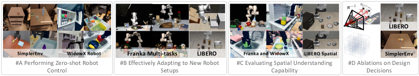
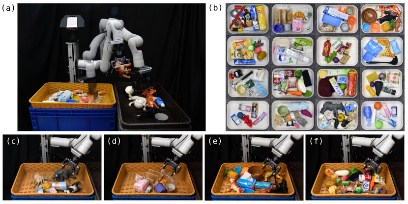

# 资产到轨迹：机器人数据生产线怎么跑通

仿真机器人数据集不是“收集一批 3D 模型”这么简单。一个资产要进入机器人训练，必须同时有视觉外观、真实尺寸、物理属性、碰撞体、抓取标注、任务脚本、轨迹规划和成功判定。缺其中一环，数据看起来很多，训练时却很难复现失败。

从一个物体资产到一条可训练的机器人轨迹，中间要经过感知、抓取、轨迹、记录和评测等环节。

{ width="720" }

<small>图源：[SpatialVLA](../paper-deep-dives/embodied-ai/spatialvla.md)，Figure 3。原图展示机器人实验中的多视角相机、机器人本体和任务场景。读图重点：资产、scale、camera pose、grasp pose 和 trajectory GT 最终都要在这样的实验设置里对齐，才能支持 VLA、WAM 或传统 planner。</small>

## 资产不是一张 3D 图

一个可用于机器人仿真的资产至少有四层。

视觉外观包括 mesh、材质和纹理，服务相机渲染和 VLA 输入。几何尺寸包括 scale、origin、轴向和真实米制尺寸，服务放置、碰撞、抓取和 success checker。物理属性包括质量、摩擦、刚体/可变形、弹性和接触参数，服务仿真接触和滑动。操作标注包括抓取点、抓取轴、可开启轴、功能点和任务 affordance，服务轨迹规划和技能库。

类似下面的目录只是开始：

```text
assets/apple/scale_080_080_070/
  info.json
  visual_mesh.obj
  textures/
  collision_mesh.obj
  grasps.yaml
```

其中 `visual_mesh` 负责“看起来像苹果”，`collision_mesh` 负责“物理上怎么碰撞”。二者不应该混为一谈。视觉 mesh 可以复杂、好看；碰撞 mesh 通常要简化、稳定、可凸分解。视觉模型正确但碰撞网格偏了，会导致机械臂看起来没碰到，仿真却判定穿模或卡住。

## 尺度、origin 和坐标系决定能不能抓

机器人不只需要知道“这是苹果”，还要知道它在世界里的位置、朝向和大小。`scale` 决定模型单位到真实米制尺寸的缩放，`origin` 决定物体自身坐标系原点，`pose` 决定物体在场景里在哪里，`frame` 决定位置是相对 world、object、camera 还是 gripper。

如果 scale 错了，规划器会以为杯口更大或更小；如果 origin 错了，抓取点会出现固定偏移；如果坐标轴约定错了，局部移动方向也会错；如果 object frame 和 world frame 混了，抓取标注看起来对，执行时会偏。

资产进入数据生产线前，最少要能回放这条链：

```text
asset scale
  -> collision mesh
  -> grasp annotation
  -> planned trajectory
  -> rendered multi-camera observation
  -> action chunk
  -> success checker
  -> failure label
```

这条链能回放，资产数据才真正能进入世界模型数据引擎。

## 抓取标注标的是位姿，不是一个点

抓取标注应表示夹爪相对物体的完整位姿。采用 \({}^{O}T_G\) 表示将夹爪坐标转到物体坐标，则物体放到世界后，目标抓取位姿为

\[
{}^{W}T_G={}^WT_O{}^OT_G.
\]

例如物体位于世界 \((0.4,0.2,0)\)，绕 z 轴旋转 90 度，抓取点在物体局部 \((0.1,0,0.05)\)，则世界抓取点为 \((0.4,0.3,0.05)\)。若误把局部偏移直接相加，得到的 x 会偏 10 厘米。夹爪朝向也必须按同一矩阵链组合。

pregrasp 可以沿夹爪接近轴退开距离 d，再规划到 pregrasp 后执行受控接近。夹爪开口、手指厚度和接近扫掠体都影响可行性，不能只检查抓取终点。

物理可行和任务可行也要分开。抓锤头也许能把锤子拿起来，但如果任务是敲钉子，应该抓手柄。抓取标注最好存候选集合，并在任务层过滤，而不是只存一个“能夹住”的姿态。

{ width="760" }

<small>图源：[GR-2](../paper-deep-dives/embodied-ai/gr2.md)，Figure 7。原图展示 bin picking 真实机器人设置。读图重点：bin picking 的难点不是一个抓取点，而是多物体遮挡、候选抓法冲突、抓起后是否还能完成后续放置。</small>

## 缩放资产时几何与惯性应一起变化

把资产等比例放大 s 倍，保持材料密度不变时，质量随 \(s^3\) 增长，绕对应质心轴的转动惯量随 \(s^5\) 增长。长度翻倍、质量仍不变会改变其物理含义；只改视觉 mesh 不改碰撞体则会造成可见表面与接触表面不一致。

碰撞简化也有精度代价。一个杯子若整体用凸包表示，杯口可能被“封住”，视觉上能放进去的物体在物理层被挡住。应通过任务相关接触验证简化网格，而不是只看 mesh 面数。

假设杯子 mesh 的数值以毫米表示，导入器却把它当成米，杯口半径 40 会成为 40 米。把可见模型缩小并不一定同时修改碰撞体和抓取标注，可能出现看起来大小正确、规划器却认为周围全是障碍的情况。因此尺度需要沿 mesh、collision、惯性、关键点和抓取位姿一起追踪。

当这些对象采用同一尺度后，感知给出世界中的杯子位姿，抓取标注给出夹爪相对杯子的位姿，两者组合才得到世界抓取目标。机器人运动学接着回答能否到达这个位姿，规划再回答怎样到达。一个阶段的数值类型正确，无法代替下一阶段的几何与物理可行性。

## Planner 把目标位姿变成轨迹

一条机器人轨迹是随时间变化的一串状态和动作：

```text
t0: joint_pos, end_effector_pose, gripper_command
t1: joint_pos, end_effector_pose, gripper_command
t2: joint_pos, end_effector_pose, gripper_command
...
```

从“抓这个苹果”到可执行轨迹，中间通常要经过检测/分割、物体 pose、抓取候选、pregrasp、IK、碰撞检测、motion planning、轨迹优化和控制器执行。FK 是已知关节角算末端在哪里；IK 是已知末端目标位姿求关节角；collision checking 判断是否碰撞；motion planning 找一条可行路径；trajectory optimization 再优化平滑、速度和安全裕度。

planner、遥操作或脚本生成的动作序列可以作为示范标签，但它通常不是唯一正确轨迹。成功验证说明这条轨迹在指定仿真配置中通过判定；行为克隆可以学习它，闭环评测仍应允许其他满足任务的路径。

### 路径加上时间才成为轨迹

一维从 0 到 1 米的平滑插值可写为 \(x(t)=3s^2-2s^3\)，其中 \(s=t/T\)。它在两端速度为零，最大速度为 \(1.5/T\) 米每秒。若速度上限为 0.5 米每秒，至少需要 T=3 秒；还要另检验加速度限制。相同几何路径配不同 T，执行难度不同。

## 批量轨迹生成为什么经常失败

批量生成轨迹时，失败不是异常，而是常态。IK 可能无解，planner 可能找不到无碰撞路径，抓取后物体可能滑落，放置时物体可能滚动，success checker 可能不通过，仿真接触也可能因为 collision mesh 或时间步问题不稳定。

更稳的批量生成逻辑是不断重采样场景、抓取候选、规划随机种子和目标位置：

```python
for task in tasks:
    for episode_id in range(target_episodes):
        for retry in range(max_retries):
            scene = sample_scene(task)
            grasp = sample_grasp(scene.core_object)
            plan = planner.solve(scene, grasp, task.goal)
            if plan is None:
                continue
            result = simulate(scene, plan)
            if success_checker(result):
                save_episode(scene, plan, result)
                break
        else:
            log_failed_case(task, episode_id)
```

这段伪代码的重点是失败也要记录。`plan is None`、抓取失败、碰撞、滑落、checker 不通过，都应该进入 failure bucket。它们可支持风险建模与失败诊断。训练恢复策略还需正确恢复动作，评测未执行动作的反事实后果还需额外真值；原失败日志不会自动提供这两种监督。

## 重采样会改变最终数据分布

若一类容易场景成功概率 0.9，另一类困难场景只有 0.1，初始各占一半，只保存成功轨迹后，容易场景约占 90%。数据集看起来整洁，实际已经筛掉大部分困难接触。应保存所有尝试的场景 ID、拒绝原因与接受率，报告生成分布和最终保留分布。

## Success checker 不能只看最终状态

任务成功判定要同时看最终状态和过程。比如“把杯子放进篮子”不能只看杯子最后在篮子里，还要看夹爪是否释放、是否碰撞其他物体、杯子是否穿模、轨迹是否越界、是否靠不真实的物理参数成功。

RoboTwin 这类平台的价值，就在于把资产、任务、功能点、专家轨迹和 success checker 放进同一条数据管线。这样一条轨迹失败时，可以定位是资产尺度、碰撞网格、抓取标注、planner、控制器还是 checker 出了问题。

## 和 VLA / 世界模型的关系

资产到轨迹的数据线，最终会变成 VLA 和世界模型的训练样本。VLA 学的是从观测和语言到动作；世界模型学的是候选动作之后未来状态、风险和成功概率怎么变。两者都需要同一批 episode 能回放。

如果只保存成功轨迹，模型学不到边界；如果只保存视频，模型学不到动作因果；如果只保存动作，不保存相机和物理状态，失败无法归因。真正有价值的数据包，是能同时提供观测、动作、状态、评测和失败原因。

## 外部材料

- [RoboTwin 2.0 docs](https://robotwin-platform.github.io/doc/)：理解双臂任务、资产、轨迹和 success checker 的组织方式。
- [SpatialVLA](../paper-deep-dives/embodied-ai/spatialvla.md)：理解空间编码和跨 embodiment 动作网格如何连接数据和模型。
- [GR-2](../paper-deep-dives/embodied-ai/gr2.md)：理解视频先验和机器人轨迹如何结合。
- [cuRobo](https://curobo.org/)：理解 GPU 加速运动规划和轨迹优化在机器人数据生成中的位置。
- [DROID](https://arxiv.org/abs/2403.12945)：理解真实机器人轨迹采集和多场景数据组织。
