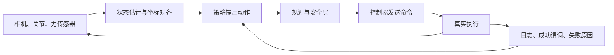

# 用一次抓取理解观测、动作与反馈

“把红杯放进盒子”这句话交给机器人以后，第一条记录通常只是相机图像和关节测量。图像里有一块红色区域，距离和坐标却还没有对上；坐标对上了，路径也可能碰到桌沿。把这些中间结果逐个写清楚，才知道一次抓取究竟在哪里出了问题。

策略输出只是闭环中的一个中间值。真正需要追踪的是它经过规划、安全层和控制器之后发生了什么，以及下一次观测是否把执行结果送回决策。

## 先把机器人真正看到的东西写下来

观测 \(o_t\) 是传感器实际提供的数据。状态 \(s_t\) 是决定未来演化所需的变量，例如位置、速度、接触与夹持；系统只能估计其中一部分。两张视觉上相似的照片，可能分别对应“杯子稳固夹持”和“杯子即将滑落”，仅看当前图像未必能区分。

策略常使用历史表示 \(\hat s_t=e(o_{\le t},a_{<t})\)。它可以来自显式滤波器、对象地图或神经网络记忆。变量名叫 state，并不表示它已经包含了全部动力学信息。遮挡与接触解释见[视频记忆](../vlm/video-representation-and-memory.md)。

假设像素 \((380,270)\) 的深度为 2 米，内参为 \(f_x=f_y=600,c_x=320,c_y=240\)，反投影得到相机坐标 \((0.2,0.1,2)\) 米。下一步还需相机到机器人底座的变换。感知输出因此必须携带时间、单位、坐标和标定版本，详见[相机与深度](cameras-depth-and-robot-vision.md)。

## 策略输出为什么还不是动作

policy action 可以是末端目标、关节目标或动作块；planner 将目标转为满足几何与约束的路径；controller 利用反馈跟踪参考；safety layer 可以限制或否决不满足条件的命令。这些模块可能集成在一起，但逻辑职责仍需分清。

看一条具体命令会更清楚。策略提出沿底座坐标的 x 轴移动 3 厘米，限幅后真正发出的命令是 1 厘米，反馈显示末端只移动了 0.8 厘米。原始输出、发给控制器的命令和真实位移分别回答三个问题。只保存那条 3 厘米的输出，限幅和跟踪误差就会被混在一起。

动作周期也会改变含义。每 100 毫秒移动 1 厘米，理想平均速度为 0.1 米每秒；如果在每 20 毫秒重复同一位移，速度变为 0.5 米每秒。字段相同不能代替完整控制协议，见[state/action 数据](state-action-robot-datasets.md)。

## 闭环发生在下一帧观测里

动作执行后，系统重新观察杯子是否移动、是否握住、是否接近盒口，再决定下一步。这使它能修正先前误差。一次性生成长序列并盲目执行，只在起点使用了观测，后面属于开环。

动作块可以一次预测 H 步，只执行 h 步后重规划。若周期为 50 毫秒，H=16、h=4，预测范围是 0.8 秒，实际重新决策间隔为 0.2 秒；两者应分别配置。迟到的新动作还要经过有效期与取消规则，不能覆盖更晚的人工停止。

VLA 在这里提供观测与语言到动作的策略，世界模型则可预测候选动作的后果。一个直接策略可以不使用显式世界模型；一个世界模型也可能只用于训练或评估。具体分工见[系统图](vla-wam-world-model-system-map.md)。

再看一次闭环。策略建议末端沿基座 x 轴移动 20 毫米，安全层放行了这条命令，控制器实际只移动 17 毫米。下一次观察和本体状态应该记录这 17 毫米，后续决策据此计算剩余误差。软件若把“发送成功”写成“已经移动 20 毫米”，内部状态就会比机器人多走 3 毫米。

这三个数分别属于 policy action、commanded action 和 executed action。简单工况下它们可能很接近，遇到限幅、接触或跟踪误差就会分开。把区别保存下来，后面才能判断问题出在策略选择、命令解释还是物理执行。闭环的价值就在这里，系统重新读取发生过什么，再决定接下来做什么。

## 夹爪闭合不等于抓取成功

夹爪闭合不代表抓住杯子，末端到盒子上方不代表杯子已放稳。任务需要明确成功谓词与过程约束，例如杯子在允许区域、夹爪释放、持续稳定，并且没有禁止碰撞。失败后要区分重新观测、重新抓取和退出，而不是无限重复同一动作。

运行条件构成 operational design domain，例如允许的载荷、对象、空间、传感器状态和人员参与方式。评测结论只覆盖被验证的条件；固定实验桌上的成功不能直接推广为任意家庭环境能力。

## 把一回合记录完整，才知道哪里坏了

episode 记录任务开始到结束的观测、原始动作、执行命令、反馈、状态切换和终止原因。假设抓取失败，可以沿时间线检查模型是否看到最新图像、动作是否被拒绝、末端是否到位、成功检测是否误判。模块指标帮助定位，整段任务成功与恢复指标检验系统是否真正完成目标。

先用三行记录把接口对齐。下面的数值是本站构造的教学 trace，位移单位为米，时间是单调时钟。

| 时间 | 观测到的杯子位置 | policy action | commanded action | executed action | success predicate |
| ---: | ---: | ---: | ---: | ---: | --- |
| 0.00 s | 0.380 | +0.030 | +0.010（限幅） | +0.008 | 未抓取 |
| 0.10 s | 0.388 | +0.022 | +0.010（限幅） | +0.009 | 夹爪闭合，未确认稳定 |
| 0.20 s | 0.397 | +0.003 | +0.003 | +0.003 | 物体仍在夹爪内，抓取成立 |

第一行的策略想移动 3 cm，安全层只允许 1 cm，执行器实际移动 0.8 cm。第二行把新的观测送回策略，策略只剩 2.2 cm 的误差，却仍被限幅；第三行才达到抓取判定。若日志只保存 `+0.030`，调试者无法知道限幅是否过严，也无法区分“动作发出”与“物体已被抓住”。

记录格式可以和 [LeRobotDataset v3](https://huggingface.co/docs/lerobot/en/lerobot-dataset-v3) 的数据层对照。官方格式把同步视频、低维 state/action、timestamp 和 episode 元数据分开存储，再通过索引恢复一条 episode。这里额外保留 `policy_action`、`commanded_action`、`executed_action` 和 `success_predicate`，是为了把学习器、控制器和物理结果分开；它们不是 LeRobot 的新增字段，也不是某个论文 benchmark 的规定。

[闭环任务走读](closed-loop-task-walkthrough.md)将这些接口落实到尺寸受限插入任务；[规划与控制](planning-control-and-safety.md)进一步推导反馈与安全约束；[VLA](../vla/index.md)解释动作分布怎样从示范中训练出来。

## 来源与改编说明

- **机器人基础**参考 [Robotics Book](https://www.roboticsbook.org/intro.html) 与 [Modern Robotics](https://modernrobotics.northwestern.edu/nu-gm-book-resource/introduction/) 的状态、坐标和运动学组织方式。
- **操作闭环**参考 [MIT Manipulation](https://manipulation.mit.edu/) 的任务、感知、规划、控制和反馈连接；课程材料中的图片与代码仍需逐页核对许可。
- **自测**：把一次抓取记录拆成 `observation`、`policy_action`、`commanded_action`、`executed_action` 和 `success predicate` 五列，说明每列由哪个模块产生。
