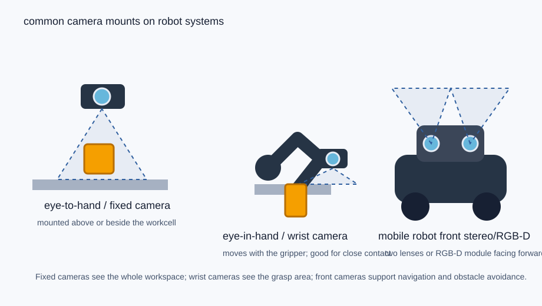
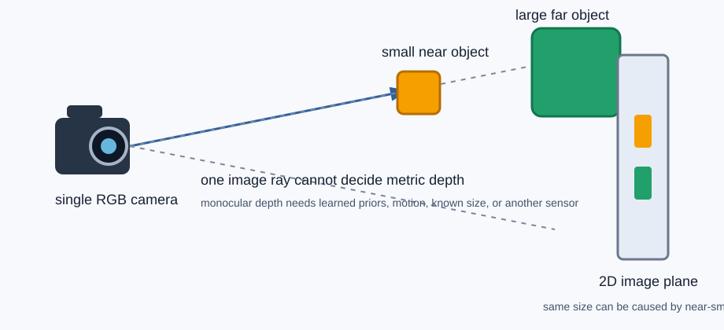
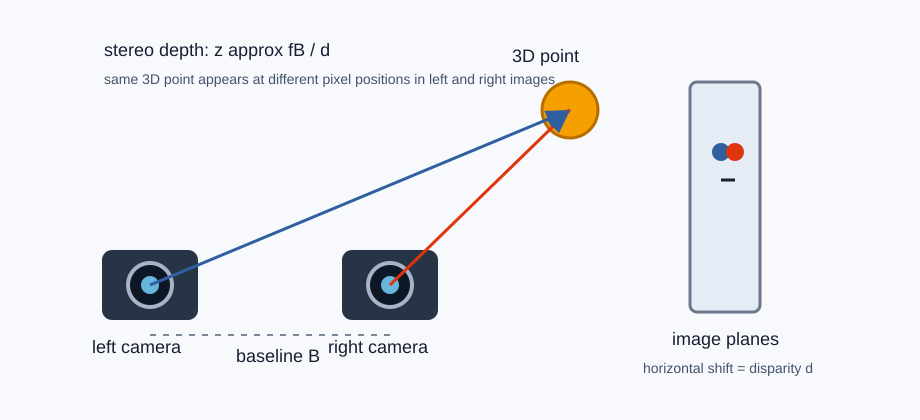
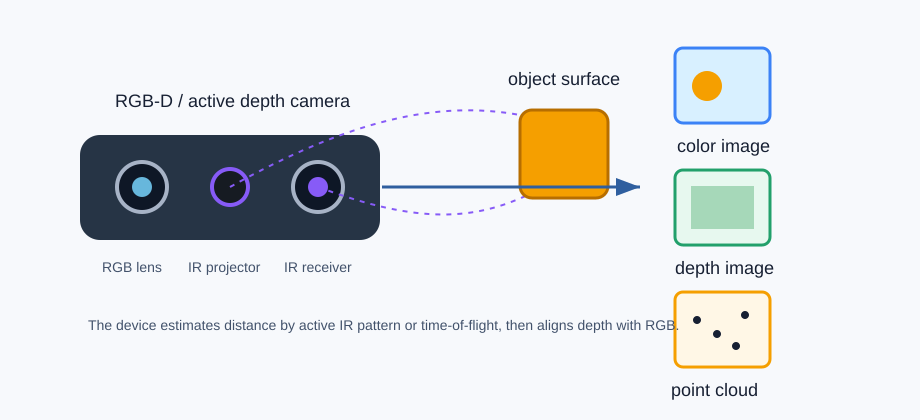

# 相机、深度与机器人视觉

这一页补一个很基础但很关键的直觉：机器人看到的“图像”并不天然等于 3D 世界。不同相机给机器人的信息不同，能不能估计距离、能不能恢复物体尺寸、能不能抓取，取决于传感器和标定。

先记住一句话：

```text
单目相机主要给 2D 图像；双目/RGB-D 才更直接给 3D 距离。
```

这不是说单目完全不能估深度，而是说**单张单目图像本身没有可靠的绝对尺度**。它需要额外假设、运动、多帧、已知物体尺寸或学习到的先验。

## 1. 相机在机器人上大概长什么样

机器人上常见相机不是一种形态，而是几类安装方式：

{ width="920" }

| 安装方式 | 长什么样 | 适合做什么 | 局限 |
| --- | --- | --- | --- |
| 固定外部相机 / eye-to-hand | 一台相机固定在桌面上方、侧面或工作站支架上 | 看全局桌面、记录轨迹、做俯视定位 | 被手臂或物体遮挡后看不到局部接触 |
| 腕部相机 / eye-in-hand | 小相机装在夹爪或手腕附近，跟着机械臂一起动 | 近距离对准、插入、抓取前校正 | 视野小，运动时画面变化大 |
| 移动机器人前置相机 | 机身前面一排镜头，常是双目或 RGB-D | 导航、避障、找物、房间级感知 | 看不到背后，近距离抓取还要配合腕部或外部相机 |

实际设备外观上，你可以先这样识别：

- `单目 RGB`：一个镜头，像普通 USB 摄像头或手机单摄。
- `双目 stereo`：两个左右分开的镜头，像两只眼睛，中间距离叫 baseline。
- `RGB-D / depth camera`：通常有 RGB 镜头、红外发射器、红外接收器，正面会看到多个圆形窗口。
- `多相机 rig`：多个相机固定在不同位置，不一定每个都能测深度，但如果都标定好，可以联合定位。

## 2. 单目为什么不能直接成立体

单目相机只有一个视角。它把 3D 世界投影到 2D 图像上，投影时会丢掉深度。

{ width="920" }

同一张图里，一个物体看起来大，可能有两种原因：

1. 它真的很大；
2. 它其实不大，只是离相机很近。

从一张单目图像本身，无法严格区分这两种情况。数学上可以理解为：3D 点沿着相机射线投影到同一个像素，深度 \(z\) 不同，但像素坐标可能一样。

这就是为什么单目有“尺度歧义”：

```text
near small object  -> image looks big
far large object   -> image also looks big
```

单目仍然很有用，但它通常适合回答：

- 这是什么物体？
- 物体大概在图像左边还是右边？
- 是否有文字、颜色、类别、语义关系？
- 根据经验估计相对远近。

它不适合单独回答：

- 这个杯口直径是不是 4cm？
- 夹爪离物体还有 2cm 还是 8cm？
- 物体精确 6D pose 是多少？

!!! note "单目深度模型是不是能解决问题"
    单目深度网络可以从大量数据中学到“地面、桌面、物体大小、透视关系”等先验，所以能估一个看起来合理的深度图。但它不是几何测量：换一个新场景、新相机、新尺度物体时，绝对深度可能偏。机器人抓取和插入任务通常不能只依赖单目估计。

## 3. 双目为什么能估计深度

双目相机有两个相机，左右之间有固定距离 \(B\)，这个距离叫 baseline。两个相机从不同位置看同一个点，这个点在左右图像里的像素位置会不同，差值叫 disparity。

{ width="920" }

双目深度的直觉公式是：

\[
z \approx \frac{fB}{d}
\]

其中：

- \(z\)：点到相机的深度；
- \(f\)：相机焦距；
- \(B\)：左右相机距离，也就是 baseline；
- \(d\)：左右图像中同一个点的像素位移，也叫 disparity。

直觉上：

- 物体越近，左右眼看到的位置差越大，\(d\) 大，\(z\) 小；
- 物体越远，左右眼看到的位置差越小，\(d\) 小，\(z\) 大。

所以双目能成立体，是因为它有两个视角，可以用三角测量恢复深度。

但双目也不是万能的：

| 问题 | 为什么 |
| --- | --- |
| 低纹理表面难 | 左右图找不到稳定匹配点，比如纯白墙、纯色杯子 |
| 透明/反光物体难 | 玻璃和金属会让左右图对应关系混乱 |
| 远距离误差大 | 远处 disparity 很小，几个像素误差就会放大成很大深度误差 |
| 需要标定 | 两个相机的相对位置、焦距、畸变必须知道 |

## 4. RGB-D 相机为什么能直接给深度

RGB-D 相机输出两张对齐图：

```text
RGB image: 每个像素是什么颜色
Depth image: 每个像素离相机多远
```

{ width="920" }

常见 RGB-D 相机有两类主动深度原理：

| 类型 | 直觉 | 典型特点 |
| --- | --- | --- |
| Structured light | 投射红外花纹，看花纹变形来算深度 | 近距离室内常见，强光或反光可能影响 |
| Time-of-flight / ToF | 发出红外光，测光返回时间或相位 | 结构紧凑，深度噪声和多径反射需要处理 |

也有一些 RGB-D 设备内部其实用的是主动双目：既有左右红外相机，也有红外投射器，用来给低纹理表面增加可匹配纹理。

RGB-D 对机器人很有用，因为它能把像素变成 3D 点。给定像素 \((u, v)\)、深度 \(z\)、相机内参 \((f_x, f_y, c_x, c_y)\)，可以反投影成相机坐标系下的 3D 点：

\[
X = \frac{(u-c_x)z}{f_x},\qquad
Y = \frac{(v-c_y)z}{f_y},\qquad
Z = z
\]

这就是点云的来源。点云不是另一种神秘数据，本质上就是“每个深度像素反投影出来的 3D 点集合”。

## 5. 深度图、点云和 6D pose 的关系

| 名词 | 是什么 | 机器人怎么用 |
| --- | --- | --- |
| RGB 图 | 每个像素的颜色 | 识别类别、纹理、文字、语义 |
| 深度图 | 每个像素的距离 | 判断物体远近、避障、抓取前校正 |
| 点云 | 深度图反投影后的 3D 点集合 | 估计物体形状、桌面平面、碰撞体 |
| 6D pose | 物体的 3D 位置 + 3D 朝向 | 生成抓取点、放置点、规划轨迹 |

机器人抓取时常见链路是：

```text
RGB/RGB-D image
-> 检测/分割目标物体
-> 用深度或点云估计物体 3D 位置
-> 估计 6D pose 或抓取候选
-> motion planner 生成轨迹
-> controller 执行
```

如果只有 RGB，没有深度，也可以用模型估计 6D pose，但通常更依赖训练数据和物体 CAD 模型。对尺寸任务、插入任务、精细抓取来说，真实深度或多视角几何会稳很多。

## 6. 内参、外参和标定

相机能不能用于机器人，关键不只是有没有图，还要知道图和真实世界怎么对应。

| 概念 | 解释 | 例子 |
| --- | --- | --- |
| 内参 / intrinsics | 相机自己的成像参数 | 焦距、主点、畸变 |
| 外参 / extrinsics | 相机坐标系相对机器人或世界的位置和朝向 | 相机装在桌子上方，离世界原点多远、旋转多少 |
| 手眼标定 / hand-eye calibration | 腕部相机和机械臂末端之间的变换 | wrist camera 看到杯子后，机械臂知道该往哪里伸 |
| 时间同步 | 图像、深度、机器人关节状态是否同一时刻 | 移动中不同步会造成 pose 和动作错位 |

举例：

```text
camera frame -> robot base frame -> world frame
```

这中间每个变换都要准确。否则相机看到“杯子在前方 20cm”，机械臂执行时可能偏到旁边。

!!! note "为什么仿真也要关心相机标定"
    仿真里相机参数可以完美知道，但如果你未来要迁移到真实机器人，就要尽量让仿真相机的焦距、视角、分辨率、安装位置和真实设备接近。否则模型可能在仿真里学会了错误的视觉几何。

## 7. 不同相机在具身任务里的选择

| 任务 | 更常用的传感器 | 原因 |
| --- | --- | --- |
| 桌面抓取 | RGB-D、双目、固定俯视相机 + 腕部相机 | 需要物体位置、深度、抓取前近距离校正 |
| 尺寸比较 | RGB-D、标定双目、多视角 | 需要可靠尺度，单目容易有尺度歧义 |
| 移动导航 | 前置双目、RGB-D、LiDAR、鱼眼相机 | 需要避障和房间级空间感知 |
| 精细插入 | 腕部相机、力觉、近距离 RGB-D | 末端附近微小误差很关键 |
| 数据采集 / 轨迹记录 | 多固定相机 + wrist camera | 方便回放、重建、标注失败原因 |

早期做仿真任务时，可以先从固定 RGB-D 或多视角相机开始，因为它更容易 debug。等任务跑通后，再减少 privileged state 或改成更接近真实部署的相机配置。

## 8. 单目、双目、RGB-D 在你的 pipeline 里怎么对应

你的资产生成流程：

```text
RGB 图像 -> 背景消除 -> 文字消除 -> 多视角生成 -> 图生 3D
```

这是离线资产生产。这里的多视角更多是为了让 3D 生成模型补全形状和纹理，不等价于真实双目测距。

你的仿真/轨迹生成流程：

```text
导入资产 -> 场景布置 -> 相机渲染 -> 估计状态或直接读取状态
-> 抓取轴 -> planner -> trajectory GT -> success checker
```

这里的相机可以分两种使用方式：

| 用法 | 数据来源 | 用途 |
| --- | --- | --- |
| privileged state | 仿真直接读取物体 pose、尺寸、速度 | 生成 GT、写 success checker、debug |
| visual observation | 从仿真相机渲染 RGB/RGB-D | 训练 VLA/WAM，让模型从图像推断状态 |

早期建议两者都保存。训练时可以只给模型图像和机器人状态；debug 和判定时用 privileged state。这样模型学的是视觉到动作，工程上仍能解释失败原因。

## 9. 常见误区

| 误区 | 更准确的说法 |
| --- | --- |
| 单目完全不能估深度 | 单目可以用先验估相对深度，但单张图没有可靠绝对尺度 |
| 双目一定比 RGB-D 好 | 双目依赖纹理和匹配，RGB-D 依赖主动深度，各有失败场景 |
| 多视图生成就是双目 | 多视图生成是资产生产或补视角，不是已标定双相机的几何测量 |
| 点云比图像高级 | 点云只是另一种表示，语义弱；图像语义强但几何弱 |
| 有深度就能抓 | 还需要分割、pose、抓取候选、碰撞检测、控制和 success checker |
| 仿真里相机随便放 | 相机位置会强烈影响模型学到的策略和真实迁移能力 |

## 10. 和其他具身页面的连接

| 继续读 | 你会补上什么 |
| --- | --- |
| [资产、感知、抓取与轨迹数据管线](asset-perception-grasp-and-trajectory-pipeline.md) | 相机输出如何进入资产、状态估计、抓取和轨迹生成 |
| [从一个任务跑通具身闭环](closed-loop-task-walkthrough.md) | 深度和 pose 如何支撑尺寸排序、容器匹配和 success checker |
| [规划、控制与安全](planning-control-and-safety.md) | 感知到的 3D 状态如何变成可执行轨迹和安全约束 |
| [VLA、WAM 与世界模型系统地图](vla-wam-world-model-system-map.md) | 相机观测如何进入 VLA、WAM 和世界模型路线 |
