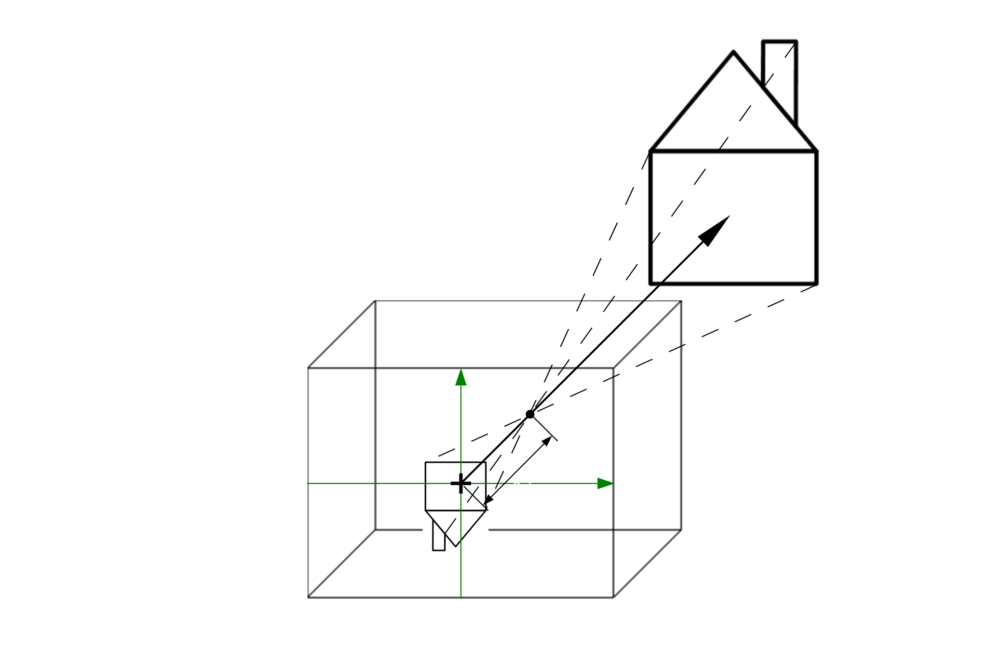
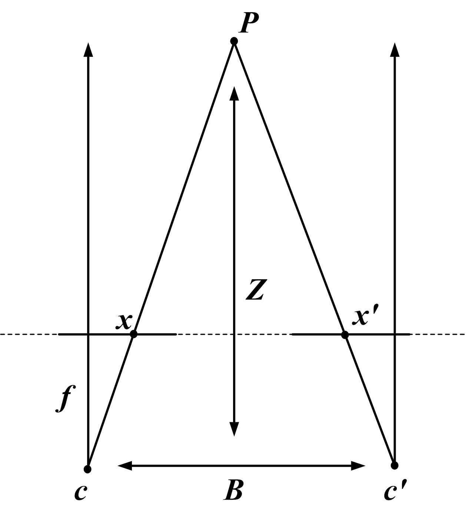
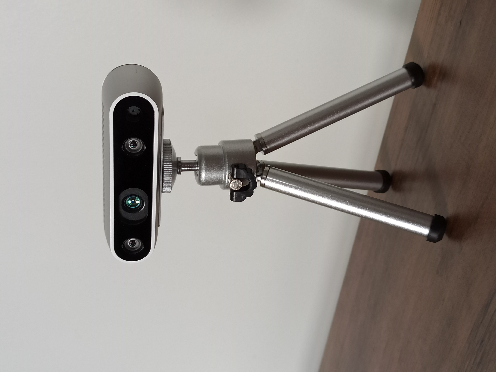
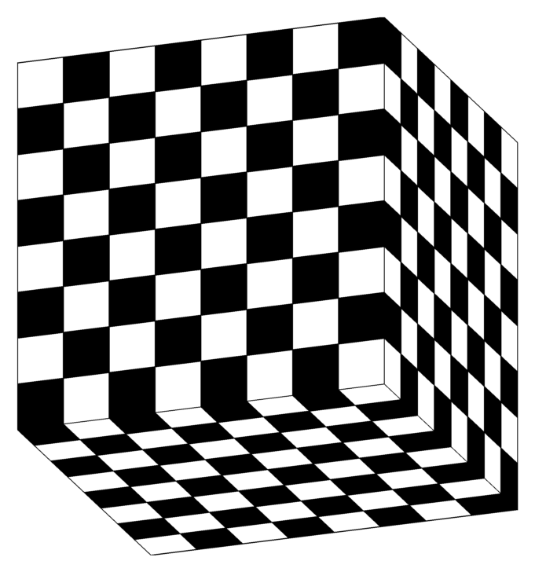
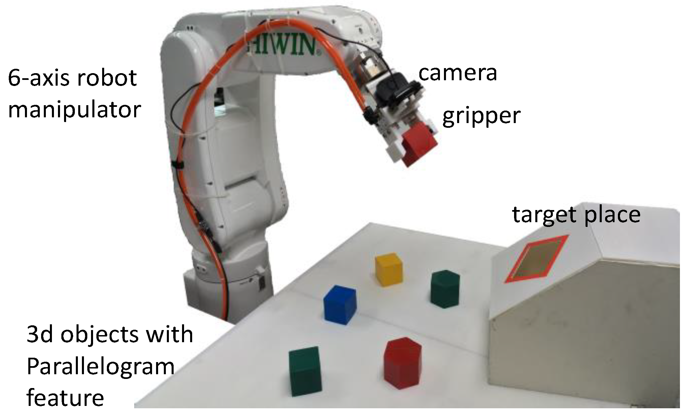

# 相机、深度与机器人视觉：图像怎样接回 3D 世界

机器人看到的“图像”并不天然等于 3D 世界。相机类型、标定、深度质量和坐标系会决定机器人能不能估距离、能不能恢复物体尺寸、能不能把视觉结果交给抓取和规划模块。

这页只讲一个问题：从 RGB 图像到机器人可用的 3D 状态，中间发生了什么。

## 单目为什么有尺度歧义

单目相机只有一个视角。它把 3D 世界投影到 2D 图像上，投影时会丢掉深度。

{ width="820" }

<small>图源：[Wikimedia Commons: Pinhole camera model](https://commons.wikimedia.org/wiki/File:Pinhole_camera_model_technical_version_-_no_annotation.svg)。原图展示针孔相机模型。本站读法：3D 点经过相机光心投影到 2D 成像平面，深度信息被压缩到尺度变化里，所以单张单目图像天然存在绝对尺度歧义。</small>

同一张图里，一个物体看起来大，可能是因为它真的很大，也可能只是离相机很近。单目深度模型可以从数据中学到透视、桌面、物体大小和场景结构先验，因此能估出相对深度；但它不是几何测量。换新相机、新物体尺度或透明反光表面时，绝对深度可能偏。

所以单目 RGB 很适合识别类别、颜色、文字、语义关系和大致位置；但如果任务要求“夹爪离杯口还有几厘米”“插孔深度是多少”“物体精确 6D pose 是多少”，单目通常需要多视角、标定、已知尺寸、metric fine-tuning 或真实深度传感器补上。

## 双目用视差恢复深度

双目相机有两个相机，左右之间有固定距离 \(B\)，也叫 baseline。同一个 3D 点在左右图像里的像素位置不同，这个差值叫 disparity。

{ width="760" }

<small>图源：[Wikimedia Commons: Stereo-camera-model.jpg](https://commons.wikimedia.org/wiki/File:Stereo-camera-model.jpg)。原图展示双目相机几何。本站读法：同一个点在左右图上的像素偏移越大，通常表示它离相机越近。</small>

双目深度的直觉公式是：

$$
z \approx \frac{fB}{d}
$$

其中 \(z\) 是点到相机的深度，\(f\) 是焦距，\(B\) 是左右相机 baseline，\(d\) 是左右图像里同一个点的 disparity。物体越近，左右眼看到的位置差越大，\(d\) 大，所以 \(z\) 小；物体越远，disparity 变小，几个像素误差都会放大成很大的深度误差。

双目也不是万能的。低纹理表面找不到稳定匹配点，透明和反光物体会让对应关系混乱，远距离误差会迅速变大，两个相机的相对位姿、畸变和同步必须标定好。

## RGB-D 把像素变成点云

RGB-D 相机同时输出颜色图和深度图。颜色图告诉模型“像素是什么”，深度图告诉系统“这个像素离相机多远”。

{ width="620" }

<small>图源：[Wikimedia Commons: Intel Realsense depth camera D435.jpg](https://commons.wikimedia.org/wiki/File:Intel_Realsense_depth_camera_D435.jpg)。原图展示 RealSense D435。本站读法：RGB-D / depth camera 常用于把像素反投影成 3D 点，再接抓取、避障和 6D pose 估计。</small>

给定像素 \((u,v)\)、深度 \(z\)、相机内参 \((f_x,f_y,c_x,c_y)\)，可以反投影到相机坐标系：

$$
X=\frac{(u-c_x)z}{f_x},\qquad
Y=\frac{(v-c_y)z}{f_y},\qquad
Z=z
$$

这里 \(X,Y,Z\) 是相机坐标系里的 3D 点，\(f_x,f_y\) 是以像素为单位的焦距，\(c_x,c_y\) 是主点。公式的意思是：像素位置离主点越远、深度越大，对应的 3D 横向/纵向坐标越大。点云就是把很多深度像素都这样反投影出来的 3D 点集合。

RGB-D 的常见失败也很实际：玻璃、黑色高反、金属、多径反射、强阳光和近距离边界都会造成深度空洞或噪声。因此机器人系统通常要记录 depth confidence、空洞 mask、接触边界和失败回放，而不是盲目信任每个深度像素。

## 内参和外参把图像接回机器人坐标

相机能否用于机器人，不只看有没有深度，还要看图像坐标和机器人坐标如何对应。这里最重要的是内参 \(K\) 和外参 \([R|t]\)。

{ width="660" }

<small>图源：[Wikimedia Commons: Chessboard calibration setup.png](https://commons.wikimedia.org/wiki/File:Chessboard_calibration_setup.png)。原图展示棋盘格标定设置。本站读法：已知尺寸的棋盘格、Charuco 或 AprilTag 把真实 3D 点和图像 2D 点配对，标定就是让投影结果尽量对齐这些角点。</small>

内参矩阵常写成：

$$
K=
\begin{bmatrix}
f_x & s & c_x\\
0 & f_y & c_y\\
0 & 0 & 1
\end{bmatrix}
$$

其中 \(f_x,f_y\) 是焦距，\(c_x,c_y\) 是主点，\(s\) 是 skew，现代相机里通常接近 0。内参描述相机自己怎么成像，和相机摆在哪里无关。图像 resize 后，\(f_x,f_y,c_x,c_y\) 也要按比例缩放，否则同一相机会变成两套几何。

外参描述世界坐标系和相机坐标系之间的刚体变换：

$$
P_c = R P_w + t
$$

这里 \(P_w\) 是世界坐标点，\(P_c\) 是相机坐标点，\(R\) 是旋转，\(t\) 是平移。机器人里最常见的错误，是把 `world-to-camera` 和 `camera-to-world` 方向混了。检测框在像素坐标里，深度反投影得到相机坐标，planner 需要机器人 base 或 world 坐标，success checker 可能又在仿真 world frame 里判断。

## 相机安装方式决定能看见什么

{ width="920" }

<small>图源：[A Simple Robotic Eye-In-Hand Camera Positioning and Alignment Control Method Based on Parallelogram Features](https://www.mdpi.com/2218-6581/7/2/31)，Figure 3。原图展示 eye-in-hand / wrist camera 设置。本站读法：腕部相机能看近距离接触，外部相机能看全局桌面，两者提供的是不同证据。</small>

固定外部相机适合看全局布局、桌面对象和轨迹；腕部相机适合近距离抓取、插入和接触校正；移动机器人前置相机适合导航和避障；多相机 rig 适合把全局、局部和俯视信息组合起来。多相机不是简单多几张图，而是多组时间戳、内参、外参和延迟都要对齐。

这对 VLA 很关键。同一张外部图里，手臂姿态可能看不清；同一张腕部图里，全局目标位置可能丢失。世界模型要预测动作后果，就必须知道每个视角承担什么角色。

## 从 RGB 到机器人动作的最小链路

机器人视觉通常走这条链：

```text
RGB / RGB-D / multi-view images
  -> detection / segmentation / depth / pose
  -> 3D point, object pose, contact state
  -> grasp candidate or target pose
  -> motion planner / controller
  -> execution result and failure replay
```

如果模型抓错了物体，不能只说“视觉失败”。要能定位是 tokenizer 丢了小目标，深度估错了距离，外参漂移导致坐标错，还是控制器没有执行到位。几何证据必须能追到 episode：相机时间戳、标定版本、深度质量、动作坐标系和失败 replay 都要保存。

## 外部精读

- [OpenCV camera calibration docs](https://docs.opencv.org/4.x/dc/dbb/tutorial_py_calibration.html)：理解内参、畸变和重投影误差的工程口径。
- [Depth Anything](../paper-deep-dives/embodied-ai/depth-anything.md) 与 [Depth Anything V2](../paper-deep-dives/embodied-ai/depth-anything-v2.md)：理解单目深度模型的能力和边界。
- [VGGT](../paper-deep-dives/embodied-ai/vggt.md)：理解 feed-forward 3D 属性预测如何把图像接到 camera、depth、point map 和 tracks。
- [DROID](https://arxiv.org/abs/2403.12945)：看真实机器人数据里多相机、动作和场景多样性如何组织。
