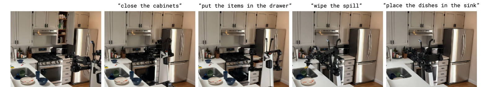
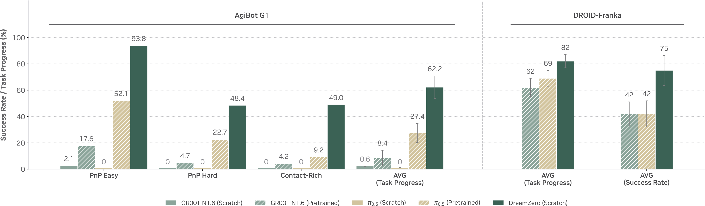

# 一个任务跑通具身闭环：从看见到失败回流

下面使用一个明确构造的插入任务，逐步追踪尺寸、坐标、动作与成功判定。示例数值用于解释计算，不是实机实验结果。

把圆柱体放进罐口尺寸接近的罐子，看起来像普通 pick-and-place，实际会同时考察尺寸感知、目标绑定、抓取、路径规划、动作执行、成功判定和失败恢复。

{ width="920" }

<small>图源：[π0.5](../paper-deep-dives/embodied-ai/pi05.md)，Figure 2。原图展示机器人在未见过的新厨房中执行多个清理子任务。读图重点：长任务不是一次性输出完整答案，而是反复经历“看见、选择、抓取、移动、放置、判定”。</small>

## 闭环一次到底发生什么

一次闭环可以写成：

$$
(o_{\le t},q_t,\ell)
\rightarrow
\text{state / subtask}
\rightarrow
A_{t:t+H-1}
\rightarrow
\text{safety + controller}
\rightarrow
o_{t+1}
\rightarrow
\text{checker}
$$

这里 \(o_{\le t}\) 是到当前为止的观测历史，\(q_t\) 是机器人状态，\(\ell\) 是语言指令，\(A_{t:t+H-1}\) 是未来 \(H\) 步动作块。公式的意思是：系统先从观测和语言估计当前状态，再决定下一段动作，动作经过安全和控制执行，拿到新观测后由 checker 判断进度。

这个循环会不断重复。长任务失败通常不是最后一步才发生，而是在目标绑定、抓取姿态、轨迹规划、控制执行或状态刷新中的某一环已经偏离。

## 先定义任务状态

如果状态定义不清，VLA、WAM、planner 和 checker 都会混乱。这个任务的最小状态应该包含圆柱体尺寸、罐口尺寸、物体位姿、抓取候选、机器人末端位姿和任务阶段。

```json
{
  "objects": [
    {
      "id": "cylinder_0",
      "category": "cylinder",
      "size_m": [0.035, 0.035, 0.08],
      "pose_w": [0.42, -0.10, 0.04, 1, 0, 0, 0],
      "grasp_candidates": ["top_grasp_0", "side_grasp_1"]
    },
    {
      "id": "can_0",
      "category": "container",
      "opening_diameter_m": 0.045,
      "pose_w": [0.30, 0.18, 0.05, 1, 0, 0, 0]
    }
  ],
  "robot": {
    "gripper_open": true,
    "eef_pose_w": [0.20, -0.20, 0.30, 1, 0, 0, 0]
  },
  "task": {
    "instruction": "put the cylinder into the closest matching container",
    "phase": "select_container"
  }
}
```

`pose_w` 按 `[x,y,z,qw,qx,qy,qz]` 表示 world frame 下的位置与单位四元数，`size_m` 和 `opening_diameter_m` 是尺寸匹配的关键变量，`grasp_candidates` 来自抓取标注或采样器，`phase` 告诉系统现在是在选目标、抓取、移动、放置还是判定。

把任务状态藏在自然语言里会带来严重问题。“放进尺寸接近的罐子”听起来简单，但系统必须知道圆柱直径、罐口直径、物体坐标、抓取候选和当前阶段。否则失败后无法判断是看错、选错、抓错还是放错。

## 七个阶段

| 阶段 | 输入 | 输出 | checker 关心什么 |
| --- | --- | --- | --- |
| 看见 | 多相机、深度、机器人状态 | 物体 pose、尺寸、罐口位置 | 目标是否可见，深度是否可信 |
| 绑定目标 | 状态 + 语言 | `target_container` | 尺寸是否匹配，目标是否唯一 |
| 选抓取 | 物体 pose + grasp candidates | grasp pose / pregrasp | 是否可达、是否稳定 |
| 生成动作 | 观测、状态、语言 | action chunk 或轨迹 | 是否朝目标推进 |
| 预测风险 | 状态 + 候选动作 | success/risk/reward | 是否会碰撞、滑落、放错 |
| 执行控制 | 动作 + 约束 | robot command | 是否越界、过快、碰撞 |
| 判定回流 | 新观测 + 任务脚本 | success / failure reason | 是否完成，失败属于哪类 |

这张表是 walk-through 的骨架。不同路线只是替换其中模块：传统 pipeline 用检测、pose、planner 和 checker；VLA 用观测和语言直接生成 action chunk；WAM 同时预测未来视频和动作；世界模型对候选动作做风险和收益评估。

## 目标绑定要落到可检查状态

语言指令是：

```text
put the cylinder into the closest matching container
```

这句话里的“closest matching”必须落到尺寸比较上，而不是靠模型感觉。可以先用规则表达：

```python
def choose_container(cylinder, containers):
    feasible = [
        can for can in containers
        if can.opening_diameter_m >= cylinder.size_m[0] + 0.005
    ]
    return min(
        feasible,
        key=lambda can: can.opening_diameter_m - cylinder.size_m[0],
        default=None,
    )
```

这段代码不是最终算法，而是把任务语义变成可检查状态。找不到合适罐子时，系统应拒绝执行或请求澄清；尺寸估计不确定时，应重新观察；多个罐子都合适时，可以按 margin 最小或用户偏好选择。

### 从直径差算到定位容差

圆柱直径 35 毫米，示例罐口为 45 毫米，理想同轴插入的径向间隙为 \((45-35)/2=5\) 毫米。上面的 5 毫米直径余量只对应 2.5 毫米径向间隙，不能误读为中心允许偏 5 毫米。

假设圆柱与罐口中心定位误差各最多 1 毫米、控制跟踪误差最多 1.5 毫米，保守相加为 3.5 毫米。45 毫米罐口还剩 1.5 毫米理想余量，40 毫米罐口则没有足够余量。若误差只是标准差而非上界，不能这样宣称确定可行，需要概率模型或更保守实验。

倾角也会吃掉间隙。圆柱长 80 毫米，倾斜 3 度时，沿长度方向两端的横向差约 \(80\sin3^\circ=4.19\) 毫米。即便中心对齐，姿态误差仍可能导致卡住。因此接近时应同时估计中心轴与朝向，最后通过受约束低速接触调整，而不是只盯平面中心点。

将容差继续传到插入过程，中心位置满足径向5毫米余量只是一个条件。物体沿80毫米长度倾斜3度，远端横向偏移约4.19毫米；若中心定位本身还有3.5毫米同向误差，最坏方向合计约7.69毫米，已经超出余量。两项误差若方向未知，不能把均值接近零当成几何可行。

因此规划目标需要同时限制位置与姿态，执行中还要根据接触反馈判断是否卡住。Checker若只看物体中心低于罐口，可能把斜靠在边缘或穿模都判成功。后面的完成判断应检查物体是否确实进入容器、是否稳定停留，以及过程有没有违反接触或安全约束。

## 动作生成有三条路线

经典 pipeline 的路线是：检测圆柱和罐子，估计尺寸和 6D pose，规则选择目标容器，抓取标注生成 grasp pose，用 cuRobo / STOMP 等规划器生成轨迹，再由控制器执行。它可解释、好 debug，适合工业和规则清楚的任务。

VLA 路线可以写成：

$$
A_{t:t+H-1}\sim \pi_\theta(o_{\le t},q_t,\ell)
$$

其中 \(\pi_\theta\) 是策略模型，输入观测历史、机器人状态和语言，输出未来 \(H\) 步动作块。VLA 适合开放语言和多任务泛化，但仍需要 checker、controller 和 safety filter。

WAM 路线可以写成：

$$
(o_{t+1:t+H},A_{t:t+H-1})
\sim
p_\theta(o,A\mid o_{\le t},q_t,\ell)
$$

这里模型同时预测未来观测和动作。它的好处是动作要和未来视觉变化对齐；风险是未来视频错了，动作也可能忠实跟着错。

{ width="920" }

<small>图源：[DreamZero](../paper-deep-dives/embodied-ai/dreamzero.md)，Figure 8。原图展示 World-Action Model 在机器人任务上的执行和评测样例。读图重点：闭环走读时要把 predicted future、issued action、real observation 和 success checker 并排看，才能判断失败来自视频预测、动作接口还是执行控制。</small>

## 安全和控制不能省

无论动作来自 VLA、WAM 还是 planner，都不应直接下发电机。更稳的执行链是：

```text
action chunk
  -> action adapter
  -> workspace / collision / speed / force checks
  -> controller
  -> robot command
```

对这个任务，安全层至少检查末端是否越过工作空间、轨迹是否撞桌面或容器、夹爪是否以过大速度接近物体、放置阶段是否可能卡住、动作是否会让圆柱滑落。高层模型可以提议动作，但最后执行的必须是满足硬约束的安全动作。

## Checker 怎样避免“看起来插进去了”

构造判定器要求圆柱进入指定深度、倾角小于阈值、夹爪释放、连续观察一段时间内物体保持稳定，且执行过程没有越界事件。深度和稳定性应在同一坐标与时间口径下计算。

如果只检查圆柱中心在容器范围内，圆柱可能横躺在口上也被判成功；如果只检查夹爪张开，物体可能已经掉落。判定器错误会污染训练标签，模型便可能学会满足错误条件。可以手工构造口沿悬挂、穿模、夹爪未释放等反例，检查判定是否拒绝。

## 失败要回流成数据

失败不是一句“任务失败”。它应落到可回放标签上。

| 失败类型 | 可能原因 | 下一轮该补什么 |
| --- | --- | --- |
| `wrong_container` | 尺寸估计错、目标绑定错 | 尺寸/罐口状态探针、更多相似容器 |
| `grasp_slip` | 抓取姿态或摩擦估计错 | 接触数据、抓取候选、risk head |
| `collision` | 轨迹规划或外参错 | 碰撞回放、标定检查、planner 约束 |
| `occlusion_lost` | 目标被遮挡后身份漂移 | 多视角、memory、重新观察策略 |
| `checker_disagree` | 成功判定太粗或脚本错 | success checker 重写和人工复核 |

具身闭环的价值在这里：每次失败都能变成下一轮训练、评测或系统约束的输入。不能回放的失败，只能变成模糊抱怨。

## 外部材料

- [π0.5](https://www.pi.website/blog/pi05)：理解开放世界 VLA 为什么需要 high-level subtask 和 action expert。
- [DreamZero](https://arxiv.org/abs/2602.15922)：理解 WAM 如何把未来视频和动作绑定到闭环控制。
- [SayCan](https://research.google/pubs/do-as-i-can-not-as-i-say-grounding-language-in-robotic-affordances/)：理解高层语义和低层 affordance 为什么必须组合。
- [cuRobo](https://curobo.org/)：理解目标位姿到可执行轨迹之间的运动规划层。
