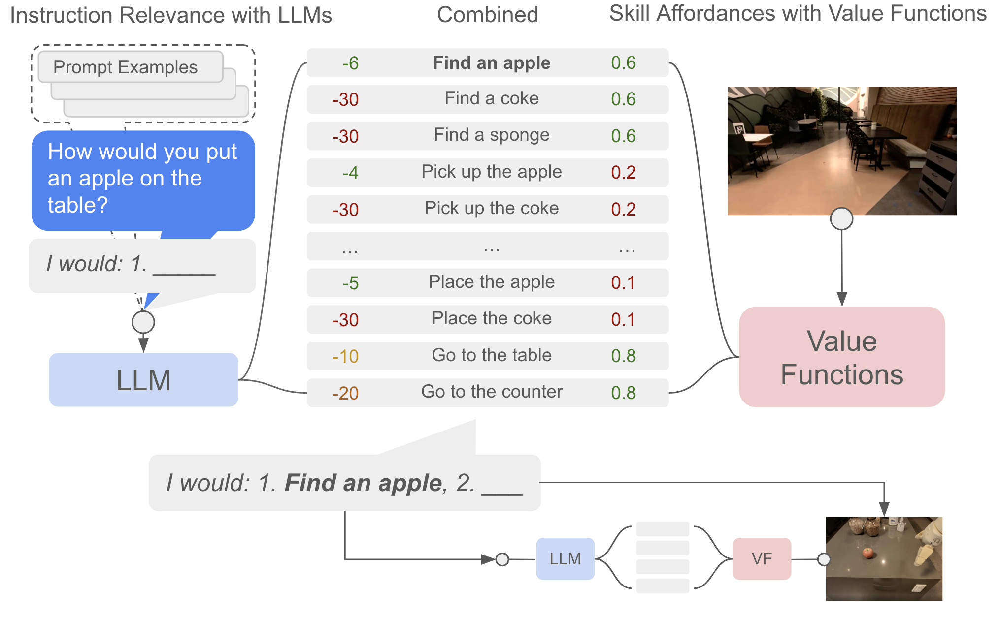

# 怎样为一个具身部署建立安全论证

假设机械臂正在固定工位搬运纸盒，工位门一打开，它必须停下来。要证明这件事，光看模型成功率没有用。得把“门打开”这件事怎样进入软件、旧命令怎样失效、驱动何时停止、载荷变化会不会拉长停止距离，一项项接到可复现的测试上。

安全案例就是这样一条可检查的论证链。它从限定场景中的主张出发，列出会破坏主张的危险、控制危险的机制、支持机制的测试，以及仍然依赖的假设。

{ width="920" }

<small>图源：[Do As I Can, Not As I Say: Grounding Language in Robotic Affordances](https://arxiv.org/abs/2204.01691)，Figure 3。原论文图意：LLM 给候选技能打“是否符合指令”的分数，value functions 给技能打“当前环境是否可执行”的 affordance 分数，二者组合后选择下一步机器人动作。</small>

图中的 affordance 表示技能可执行性的估计。它可以影响动作选择，但不能替代人员检测、制动、关节约束和硬件保护，因而不能独立充当安全论证。

## 先把主张写到能验证

以教学构造的固定工位搬运为例，允许机器人处理给定尺寸与载荷范围的纸盒，在封闭区域内移动；区域门打开后停止任务，不处理未知容器与液体。这组条件构成 operational design domain 的一部分。

“机器人不会伤人”太宽，无法靠有限实验直接支持。更可检查的子主张是“区域门打开后，控制系统撤销待执行命令，并在规定条件下于最大停止距离内停止”。它明确了触发事件、系统行为和可测终点，但最大停止距离仍需结合硬件制动、载荷与测量误差确定。

## 沿一个危险把链条接起来

危险是人员进入时机械臂继续运动。可能原因包括门状态信号丢失、软件没有处理事件、旧命令还留在队列、驱动未执行停止。防护应覆盖完整链路，而不是只给模型增加一条“有人就停”的提示词。

可以用故障注入验证门信号断开、通信超时、推理线程挂起和旧命令迟到。测试记录需要同时有输入事件时刻、停止请求时刻、驱动响应和实际运动停止，而不只是软件打印“stopped”。独立保护的价值取决于是否共享同一个失效源；两个检测器若共用失效相机，并不因为数量为二就形成充分冗余。

一个具体安全主张应能追到如下关系。

| 主张 | 机制 | 需要的证据 |
| --- | --- | --- |
| 过期任务命令不会恢复运动 | epoch、有效期与队列取消 | 延迟旧命令的注入测试 |
| 检测到异常后停止距离受控 | 制动与限速策略 | 不同载荷、速度下的实测停止距离 |
| 未知物体不进入自动抓取 | 对象范围检查与降级 | 范围外对象和误识别测试 |

这里的表格只是论证结构示例，不表示某台系统已经通过验证。

再考虑一个共同失效的教学反例。命令有效期检查与门事件响应都依赖同一线程更新时间戳，该线程卡住后，两处界面仍可能显示最后一次的正常状态。表面有两项检查，失效原因却相同。故障注入应暂停这个线程，再观察独立 watchdog 是否发现时间停止、执行端是否拒绝过期命令，以及实际驱动是否停止。

测量停止延迟也需要可信时间基准。如果事件时间和停止时间都由卡住的同一个软件时钟填写，日志甚至可能给出接近零的响应时间。独立测量、外部触发记录和实际运动反馈承担不同证据职责。这个例子说明为何安全案例必须检查假设与共同依赖，不能把软件字段数量当作保护强度。

## 先算一个停止距离，再决定测什么

教学上可以把停止距离拆成两段。速度为 \(v\)，从检测到制动真正生效的延迟为 \(\tau\)，制动阶段的保守减速度为 \(a>0\)，则

\[
d_{stop}=v\tau+\frac{v^2}{2a}.
\]

例如末端速度为 \(0.5\,\mathrm{m/s}\)，检测、通信和控制延迟合计 \(0.15\,\mathrm{s}\)，保守减速度取 \(1\,\mathrm{m/s^2}\)，得到

\[
d_{stop}=0.5\times0.15+\frac{0.5^2}{2\times1}=0.20\,\mathrm m.
\]

这个数字只是把测量项拆开的例子。真实系统还要考虑载荷、关节姿态、摩擦、制动器响应和测量误差，不能把公式结果直接当作认证距离。它至少告诉我们应分别记录事件到停止请求的延迟、请求到驱动响应的延迟，以及响应后真正走过的距离。

一个可复现的停止测试可以固定四个时间点：外部装置触发门打开，控制进程收到事件，驱动确认停止，外部位置或速度传感器确认运动结束。每次试验保存速度、载荷、姿态、软件版本和触发方式。若只比较日志中的“停止成功”字段，就无法发现驱动响应慢、传感器时间戳漂移或旧命令在停止后重新生效。

## 风险评分只能帮助排序

若危险事件概率可估计、损失可量化，期望损失可写成 \(\sum_iP_iL_i\)。但罕见事件往往缺乏足够样本，严重度也可能不是可加的货币量。FMEA 中把严重度、发生与检测难度评分相乘得到的 RPN，是排序辅助量；这些序数评分的乘积不能解释成真实事故概率。

零事件也有证据边界。独立同分布条件下，n 次实验无事故时，95% 单侧概率上界为 \(1-0.05^{1/n}\)，大样本近似 \(3/n\)。n=1000 时约 0.003。它只约束测试分布，不能覆盖没有测试的环境或共同原因失效。

## 出故障以后会怎么停，也要验证

相机失联后“回到安全位”未必安全，因为返回路径可能经过未知障碍。系统应根据可用传感器、当前速度和机械状态选择保持、受控制动或限定退回，不能把一个固定动作名字当成所有异常的通用答案。

人工接管也不是瞬时机制。远程操作包含告警、理解、网络往返和人工动作延迟。若任务要求在几十毫秒内反应，不能依赖远程人员兜底。需要把可自动处理和必须等待人工的状态分开，并确保等待期间本身稳定。

## 改了系统以后，旧论证还剩多少

换夹爪、增加载荷、移动相机、修改动作周期、更新模型或控制器，都可能破坏原假设。应保存配置、软件与标定版本，并将变更关联到需要重做的测试。新模型成功率提高，也可能更频繁地产生被安全层拒绝的动作，说明它更依赖外部保护。

上线后记录实际执行、拒绝、接管和近失事件，用于判断部署分布是否超出原验证范围。安全论证不是一次写完的说明书，它随可验证条件变化而更新。正式工业或协作机器人项目还应依据适用标准和专业风险评估，本文只解释论证结构。

控制与停止距离的计算见[规划与控制](planning-control-and-safety.md)和[VLA 部署](../vla/deployment-and-safety.md)，动力学约束和碰撞建模可对照 [MIT Underactuated Robotics](https://underactuated.mit.edu/)，原始标准入口见 [ISO 10218](https://www.iso.org/standard/73933.html)。

## 来源与自测

SayCan 图示用于说明语言建议与 affordance 的职责边界，停止距离和共同失效是教学构造；MIT Underactuated 用于补充约束和动力学背景，ISO 入口不等于本系统认证。自测时注入一次门信号丢失或旧命令迟到，记录事件、停止请求、驱动响应和实际停止的独立时间戳。
