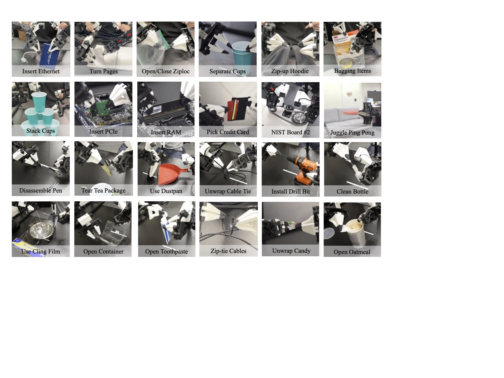
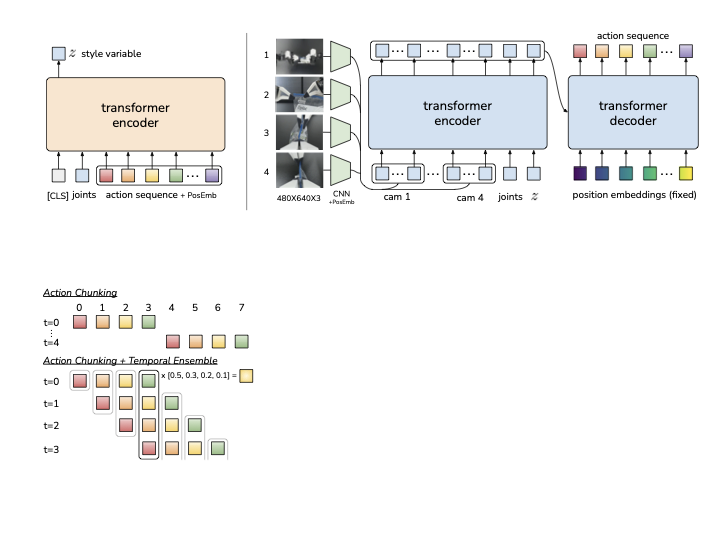

# 家庭任务怎样保持目标、物体与执行状态一致

“把蓝杯放到水槽旁边，再把纸巾盒扶正”听起来只是两个家务动作。机器人把杯子送到水槽旁边后，纸巾盒可能已经被人挪了位置；“扶正”也不等于把盒子推到某个坐标。家庭任务的难点，经常藏在这些中途变化里。

{ width="920" }

<small>图源：[Learning Fine-Grained Bimanual Manipulation with Low-Cost Hardware](https://arxiv.org/abs/2304.13705)，Appendix Figure。原论文图意：展示 ALOHA 遥操作任务示例，覆盖多种双臂精细操作场景，说明真实操作数据包含接触、遮挡、双手协同和任务阶段变化。</small>

## 先问清楚“扶正”到底是什么

在这个教学任务中，第一个子目标可表达为杯子位于指定放置区域、姿态稳定、夹爪已释放；第二个是纸巾盒的上方向与重力反方向接近，并处于允许区域。目标谓词描述结果，动作名描述过程，两者不能互相替代。

如果纸巾盒上方向为单位向量 \(n\)，竖直向上为 \(e_z\)，姿态误差可用 \(\theta=\arccos(\operatorname{clip}(n^\top e_z,-1,1))\) 度量。设允许误差为 5 度，平移盒子但不改变其倾角，不会让这个谓词成立。这一计算把“扶正”从模糊动作名变成能检查的终态。

“蓝杯”也要绑定到持久对象 ID。如果桌上有两个蓝杯，模型需要利用位置、对话上下文或澄清来选择，而不能在每帧重新选当前最显眼的蓝色物体。对象被遮挡时应保留最后可信位置与时间，承认当前状态可能已经变化。

## 每个子目标都要留下证据

一个任务记录可以包含 `target_id`、`goal_predicate`、`status`、`last_verified_at` 和 `evidence`。状态从待执行变为执行中，再变为已确认完成；仅仅发送放置动作不能提前写成完成。

杯子放下后，系统确认其位于稳定区域，才记录第一子目标完成。返回餐桌时重新观察纸巾盒，因为它可能已被人移动。任务记忆保存“还有哪件事没完成”，当前感知保存“现在物体在哪里”，两者合作才能避免拿旧位置替代新观测。

蓝杯从相机里消失时，可能已经放入柜中，也可能落到桌下，或者只是被机械臂挡住。单独的“不可见”观测分不出这三种情况，收纳谓词不能就此变成真。此前的抓取与放置事件、柜内视角和位置证据可以一起使用；证据不够时，状态就留在待验证。

纸巾盒扶正也需要类似区分。看到正面图案朝向相机，只反映一个视角的外观，盒子的支撑面和姿态可能仍不符合任务。保存对象ID、目标姿态和具体判定依据，使系统在中途打断后能够恢复尚未证实的子目标，避免把语言摘要中的“已完成”当成事实。

## 日志要能把一次失败重新放出来

如果只保存“任务失败”，下一次只能重新猜原因。至少把同一时间轴上的观测、策略输出、控制命令和实际执行结果放在一起：

| t (s) | 观测 | policy action | 执行结果 | 目标检查 |
| ---: | --- | --- | --- | --- |
| 0.0 | 蓝杯可见，纸巾盒倾斜 12° | 接近蓝杯 | 末端到达抓取位 | 两个子目标都未完成 |
| 0.1 | 蓝杯被夹住 | 向水槽区域移动 | 夹爪保持，路径无碰撞 | 搬运中 |
| 1.4 | 蓝杯落在区域边缘 | 释放 | 释放后杯体晃动 | 稳定性待确认 |
| 1.8 | 杯子稳定，纸巾盒被人移开 | 重新观察 | 没有发出扶正动作 | 第一目标完成，第二目标待执行 |

这里的 `policy action` 和“执行结果”必须分开。策略可能要求移动 5 cm，控制器因为限幅只执行 3 cm；把命令直接写成实际状态，会让后续故障分析失去证据。LeRobotDataset v3 也把状态、动作、时间戳等低维信号与相机视频分开存储，再用 episode 元数据恢复边界。这个数据层设计适合拿来约束家庭任务日志，但任务谓词和安全事件仍需由具体系统定义。

一个最小回放检查可以只做三件事：按时间戳对齐一帧图像和一行状态，确认 episode 起止没有跨样本拼接，再检查“已完成”记录是否有对应的观测证据。若时间戳缺失或视频与状态漂移，先修数据记录，暂时不要用这些轨迹训练策略。

## 人类打断以后，哪些动作还算有效

若用户在搬运时说“先停一下”，系统需要停止生成后续动作、取消未执行块，并根据当前抓持状态安全保持。任务本身可以暂停，但不能直接释放手里物体。恢复时重新确认目标与环境，丢弃依据旧观测生成的动作。

如果用户将目标改成“把杯子放到托盘”，应更新目标版本，让旧水槽计划失效。可以让每个执行命令携带任务版本号；执行端拒绝旧版本命令。这与软件中的取消操作类似，但机器人还需要处理惯性、接触和持有物体的物理状态。

{ width="720" }

<small>图源：[Learning Fine-Grained Bimanual Manipulation with Low-Cost Hardware](https://arxiv.org/abs/2304.13705)，Figure 2。原论文图意：Action Chunking with Transformers (ACT) 用 CVAE 编码动作序列和关节观测，测试时根据多视角图像、关节状态和 latent 生成一段 action sequence，并用 temporal ensembling 平滑执行。</small>

ACT 的动作块为局部轨迹提供时间结构，不能代替任务状态与中断协议。预测一段动作与必须执行完整段是不同选择，具体见[动作块与技能](../vla/action-chunking-hierarchical-policies-and-latent-skills.md)。

## 失败以后沿着证据回看

假设机器人把杯子放在水槽边缘，随后杯子倾倒。第一步看目标区域是否本来允许边缘位置；若允许，任务约束有缺口。若目标在安全区域，再比较感知位姿、规划轨迹与实际执行位置。只有目标与执行位置都正确，才进一步检查支撑几何、摩擦、释放速度与稳定性判定。

这样回看，能避免一看到掉落就给动作模型补更多数据。根因若是容器边界坐标错误，扩大模型修不了它；释放后的稳定观察太短，应该改 checker；湿滑表面改变了动力学，才轮到接触数据或执行策略。

## 用扰动把流程逐段试出来

保持任务不变，分别改变对象位置、加入相似杯子、在搬运时打断、在人离开后移动纸巾盒。每次只改变一个主要因素，检查系统是否在对应状态刷新证据。然后再做组合扰动，检验多个机制一起工作。

报告整段完成率、无需人工提示完成率、错误对象次数、每个子目标完成情况和恢复耗时。若第一任务成功第二任务失败，不能只展示前半段视频。一次任务中发生过碰撞，即使最后达成摆放，也应保留安全事件。

可以把扰动写成一个小矩阵，避免只挑成功视频：

| 扰动 | 预期应刷新什么 | 观察指标 |
| --- | --- | --- |
| 遮挡蓝杯 | 对象置信度和最后可信位置 | 是否错误重选另一个蓝杯 |
| 搬运中暂停 | 命令队列与持物状态 | 是否安全保持而非直接释放 |
| 人移走纸巾盒 | 第二子目标的目标位姿 | 是否沿用旧坐标 |
| 放置后轻推杯子 | 稳定性谓词 | 是否把一次释放误记成完成 |

每次先只加入一项扰动，再组合两项。这样能知道是身份跟踪、版本取消、状态确认还是执行稳定性出了问题。

家庭场景的核心挑战由具体接口呈现出来：语言确定结果，对象记忆保持身份，感知刷新位置，控制承受接触，任务状态机确认完成与恢复。进一步见[人机交互](human-robot-interaction-and-evaluation.md)、[闭环任务走读](closed-loop-task-walkthrough.md)和[VLA 恢复](../vla/closed-loop-recovery-and-failure-analysis.md)。

## 来源与自测

ALOHA 图示来自原论文，LeRobotDataset v3 的数据分层参考 [Hugging Face 官方文档](https://huggingface.co/docs/lerobot/en/lerobot-dataset-v3)，家庭任务、目标谓词和故障扰动是教学构造。自测时只改变对象遮挡、用户打断或目标位置中的一个因素，记录状态机刷新了哪条证据，以及最终是完成、恢复还是中止。页面中的时间戳表不是实际机器人运行日志。
