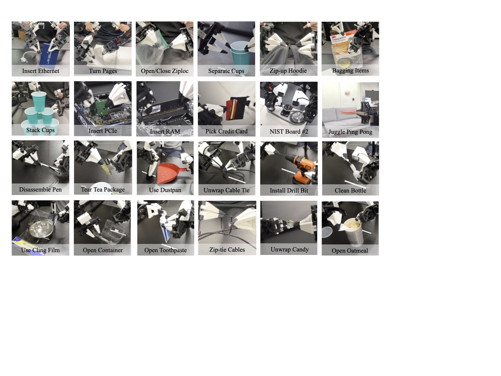
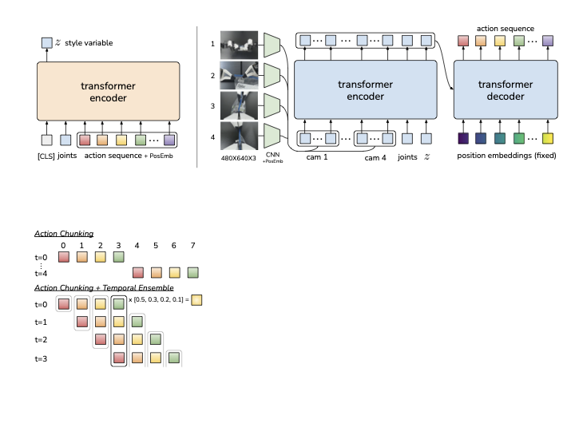

# 家庭机器人流程与失败排查

家庭机器人常被视为具身智能最具想象力的落地场景，但它也是最容易被低估的复杂场景。
家庭环境看起来比工厂轻松，实际上却包含更多开放物体、更强分布变化、更多人类打断，以及远高于实验室的长尾。真正理解家庭机器人，不仅要看它能做哪些任务，更要看它在哪些流程上最容易失败。

这页的重点不是列举 demo，而是把家庭机器人放回真实家庭流程中看：任务会被打断，环境会变化，指令常常很口语，成功标准也并不总是单一步动作是否完成。

ALOHA 原论文的任务示例图很适合提醒读者：家庭和桌面操作不是一个“抓取”动作，而是很多精细接触、双臂协调、物体状态变化和阶段性恢复的组合。

{ width="920" }

<small>图源：[Learning Fine-Grained Bimanual Manipulation with Low-Cost Hardware](https://arxiv.org/abs/2304.13705)，Appendix Figure。原论文图意：展示 ALOHA 遥操作任务示例，覆盖多种双臂精细操作场景，说明真实操作数据包含接触、遮挡、双手协同和任务阶段变化。</small>

**家庭任务难在阶段和接触细节。**
这组任务图比单张抓取 demo 更有教学价值：它展示的是“先接近、再接触、再改变物体状态、再验证结果”的连续过程。家庭机器人做收纳、开关抽屉、整理桌面时，失败往往出现在阶段切换处，例如已经抓到但没放稳、打开了但没有验证、移动了但没有完成用户意图。

ALOHA/ACT 的结构图则从策略侧补充了同一件事：家庭机器人不应该只输出“下一瞬间动作”，而要输出能跨越一个小阶段的 action chunk，并用时间集成降低抖动和阶段切换错误。

{ width="720" }

<small>图源：[Learning Fine-Grained Bimanual Manipulation with Low-Cost Hardware](https://arxiv.org/abs/2304.13705)，Figure 2。原论文图意：Action Chunking with Transformers (ACT) 用 CVAE 编码动作序列和关节观测，测试时根据多视角图像、关节状态和 latent 生成一段 action sequence，并用 temporal ensembling 平滑执行。</small>

**家庭任务要按阶段输出和验证。**
ACT 图里的重点是 action chunk：策略一次预测一小段动作，而不是每个控制周期孤立地预测一步。家庭机器人做开抽屉、取物、放置、整理这类任务时，失败常发生在阶段边界，例如抓到了但没放稳、打开了但没验证、移动了但没有完成用户意图。chunk 能提供更连贯的局部动作先验，但系统仍需要在每个阶段后做状态验证、失败检测和必要的重试或接管。

## 家庭任务为什么难

家庭环境的问题集中在四点：物体种类极多且摆放无规律，语言指令口语化、含指代、经常不完整，人和宠物会随时进入环境，任务通常也是多步骤且会被打断。

因此家庭机器人不是“把工厂机器人搬回家”，而是更接近长期共处的开放世界 agent。

### 1.1 为什么“开放世界”在家庭里特别明显

家庭里常见的困难包括同类物体外观相近但细节不同，物体可能被塞进抽屉、篮子、布袋或沙发缝，房间布局会被家庭成员随时改变，用户指令还常常带省略和共享常识，例如“顺手把那个也收一下”。

这些都意味着机器人不仅要会操作，更要会持续理解一个动态变化的日常世界。

## 一个家庭任务的典型流程

一个家庭任务常从接收自然语言目标开始，先解析约束和指代，再定位相关房间与物体，导航接近后执行抓取、打开、放置等操作，并在必要时与人确认中间状态，出错后再恢复或继续。

任何一个环节不稳，整条任务链都会断。

### 2.1 为什么流程视角比单项能力更重要

一个机器人可能导航很强、抓取也不错，但如果它在“找不到东西时如何求助”“被打断后如何续上”“放置完成后如何验证”这些流程节点上薄弱，整体体验仍然会很差。

## 家庭任务真正难在跨模块耦合

家庭机器人最难的不是单个子问题，而是子问题之间互相放大。

**举例来说**：

- 语言理解里把“蓝色杯子”理解成了“桌上唯一的杯子”；
- 视觉定位又没发现旁边其实还有一个深蓝色马克杯；
- 抓取时选错对象；
- 放到厨房后还自认为任务成功。

这说明家庭任务里很多失败不是某个模块完全崩，而是多个模块“各错一点，最后整体失败”。

## 最常见失败模式

### 4.1 找物失败

物体被遮挡、被放到异常位置、外观变化大。
家庭里最典型的情况，是杯子被毛巾挡住一半、遥控器夹在沙发缝里、纸巾盒被购物袋部分遮挡。

实验室数据里常见的完整摆放物体，并不能覆盖这些情况。

### 4.2 语言 grounding 失败

“那个杯子”“左边那个抽屉”“把它放回原位”这类指代若没有共享上下文，很容易理解错。

尤其当环境里存在多个相似物体、多个候选位置，或历史对话中提过多个对象时，指代错误会迅速级联。

### 4.3 操作细节失败

门把、抽屉、塑料袋、布料、玻璃器皿都属于高难对象。
家庭操作不止是“抓住一个刚体”，还包括打开冰箱门、抻开塑料袋、扶正歪倒的物体、轻放易碎容器。

这些都对接触、力度、姿态和安全要求很高。

### 4.4 任务被打断后状态丢失

人类临时改口、宠物碰动物体、其他家庭成员改变环境，都会让机器人原计划失效。

例如：

- 机器人正要拿杯子，用户说“先不用杯子，先把桌子擦一下”；
- 它中途转去厨房，回来后杯子被别人拿走了；
- 机器人却仍然按原计划在旧位置搜索。

### 4.5 “做了动作但没完成意图”

这类失败在家庭里特别多。
例如用户说“把桌上的纸巾盒扶正”，机器人只是把纸巾盒挪了一下位置，却没把倾斜姿态纠正。
动作发生了，但任务意图没有真正完成。

## 为什么家庭场景更需要恢复能力

工厂里环境较固定，家庭里则经常“世界已经变了”。
因此家庭机器人若没有状态跟踪和恢复机制，很快就会反复找同一个物体，在旧目标上继续行动，执行前不重新确认环境，或出错后只会停住、不会换策略。

恢复能力在家庭场景中不是增强项，而是主能力。

### 一个直观类比

家庭机器人更像一个在家里帮忙的新助手，而不是工厂里的固定机械臂。
一个好助手不是永远不犯错，而是在出错后知道先停、再看、再问、再改计划。

这正是恢复能力的本质。

## 一个具体例子

**任务**：“把餐桌上的蓝色杯子放到水槽旁边，然后把桌上的纸巾盒扶正。”
看似简单，实际上要求机器人正确识别蓝色杯子而非其他杯具，安全抓取并移动到厨房，在水槽周围找到合适放置点，返回餐桌定位纸巾盒，还要理解“扶正”意味着姿态修复而非仅仅移动位置。

这类任务跨房间、跨对象、跨动作类型，任何一步都可能出错。

### 6.1 如果把失败拆开，会发现很多隐含前提

机器人需要隐式知道：“水槽旁边”不是任意潮湿区域，杯子不能倒扣放在不稳边缘，纸巾盒扶正后还要保持可用，执行完第一步后还要记得第二步仍然未完成。

这些都是家庭环境里的常识与任务持续性问题。

## 家庭机器人为什么比 demo 更依赖人机交互

真实家庭场景里，机器人常常需要澄清含糊指令、反馈中间状态、在失败时询问替代方案，并确认是否继续执行。

例如：

- “你说的是餐桌左边那个蓝杯，还是靠窗那个？”
- “水槽边已经没有安全放置空间，要放在沥水架上吗？”

这说明家庭机器人不是只靠动作模型，还需要稳定的人机协商机制。

## 家庭长尾物体特别难

相比标准数据集中那些常见刚体，家庭里更麻烦的是柔性包装、透明容器、反光厨具、湿滑餐具、形变布料、半开抽屉与门。

这些对象的共同特点，是外观易受视角和光照影响、接触模型复杂、抓取和放置需要细致控制。

## 评测家庭机器人时不能只看单步成功率

家庭机器人评测不能只看单步成功率，更应该把长任务、恢复、澄清、安全和放置合理性放到一起看。

### 一张更贴近现实的指标表

| 指标 | 为什么重要 |
| --- | --- |
| 长任务完成率 | 家务通常不是一步动作 |
| 恢复率 | 家庭环境经常变化 |
| 澄清成功率 | 用户指令常不完整 |
| 安全事件率 | 与人共处是刚需 |
| 误抓率 | 相似物体很多 |
| 放置合理率 | “放下”不等于“放对” |

## 一些典型流程设计建议

如果从系统设计角度看，家庭机器人至少要把几类能力做成流程节点，而不是留给模型临场发挥：找不到物体时的重搜和求助策略，指令含糊时的澄清策略，中途环境变化后的状态刷新，操作前的安全检查，以及完成后的结果验证。

这些节点往往比单次抓取精度更决定整体体验。

## 读完以后怎么判断

家庭机器人流程的真正难点，不是单一抓取或导航，而是把语言、记忆、规划、操作、恢复和人机共处一起串成可持续流程。
理解这些失败模式，是判断家庭机器人距离真实可用还有多远的关键。

如果把整页浓缩成一句话，可以记成：

**家庭机器人不是“会做几个动作”的问题，而是“能不能在不断变化的家里持续把事情做成”的问题。**

## 工程收束

家庭机器人要验收的是连续流程，而不是单个动作。任务状态、物体记忆、异常恢复、人类打断和安全边界都要进入评测与日志；否则系统即使会抓取、会导航，也很容易在真实家庭的长尾变化里失稳。

## 相关阅读与下一步

- 外部材料：[RT-2 官方博客](https://deepmind.google/discover/blog/rt-2-new-model-translates-vision-and-language-into-action/)。
- 外部材料：[Open X-Embodiment 论文](https://arxiv.org/abs/2310.08864)。
- 外部材料：[RoboTwin 项目](https://robotwin-platform.github.io/)。
- 站内下一步：[具身智能专题](index.md)。
- 站内下一步：[具身智能基础：观测、动作与反馈闭环](beginner-learning-path.md)。
- 站内下一步：[Sim2Real 与具身数据引擎](sim2real-and-data-engines.md)。
