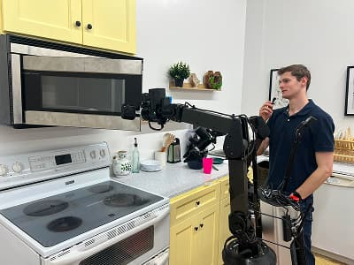

# 人机交互怎样进入机器人控制与评测

把工具递给人，不能只把末端移动到一个固定位置。机器人需要判断对方是否准备接收、是否真的握住工具、何时释放，以及中途说“等一下”时怎样取消旧动作。人的行为改变机器人输入，机器人行为又改变人的反应，交互构成一个持续反馈过程。

{ width="390" }

<small>图源：[Physical Intelligence π0.5 官方博客](https://www.pi.website/blog/pi05)。原页面图意：人类通过自然语言给机器人提供 verbal instruction，帮助机器人完成复杂长任务中的下一步子任务。</small>

## 沿一次递物解释状态与证据

教学任务中，机器人先拿住工具，再移动到双方可见的交接区域。到达区域只满足几何条件，下一步是否释放还依赖人是否接触和承担重量。状态可分为持有、等待准备、接近、共同持有、释放、完成和中止。

“手在工具附近”只提供视觉接近证据，不能证明已握稳；接触力下降也可能来自工具滑落。实际检测可以结合手部位置、力或触觉和任务上下文，但必须记录每个信号的延迟与失效条件。只有这些条件明确，才能解释为何系统在某一步等待。

如果人的手在等待过程中移开，系统应保持或退回定义好的安全姿态。再次进入接近状态前应读取新观测，而不是接着执行被暂停的旧动作块。人类的停止请求还需要比普通任务指令更高的执行优先级。

## 什么时候澄清能减少错误

假设两件工具外观接近，机器人对目标 A 的判断概率为 0.6。直接选择 A 的错误概率是 0.4。用一个仅作教学的代价模型，错误交付代价为 10，询问一次代价为 1，询问后仍有 0.05 概率出错，则直接行动期望代价为 4，询问为 \(1+0.05\times10=1.5\)。

这个比较解释了为何澄清是决策动作。它依赖概率与代价可信，不能把任意模型置信度代入就称为最优交互。若问题问得含糊，用户回答不能减少目标歧义，询问的实际收益也会下降。需要评测回答是否改变了对象绑定，而不只是统计机器人问了多少问题。

## 共享控制不能只做平均

在同一个线性速度空间中，可以构造 \(u=\lambda u_R+(1-\lambda)u_H\)。例如机器人建议 0.2 米每秒向前，人建议 0.1 米每秒后退，\(\lambda=0.5\) 得到 0.05 米每秒向前。但如果人的动作表达“停止”，这个平均仍在前进，违背接管语义。

因此应区分连续修正与权限切换。连续修正可在同一坐标和单位下融合，停止、取消、接管则应通过离散状态与权限规则处理。两个无碰撞轨迹的均值也未必无碰撞，融合后的命令仍需独立约束检查。

控制权切换还要处理内部状态。若机器人控制器保留旧积分误差或旧轨迹队列，人一放开接管就可能突然恢复旧动作。应记录切换时刻、清理或重置必要状态，并要求重新确认当前任务与参考。

把权限问题接回递工具流程。机器人已进入“共同持有”状态时，人突然说“等一下”，可能只是还没握稳，也可能改变了接收意图。无论语义解析最终怎样分类，停止或取消通道都不能继续沿原来的“下一步释放”队列推进。保持工具、撤回动作或等待确认应由当前物理接触与任务规则决定。

恢复以后，需要重新读取谁在承重、工具在哪里和人是否准备好。若直接从旧状态继续执行释放，就把一句语言确认当成了新的物理证据。日志中应把意图、接触判断、控制权和实际释放分别记录，这样后面的交互评测才能分清“用户表达不清”和“系统没有落实已识别的停止意图”。

## 把辅助完成和自主完成分开

假设 20 次递物中，12 次无需帮助完成，6 次在用户重新指点后完成，2 次失败。总体完成率 90%，无需帮助完成率 60%。如果只报 90%，看不出系统依赖多少交互。还应报告用户提示次数、等待时间、接管耗时与中断恢复情况。

等待时间需要定义端点。从机器人发出交接提示到人准备好，是人的响应；从人已准备好到机器人动作开始，是系统响应。把二者相加只能得到总等待，不能定位瓶颈。时间戳和事件定义应在实验前固定。

## 用户研究怎样减少顺序与熟练度干扰

同一个人先用 A 再用 B，可能因为已经熟悉任务而偏向 B。可以让一半参与者按 A→B，另一半按 B→A，并记录训练轮与正式轮。任务难度、机器人速度、解释信息也应保持可比较，避免把更详细的教学提示误当成算法效果。

主观信任、舒适和负担可用明确问卷或访谈记录，但不能把高信任本身当成可靠性。过度信任会让人忽略系统边界。更有价值的是观察用户判断是否与实际能力匹配，例如系统不确定时，用户是否能看懂状态并及时接管。

图中的论文系统展示语言指令接口，不代替上述交互实验。完整执行机制见[VLA 闭环恢复](../vla/closed-loop-recovery-and-failure-analysis.md)，持续任务见[家庭机器人流程](household-robotics-workflows-and-failure-patterns.md)，运行边界见[安全案例](deployment-patterns-and-safety-cases.md)。
