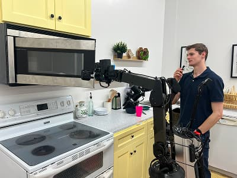

# 人机协作与交互评测

具身智能一旦进入真实环境，就很少是“机器人单独干活”。它往往需要与人共享空间、共享任务，甚至共享决策。于是问题不再只是机器人能否完成动作，而是它能否让人愿意与它一起工作、信任它、理解它，并在必要时安全接管。人机协作与交互评测，正是把具身智能从纯控制问题提升为社会技术系统问题的关键环节。

{ width="390" }

<small>图源：[Physical Intelligence π0.5 官方博客](https://www.pi.website/blog/pi05)。原页面图意：人类通过自然语言给机器人提供 verbal instruction，帮助机器人完成复杂长任务中的下一步子任务。</small>

**人机交互不是只给一句初始指令。**
这张图适合把 HRI 和 VLA 数据联系起来：人类不只在 episode 开头说目标，也可能在中途纠正、澄清、接管或给下一步提示。评测时要记录这些交互信号，否则模型看似成功，实际可能依赖大量人工隐性补救。

## 人机协作为什么是独立难题

机器人面对的对象不是静态货箱，而是会临时改变计划、表达含糊意图、具有安全感受和工作节奏偏好的真人。人机协作比纯自动化多出几个维度：人类意图不完全显式，人类行为具有不确定性和反应性，用户会根据机器人的表现改变自己的行为，成功标准也不只是完成任务，还包括舒适、可理解和信任。

## 交互任务的几个层级

### 2.1 共处（coexistence）

人与机器人在同一空间活动，核心是避让与不打扰。例如医院配送机器人在走廊中与医护和病患共行。

### 2.2 协作（collaboration）

人和机器人共同完成任务，如递工具、协作装配、搬运大件。

### 2.3 协商（coordination / negotiation）

双方需要在节奏、目标或动作顺序上协商。例如机器人先递哪个部件、人类何时接手下一步。

### 2.4 指导与教学（instruction / teaching）

人类通过语言、示范、指点或纠正训练机器人，机器人则要能理解反馈并调整行为。

## 成功不只是任务完成率

设任务成功率为 $S$，人机协作系统的总体效用可更合理地写成

$$
U = \alpha S - \beta R + \gamma T - \delta F,
$$

其中 $R$ 是风险或不安全事件，$T$ 是人类信任 / 接受度，$F$ 是摩擦成本，如沟通次数、等待时间、额外认知负担。

这说明“完成了”并不代表“适合部署”。

## 意图理解与可预期行为

人机协作中，机器人不必永远最优，但必须足够可预期。一个动作若在物理上可行，但对人类而言难以理解，就会降低协作效率。比如装配场景里，机器人明明能从桌子上方横切过去递工具，但人类可能更希望它从固定安全通道靠近，因为那更可预期。

因此交互评测要看机器人是否理解人类意图、人类是否能预测机器人下一步，以及双方是否能建立稳定节奏。

## 交互信号的来源

机器人可利用的交互信号包括语言指令、手势和指点、视线和朝向、接触和力反馈，以及历史协作习惯。

一个成熟系统常需融合多种信号，而不是只依赖语音。

## 交互评测维度

### 6.1 安全

最基本的是安全，包括最小距离、急停触发率、近失事件（near-miss）和接触力峰值。

### 6.2 效率

效率指标包括任务完成时间、人类等待时间、切换成本和多轮澄清次数。

### 6.3 理解正确性

理解正确性可以看指令 grounding 准确率、手势目标识别率和澄清问题有效率。

### 6.4 主观体验

包括信任、舒适、可理解、负担感。虽然主观，但对真实部署很关键。

## 主观指标不等于“不科学”

很多人觉得主观打分不可靠，但在人机协作系统里，它是必要信息。可用标准问卷、Likert 量表或任务后访谈记录用户是否愿意再次合作、是否理解机器人为何这么做、是否担心突然危险动作，以及合作到底省力还是更麻烦。

这些量直接影响真实采用率。

## 共享控制与接管

很多场景下，机器人不应完全自治，而应支持人类接管或微调。可把控制写成混合策略：

$$
a_t = \lambda_t a_t^{\text{robot}} + (1-\lambda_t) a_t^{\text{human}},
$$

其中 $\lambda_t$ 表示自治程度。评测时要关心人类接管是否顺畅、机器人是否在需要时主动让权，以及频繁接管是否说明系统边界设计不合理。

## 协作中的节奏问题

机器人即便动作正确，若节奏不对，也会让人很难受。例如递工具太慢导致人等待，太快又让人措手不及。交互质量常取决于它是否能在适当时机靠近、是否在对方准备好前就执行下一步、是否在不确定时及时请求确认而不是无休止等待。

这类问题很难通过纯离线任务成功率反映出来。

## 场景例子：医院辅助配送

机器人需要在走廊中移动、避让病人、在护士站交接药品。此时评测不仅是“是否送到”，还包括是否挡路、接近人时是否减速、是否通过灯光 / 语音明确表达意图，以及医护是否觉得它增加了工作负担。

这就是交互评测比物流效率更宽的地方。

## 场景例子：协作装配

机器人为工人递螺丝刀、固定工件、搬运部件。若它每次都要等人说完完整指令才行动，效率会很低；若它过于主动、总在错误时机插手，人又会觉得危险和烦躁。这里评测的重点是动作是否可预期、提前量是否合适、错误后是否容易纠正，以及人类是否愿意继续依赖它。

## 人机协作中的失效模式

### 12.1 技术上正确，交互上糟糕

机器人完成任务，但路径奇怪、靠人太近或频繁打断。

### 12.2 过度保守

虽然安全，但总是不敢行动，导致人类宁可自己做。

### 12.3 解释缺失

系统动作突然变化，人类不知道原因，从而降低信任。

### 12.4 不会求助

机器人已明显不确定，却仍继续尝试，造成更大混乱。

## 评测组织建议

一个较完整的人机协作评测应包括封闭场景安全测试、任务效率测试、主观体验问卷、长期使用观察，以及接管与异常场景演练。

若只做一次短时间 demo，往往看不到信任与摩擦的真实变化。

## 数据与训练建议

数据侧要收集多样的人类互动风格，而不只一种标准示范；明确标注澄清、接管、等待、礼让等交互动作；把失败协作案例纳入训练和评测；并为不同人群设计适配，例如新手用户与专业操作员。

## 直觉例子

人机协作评测有点像评估一位新同事。你不会只看他把活干完没有，还会看他是不是懂得配合节奏、会不会抢活、会不会在不确定时问清楚、出错后是否好沟通、大家愿不愿意继续跟他一起上班。机器人进入工作场所后，也同样要通过这样的“团队协作测试”。

## 读完以后怎么判断

**人机协作与交互评测提醒我们**：具身智能不是单机算法问题，而是人与机器共同组成的系统问题。任务成功率固然重要，但安全、节奏、可理解、可接管和信任感同样关键。只有把这些维度一起评估，机器人才能真正从“会动的机器”变成“可合作的伙伴”。

## 工程收束

人机协作的评测要把“人”放回系统里：任务完成只是底线，用户是否能理解机器人状态、能否及时接管、交互节奏是否可接受、失败后是否还能建立信任，都会决定部署质量。HRI 的数据回流也应记录用户反馈和接管上下文，而不只是成功或失败标签。

## 相关阅读与下一步

- 外部材料：[RT-2 官方博客](https://deepmind.google/discover/blog/rt-2-new-model-translates-vision-and-language-into-action/)。
- 外部材料：[Open X-Embodiment 论文](https://arxiv.org/abs/2310.08864)。
- 外部材料：[RoboTwin 项目](https://robotwin-platform.github.io/)。
- 站内下一步：[具身智能专题](index.md)。
- 站内下一步：[具身智能基础：观测、动作与反馈闭环](beginner-learning-path.md)。
- 站内下一步：[Sim2Real 与具身数据引擎](sim2real-and-data-engines.md)。
