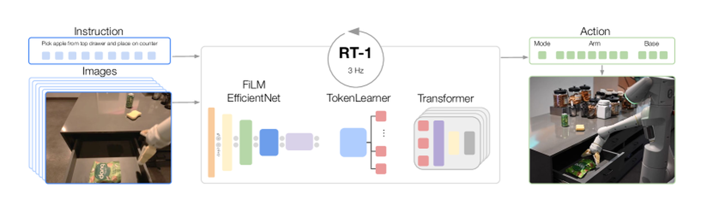

# 具身智能路线图

**具身智能关注的是**：智能体不是只在文本里回答问题，而是在物理世界中感知、规划、行动并承担后果。它面对的不是“下一个 token 生成什么”这么单一的问题，而是一个物理闭环：

!!! tip "基础知识入口"
    具身智能会同时调用感知特征、序列建模、概率预测和系统闭环。建议把 [Transformer 与 Attention](../foundations/transformer-attention-and-tokenization.md)、[概率与潜变量](../foundations/probability-latent-variables-and-generative-models.md) 和 [优化与训练入门](../foundations/optimization-and-training-basics.md) 作为前置地图。

!!! note "主线定位：世界模型负责想象，具身智能负责落地"
    世界模型回答“如果执行动作 \(a_t\)，未来可能变成什么样”；具身智能继续追问“这个预测能不能在真实传感器、真实控制器、真实接触和安全约束里闭环运行”。所以具身智能不是世界模型之后的附录，而是检验世界模型是否真的有用的落地场景。

!!! tip "本专题的读法"
    具身智能不要先按模型名读，先按闭环读：看见什么、相信什么、计划什么、执行什么、如何知道成功、失败怎么回流。VLM、VLA、世界模型、控制器和仿真数据都只是这条闭环里的不同部件。

<div class="atlas-meta-grid">
  <div>
    <strong>读前先知道</strong>
    <p>视觉表征、概率状态、动作接口、基础控制和评测指标。</p>
  </div>
  <div>
    <strong>读中抓主线</strong>
    <p>感知状态、任务语义、动作块、世界前瞻、控制安全、数据回流。</p>
  </div>
  <div>
    <strong>读完能判断</strong>
    <p>一个机器人方案是只会看图、只会出动作，还是能闭环执行并处理失败。</p>
  </div>
</div>

\[
o_t \rightarrow b_t \rightarrow p_t \rightarrow a_t \rightarrow o_{t+1}
\]

其中：

\(o_t\) 是相机、深度、力觉、关节角、语言指令等观测；\(b_t\) 是模型对物体位置、任务进度、遮挡和接触状态的内部信念；\(p_t\) 是未来几步的子目标、轨迹或技能调用；\(a_t\) 则是低层控制器真正能执行的关节、末端执行器、移动底盘或离散技能命令。

只要其中任何一环不稳，系统都会在真实环境中迅速暴露脆弱性。

把世界模型接进这个闭环时，常见写法是先把观测压成 latent state：

\[
z_t = e_\phi(o_{\le t})
\]

再让世界模型预测动作后果：

\[
(\hat z_{t+1}, \hat r_t, \hat c_t) = W_\theta(z_t, a_t)
\]

这里 \(\hat z_{t+1}\) 是下一步状态预测，\(\hat r_t\) 是任务收益或进度预测，\(\hat c_t\) 是碰撞、滑落、越界等风险预测。具身智能的关键，是把这些预测交给 planner、policy、controller 和 safety guard，而不是只生成一段看起来合理的视频。

RT-1 原论文图很适合先建立具身智能闭环直觉：语言指令和相机观测进入模型，模型持续输出离散动作 token，机器人执行后又得到新的观测。

{ width="760" }

<small>图源：[RT-1: Robotics Transformer for Real-World Control at Scale](https://arxiv.org/abs/2212.06817)，Figure 1。原论文图意：RT-1 接收自然语言指令和图像历史，经过 tokenization 与 Transformer policy，以约 3Hz 输出机器人动作 token，驱动机械臂完成真实任务。</small>

!!! note "图解：RT-1 图展示的是闭环控制而不是静态识别"
    图的左侧是任务指令和相机历史，中间是把视觉与语言转成 token 后交给 Transformer policy，右侧是连续执行的机器人动作。关键不是模型“看懂了一张图”，而是每一步动作都会改变环境，下一帧观测又会反过来影响后续动作。如果一个方案只展示“看懂场景”或“输出动作”，但没有说明执行后的反馈、失败恢复和数据回流机制，它还不是完整具身系统。

## 0. 先建立系统地图

具身智能容易难懂，是因为它不是单条模型路线，而是七层系统同时工作：

| 层级 | 先问的问题 | 相关页面 / 论文 |
| --- | --- | --- |
| 感知与状态 | 机器人现在看见什么、物体在哪里、自己状态是什么 | [相机、深度与机器人视觉](cameras-depth-and-robot-vision.md)、[Depth Anything 3](../paper-deep-dives/embodied-ai/depth-anything-3.md)、[资产到轨迹：感知、抓取与数据管线](asset-perception-grasp-and-trajectory-pipeline.md) |
| 语义与任务 | 高层目标要拆成哪些子任务，哪个对象当前最相关 | [π0.5](../paper-deep-dives/embodied-ai/pi05.md) |
| 动作接口 | 动作是 token、末端位姿、关节角，还是一段 action chunk | [VLA 动作表示](../vla/action-representation-and-interfaces.md) |
| 策略 / VLA | 给定观测和语言，下一段动作是什么 | [π0.5](../paper-deep-dives/embodied-ai/pi05.md)、[VLM/VLA 总览](../vlm/index.md) |
| 世界模型 / WAM | 如果执行动作，未来会怎样；未来视频和动作是否一致 | [DreamZero](../paper-deep-dives/embodied-ai/dreamzero.md)、[LingBot-World](../paper-deep-dives/world-models/lingbot-world.md) |
| 规划控制与安全 | 动作能否执行、是否碰撞、是否需要降速或拒绝 | [规划、控制与安全](planning-control-and-safety.md) |
| 数据与评测 | 数据如何生成，成功如何判定，失败如何回流 | [Sim2Real 与具身数据引擎](sim2real-and-data-engines.md)、[具身任务谱系与评测](task-taxonomy-and-benchmarks.md) |

如果现在觉得概念散，先读 [具身智能从零路线](beginner-learning-path.md)。那一页按“看见世界 -> 理解任务 -> 选择动作 -> 预测后果 -> 执行控制 -> 判断成败 -> 回流数据”的顺序，把 VLM、VLA、world model、WAM、π0.5、DreamZero 和资产/轨迹 pipeline 放到同一条学习线上。

如果卡在机器人视觉和仿真工具，先分别读 [相机、深度与机器人视觉](cameras-depth-and-robot-vision.md) 和 [Isaac Sim 与 RoboTwin 仿真数据链](isaacsim-and-robotwin.md)。前者解释单目/双目/RGB-D、相机内参/外参、标定和安装方式，后者解释 Isaac Sim、RoboTwin、cuRobo、success checker 怎么组成数据生成闭环。

读完从零路线后，再读 [VLA、WAM 与世界模型地图](vla-wam-world-model-system-map.md)。那一页把 π0.5、DreamZero、LingBot-World、Dreamer 和资产/轨迹 pipeline 放进同一张结构图里，建立“每个方法在系统里负责哪一层”的判断。

如果你想用一个具体任务把整条链路跑通，再读 [一个任务跑通具身闭环](closed-loop-task-walkthrough.md)。那一页用“按尺寸排序”和“放入匹配容器”解释从任务状态、离线轨迹生成、在线执行、success checker 到失败排查的完整闭环。

## 一条贯穿路线

这个专题可以按下面这条线读：从任务和数据开始，经过 VLA、世界模型、控制器和评测，再回到数据 recipe。

{ width="740" }

<small>图源：[Open X-Embodiment: Robotic Learning Datasets and RT-X Models](https://arxiv.org/abs/2310.08864)，Figure 1。具身智能的主线首先是跨机器人、跨任务、跨相机和跨动作接口的数据汇聚，再在这个数据底座上连接 VLA policy、世界模型、控制器、评测和失败回流。</small>

!!! note "图解：具身智能为什么先讲数据异质性"
    这张图里的重点是“同一个机器人数据集并不统一”：机器人本体、场景、物体、技能和轨迹分布都不同。VLA / WAM 要泛化，必须处理跨 embodiment、跨相机、跨动作空间的数据契约；否则模型可能只是在某个固定实验室里成功。

| 阶段 | 关键问题 | 对应入口 |
| --- | --- | --- |
| 任务谱系 | 到底在考短技能、长任务、跨环境，还是无效指令拒绝 | [具身任务谱系与评测](task-taxonomy-and-benchmarks.md) |
| 数据 recipe | 数据是干净脚本演示，还是含失败、纠正、脏场景和长会话 | [VLA 数据、模型与评测路线](vla-data-model-and-evaluation-roadmap.md) |
| VLA policy | 视觉、语言、本体状态如何输出 action chunk 或轨迹锚点 | [VLA、WAM 与世界模型地图](vla-wam-world-model-system-map.md) |
| 世界模型前瞻 | 候选动作执行后是否可见、可达、会碰撞、能恢复 | [世界模型开发路线](../world-models/development-roadmap-data-simulation-and-evaluation.md) |
| 控制和安全 | 高层动作如何落到真实关节、速度、力和急停边界 | [规划、控制与安全](planning-control-and-safety.md) |
| 失败回流 | 失败轨迹、人工纠正和价值函数如何改进策略 | [Sim2Real 与具身数据引擎](sim2real-and-data-engines.md) |

## 1. 具身智能和“大模型智能体”有什么不同

纯软件智能体的动作常是发一句话、调一个 API 或点一个按钮，错误通常还能重试、撤回或在业务流程里补救。具身智能体的动作则会真正改变物理世界：几十到几百毫秒的延迟就可能让抓取错位，速度、力、距离和碰撞边界都必须被满足，光照、摩擦、遮挡和人类干预还会不断改变状态分布。

软件 agent 出错，常常是流程重试；具身 agent 出错，可能是撞到桌角、摔碎杯子、挡住人类通路，或者在危险边界继续尝试。

## 2. 一个直观例子：厨房机器人

机器人接到“把锅铲放回抽屉”任务时，需要同时解决：

先识别锅铲和抽屉，再把“放回”绑定到正确目标位置，随后规划一条不碰撞的轨迹，控制夹爪完成抓取，并在抽屉没有完全打开时根据新观测修正动作。这个例子里，VLM/VLA、几何规划、接触控制和失败恢复不是分开的功能点，而是同一条闭环链路上的连续环节。

如果它只是“理解了这句话”，还远远不够。它必须在空间里、时间里、接触里都做对。也就是说，具身智能不是把 VLM 接一个机械臂那么简单，而是把语义理解、几何推理、控制稳定性和安全边界绑在了一起。

## 3. 具身智能的三层问题

### 感知与表征

看见什么、信什么、记住什么。VLM/VLA 通常从这里进入：把图像、语言和历史观测压成可供策略使用的状态。难点在于，机器人看到的是局部视角，不是完整世界；所以表征必须处理遮挡、时序记忆和不确定性。

### 规划与控制

接下来怎么动，动作是否平滑、可执行、可恢复。世界模型在这里开始变得重要：它可以先预测几种候选动作的后果，再让 planner 或 policy 选择更稳的路线。传统控制器则负责把高层动作落到真实电机和安全边界里。

### 数据与迁移

仿真里学到的东西能不能迁到真实世界，失败样本能否持续回流。具身系统真正的进步常来自数据闭环：发现失败、标注原因、回放轨迹、生成反事实样本，再把这些样本送回 VLA 或世界模型训练。

这三层问题共同决定了为什么同一个机器人系统在 demo 里很聪明，在真实家庭或仓库里却常常变脆。

!!! note "难点解释：为什么世界模型不能替代控制器"
    世界模型擅长预测“可能会怎样”，但真实机器人还需要满足速度、加速度、力矩、碰撞距离和急停约束。一个视频世界模型即使能生成“夹起杯子”的未来帧，也不等于它知道每个关节该用多大力、遇到滑动时如何补偿。工程上更稳的形态通常是：世界模型做前瞻，VLA 或 planner 给意图，控制器保证可执行和安全。

## 4. 为什么具身智能难得多

具身智能难，是因为多模态感知、时序决策、动力学约束、实时控制、安全问题和数据稀缺会同时出现。它既不是单纯的 VLM，也不是单纯的机器人控制，而是一个耦合系统：模型要看懂场景，动作要能被控制器稳定执行，失败时还要知道怎么退。

## 5. 具身智能的任务谱系

具身任务至少要分清桌面操作、移动导航、移动操作、人机协作和长时家务流程。它们对感知、记忆、规划和安全的要求完全不同；如果一篇论文只说“泛化能力强”，却不说明任务谱系，通常都过于乐观。

## 6. 为什么数据是决定性瓶颈

和互联网文本不同，具身数据采集极贵：一条操作轨迹背后往往有真机硬件、遥操作系统、多传感器同步、环境重置和安全监管。因此具身智能很难简单走“模型更大 + 数据更多”的路线。真正值钱的常常是高价值失败样本、恢复轨迹、长尾场景，以及高质量的任务分解与阶段标签。

## 6.1 从资产到轨迹的工程数据管线

如果从仿真数据集或机械臂任务落地出发，具身智能还要补一条更工程化的线：

```text
3D 资产和纹理 -> 物理属性 -> 仿真导入 -> 抓取标注
-> 场景布置 -> 任务判定脚本 -> 轨迹 GT -> 失败复位重试
```

这条线会把很多容易混淆的概念连在一起：单目、双目、多视图、RGB-D、scale、collision mesh、grasp pose、IK、cuRobo、STOMP、clean/random scene 和 success checker。单独看每个词都像工具名；放回数据管线里，它们分别回答“看见什么、物体是什么、能不能抓、怎么动、成功没有”。

建议结合 [资产到轨迹：感知、抓取与数据管线](asset-perception-grasp-and-trajectory-pipeline.md) 阅读这一类项目材料。那一页会把资产生成、物理标注、抓取轴、轨迹 ground truth 和任务成功判定拆开解释。

## 7. 具身智能和 VLA、世界模型的关系

### 与 VLA 的关系

VLA 更像具身智能里的端到端策略接口之一。它回答的是：给定视觉观测和语言指令，模型能否直接给出动作或动作块。这个接口很关键，但它本身还不等于完整具身智能，因为真实系统还要处理执行反馈、动作约束、失败恢复和安全退出。

{ width="720" }

<small>图源：[Learning Fine-Grained Bimanual Manipulation with Low-Cost Hardware](https://arxiv.org/abs/2304.13705)，Figure 2。原论文图意：Action Chunking with Transformers (ACT) 用 CVAE 编码动作序列和关节观测，测试时根据多视角图像、关节状态和 latent 生成一段 action sequence，并用 temporal ensembling 平滑执行。</small>

!!! note "图解：动作不是单点输出"
    ACT 图里的 action sequence 说明了具身策略和普通 VLM 输出的差别：机器人常需要一次生成一小段未来动作，而不是每帧只给一个离散答案。chunk 能减少抖动、保留短时技能结构，但执行时仍要持续重新观察、重新预测，并经过低层控制器和安全过滤。

### 与世界模型的关系

世界模型更像具身系统里的内部模拟器和前瞻模块。它回答的是：如果现在这样做，未来大概率会怎样变化。对具身智能来说，世界模型最有价值的地方不是“生成一段未来视频”本身，而是把未来预测变成可用于决策的信号。

!!! note "主线位置：具身智能是世界模型的落地闭环"
    如果从世界模型读到这里，具身智能要回答的是“内部模拟如何进入真实物理闭环”。VLA 给动作接口，世界模型给未来预测，传统控制和安全层负责把动作落到物理系统。阅读家庭机器人、导航、人机协作等页面时，始终回到同一个问题：系统如何感知、预测、规划、执行、恢复。

在具身系统里，世界模型至少有三种用法：

| 用法 | 世界模型提供什么 | 具身系统怎么消费 |
| --- | --- | --- |
| 前瞻规划 | 候选动作后的未来状态、可达性、任务进度 | planner 或 policy 选择更可能成功的动作 |
| 风险评估 | 碰撞、滑落、遮挡、接触失败、不可恢复状态的概率 | safety layer 降速、重规划、拒绝或请求接管 |
| 数据回流 | near-miss、失败恢复、反事实轨迹和合成 rollout | 数据引擎挑选更有价值的训练样本和 hard set |

一个更接近工程系统的分工可以写成：

| 模块 | 输入 | 输出 | 和世界模型的关系 |
| --- | --- | --- | --- |
| VLM / perception | 图像、语言、传感器历史 | 物体、关系、任务状态、latent 表征 | 给世界模型提供可预测的状态 |
| VLA / policy | 当前状态、语言目标、历史动作 | 动作 token、动作块或技能调用 | 可以直接执行，也可以先交给世界模型评估 |
| world model | 状态和候选动作 | 未来状态、奖励、风险、done 概率 | 支撑 look-ahead、反事实比较和数据生成 |
| controller / safety | 动作目标、机器人状态、约束 | 可执行控制命令或拒绝执行 | 把预测和动作落到真实硬件边界里 |

!!! example "有趣例子：把玻璃杯放进柜子"
    VLA 可以学到“夹住杯子并移动到柜子里”。世界模型要补的是动作后果：如果杯口太高会撞到层板，如果夹爪速度太快会晃出杯子，如果柜门没完全打开就会路径不可行。具身系统真正需要的是这类前瞻信号，而不只是一个看起来合理的动作序列。

!!! note "初学者判断标准：看它有没有回答 what-if"
    如果一个系统只能从当前图像直接输出动作，它更像反射式 policy。它可能在训练分布内很好用，但遇到遮挡、卡住、物体滑动时容易连续犯错。接入世界模型后，系统至少应该能比较几个候选动作的后果：向左抓会不会撞杯柄，先开门再伸手是否更安全，失败后退一步是否能恢复。这个 what-if 能力，就是世界模型和具身智能发生关系的核心。

### 从论文专题回填的具身知识点

论文专题里和具身智能关系最紧的，不是“模型会看图”本身，而是视觉、动作、未来预测和真实闭环如何接起来。回看本章时，可以先按下面几条线补知识点：

| 专题来源 | 具身系统层面的补充 | 应接到本章哪里 |
| --- | --- | --- |
| [Depth Anything 3](../paper-deep-dives/embodied-ai/depth-anything-3.md) | depth-ray、cross-view attention 和 teacher-student 深度监督把 RGB / 多视角 / 视频转成可融合点云、相机和 3DGS，是 VLA 与世界模型之前的几何状态层 | [相机、深度与机器人视觉](cameras-depth-and-robot-vision.md)、[资产到轨迹：感知、抓取与数据管线](asset-perception-grasp-and-trajectory-pipeline.md) |
| [π0.5](../paper-deep-dives/embodied-ai/pi05.md) | heterogeneous co-training、FAST 动作离散化、flow matching action expert 和高层子任务预测说明开放家庭任务不能只靠单一机器人数据 | [Sim2Real 与具身数据引擎](sim2real-and-data-engines.md)、[具身任务谱系与评测](task-taxonomy-and-benchmarks.md) |
| [DreamZero](../paper-deep-dives/embodied-ai/dreamzero.md)、[LingBot-World](../paper-deep-dives/world-models/lingbot-world.md) | 动作既是策略输出，也是未来世界的条件变量；具身系统要评估不同动作会把场景带向哪里 | [规划、控制与安全](planning-control-and-safety.md)、[家庭机器人流程与失败排查](household-robotics-workflows-and-failure-patterns.md) |
| [PlaNet](../paper-deep-dives/world-models/planet.md)、[Dreamer](../paper-deep-dives/world-models/dreamer.md) | latent dynamics、reward / continue prediction 和 imagined rollout 说明世界模型最有价值的用法是减少真实试错、提前评估风险 | [规划、控制与安全](planning-control-and-safety.md)、[Sim2Real 与具身数据引擎](sim2real-and-data-engines.md) |
| [CausVid](../paper-deep-dives/diffusion/causvid.md)、[Self Forcing](../paper-deep-dives/world-models/self-forcing.md) | 视频生成若要服务闭环控制，必须从离线补帧走向 causal rollout，并处理自回归漂移和 train-test gap | [具身部署模式与安全案例](deployment-patterns-and-safety-cases.md)、[人机协作与交互评测](human-robot-interaction-and-evaluation.md) |
| [GPT-4o System Card](../paper-deep-dives/technical-reports/gpt-4o-system-card.md)、[Qwen3.5-Omni](../paper-deep-dives/technical-reports/qwen35-omni.md) | 实时语音、视觉和文本接口会把延迟、安全拒答、身份保护和多模态评测带进机器人交互层 | [人机协作与交互评测](human-robot-interaction-and-evaluation.md)、[具身部署模式与安全案例](deployment-patterns-and-safety-cases.md) |

### 与传统控制的关系

传统控制器并没有过时。相反，很多真实系统里更稳定的形态是分层协作：高层由 VLM/VLA 或任务规划模块决定意图，中层由技能库和状态机组织执行，低层再由经典控制器和安全约束把动作落到真实硬件边界里。

## 8. 具身智能中的核心矛盾

几乎所有路线最终都会回到几组长期矛盾：`通用性 vs 可靠性`、`端到端学习 vs 分层控制`、`仿真扩展性 vs 真实世界真实性`、`更强模型 vs 更稳数据与评测`、`更激进自治 vs 更保守安全`。

真正成熟的系统，不是简单地站队某一边，而是根据目标场景决定哪一边应该更重。

## 9. 一个更实际的理解方式

如果把具身智能系统想成一位进入真实家庭或工厂的新员工，那么他至少要看得明白，记得住刚刚发生了什么，知道下一步做什么，手脚协调，出错时能恢复，并且始终不伤人、不砸物、不把现场越弄越乱。

这六点缺一不可，而今天很多系统往往只在其中一两点上看起来很强。

## 10. 阅读建议

如果你从世界模型主线进入具身方向，可以先用 [VLA 数据、模型与评测路线](vla-data-model-and-evaluation-roadmap.md)、[具身智能从零路线](beginner-learning-path.md)、[VLA、WAM 与世界模型地图](vla-wam-world-model-system-map.md) 建立主线，再接 [规划、控制与安全](planning-control-and-safety.md)、[Sim2Real 与具身数据引擎](sim2real-and-data-engines.md) 和 [具身任务谱系与评测](task-taxonomy-and-benchmarks.md)。

如果你更关心仿真数据集、资产生成或专家轨迹，就把 [相机、深度与机器人视觉](cameras-depth-and-robot-vision.md)、[Isaac Sim 与 RoboTwin](isaacsim-and-robotwin.md)、[资产到轨迹：感知、抓取与数据管线](asset-perception-grasp-and-trajectory-pipeline.md) 提前读。进入产品或部署视角后，再补 [具身部署模式与安全案例](deployment-patterns-and-safety-cases.md)、[人机协作与交互评测](human-robot-interaction-and-evaluation.md)、[家庭机器人流程与失败排查](household-robotics-workflows-and-failure-patterns.md)，并回看 [VLM/VLA 总览](../vlm/index.md) 与 [世界模型路线图](../world-models/index.md)。

## 11. 一个总判断

具身智能不是“把语言模型装到机器人上”的简单延伸，而是把感知、记忆、规划、控制、安全和数据闭环放进同一个真实物理系统里。它最难的地方，也正来自这种全链路耦合。理解这点之后，再看 VLA、世界模型、Sim2Real、恢复策略和安全部署，才会真正知道它们为什么都不是可有可无的附属模块。 

## 快速代码示例

```python
def closed_loop_step(robot, perception, planner, controller):
    state = perception(robot.sensors())
    plan = planner(state, goal=robot.goal)
    cmd = controller(plan, state)

    if not robot.safety_guard(cmd):
        cmd = robot.recover_cmd(state)     # 失败恢复 / 安全回退

    robot.execute(cmd)
```

这段代码把具身系统写成最小闭环：**感知 -> 规划 -> 控制 -> 安全检查 -> 执行**。关键点在于把 `safety_guard` 和 `recover_cmd` 放在主路径里，而不是异常路径里，这样系统在分布外场景下更可控。


## 学习路径与阶段检查

具身智能建议按“任务边界 -> 规划控制 -> 数据迁移 -> 部署安全 -> 人机协作”读。它的核心不是展示 demo，而是让闭环长期可靠。

| 阶段 | 先读 | 读完要能回答 |
| --- | --- | --- |
| 1. 数据与模型路线 | [VLA 数据、模型与评测路线](vla-data-model-and-evaluation-roadmap.md) | Benchmark、数据集、VLA 模型族、任务状态、动作表示和数据 recipe 如何连起来 |
| 2. 从零主线 | [具身智能从零路线](beginner-learning-path.md) | VLM、VLA、world model、WAM、π0.5、DreamZero 和资产/轨迹 pipeline 的基本关系 |
| 3. 视觉传感器 | [相机、深度与机器人视觉](cameras-depth-and-robot-vision.md) | 单目、双目、RGB-D、点云、内参/外参和相机安装方式分别是什么 |
| 4. 仿真工具链 | [Isaac Sim 与 RoboTwin](isaacsim-and-robotwin.md) | Isaac Sim、RoboTwin、cuRobo、success checker 在数据生成中如何分工 |
| 5. 系统地图 | [VLA、WAM 与世界模型地图](vla-wam-world-model-system-map.md) | π0.5、DreamZero、LingBot-World、Dreamer 和传统规划分别负责哪一层 |
| 6. 端到端任务 | [一个任务跑通具身闭环](closed-loop-task-walkthrough.md) | 一个尺寸排序或容器匹配任务如何从状态定义走到在线执行和失败排查 |
| 7. 任务谱系 | [具身任务谱系与评测](task-taxonomy-and-benchmarks.md) | 桌面操作、导航、移动操作、家庭流程和人机协作的评测口径为什么不同 |
| 8. 资产与轨迹 | [资产到轨迹：感知、抓取与数据管线](asset-perception-grasp-and-trajectory-pipeline.md) | 资产标注、抓取轴、轨迹 GT 和 success checker 分别在管什么 |
| 9. 规划控制 | [规划、控制与安全](planning-control-and-safety.md) | 高层语义计划、技能库、低层控制器和安全约束如何分工 |
| 10. 数据迁移 | [Sim2Real 与具身数据引擎](sim2real-and-data-engines.md)、[家庭机器人流程与失败排查](household-robotics-workflows-and-failure-patterns.md) | 仿真、遥操作、失败样本和恢复轨迹如何共同支撑实机泛化 |
| 11. 部署协作 | [具身部署模式与安全案例](deployment-patterns-and-safety-cases.md)、[人机协作与交互评测](human-robot-interaction-and-evaluation.md) | 系统如何在人类共享空间里限制风险、解释状态、支持接管和回放 |

读完后建议回到 [VLM/VLA 总览](../vlm/index.md) 和 [世界模型路线图](../world-models/index.md)：前者负责视觉到动作接口，后者负责内部模拟和风险前瞻。一个具身方案如果没有把失败恢复和安全退出写进主路径，就还不能算学习闭环完整。
## 深度标杆页

具身智能专题的标杆页要能把传感器、数据、控制、仿真、部署和失败排查接成真实闭环。其它页面应向这些页面补任务上下文和工程案例。

| 标杆页 | 对齐标准 |
| --- | --- |
| [资产到轨迹：感知、抓取与数据管线](asset-perception-grasp-and-trajectory-pipeline.md) | 把传感器、资产、抓取、轨迹和数据记录连成一条线 |
| [一个任务跑通具身闭环](closed-loop-task-walkthrough.md) | 用完整任务解释观察、决策、执行、反馈和恢复 |
| [Sim2Real 与具身数据引擎](sim2real-and-data-engines.md) | 讲清仿真、真实数据、回放和分布差异 |
| [VLA 数据、模型与评测路线](vla-data-model-and-evaluation-roadmap.md) | 把 VLA 数据 schema、模型训练和评测路线对齐 |
| [家庭机器人流程与失败排查](household-robotics-workflows-and-failure-patterns.md) | 给出真实任务中的失败模式和排查口径 |
