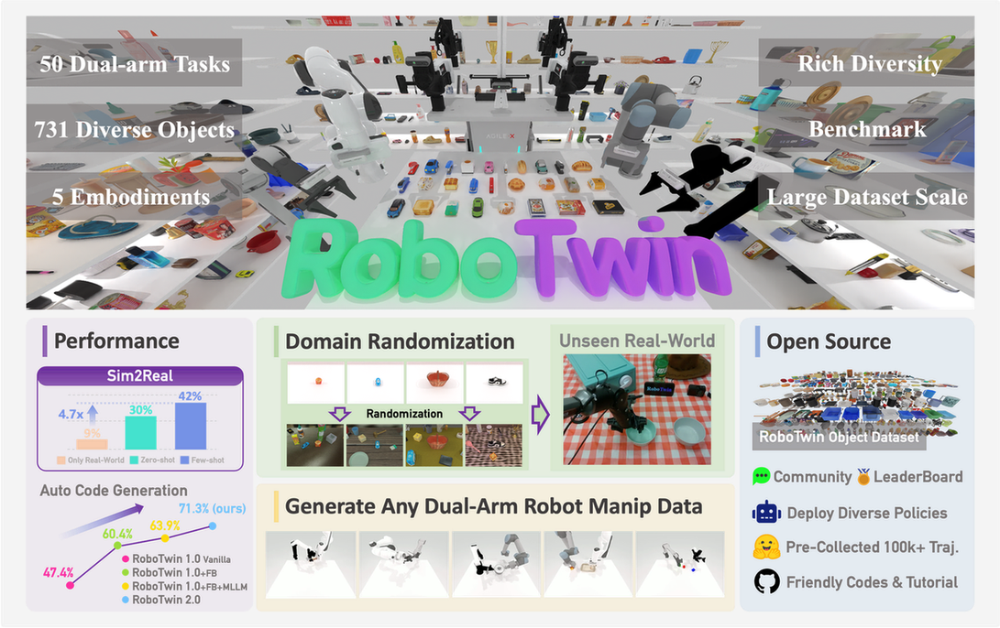

# Isaac Sim 与 RoboTwin 仿真数据链

这一页解释 Isaac Sim 和 RoboTwin 在具身智能项目里分别负责什么。先给结论：

```text
Isaac Sim 更像“高保真机器人世界”
RoboTwin 更像“任务、资产、标注和专家数据的组织范式”
cuRobo / STOMP 更像“轨迹规划器”
success checker 更像“自动判卷器”
```

它们不是同一层工具，不能横向比较。一个完整数据生成系统通常会把它们接起来。

{ width="960" }

<small>图源：[RoboTwin 2.0 官方文档](https://robotwin-platform.github.io/doc/index.html)。这张官方 overview 图适合放在开头：它同时展示了双臂任务、物体库、domain randomization、sim2real、benchmark、开源数据和策略部署，正好对应本文后面讨论的“仿真不是一个画面，而是任务、资产、轨迹、判定和数据保存的系统”。</small>

**这张 RoboTwin 图怎么读。**
先看任务和资产从哪里来，再看 domain randomization 如何扩展场景，然后看 expert trajectory / policy training 如何生成数据，最后看 benchmark 和 sim2real 如何验收。Isaac Sim 提供物理和渲染能力，RoboTwin 风格 pipeline 提供任务、标注、判卷和数据组织方式。

## Isaac Sim 是什么

Isaac Sim 是 NVIDIA 基于 Omniverse / USD 生态的机器人仿真平台。对具身智能来说，它主要提供：

| 能力 | 具体做什么 | 为什么重要 |
| --- | --- | --- |
| 场景和资产加载 | 导入机器人、桌子、容器、物体、材质、纹理 | 构造机器人所在的 3D 世界 |
| 物理仿真 | 刚体、碰撞、关节、夹爪、接触、摩擦 | 判断动作执行后物体会不会动、掉、撞 |
| 传感器仿真 | RGB、depth、segmentation、LiDAR、相机外参 | 给 VLA/WAM 生成视觉观测 |
| 机器人 articulation | 机械臂关节、夹爪、移动底盘、控制接口 | 执行 action 或 replay 专家轨迹 |
| 渲染和数据生成 | 光照、材质、相机、多视角、域随机化 | 生成更接近真实相机的训练数据 |
| 调试和可视化 | 看轨迹、碰撞、坐标系、相机视野 | 快速定位资产、抓取和任务脚本问题 |

你可以把 Isaac Sim 理解成一个“可编程的机器人实验室”。它不是只展示 3D 画面，而是要让机器人在里面看见、行动、碰撞、抓取、失败和重试。

## Isaac Sim 不自动解决什么

Isaac Sim 很强，但它不会自动替你解决所有问题。

| 不会自动解决的事 | 仍然需要你提供什么 |
| --- | --- |
| 任务定义 | 什么叫成功、目标物体是谁、目标位置在哪里 |
| 资产语义 | 这个 mesh 是苹果还是杯子，尺寸和类别是什么 |
| 抓取语义 | 哪些 grasp pose 物理可行，哪些符合任务语义 |
| 专家轨迹 | 轨迹由 planner、遥操作或策略生成，仿真只负责执行验证 |
| 数据清洗 | 哪些 episode 成功，哪些失败，失败原因是什么 |
| 模型训练 | Isaac Sim 生成数据，但不会自动把 VLA/WAM 训好 |

所以如果你看到“用 Isaac Sim 做机器人”，要继续问：任务怎么定义？资产怎么标？轨迹谁生成？成功怎么判？失败怎么回流？

## RoboTwin 是什么

RoboTwin 可以理解为一套面向机器人操作任务的 benchmark / pipeline 参考。它的价值不只是“有一些任务”，而是给出了一套组织方式：

| 组件 | 负责什么 |
| --- | --- |
| 任务集合 | 抓、放、插、开关、堆叠、双臂协作等任务模板 |
| 资产体系 | 物体、机器人、场景对象的组织方式 |
| 对象标注 | 关键点、轴线、可操作方向、抓取相关信息 |
| 专家数据 | 通过规划器或脚本生成可用于模仿学习的轨迹 |
| 成功判定 | 每类任务对应的 termination / success function |
| Benchmark 口径 | 训练/测试任务、场景随机化、成功率或任务进度 |

你可以把 RoboTwin 当作“怎么把一个仿真机器人任务做成可规模化数据集”的参考模板。它告诉你：只导入一个 3D 物体远远不够，还要有任务脚本、标注、重置、轨迹、判定和评测。

## Isaac Sim 和 RoboTwin 的分工

| 问题 | Isaac Sim | RoboTwin 风格 pipeline |
| --- | --- | --- |
| 世界在哪里跑 | 提供仿真环境、物理和渲染 | 调用或适配仿真环境 |
| 任务有哪些 | 不内置具体业务任务 | 定义任务族、对象角色和成功条件 |
| 物体怎么来 | 加载 USD/OBJ/材质/碰撞体 | 规定资产目录、尺寸、类别和标注格式 |
| 轨迹怎么来 | 可以执行和验证轨迹 | 组织专家轨迹生成、失败重试和数据保存 |
| 相机图像怎么来 | 渲染 RGB、Depth、Segmentation | 决定哪些相机视角进入训练/评测 |
| 成功怎么判 | 提供状态查询和仿真结果 | 写具体 success checker |

一句话：Isaac Sim 是“仿真世界和传感器”，RoboTwin 是“任务和数据集组织方式”。

## cuRobo / STOMP 在哪里

Isaac Sim 不是轨迹规划算法本身。你通常还需要 planner：

| 工具 | 负责什么 | 典型输入 | 典型输出 |
| --- | --- | --- | --- |
| cuRobo | GPU 加速 IK、碰撞检查、运动规划和轨迹优化 | 机器人状态、目标位姿、障碍物、抓取点 | 关节轨迹或末端轨迹 |
| STOMP | 随机轨迹优化 | 初始轨迹、代价函数、碰撞/平滑约束 | 优化后的轨迹 |
| 手写脚本 | 简单 pick-place 轨迹、固定 waypoint | 物体 pose、目标 pose | pregrasp、grasp、lift、place 序列 |

一个典型流程是：

```text
Isaac Sim / simulator 给出当前状态和障碍物
-> grasp annotation 给出候选抓取位姿
-> cuRobo 生成无碰撞轨迹
-> Isaac Sim 执行轨迹
-> success checker 判断是否成功
```

如果 planner 生成失败，不一定是 planner 不行，也可能是抓取点不可达、collision mesh 过大、机器人初始姿态不合理，或目标物体摆放太靠边。

## 一个最小数据生成闭环

项目早期目标可以写成这个循环：

```python
for task in task_suite:
    for episode_id in range(num_episodes):
        scene = reset_scene(task, assets, randomization)
        state = read_privileged_state(scene)
        target = bind_task_objects(task, state)
        grasp = choose_grasp(target.object)
        trajectory = planner.solve(state.robot, grasp, target.goal)

        if trajectory is None:
            log_failure("planner_failed")
            continue

        rollout = simulator.replay(trajectory)
        if success_checker(task, rollout):
            save_episode(rollout)
        else:
            log_failure("task_failed")
```

这段代码里：

- `simulator` 可以是 Isaac Sim，也可以是其他机器人仿真器；
- `task_suite` 和 `success_checker` 是 RoboTwin 风格任务组织的核心；
- `planner` 可以是 cuRobo、STOMP 或手写 waypoint；
- `save_episode` 是后续训练 VLA/WAM 的数据来源。

## Isaac Sim 里常见对象

| 名词 | 含义 | 容易踩的坑 |
| --- | --- | --- |
| USD | Omniverse 生态的场景/资产格式 | OBJ 导入后还要处理材质、scale、碰撞体 |
| Articulation | 有关节的机器人或机构 | 关节命名、限位、控制模式要和 action 对齐 |
| Rigid body | 刚体物体 | 没有正确 collision 或 mass 会导致仿真不真实 |
| Collider | 碰撞几何 | 太复杂会慢，太粗会误碰撞，太碎会不稳定 |
| Material | 材质和物理表面属性 | 视觉材质和物理摩擦不是一回事 |
| Camera prim | 仿真相机 | 内参、外参、分辨率、视野会影响训练分布 |
| Action / controller | 下发给机器人执行的控制命令 | 位置控制、速度控制、力矩控制语义不同 |

如果 Isaac Sim 里“看起来对了但轨迹失败”，优先检查 scale、origin、collision、质量、摩擦、关节限位和坐标系。

## RoboTwin 式资产标注为什么重要

机器人任务里的资产不只是 mesh，还需要可操作语义。

| 标注 | 用途 |
| --- | --- |
| 尺寸 / scale | 尺寸任务、碰撞、放置、路径规划 |
| 质量 / friction | 抓取稳定性、滑动、Sim2Real 随机化 |
| grasp pose / grasp axis | 让 planner 知道从哪里抓、怎么接近 |
| keypoint | 门把手、抽屉把手、开关、工具功能点 |
| articulation axis | 门、抽屉、旋钮等可动机构的运动轴 |
| task role | 哪个是目标物体，哪个是容器，哪个是干扰物 |

RoboTwin 的启发在于：资产标注要服务任务。随机标一个抓取轴可能能拿起物体，但未必能完成后续任务。比如锤子抓锤头可以拿起来，但无法正常使用锤子。

## 生成式数字孪生资产流程

RoboTwin 1.0 的生成式数字孪生流程很适合放到这里：它把“从一张图生成仿真资产”拆成了可检查的中间产物。

| 步骤 | 处理 | 为什么对具身数据重要 |
| --- | --- | --- |
| 参考图 | 输入单张 RGB 物体图 | 给资产生成一个真实外观锚点 |
| 视觉描述 | GPT-4V 描述类别、部件、形状、材质线索 | 让后续生成保留可操作语义 |
| 变体扩展 | LLM 生成同类物体不同外观和视角描述 | 增加资产多样性 |
| 2D 生成 | SDXL-Turbo 生成多样化物体图像 | 给 3D 生成模型提供更丰富条件 |
| 3D 合成 | Rodin 生成几何、法线、线框和纹理 | 得到可导入仿真的 mesh |
| 物理属性 | 估计材质、质量、摩擦，并做小范围随机化 | 让抓取和碰撞更接近真实分布 |
| 碰撞处理 | convex decomposition、mesh merge、collision 资产清理 | 避免仿真穿模、卡顿和不稳定 |
| 功能标注 | 标注 functional point / axis，并迁移到变体资产 | 让任务脚本和 success checker 知道“哪里可操作” |

这条链路的重点是：生成式资产只有进入“物理属性 + 碰撞体 + 功能点 + success checker”的格式后，才真正变成具身智能训练数据。否则它只是好看的 3D 模型。

## Isaac Sim 和 SAPIEN 怎么理解

很多机器人项目会同时提到 Isaac Sim、SAPIEN、MuJoCo、PyBullet 等仿真器。它们都能做机器人仿真，但侧重点不同。

| 工具 | 常见定位 | 适合场景 |
| --- | --- | --- |
| Isaac Sim | 高保真渲染、传感器、Omniverse/USD、复杂场景 | 视觉数据、数字孪生、机器人部署前验证 |
| SAPIEN | 机器人操作仿真、较轻量、常用于 manipulation benchmark | 快速生成操作任务和专家轨迹 |
| MuJoCo | 接触动力学、控制研究、RL 环境 | 控制算法、强化学习、低维状态任务 |
| PyBullet | 轻量、易脚本化 | 快速原型和教学 |

如果一个 pipeline 先在 SAPIEN 中生成专家轨迹，再在 Isaac Sim 中对齐和验证，可以理解为：前者偏快速任务生成，后者偏高保真视觉和系统验证。实际项目里怎么组合，取决于速度、视觉质量、物理稳定性和工程生态。

## 项目可以怎么落地

具身数据与仿真任务落地时，可以把工作拆成四个层级：

### 第一层：资产和标注

```text
assets/category/size_variant/
  info.json
  visual.obj or visual.usd
  textures/
  collision.usd
  grasps.yaml
```

先保证 scale、origin、碰撞体和抓取候选稳定。没有这一层，后面轨迹失败很难 debug。

### 第二层：任务和重置

```text
task_config:
  core_objects
  distractor_objects
  initial_pose_sampler
  target_binding_rule
  success_checker
```

clean 场景先只放核心物体；random 场景再增加干扰物、随机位置、随机纹理、随机光照。

### 第三层：轨迹生成

```text
read state
-> choose grasp
-> cuRobo solve
-> simulate
-> check success
-> retry if failed
```

每条失败轨迹都要记录原因：`planner_failed`、`grasp_failed`、`collision`、`drop_object`、`success_check_failed`。

### 第四层：训练和评测数据

每条 episode 建议保存：

| 字段 | 为什么 |
| --- | --- |
| RGB / depth / segmentation | 训练视觉模型和 VLA/WAM |
| object states | debug、success checker、privileged eval |
| robot states | 行为克隆和控制复现 |
| actions | 训练 policy 或 WAM |
| task progress | 长任务评测 |
| failure reason | 数据回流和 hard case mining |
| asset metadata | 追踪 scale、材质、抓取标注版本 |

## 常见 debug 顺序

如果在 Isaac Sim / RoboTwin 风格任务里失败，按这个顺序排查：

1. `asset scale`：物体是否真实尺寸，单位是不是米。
2. `origin / pose`：物体原点是否合理，放置位置是否正确。
3. `collision mesh`：碰撞体是否太大、太小、太碎或缺失。
4. `physics material`：质量、摩擦、刚体属性是否合理。
5. `grasp pose`：抓取候选是否可达，是否符合任务语义。
6. `robot frame`：world、robot base、object、gripper 坐标系是否对齐。
7. `planner constraints`：障碍物、关节限位、目标位姿是否合理。
8. `controller mode`：轨迹输出和机器人控制接口是否一致。
9. `camera config`：相机视角、深度、分割是否覆盖目标物体。
10. `success checker`：阈值、夹爪状态、物体稳定性判断是否正确。

不要一开始就怀疑模型。大多数早期失败来自资产、坐标系、碰撞、抓取和任务判定。

## 和其他页面的连接

| 继续读 | 你会补上什么 |
| --- | --- |
| [相机、深度与机器人视觉](cameras-depth-and-robot-vision.md) | Isaac Sim 中 RGB、Depth、相机外参为什么影响训练分布 |
| [资产到轨迹：感知、抓取与数据管线](asset-perception-grasp-and-trajectory-pipeline.md) | 资产、抓取、轨迹和 success checker 的细节 |
| [一个任务跑通具身闭环](closed-loop-task-walkthrough.md) | 一个具体任务如何从状态定义走到轨迹和判定 |
| [Sim2Real 与具身数据引擎](sim2real-and-data-engines.md) | 仿真数据怎样走向真实系统，以及失败如何回流 |
| [VLA、WAM 与世界模型地图](vla-wam-world-model-system-map.md) | 这些仿真数据如何服务 π0.5 式 VLA 和 DreamZero 式 WAM |
