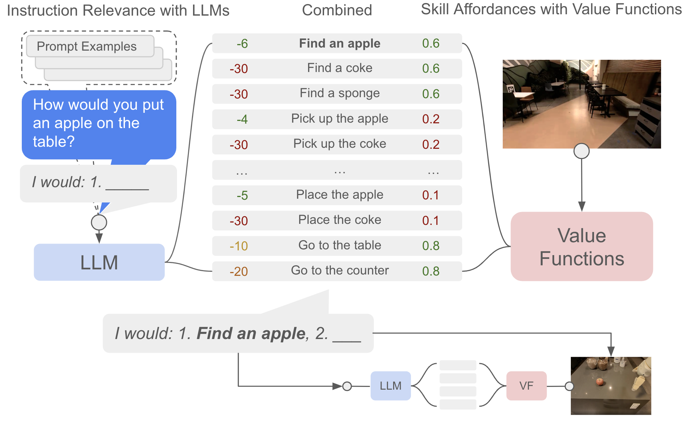

# 规划、反馈控制与安全约束

一个目标位姿只说明末端应该在哪里，没有规定怎样绕过障碍、沿路径多快移动、接触后用多大力。路径、轨迹与控制输入是不同对象。路径规定几何顺序，轨迹加上时间，控制器根据实时误差产生执行命令。

{ width="920" }

<small>图源：[Do As I Can, Not As I Say](https://research.google/pubs/do-as-i-can-not-as-i-say-grounding-language-in-robotic-affordances/)，Figure 3。原图展示语言模型分数和 affordance 分数如何组合。读图重点：高层语义判断“该做什么”，低层 affordance / value 判断“现在能不能做”。</small>

## 用一个可手算的 MPC 看清优化与反馈

考虑教学系统 \(x_{k+1}=x_k+u_k\)，当前位置 \(x_0=0\)，目标为 1，预测两步。代价为

\[
J=(x_2-1)^2+\rho(u_0^2+u_1^2),\qquad \rho=1.
\]

因为 \(x_2=u_0+u_1\)，对两个动作求导得到 \(2(u_0+u_1-1)+2u_i=0\)，对称解为 \(u_0=u_1=1/3\)。若增加动作约束 \(|u_i|\le0.2\)，最优解变为两步都取 0.2，终点只有 0.4。有限窗口与动作限制下，不一定能立刻到达目标。

MPC 执行第一个动作后重测状态。若实际只到 0.15，而不是计划的 0.2，下一轮应以 0.15 重新求解。直接执行原来整段计划属于开环回放，不具备这项误差修正。

一般问题是

\[
\min_{u_{0:H-1}}\sum_{k=0}^{H-1}\ell(x_k,u_k)+\ell_f(x_H)
\quad\text{s.t. }x_{k+1}=f(x_k,u_k),\ x_k\in\mathcal X,\ u_k\in\mathcal U.
\]

动力学模型、代价和约束共同决定结果。世界模型可以提供近似 \(f\)，但模型误差会改变可行性；预测到达不等于真实到达。

## 反馈增益为什么不能随便增大

对一阶离散系统 \(x_{k+1}=x_k+\Delta t\,u_k\)，固定目标 \(r\)，使用比例反馈 \(u_k=-K(x_k-r)\)。误差满足

\[
e_{k+1}=(1-K\Delta t)e_k.
\]

收敛需要 \(|1-K\Delta t|<1\)，即 \(0<K\Delta t<2\)。取 \(\Delta t=0.1,K=5\)，每步误差缩为一半；取 K=25，系数为 −1.5，误差会交替放大。高增益并不自动更精确，延迟、噪声、饱和和真实高阶动力学还会进一步限制选择。

接触控制通常也不能只追求位置误差归零。阻抗控制用期望刚度与阻尼规定误差和力的关系，简化为 \(F=K_p(x_{\mathrm{ref}}-x)+D(v_{\mathrm{ref}}-v)\)。大刚度会使小位置误差对应大接触力；是否可用取决于硬件、接触对象和控制稳定性。

## 安全集合怎样约束下一步

设一维允许位置为 \(x\ge0\)，当前 \(x=0.1\)，时间步长 0.1 秒。若动作是速度，为保持下一步非负，需要 \(x+\Delta t u\ge0\)，即 \(u\ge-1\)。模型提出 −2 时，仅从这条离散约束出发应将其改为不小于 −1。

连续控制障碍函数用 \(\mathcal C=\{x:h(x)\ge0\}\) 描述安全集合，在控制仿射动力学 \(\dot x=f(x)+g(x)u\) 下，常用约束为

\[
\nabla h(x)^\top(f(x)+g(x)u)+\alpha(h(x))\ge0.
\]

它约束安全裕量的变化速度。在模型与可行性等假设成立时，可用于论证不离开安全集合。采样实现、状态误差、未知障碍和制动限制都会影响实际保证，不能只写出 \(h(x)\ge0\) 就宣称系统安全。

安全机制改变动作后，预测链也要使用改变后的量。设世界模型按原请求速度 −2 预测下一位置 −.1，安全投影最终执行 −1，理想下一位置为 0。若日志仍把 −2 当作 executed action 来训练转移模型，它就会从同一动作学到错误位移，下一轮规划也会重复提出被拒绝的候选。

应分别保存策略请求、限幅后命令和实测响应。预测规划时可显式模拟已知安全处理，或将实际执行量反馈给状态估计。若保护机制不满足规划假设，就需要重新求解或进入可解释的退化行为。闭环修正依赖这条实际发生的动作链，而非只依赖最早的策略输出。

## 接口顺序与否决

策略给出候选，adapter 解释单位和坐标，planner 或控制器形成可执行参考，安全机制检查并保留否决通道。具体系统可能把约束嵌入规划或控制，而非只有一个末端过滤模块。任何需要停止的事件都应能取消旧队列。

规划器找到无碰撞离散节点也未必保证节点之间无碰撞，需要连续检查或足够可靠的分段验证。跟踪器出现饱和后，实际轨迹又可能偏离规划轨迹，因此要记录候选、最终命令与实测状态。

继续看[运动学](robot-kinematics-and-dh-parameters.md)、[部署时间与命令](../vla/deployment-and-safety.md)和[安全案例](deployment-patterns-and-safety-cases.md)。理论依据见 [Control Barrier Functions](https://arxiv.org/abs/1903.11199)，工程工具可查 [cuRobo](https://curobo.org/)。
