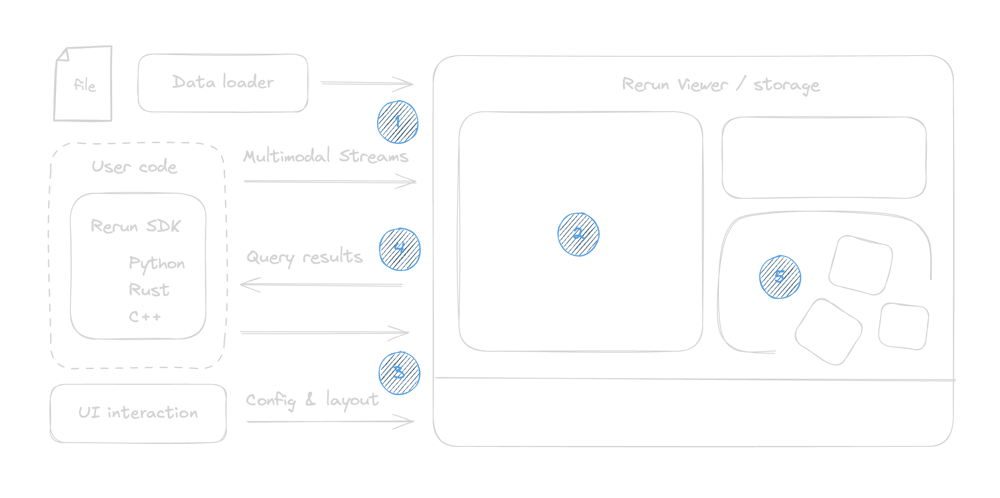
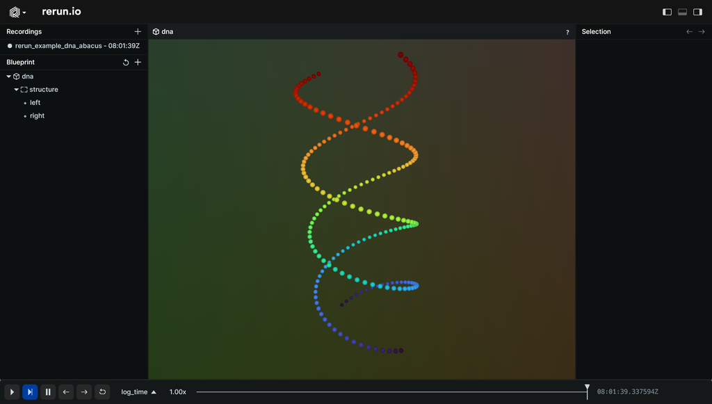
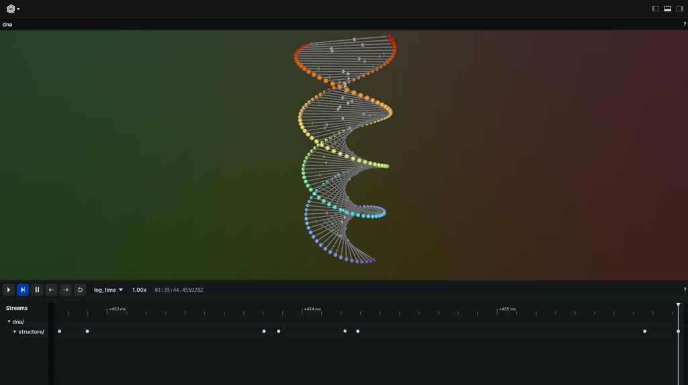

# Rerun：具身智能的多模态时序数据层

Rerun 不是一个 VLA 模型，也不是仿真器。它更像具身智能系统里的**黑盒飞行记录仪 + 可视化回放器 + 可查询数据层**：把相机、深度、点云、机器人位姿、动作、文本、标量和模型输出放到同一条时间线上，让你能复盘“机器人到底在什么时候看到了什么、相信了什么、做了什么”。

!!! note "读法定位"
    这页先回答“Rerun：具身智能的多模态时序数据层”在「具身智能」里的位置：它解决什么局部问题，依赖哪些前置，最后会影响哪类工程或研究判断。
    **前置**：先知道 VLA、世界模型、相机/深度和评测集的基本角色。 必要时先回 [具身智能入口](index.md)、[基础知识](../foundations/index.md) 或 [术语表](../glossary/index.md)。
    **主线关系**：把感知、数据、仿真、策略、控制、安全和真实闭环连起来，看机器人系统为什么不能只靠离线指标判断。

Rerun 官方把它定位为面向 Physical AI 的 unified data layer，用于理解和改进包含 2D、3D、文本、时间序列和 tensor 的复杂多模态过程。官方文档还特别强调它服务 robotics、spatial computing、embodied AI、computer vision、simulation 等传感器随时间变化的系统。[Rerun 文档](https://rerun.io/docs/overview/what-is-rerun)里也说得很清楚：它不是训练平台、不是部署工具、也不是机器人操作系统，而是帮助准备数据、理解系统和调试开发链路的工具。

!!! info "工具入口"
    - 官网 / 产品入口：[rerun.io](https://rerun.io/)
    - 官方说明：[What is Rerun?](https://rerun.io/docs/overview/what-is-rerun)
    - Python 快速开始：[Log and Ingest](https://rerun.io/docs/getting-started/data-in)
    - 示例库：[Rerun Examples](https://rerun.io/examples)
    - Python API：[Rerun Python API](https://ref.rerun.io/docs/python/)

!!! tip "主线定位：降低调试成本、数据清洗成本和评测错误成本"
    具身智能最贵的不是单次 forward，而是失败不可解释。Rerun 在世界模型和 VLA 主线里负责把多传感器日志、坐标系、动作、预测和真实结果对齐，降低定位失败、清洗数据和构建 hard set 的成本。

## 先看它长什么样

Rerun 的基本体验是：代码或日志把多模态数据送进 Rerun，Viewer 里同步显示 2D 图像、3D 场景、时间线、曲线和文本；需要做数据清洗或训练集构造时，再从 recording 查询 dataframe。

{ width="860" }

<small>图源：[Rerun docs](https://rerun.io/docs/overview/what-is-rerun)。这张图说明 Rerun 的位置：SDK / data loader 把多模态 streams 送入 Viewer / Storage，用户既能配置 layout，也能查询结果。</small>

下面是官方 quickstart 里第一次把 3D points 送进 Viewer 后的效果。对具身智能来说，把这里的 `Points3D` 换成点云、机械臂末端轨迹、抓取候选或相机坐标系，排查思路是一样的。

{ width="860" }

<small>图源：[Rerun Log and Ingest](https://rerun.io/docs/getting-started/data-in)。官方示例用 `rr.Points3D` 记录两个螺旋点云，并在 Viewer 中交互查看。</small>

时间线是 Rerun 对机器人特别有用的地方：同一个 step 上可以同时看 RGB、depth、点云、动作、控制状态和事件日志。

{ width="860" }

<small>图源：[Rerun Log and Ingest](https://rerun.io/docs/getting-started/data-in)。时间线让多模态数据按 frame、step 或 sensor timestamp 对齐。</small>

## 5 分钟跑通

最小使用路径很简单：

```bash
pip install rerun-sdk
```

新建 `rerun_demo.py`：

```python
import numpy as np
import rerun as rr

rr.init("robot_debug_demo", spawn=True)

for step in range(100):
    rr.set_time_sequence("step", step)

    points = np.random.randn(200, 3)
    points[:, 2] += step * 0.01

    rr.log("world/points", rr.Points3D(points, radii=0.02))
    rr.log("metrics/gripper_width", rr.Scalar(0.08 - step * 0.0003))
    rr.log("events/status", rr.TextLog("running"))
```

运行：

```bash
python rerun_demo.py
```

你应该看到 Rerun Viewer 被拉起，里面有一个 3D 点云、一个标量曲线和文本事件。这个 demo 还不是机器人系统，但它已经包含 Rerun 的三个核心动作：`init` 创建 recording，`set_time_sequence` 设定时间线，`log` 写入不同类型的数据。

## 它解决什么现场问题

真实机器人失败时，日志通常长这样：

```text
task_id=sort_red_block
t=153.20 rgb=cam0_9123.jpg depth=cam0_9123.npy
joint=[...] action=[0.02,-0.01,0.00,0.04]
success=false reason=grasp_empty
```

这条日志只告诉你“抓空了”，但不知道为什么抓空。真正排查时要同时看：

| 需要并排看的对象 | 如果缺失会怎样 |
| --- | --- |
| RGB / depth / point cloud | 不知道是视觉没看见，还是几何反投影错 |
| camera / base / end-effector frame | 不知道是不是外参、坐标轴或时间同步错 |
| 检测框、分割、抓取候选 | 不知道 perception 是否给了错误目标 |
| policy action、controller state | 不知道动作是模型错，还是控制器执行偏了 |
| success checker、人工接管标签 | 不知道失败应回流到哪个训练桶 |

Rerun 的价值就是把这些对象放进同一个 recording：按 entity path 管理空间对象，按 timeline 对齐事件，按 viewer 回放 2D/3D/曲线/文本，最后还能 query/export 成 dataframe 继续分析。

## 数据模型怎么理解

可以把一条 Rerun 记录抽象成：

\[
r = (p,\; \tau,\; C)
\]

其中：

- \(p\)：entity path，例如 `world/robot/gripper`、`world/camera/rgb`；
- \(\tau\)：timeline 上的时间戳或序号，例如 frame index、sensor time、episode step；
- \(C\)：component batch，例如 image、depth、points3D、transform、scalar、text log。

这个抽象很重要。具身智能不是只有一个“样本 id”，而是很多异步流：

\[
o_t = \{I_t, D_t, q_t, f_t, a_{t-1}, \ell_t\}
\]

这里 \(I_t\) 是 RGB，\(D_t\) 是深度，\(q_t\) 是关节，本体力觉 \(f_t\)，上一动作 \(a_{t-1}\)，语言或事件日志 \(\ell_t\)。如果它们没有共同 timeline，就很难判断模型在第 \(t\) 步的动作到底基于哪一帧观测。

Rerun 的另一条关键线是坐标系。机器人里经常需要：

\[
X_{\text{world}}
=
T^{\text{world}}_{\text{base}}
T^{\text{base}}_{\text{camera}}
K^{-1}
\begin{bmatrix}
u d\\
v d\\
d
\end{bmatrix}
\]

这里 \(K\) 是相机内参，\(T^{\text{base}}_{\text{camera}}\) 是相机到机器人 base 的外参。Rerun 不替你自动修正标定，但它让你把 `Pinhole`、`Transform3D`、depth、point cloud 和 robot frame 一起可视化。很多“模型抓不准”的问题，最后其实是坐标轴方向、外参版本或时间戳错了。

## 在具身数据引擎里的位置

Rerun 最适合放在下面这条链路中间：

```text
机器人 / 仿真 / ROS2 / MCAP / 自定义日志
-> Rerun SDK 或 importer
-> synchronized recording
-> 2D/3D/time-series/text 回放
-> query/export dataframe
-> 失败分桶、数据清洗、训练集回流
```

这和 [Sim2Real 与具身数据引擎](sim2real-and-data-engines.md) 的关系很直接：Sim2Real 页面讲“失败样本为什么值钱”，Rerun 负责让失败样本可看、可切片、可复盘、可导出。

## 接到机器人日志里怎么写

真实接入时，不要只记 RGB 或最终 action。更实用的 recording 应该把观测、几何、动作、控制状态和事件标签落在同一条 timeline 上：

```python
import rerun as rr

rr.init("pick_place_debug", spawn=True)

for step, sample in enumerate(episode):
    rr.set_time_sequence("step", step)

    rr.log("world/camera/rgb", rr.Image(sample.rgb))
    rr.log("world/camera/depth", rr.DepthImage(sample.depth, meter=1.0))
    rr.log("world/camera", rr.Pinhole(
        image_from_camera=sample.K,
        resolution=[sample.width, sample.height],
    ))
    rr.log("world/camera", rr.Transform3D(
        translation=sample.T_base_camera[:3, 3],
        mat3x3=sample.T_base_camera[:3, :3],
    ))

    rr.log("world/points", rr.Points3D(sample.point_cloud))
    rr.log("world/grasp_candidates", rr.Points3D(sample.grasp_points))
    rr.log("robot/action", rr.Tensor(sample.action))
    rr.log("metrics/gripper_width", rr.Scalar(sample.gripper_width))
    rr.log("events/status", rr.TextLog(sample.failure_reason or "running"))
```

这段代码的重点不是 API 本身，而是记录粒度：观测、几何、动作、控制状态和事件标签要落在同一条 `step` timeline 上。

## 常用对象速查

| 想看什么 | 常用 Rerun 对象 | 具身智能里的用途 |
| --- | --- | --- |
| RGB / 深度 | `rr.Image`, `rr.DepthImage` | 检查相机画面、遮挡、深度边缘和异常曝光 |
| 相机模型 | `rr.Pinhole` | 把 2D 像素和 3D 空间对应起来 |
| 坐标系 / 外参 | `rr.Transform3D`, `rr.TransformAxes3D` | 检查 camera、base、end-effector 是否对齐 |
| 点云 / 轨迹 | `rr.Points3D`, `rr.LineStrips3D` | 查看重建点云、抓取候选、末端轨迹 |
| 标量曲线 | `rr.Scalar` | 看置信度、gripper width、力觉、速度、延迟 |
| 文本事件 | `rr.TextLog` | 记录 failure reason、planner state、人工接管原因 |
| 模型输出 | `rr.Tensor` 或结构化对象 | 保存 action chunk、logits、embedding 或中间特征 |

## 一个真实排查案例

```text
症状：模型在仿真里抓取成功率 87%，真机只有 42%，失败集中在透明盒子
指标：grasp_empty 率高，detector confidence 不低，end-effector 到目标中心误差偏大
Rerun 观察：RGB 检测框正确，depth 边缘破碎；点云投到 base frame 后整体偏左约 3 cm
判断：不是 VLA 语义问题，优先怀疑深度噪声和相机外参
修复：透明物体单独建 hard bucket；重做 hand-eye calibration；把低置信 depth mask 记录进训练样本
反例：如果点云和外参正确，但 action chunk 后半段越来越偏，则应回看 policy rollout 或控制器
```

这里 Rerun 支撑的是证据链：不是“感觉模型不行”，而是能证明视觉、几何、动作、控制哪一层先错。

## 和 W&B、ROS、仿真器的区别

| 工具 | 更擅长什么 | 不要拿它替代什么 |
| --- | --- | --- |
| Rerun | 多模态时序数据记录、2D/3D 可视化、坐标系与传感器回放 | 训练平台、模型 registry、机器人运行时 |
| W&B | 实验追踪、指标曲线、artifact、sweep、报告和模型/数据版本治理 | 多传感器 3D 回放、坐标系调试 |
| ROS / ROS2 | 机器人消息通信、节点编排、硬件与控制生态 | 实验结论管理、长期数据治理 |
| Isaac Sim / RoboTwin | 可控仿真、合成数据、任务脚本、物理环境 | 真机日志统一回放和跨源数据查询 |

一个常见组合是：ROS2/MCAP 负责采集和消息生态，Rerun 负责回放和空间时间对齐，W&B 负责训练实验、artifact 和评测曲线。

## 什么时候值得用

适合用 Rerun：

1. 多相机、深度、点云、关节、动作和事件标签需要对齐；
2. 需要检查相机内外参、坐标系、点云和抓取候选；
3. 需要把失败样本切成可训练的 hard bucket；
4. 需要让 perception、policy、control 和数据团队看同一份回放。

不一定值得用：

1. 只有离线纯文本训练日志；
2. 任务只需要标量 loss 和评测分；
3. 已有成熟内部多模态回放系统，且能导出训练所需 dataframe；
4. 线上部署只关心告警和 SLA，不需要逐 episode 复盘。

## 具身智能里的判断方式

读 Rerun 时不要把它当“好看的可视化工具”。它真正改变的是排查方法：

```text
问题症状 -> 同步观测 -> 空间坐标 -> 动作执行 -> 失败标签 -> 数据回流
```

如果一个 VLA / WAM 项目没有这种可回放证据链，就很难回答：失败样本该回流到视觉、动作、世界模型、控制器还是评测脚本。Rerun 的角色，就是把这些判断从口头争论变成可视化、可查询、可复现的数据事实。

## 参考

1. [What is Rerun?](https://rerun.io/docs/overview/what-is-rerun)
2. [Rerun Log and Ingest](https://rerun.io/docs/getting-started/data-in)
3. [Rerun Documentation](https://rerun.io/docs)

!!! tip "下一站"
    - 回到本专题入口：[具身智能](index.md)，确认这页在整条路线中的位置。
    - 按导航顺序继续：[一个任务跑通具身闭环](closed-loop-task-walkthrough.md)。
    - 概念或符号卡住时，先查 [术语表](../glossary/index.md)，再回到当前页。
