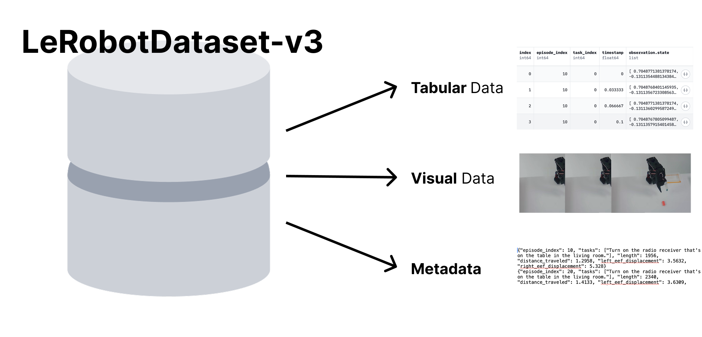
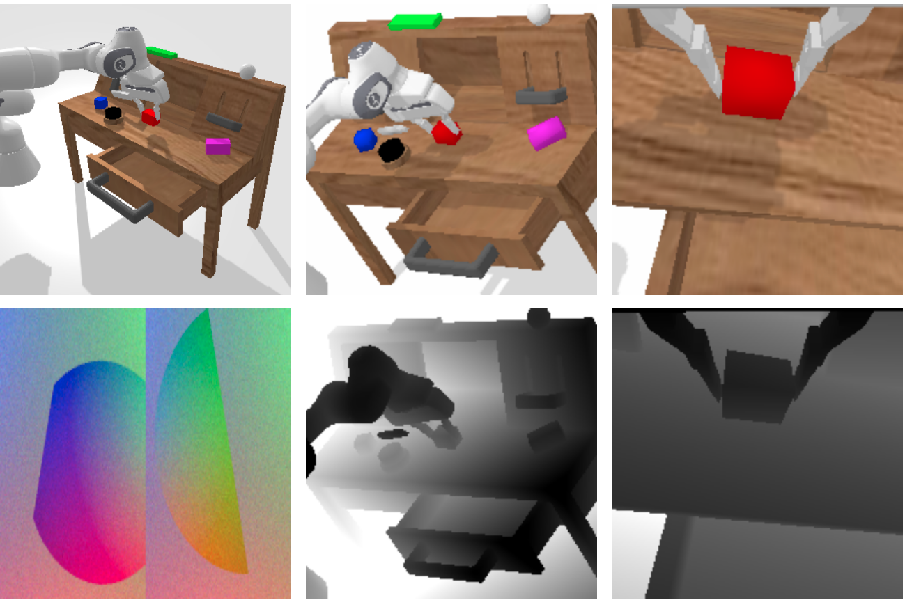
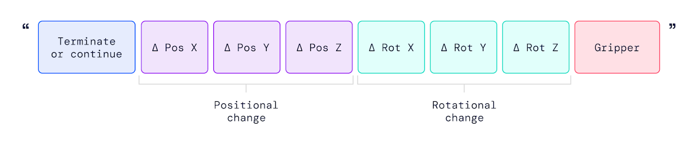

# 机器人数据里的 `state` 和 `action`：不要被字段名骗了

> **这篇回答的问题。** 在 LeRobot、CALVIN、robomimic 或自采 parquet 里看到 `observation.state` 和 `action` 时，怎样判断它们到底表示当前状态、目标关节角、末端位姿增量、速度，还是被数据写入逻辑对齐过的字段。

具身智能的入门很容易从模型名开始：VLA、Diffusion Policy、ACT、RT-2。可是训练真正落到机器人数据时，最先撞上的问题通常更朴素：一行数据里有 `observation.state`，还有 `action`，它们维度相同、数值也很像，那模型到底在学什么？

结论先放前面：**字段名不决定语义，数据采集和控制接口才决定语义。** `observation.state` 一般表示机器人在当前时刻被观测到的低维本体状态；`action` 是策略要预测、控制器要接收的动作标签。二者可以同维度、同量纲，甚至在同一行里近似相等，但这不自动说明 `action = state`，也不说明应该执行 `state + action`。

## 先把一行样本放回 episode

LeRobotDataset v3 的官方博客把机器人数据拆成三类：低维高频表格数据、视频数据和元数据。表格数据里会放 joint states、actions 这类高频量；`meta/info.json` 定义 `observation.state`、`action` 等 feature 的 shape 和 dtype；`meta/stats.json` 记录 mean、std、min、max；episode 边界也由 metadata 维护。换句话说，一行 parquet 不是孤立样本，它属于某个 episode、某个控制频率、某套归一化统计和某种动作空间。

{ width="920" }

<small>图源：[Hugging Face LeRobotDataset v3.0 blog](https://huggingface.co/blog/lerobot-datasets-v3)。原图展示 LeRobot v3 把机器人数据组织为 tabular data、visual data 和 metadata。本站读法：排查 `state/action` 关系时不能只看 parquet 的一列，要同时看 schema、stats、fps 和 episode 边界。</small>

最小抽象可以写成：

```text
row t:
  observation_t = 当前观测
  action_t      = 示教者或策略在该时间对齐规则下给出的动作标签
```

robomimic 的 observation 文档也提醒了同一件事：观测不是一个单一字段，而是多个 observation keys 和 modalities 的组合，例如 `rgb_wrist`、`eef_pos`、`joint_vel` 可以作为不同 key，低维状态、RGB、depth 又属于不同 modality。`observation.state` 只是低维状态的一种常见打包方式，不等于“机器人全部信息”。

## 第一问：它在关节空间，还是末端空间

机器人里最常见的混淆，是把 joint space 和 Cartesian space 当成同一件事。

| 空间 | 常见字段形式 | 含义 | 控制前要问什么 |
| --- | --- | --- | --- |
| 关节空间 joint space | `[q1, q2, ..., qn, gripper]` | 每个关节的位置、速度或目标 | 是位置、速度、力矩，还是归一化后的值 |
| 末端空间 Cartesian space | `[x, y, z, roll, pitch, yaw, gripper]` | 夹爪或工具中心点在某坐标系下的位姿 | 坐标系是 base、camera、world，还是 gripper frame |
| 混合状态 | `eef_pos + eef_rot + joint_pos + gripper` | 多个本体状态拼接 | 字段顺序、单位和归一化如何记录 |

CALVIN 很适合做这个入门对照。它的 sensory observations 同时包含静态相机、夹爪相机、depth、tactile image 和 proprioceptive state；proprioceptive state 可以包含末端位置、末端欧拉角、夹爪宽度、关节位置等。而它的 action space 又明确分成三类：absolute Cartesian pose、relative Cartesian displacement 和 joint action。

{ width="880" }

<small>图源：[CALVIN GitHub README](https://github.com/mees/calvin)，官方 sensors 图。原图展示 CALVIN 的多视角、多模态观测。本站读法：同一份机器人数据里，观测可以同时有 RGB、depth、本体状态；动作却必须落到某个明确 action space。</small>

关节角和末端位姿之间有运动学映射，但不是一一对应字段：

```text
joint angles q  --FK-->  end-effector pose [x, y, z, R]
end-effector pose [x, y, z, R] --IK--> joint angles q
```

MoveIt Pro 的 IK 文档给出的定义很直接：给定期望末端位姿，求一组能达到该位姿的关节角。也就是说，`q1` 不是 `x`，某个 wrist joint 也不是末端 `pitch`；一个末端姿态通常由多个关节共同决定。

## 第二问：`action` 是绝对量、增量、速度，还是底层控制量

判断 `state` 和 `action` 的数学关系，关键看 action semantics，而不是看字段长得像不像。

| action 语义 | 典型关系 | 推理时怎么用 |
| --- | --- | --- |
| 绝对关节目标 | `action_t ≈ q_target_t`，常见时可接近 `state_{t+1}` | 直接发给 joint-position controller |
| 关节增量 | `state_{t+1} ≈ state_t + action_t` | 执行 `current_q + delta_q` |
| 关节速度 | `state_{t+1} ≈ state_t + action_t * dt` | 乘以控制周期或交给 velocity controller |
| 绝对末端位姿 | `action_t = [x, y, z, R, gripper]` | 先 IK / 规划，再变成关节目标 |
| 相对末端位姿 | `T_{t+1} ≈ T_t · ΔT_t` | 平移可近似相加，旋转要组合 |
| 力矩 / 电流 | 经过机器人动力学影响下一状态 | 不能用简单加法解释 |

robosuite 的 controller 文档也说明了这一层差异：不同 controller 会把策略输入解释成 pose、position、joint position、joint velocity 或 joint torque；即使最终机械臂都由关节力矩驱动，policy 所处的 action space 仍然可以完全不同。它还特别指出，很多 position-based controller 默认把输入动作解释为相对当前状态的 delta，这和“绝对关节目标”是两种不同协议。

所以看到一行数据时，不能只问：

```text
action 和 observation.state 维度一样吗？
```

更应该问：

```text
这个 action 是给哪个 controller 的？
单位是什么？
是否 normalize 过？
是当前帧、下一帧，还是执行后的状态？
```

## 第三问：同一行相等，不等于动作没意义

如果你在 Kai0 或类似 LeRobot parquet 中看到：

```text
observation.state[i] == action[i]
```

至少有四种可能。

第一，`action` 字段真的被错误写成了当前 state。这个数据不能直接当有效监督标签，除非任务本来就是保持当前位置。

第二，数据采用了 post-action alignment。row i 记录的是执行某个动作之后的状态，同时 action 被写成这个目标状态，因此同一行里二者相等，但它仍可能对应上一控制步的目标。

第三，action 是下一帧绝对关节目标，但转换 parquet 时做过 shift 或重采样。原始关系可能是 `action_t ≈ state_{t+1}`，写入后看起来变成同帧接近。

第四，你比较的不是同一个数值域。LeRobot 的 metadata 会保存每个 feature 的统计量用于 normalization；训练 dataloader 输出、原始 parquet 和模型输出可能分别处在 raw、normalized、unnormalized 三个空间。

因此，对 Kai0 这类数据更稳妥的表述是：

```text
observation.state_t = 当前观测到的关节状态 q_t
action_t            = 数据集中记录的控制目标或动作标签
```

如果后续验证发现 `action_t ≈ state_{t+1}`，再写成“绝对关节位置目标”；如果只发现 `action_t ≈ state_t`，就要继续查控制脚本和数据写入逻辑，不能直接断言它是 delta。

## 最小验证：比较三种误差

不要跨 episode 比较。LeRobot v3 和 Hugging Face Robotics Course 都强调，单个 parquet 文件可能拼接多个 episode，metadata 才是 episode 起止的地图。验证 `action[t]` 和 `state[t+1]` 时，必须先按 `episode_index` 分组。

最小排查可以比较三种关系：

```text
case 1: action_t ≈ state_t
case 2: action_t ≈ state_{t+1}
case 3: action_t ≈ state_{t+1} - state_t
```

```python
import numpy as np
import pandas as pd

df = pd.read_parquet("your_file.parquet")

def to_arr(series):
    return np.stack(series.to_numpy()).astype(np.float64)

def mae(x, y):
    return np.mean(np.abs(x - y))

episode_key = "episode_index" if "episode_index" in df.columns else None
groups = df.groupby(episode_key) if episode_key else [("unknown", df)]

err_same, err_next, err_delta = [], [], []
step_mag, action_mag = [], []

for _, g in groups:
    if len(g) < 2:
        continue

    states = to_arr(g["observation.state"])
    actions = to_arr(g["action"])

    s_t = states[:-1]
    s_next = states[1:]
    a_t = actions[:-1]

    err_same.append(mae(a_t, s_t))
    err_next.append(mae(a_t, s_next))
    err_delta.append(mae(a_t, s_next - s_t))
    step_mag.append(np.mean(np.abs(s_next - s_t)))
    action_mag.append(np.mean(np.abs(a_t)))

print("MAE action[t] vs state[t]:", np.mean(err_same))
print("MAE action[t] vs state[t+1]:", np.mean(err_next))
print("MAE action[t] vs state[t+1] - state[t]:", np.mean(err_delta))
print("Mean |state[t+1] - state[t]|:", np.mean(step_mag))
print("Mean |action[t]|:", np.mean(action_mag))
```

结果可以这样读：

| 最小误差关系 | 更可能的含义 | 还要确认什么 |
| --- | --- | --- |
| `action_t ≈ state_t` | 当前绝对 joint、post-action 对齐，或字段复制 | 控制脚本和写入时序 |
| `action_t ≈ state_{t+1}` | 下一控制步绝对 joint target | 是否按 episode 分组，是否归一化 |
| `action_t ≈ state_{t+1} - state_t` | delta joint | 控制频率和单位 |
| `state_{t+1} ≈ state_t + action_t * dt` | joint velocity | `dt = 1 / fps` 是否正确 |
| 都不接近 | 可能是 Cartesian、torque、字段顺序不同或数值域不同 | schema、stats、controller |

如果采样频率很高，相邻帧变化很小，`action_t` 同时接近 `state_t` 和 `state_{t+1}` 并不奇怪。此时要看明显运动片段、每个维度曲线、最大误差和误差分布，而不是只看一个全局 MAE。

## VLA 里的 action token 也绕不开这些问题

RT-2 的官方博客有一张很适合放在这里的图：它把机器人动作写成一串 action tokens，第一位表示 continue / terminate，后面是末端位置变化、旋转变化和 gripper。这个设计让 VLM 可以像生成文本一样生成动作，但它没有消除控制语义；它只是把某个明确动作空间离散成 token。

{ width="860" }

<small>图源：[Google DeepMind RT-2 blog](https://deepmind.google/blog/rt-2-new-model-translates-vision-and-language-into-action/)。原图展示 RT-2 training 中 action string 的组成。本站读法：把动作 token 化以后，仍然要知道每个 token 对应的控制量、坐标系、归一化范围和执行频率。</small>

这也是为什么 `state/action` 的问题不是低级细节，而是 VLA 的接口问题。模型输出的是：

```text
token -> 数值动作 -> adapter/controller -> 机器人执行
```

如果 action space 没说清，模型 loss 再低也可能只是学会了某套数据写入习惯；一旦换机器人、换 controller、换采样频率，动作语义就断了。

## 写项目文档时可以这样定义

对一份机器人数据集，建议在 README 或 dataset card 里至少写清这几行：

```text
observation.state:
  Low-dimensional proprioceptive state of the robot.
  Specify joint positions / joint velocities / end-effector pose / gripper state.

action:
  Supervision target predicted by the policy.
  Specify action space, control mode, units, normalization, frequency, and alignment.

control interpretation:
  Say whether the policy output should be sent directly to a controller,
  added to the current state, multiplied by dt, or converted through IK.
```

如果以 Kai0 这类“关节空间绝对目标”作为工作假设，可以写成：

```text
observation.state:
  当前观测到的关节角 q_t。

action:
  joint space 中的绝对关节位置目标，而不是 delta joint。

control interpretation:
  策略输出应直接作为 joint-position target 发送给底层控制器。
  除非明确转换成 delta-action 格式，否则不要执行 state + action。
```

但这句话必须以验证为前提：先看 `meta/info.json`、`meta/stats.json`、episode 边界、控制脚本和误差分布，再决定它是不是绝对 joint target。

## 外部精读

- [本页来源台账](../references/robot-state-action-source-ledger.md)：记录本文事实来源、图片来源和写作边界。
- [Hugging Face LeRobotDataset v3.0 blog](https://huggingface.co/blog/lerobot-datasets-v3)：理解 parquet、video、metadata、stats 和 episode 边界。
- [Hugging Face Robotics Course: LeRobotDataset](https://huggingface.co/learn/robotics-course/unit1/3)：更教学化地理解 LeRobot 数据组织。
- [robomimic Multimodal Observations](https://robomimic.github.io/docs/tutorials/observations.html)：理解 observation keys、modalities 和 low_dim/RGB/depth。
- [robomimic Action Configuration](https://robomimic.github.io/docs/tutorials/action_configs.html)：理解 action components、顺序和 normalization。
- [CALVIN GitHub README](https://github.com/mees/calvin)：看 action space 如何分为 absolute Cartesian、relative Cartesian 和 joint action。
- [robosuite Controllers](https://robosuite.ai/docs/modules/controllers.html)：理解 controller 如何解释 policy action。
- [MoveIt Pro IK docs](https://docs.picknik.ai/how_to/robotics_applications/computing_inverse_kinematics/)：理解 Cartesian 末端目标如何转成 joint states。
- [Google DeepMind RT-2 blog](https://deepmind.google/blog/rt-2-new-model-translates-vision-and-language-into-action/)：理解 VLA 如何把动作写成 token，但仍然需要动作接口。

## 相关阅读与下一步

- 站内下一步：[具身智能专题](index.md)。
- 站内下一步：[VLA 数据、模型与评测](vla-data-model-and-evaluation-roadmap.md)。
- 站内下一步：[规划、控制与安全](planning-control-and-safety.md)。
- 站内下一步：[VLA 动作表示与控制接口](../vla/action-representation-and-interfaces.md)。
